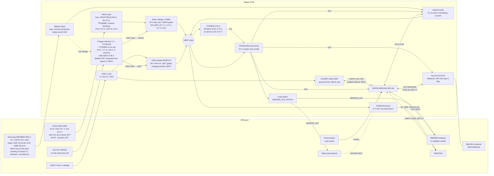

# Station PCB architecture

Status: **F1 revision 5 for review**, 27.10.2026, written by the designer session `pcb-design` on the Zephyr team's intercom (until 27.10.2026 on Reason Network as `mobric/pcb-design-2`, earlier `mobric/pcb-design`, `mobric/mikolaj-claude-60` and `mobric/pcb-opus-5-5`; the same session renamed).
- It revises revision 4 (a0ae015) after the Codex fifth review in [reviews/F1-codex-r5.md](reviews/F1-codex-r5.md). The item-by-item response is in [reviews/F1-response-r5.md](reviews/F1-response-r5.md). The earlier responses are [reviews/F1-response-r4.md](reviews/F1-response-r4.md), [reviews/F1-response-r3.md](reviews/F1-response-r3.md), [reviews/F1-response-r2.md](reviews/F1-response-r2.md) and [reviews/F1-response.md](reviews/F1-response.md).
- It folds in mobric's answers to questions 15, 16, 19, 22 and 23 and the choice of 8 cells, and, new in revision 4, Q24 (a) and Q25 (a), all relayed by the coordinator on 26.10.2026 (§ 8).
- Approved so far:
  - D1 (25.10.2026);
  - R1, decided (a) (see [STATUS.md](STATUS.md));
  - **D5 = LT3652**, approved by mobric on 25.10.2026 and relayed by the coordinator.

  Every other decision below is a recommendation until the F1 gate. mobric's answers are preferences, not approvals.

Labels are defined in [REQUIREMENTS.md](REQUIREMENTS.md#labels-and-sources): **datasheet**, **owner/photo**, **measured**, **assumed**, **computed**, **model-derived**.

## 1. Block diagram

**Power path.**
- **Panel input.** The panel reaches the solar charger through a fuse, an SM15T33CA TVS (1.5 kW) and a TPS26600 protection switch (D5).
  - The TPS26600 blocks a reversed panel and night backflow. It keeps the charger's input off until the panel is above about 15 V (UVLO) and opens above 31–34 V (OVP). It replaces revision 1's 60 V Schottky.
  - The TVS stays below its breakdown at the coldest Voc. During the defined surge it keeps the TPS26600's input at ≤ 39.47 V, and with the layout's loop from IN to the VIN capacitors bounded (√(L / C) ≤ 22.4 mΩ), the charger's VIN at ≤ 39.75 V, below the LT3652's 40 V rating. The bound uses ST's maximum-clamp formula and its temperature scaling, rounded up, and nothing depends on the switch's timing (R3-M2, R4-M2, R5-M2).
- **Interlock.** It runs only while the panel or USB supplies power, so it draws nothing from the battery. Three TLV3012B comparators check two things: that the NTC on the pack reads between +1.7 and +42.6 °C (nominal trips), and that the cells are below 4.36 V. A TPS3840 checks that the interlock's own rail is valid (R3-M1). Series FETs combine the four outputs (an AND) into the solar charger's SHDN and the USB charger's ISET return.
  - Charging is blocked by default: interlock unpowered, starting (power-on reset), its rail below the supervisor's threshold or browning out, NTC open or shorted, cells overcharged.
- **USB.** VBUS feeds only the CH343P, the interlock supply and, through a charging jumper that is open by default (Q24), the USB charger.
- **Battery.** The board protects itself without relying on the pack's protection board, whose IC is unmarked (answer 20, D5.2):
  - a fuse and reverse-polarity protection in the battery input;
  - the battery overvoltage cut-off in the interlock;
  - a TPS3840 that holds the 3.3 V converter off below 3.05–3.15 V;
  - an inline fuse at the pack for the battery cable.
- **Measurement.** The INA219 shunt sits between the battery connector and VBAT, where the chargers and loads meet. It sees net battery current, signed. The firmware infers charging from it. The LT3652's CHRG and FAULT pins go to test points only (D5).
- **Rails.** The TPS631000 holds 3.3 V over the whole battery range above the UVLO. The TPS61023 makes 5 V for the PMS7003 only while a reading runs.
- **Sensors.** A load switch feeds the off-board sensors (BME680, vane divider, 1-Wire, anemometer pull-up) only while the firmware reads them.

## 2. Power architecture choices in brief

| Block | Choice | Main reason | Decision |
|---|---|---|---|
| Solar charger | LT3652, VIN_REG for 18.7 V, gated through SHDN, C/10 termination | 40 V absolute maximum; documented enable pin | D5, **approved 25.10.2026** |
| Panel input | Fuse + SM15T33CA + TPS26600 (reverse blocking, UVLO, OVP) | The TVS alone bounds the charger's input below its 40 V rating during the defined surge; the switch blocks reverse polarity and backflow | D5 |
| Charge interlock | MF52A NTC and two TLV3012B as a window, a third TLV3012B for battery overvoltage, a TPS3840 for a valid rail, series-FET AND, off by default | The B variant's power-on reset holds its output low (datasheet); the supervisor bounds the rail the trips are proven for; documented enable inputs on both chargers | D5 |
| USB charging | BQ25170, ISET 750 Ω through the AND chain and a charging jumper, open by default (Q24) | Open ISET means no charge (datasheet); ≤ 444 mA including the ±10 % gain tolerance; the jumper keeps USB inside every host state | D5 |
| Cell protection | On-board and self-sufficient. The pack's board stays but isn't relied on | Its IC is unmarked (answer 20) | D5.2 |
| Low-battery cut-off | TPS3840PL31 on VBAT drives the TPS631000's EN | Hardware backstop behind the firmware's hibernation | D5.2, § 6 item 11 |
| 3.3 V | TPS631000 in power-save mode | Holds 3.3 V down to the UVLO; rated 1.5 A for an input ≥ 2.7 V | D6 |
| 5 V | TPS61023 with true disconnect | 0.1 µA when off; one chip | D7 |
| Sensor supply | Load switch on GPIO14 | Sleep current no longer depends on the unknown BME680 breakout | D8 |
| Measurement | INA219 0x45, 0.1 Ω, battery path, voltage = bus + shunt | Signed net current and true battery voltage; also shows whether the battery is charging | D9 |
| Winter energy | M2 adaptive firmware without listening, and a 1S8P pack of new Samsung 35E cells (mobric's choice of pack; not yet approved) | The cold-charge block, not the panel, limits the winter | D13 |

## 3. Pin table

Source: `firmware/station/station.ino` at 82ee40d. Module: ESP32-WROOM-32E-N4.

Pin constraints (datasheet):
- **Strapping pins:** GPIO0, 2, 5, 12, 15.
  - GPIO12 must be low at reset, otherwise the module may select 1.8 V flash.
  - GPIO5 is the radio NSS. It gets a pull-up, so the radio stays deselected through reset and the strap sees its default high level.
  - F2 checks the reset state of every strap on the schematic.
- **Input only, no pulls:** GPIO34–39.
- **RTC GPIOs:** 0, 2, 4, 12–15, 25–27, 32–39. These are the pins for EXT0/EXT1 wake and RTC hold.
  - Digital GPIOs can also hold an output level in deep sleep through `gpio_deep_sleep_hold_en()` (Espressif GPIO API).
  - RTC hold and EXT wake have different constraints.
- **Internal flash:** GPIO6–11 are not led out on the module.

| Function | Today | New board | Change | Firmware impact |
|---|---|---|---|---|
| INA219 I²C0 SDA / SCL | GPIO21 / 22, module on wires | GPIO21 / 22, INA219 on board, 0x45 (A0 = A1 = VS) | Part moves on board; 0.1 Ω shunt in the battery path | **Required:** - send battery voltage = bus + shunt voltage; - keep the current signed; - power down after every full read (D9) |
| BME680 I²C1 SDA / SCL | GPIO32 / 33 | GPIO32 / 33 to a pluggable terminal, pull-ups to SENSOR_3V3, ESD | Supply switched | **New:** - switch SENSOR_3V3 on and wait for start-up before init; - set the pins high-Z before switching off |
| PMS7003 UART1 RX / TX | GPIO25 / 26 | GPIO25 / 26 through 1 kΩ series resistors | Series resistors added | Before the 5 V rail goes off: end UART, TX and SET low, pulls off |
| PMS7003 SET | GPIO27, held low in deep sleep with `gpio_hold_en` | GPIO27 through 1 kΩ | None | Park low before 5 V goes off. Hold no longer needed |
| PMS7003 5 V enable | None (PMS always on the DevKit 5V pin) | **GPIO13** → TPS61023 EN, 100 kΩ pull-down | **New** | **New:** enable before the 30 s warm-up, disable after the read. Skip below −10 °C (Q12) |
| Sensor supply enable | None | **GPIO14** → SENSOR_3V3 load switch EN, 100 kΩ pull-down | **New** | **New:** on for full reads (BME680, wind, vane, 1-Wire), off before deep sleep |
| Anemometer | GPIO4, `INPUT_PULLUP`, FALLING interrupt, 10 ms debounce | GPIO4, 1 kΩ + 10 nF filter, TVS, pull-up to SENSOR_3V3 | Pull-up moves to the switched rail | `INPUT` without the internal pull-up. Before deep sleep, isolate GPIO4 (§ 6) |
| LoRa radio | UART2: RX GPIO16, TX GPIO17, 57600 baud, Grove module on 5 V | **SPI:** SCK GPIO18, MISO GPIO19, MOSI GPIO23, NSS GPIO5 (pull-up). **DIO0 → GPIO35**, **RESET → GPIO17** (never low in sleep), DIO1 → GPIO34 (DNP 0 Ω). Module on 3.3 V | **Changed bus** | **Driver change to RadioLib**, see D4 |
| GPIO16 | LoRa RX | 1-Wire header (DS18B20), 4.7 kΩ pull-up to SENSOR_3V3, ESD | Freed | Optional. A DS18B20 on the pack logs cell temperature (D13) |
| Wind vane | None | **GPIO36** (ADC1_CH0), terminal, divider fed from SENSOR_3V3, RC filter, TVS | **New, reserved** | Optional, when the vane exists |
| GPIO39 | Unused | Spare input. The LT3652's CHRG and FAULT go to test points only (D5) | Revision 1's CHRG input dropped (R2-M4) | None. Charging is inferred from the sign of the INA219's current (D9) |
| USB-UART | DevKit CP2102 on GPIO1 / 3, DTR/RTS auto-reset | CH343P on GPIO1 / 3, two-transistor auto-reset on EN and GPIO0. Powered from VBUS only, lines isolated without VBUS (D3) | Same function | None. Upload works as on the DevKit |
| Buttons | DevKit BOOT / EN | BOOT on GPIO0, RESET on EN; EN 10 kΩ / 1 µF | Same | None |
| LED | DevKit power LED, always on | Optional status LED on GPIO2 (DNP) | No always-on LED | None |
| GPIO12, GPIO15 | Unused | GPIO12 unused (must stay low at reset). GPIO15 to a test point | — | — |

Why these pins:
- **DIO0 on GPIO35.** The RadioLib interrupt only sets a flag: transmission done, or a received frame if the PRD's ACK is added later (§ 6). GPIO35 is an input-only RTC GPIO, so the radio could also wake the ESP32 from light sleep.
- **5 V enable on GPIO13 and sensor enable on GPIO14.** Pull-downs keep both rails off during reset and deep sleep without a hold. GPIO14 may glitch at boot (assumed, from community pin guides; F2 checks). A glitch only switches the sensors on for a moment.
- **GPIO39 spare.** Revision 1 read the LT3652's CHRG here, through a pull-up to the always-on 3V3. The CHRG pin is rated only VIN + 0.5 V, and VIN is 0 V every night, so that pull-up would have driven 3.3 V into it (the review's R2-M4). The pin now goes to a test point with no pull-up.
- **Radio alone on VSPI.** This keeps the bus simple, but it doesn't make the radio driver interrupt-safe. That fix is the driver change (D4).

## 4. Power budget

### 4.1 Inputs

The third column holds the datasheet maximum where one is published, otherwise a pessimistic value or an allowance. It is not a guaranteed bound (R2-M2, § 4.2).

| Input | Typical | High-side / pessimistic | Label and source |
|---|---|---|---|
| ESP32 deep sleep (RTC timer + memory) | 10 µA | no maximum published | datasheet [E2] Table 4-2 |
| ESP32 awake at 240 MHz, radio off | 45 mA | 68 mA | datasheet range 30–68 mA [E2]; nominal assumed |
| ESP32 awake at 80 MHz | 25 mA | 31 mA | datasheet [E2]; nominal assumed |
| ESP32 light sleep | 0.8 mA | — | datasheet [E2] |
| Wake time to the app, Arduino defaults | ≈ 0.19 s | — | measured [K1] |
| Ra-01H receive at BW125, 868 MHz | 12.15 mA | — | datasheet [RA] p.5 |
| SX1276 sleep / standby | 0.2 µA / 1.6 mA | 1 µA (sleep) | datasheet [S1] Table 6 |
| Ra-01H RF switch (PE4259), fed from 3V3 inside the module | 9 µA | 20 µA | datasheet: [RA] p.11 schematic, [PE] Table 2 |
| SX1276 TX at +10 dBm, PA_BOOST | 40 mA | — | assumed (not tabulated) |
| LoRa airtime of the 28-byte frame (24 + 4 header) | 66.8 ms | — | computed [S1]; the reviewer got 66.816 ms |
| BME680 sleep / gas heater 320 °C | 0.15 µA / 12 mA for 150 ms | — | datasheet [B1]. The breakout is unpowered in sleep (D8) |
| INA219 on / power-down; IN+ and IN− leakage | 0.7 mA / 6 µA; 0.1 µA each | 1 mA / 15 µA; 0.5 µA each | datasheet [I1] §7.5 |
| PMS7003 active at 5 V | 80 mA | 100 mA | 80 mA assumed (no traceable measurement); 100 mA datasheet maximum [P1] |
| PMS7003 time on per reading | 31.6 s | 35.1 s | computed from station.ino: nominal, retries allow 30.6–35.1 s |
| Gateway requests answered | none: the station no longer listens | 2 / 10 a day in the comparison rows only | owner/photo (answer 23); requests come only from the gateway's BOOT button or a serial `r` (§ 4.3) |
| LT3652 battery drain with VIN floating, plus its float divider | 5.6 µA at 3.7 V (chip 3.1, divider 2.5) | 6.4 µA at 4.2 V; no maximum published | datasheet [LT2] p.6 typical curve, read from the graph; divider current computed (p.15) |
| LT3652 catch Schottky, reverse-biased by the battery at night | about 5 µA at 25 °C | rises steeply when hot (an SS34: about 0.3 mA at 75 °C) | datasheet [SS] curve; F2 picks a part with ≤ 10 µA at 4.2 V and 50 °C |
| LT3652 VIN node at night: VIN_REG divider (≥ 1 MΩ) and the TPS26600's OUT leakage | 0 | 3.5 µA allowance | datasheet: the battery reaches VIN only through the LT3652's reverse path, IREVERSE 1 µA typical at VIN = 0 V ([LT2] p.3); TPS26600 OUT leakage ≤ 11 µA at OUT 24 V, IN 0 V ([TP]). Allowance assumed |
| BQ25170 battery drain, no VBUS | 0.35 µA | 0.6 µA | datasheet [BQ] |
| TPS3840PL31 supervisor on VBAT | 0.3 µA | 0.7 µA | datasheet [SV] |
| Battery-overvoltage divider and its switch Q8, interlock off | 0 | 1 µA | assumed: FET off-state leakage; F2 checks the chosen part at 4.2 V |
| Interlock rail VREG: three TLV3012B, the TPS3840PL30, LM4041, NTC and tap dividers, FET gates | about 0.6 mA | 0.74 mA (NTC at about +66 °C, VREG 3.4 V); ≤ 1.05 mA while every gate charges. The LDO itself draws ≤ 25 µA more from its input ([T7]) | computed ([calc/interlock_trips.py](calc/interlock_trips.py)); drawn from the panel or VBUS only, never from the battery |
| TPS631000 quiescent current, not switching | 0.15 µA at VIN, 8 µA at VOUT | 6.1 µA at VIN; none published at VOUT | datasheet [T1] §5.5. The VOUT share is a 3.3 V load and is converted like the rest of the rail |
| TPS631000 shut down (EN low: the UVLO holds it off) | 0.5 µA | 0.9 µA | datasheet [T1], at 3.8 V and 25 °C |
| TPS631000 feedback divider 511 kΩ / 91 kΩ | 5.5 µA | — | datasheet [T1] Table 7-5 values; current computed |
| TPS61023 shutdown | 0.1 µA | 0.2 µA at 85 °C (curve) | datasheet [T2] §6.5, Fig. 6-8 |
| CH343P and its isolation (two SN74LVC1T45), USB unplugged | 0 | 8 µA | design (D3); translator supply and Ioff limits from datasheet [LV] |
| SENSOR_3V3 load switch TPS22917, off | 0.01 µA | 0.1 µA | datasheet [LS] §7.5, −40 to 85 °C |
| External protection board | 3 µA | 6 µA | assumed: DW01A at 3.9 V, 25 °C (datasheet). The board's IC is unmarked (answer 20), so DW01A-class is assumed. Nothing relies on it (D5.2) |
| Leakage at the battery node: ESD/TVS parts, capacitors, board | 0.5 µA | 2 µA | assumed allowance. Every other ESD/TVS part sits on a net that is unpowered in sleep. Low-leakage ESD parts are rated ≤ 0.1–0.15 µA at stand-off (datasheets [U1], [U2]) |
| Cells | Samsung INR18650-35E: 3.35 Ah minimum at 0.2C; 10.05 Ah today (1S3P). The model uses the minimum | — | owner/photo: the model (answer 19); datasheet [35E] (specification Ver 1.1): capacity at 0.2C |
| Cell limits | charge 0 to 45 °C, discharge −10 to +60 °C (cell surface); charge at 4.20 V, 1.7 A standard, 1.02 A for cycle life, 2.0 A maximum per cell; cut-off 2.65 V; storage −20 °C at the coldest | — | datasheet [35E] (Ver 1.1, R4-m2) |
| Air below the cell's limits at the site | below −10 °C: 152 h a winter on average, 444 h at most (2010/11); below −20 °C: 3.4 h on average, 25 h at most (2005/06); coldest hour −25.2 °C (23 Jan 2006) | — | model-derived (PVGIS T2m, 2005/06–2022/23, § 4.4) |
| Li-ion self-discharge | 2 % of stored energy per month | 10 % in 30 days (LG MJ1 limit, an example cell) | assumed; 1–2 %/month is typical at 25 °C [BU]. Samsung's 35E specification gives no figure, only ≥ 95 % recovery after 20 days at 60 °C [35E] |
| Charge interlock trips (cell temperature) | off below +1.71 °C, on above +2.11 °C; off above +42.64 °C, on below +42.42 °C | energy corner (interlock rail down to U4's threshold): +2.72 / +3.09 °C and +41.52 / +41.33 °C (the winter model rounds them toward less charging: +2.73 / +3.09 and +41.52 / +41.32) | computed, [calc/interlock_trips_output.txt](calc/interlock_trips_output.txt) (D5) |
| Firmware's charge estimate | exact | 15 % of usable energy too high or too low | assumed (§ 6 item 10) |
| Low-energy thresholds | hibernate below 3 %, resume above 12 %; TPS3840 off below 3.05–3.15 V, on again above 3.23–3.37 V (taken as 2 %) | — | assumed (hibernation, § 6 item 11; the voltage-to-energy mapping, R3-N2); datasheet (TPS3840 thresholds [SV]) |
| Buck-boost switching efficiency at sleep load | 85 % at 3.7 V | 70 % at 3.0 V | assumed. The converter's own quiescent current is counted separately, so it isn't counted twice |
| Buck-boost efficiency, 10–60 mA | 90 % | — | assumed (datasheet curves ≈ 90–95 %) |
| 5 V boost efficiency at 100 mA | 90 % | — | assumed (datasheet curve ≈ 93–95 %) |
| Battery voltage for conversion | 3.7 V | 3.0 V | assumed. 3.0 V is below the UVLO, so for powered sleep it is a pessimistic bound (§ 4.2) |
| Charger efficiency at 0.3–1.5 W | 85 % | — | assumed |

Battery current while awake: I_bat = I_3V3 × 3.3 / (η₃ × 3.7) + I_5V × 5 / (η₅ × 3.7) + I_VBAT, where η₃ and η₅ are the 3.3 V and 5 V converter efficiencies.

### 4.2 Sleep floor

**Conditions.** Deep sleep with the radio asleep, sensors and PMS unpowered, USB unplugged and the panel dark. Part values at 25 °C.
- **Typical** uses typical values.
- **High-side estimate** uses the datasheet maximum where one is published, and otherwise the typical value or an allowance. The last column says which.
  - It is **not a guaranteed bound** (R2-M2). The ESP32's deep-sleep current, the converter's output-side quiescent current, the LT3652's battery drain and the catch diode's leakage have no published maximum.
  - Revision 1 called this column "bounded"; the word is dropped.
- **Conversion.** The 3.3 V rail is converted to the battery at 3.3 / (0.85 × 3.7) = 1.049 at 3.7 V. In the low-battery corners (70 % efficiency, assumed) the factor is 3.3 / (0.70 × 3.4) = 1.387 at 3.4 V and 3.3 / (0.70 × 3.0) = 1.571 at 3.0 V.
- **States (R3-m1).** Above the UVLO the converter runs and the board is in powered deep sleep. Below it the TPS3840 holds the converter off: the hardware-off state, after the table.

| Load | Supplied from | Typical, µA | High-side, µA | Basis of the high-side figure |
|---|---|---|---|---|
| ESP32 deep sleep, RTC timer and memory | 3V3 | 10 | 10 | typical; no maximum published |
| SX1276 sleep | 3V3 | 0.2 | 1 | maximum |
| Ra-01H RF switch (PE4259) | 3V3 | 9 | 20 | maximum |
| INA219 power-down | 3V3 | 6 | 15 | maximum |
| TPS631000 quiescent current at VOUT | 3V3 | 8 | 8 | typical; no maximum published |
| TPS631000 feedback divider | 3V3 | 5.5 | 5.5 | computed |
| CH343P isolation, two SN74LVC1T45 | 3V3 | 0 | 8 | maximum |
| SENSOR_3V3 load switch, off | 3V3 | 0.01 | 0.1 | maximum |
| **3.3 V rail** | | **38.7** | **67.6** | |
| **3.3 V rail at the battery, 3.7 V / 85 % (× 1.049)** | | **40.6** | **70.9** | |
| TPS631000 quiescent current at VIN | VBAT | 0.15 | 6.1 | maximum |
| TPS61023 shutdown | VBAT | 0.1 | 0.2 | curve at 85 °C |
| LT3652 with VIN floating | VBAT | 3.1 | 3.6 | typical curve; no maximum published |
| LT3652 float divider | VBAT | 2.5 | 2.8 | computed |
| LT3652 VIN node: VIN_REG divider, TPS26600 OUT leakage | VBAT | 0 | 3.5 | allowance |
| LT3652 catch Schottky at 25 °C | VBAT | 5 | 5 | typical curve; F2 limit ≤ 10 µA at 4.2 V and 50 °C |
| BQ25170 without VBUS | VBAT | 0.35 | 0.6 | maximum |
| INA219 IN+ and IN− leakage | VBAT | 0.2 | 1 | maximum |
| TPS3840 supervisor (new) | VBAT | 0.3 | 0.7 | maximum |
| Battery-overvoltage divider switch, off | VBAT | 0 | 1 | FET off-state leakage (assumed; F2 checks at 4.2 V) |
| ESD/TVS and board leakage | VBAT | 0.5 | 2 | allowance |
| **Board total at the battery link, 3.7 V / 85 % (R-P7 a)** | | **52.8** | **97.4** | |
| **Board total at the battery link, 3.4 V / 70 % (R-P7 b)** | | **65.9** | **120.2** | |
| **Board total at the battery link, 3.0 V / 70 %** (below the UVLO: the model's pessimistic bound, not a real powered state) | | **73.0** | **132.7** | |
| External protection board (DW01A class) | cells | 3 | 6 | assumed |
| **Total drain on the cells, 3.7 V / 85 %** | | **55.8** | **103.4** | |
| **Total drain on the cells, 3.0 V / 70 %** | | **76.0** | **138.7** | |

**Hardware-off (R-P7 c).** Below the UVLO the TPS3840 holds the TPS631000 off, so the 3.3 V rail and everything on it draw nothing. What remains is the VBAT part of the table, with the converter's shutdown current in place of its quiescent current:

| Load | Typical, µA | High-side, µA | Basis |
|---|---|---|---|
| TPS631000 shut down | 0.5 | 0.9 | maximum at 3.8 V and 25 °C [T1] |
| The other VBAT loads above: TPS61023, LT3652 and its divider, VIN node, catch Schottky, BQ25170, INA219 inputs, TPS3840, Q8, leakage | 12.05 | 20.4 | as above |
| **Board total at the battery link** | **12.6** | **21.3** | |
| With the external protection board, on the cells | 15.6 | 27.3 | the model's UVLO-off drain (§ 4.3) |

All computed from the inputs in § 4.1, not measured.
- **The VIN node.** The battery can reach the LT3652's VIN only through the chip's reverse path. IREVERSE is 1 µA typical at VIN = 0 V and 4.2 V on BAT, SENSE and SW, and SW may sit up to 4.5 V above VIN (datasheet [LT2] p.2–3). So the VIN_REG divider and the TPS26600's OUT leakage (≤ 11 µA at OUT 24 V, IN 0 V, datasheet [TP]) can draw only through that path. The 3.5 µA allowance stays.
- **Zero in sleep by design:**
  - BME680 breakout, vane divider, 1-Wire and anemometer pull-ups: SENSOR_3V3 is off.
  - PMS7003: the 5 V rail is off.
  - CH343P: powered from VBUS only.
  - The interlock: its comparators, NTC divider and LM4041 run from the panel or VBUS only. The battery-overvoltage divider's low side opens whenever the interlock rail is off.
  - CHRG and FAULT: no pull-ups any more (D5).
  - EN and BOOT pull-ups: the auto-reset transistors are off and only leak.
  - GPIO13/14 pull-downs: they drive CMOS enable inputs.
- **R-P7, restated for the real states (R3-m1, answer 22).**
  - Revision 2 proposed ≤ 100 µA at 3.7 V and 25 °C, and ≤ 150 µA at 3.0 V and +50 °C. The review pointed out that at 3.0 V the TPS3840 holds the converter off, so that test would measure the hardware-off state, not powered sleep.
  - mobric agreed in principle (answer 22). R-P7 now has one limit per state, for the board at the battery link:
    - **(a) powered, 3.7 V, 25 °C: ≤ 100 µA.** Estimate 52.8 µA typical, 97.4 µA high-side; 2.6 µA left.
    - **(b) powered, 3.4 V, +50 °C: ≤ 132 µA** (136 µA in revision 3; lowered for R4-N1, as the coordinator asked). 3.4 V is above the UVLO's highest release, 3.37 V (VIT− 3.1 V + 1.5 % plus 225 mV of hysteresis, [SV]), so the converter runs whatever the history. Estimate 120.2 µA high-side, plus up to 5 µA more from the catch diode at 50 °C (F2 limits it to ≤ 10 µA): 125.2 µA, leaving 6.8 µA for the ESP32's rise with temperature, for which there is no data.
    - **(c) hardware-off, 3.0 V, +50 °C: ≤ 35 µA.** 3.0 V is below the UVLO's lowest threshold, 3.05 V. Estimate 21.3 µA high-side, plus the hot diode's 5 µA: 26.3 µA, leaving 8.7 µA.
  - **None of them is looser than revision 2's 100 / 150 µA** (mobric asked to be told of any):
    - (a) is unchanged;
    - (b) is now also no looser in power at the battery terminals: 132 µA × 3.4 V = 448.8 µW, against 150 µA × 3.0 V = 450 µW. Revision 3's 136 µA was 462.4 µW, 2.8 % more, which the review flagged (R4-N1). On the 3.3 V rail, with the 70 % conversion model, (b) leaves 4.9 µA of headroom ((132 − 125.2) / 1.387), less than the 7.8 µA that 150 µA left at 3.0 V ((150 − 137.7) / 1.571). Those rail figures depend on the model; the terminal-power comparison doesn't;
    - (c) is a new state, with a limit far below 150 µA.
- **The protection board is upstream of the battery link**, so a meter in the link (R-P8) doesn't see its 3–6 µA.
- **Traps.** F2, F5 and F6 must avoid each of these, because any one would dominate the floor:
  - an unswitched BME680 breakout: about 1–240 µA (D8);
  - today's anemometer `INPUT_PULLUP` with the reed switch resting closed: about 72 µA through the 45 kΩ internal pull-up ([E2] Table 5-3);
  - a battery-overvoltage divider left connected at night: 4 µA (its low side must open with the interlock rail);
  - the radio's NRESET (GPIO17) held low: up to 1 mA ([S1] § 5.2.2);
  - a hot catch Schottky (about 0.3 mA at 75 °C for an SS34), so F2 picks a low-leakage part;
  - a TVS on the battery line with a low stand-off voltage, whose leakage F2 checks at 4.2 V.
- **Energy.** The floor is small against the normal schedules: 138.7 µA is 3.3 mAh/day, 1.9 % of M2's pessimistic normal day. In the survival schedule it is a large share: 3.3 of 10.1 mAh/day. So the winter model uses the 3.0 V high-side figure in every pessimistic case (§ 4.3). With the converter off below 3.05 V, that figure is pessimistic.

### 4.3 Operating cases (battery side, computed)

Every event comes from one explicit timeline (R2-m1), implemented in [calc/winter_model.py](calc/winter_model.py) (`read_event` and `day_load`, plus `listen_event` for the comparison rows). While awake, battery current = 3.3 V rail current × 3.3 / (0.9 × 3.7) + 5 V rail current × 5 / (0.9 × 3.7) (§ 4.1).

**No listen windows (answer 23, R3-M3).** Revision 2 listened for gateway requests every 1–15 min. mobric says nobody uses them, so revision 3 checked what they are for:
- **What triggers a request (Q23 a).** Only a person at the gateway: its BOOT button (GPIO0, `handleButton`, gateway.ino lines 1645–1658) or `r` / `R` typed on its serial console (lines 1763–1773). Both call `sendDataRequest` (lines 1572–1582), the only place that sets `requestPending`. Nothing sends a request at start-up, after a missed frame or after a timeout. The gateway sends no ACKs.
- **What else the station's receiver does (Q23 b).** Nothing. The station receives only in `checkForRequest` and `listenForRequest` (station.ino lines 518–555), which accept nothing but `AA 55 01`. `doListenCheck` (lines 759–785) is never called, but `setup()` calls `listenForRequest()` at line 807, so F5 removes that call too (R4-N2). There is no configuration or OTA over the radio.
- **So the listen windows go,** and with them the request service and revision 2's "every request heard". A button press now goes unanswered. The gateway clears it after 120 s (gateway.ino lines 1779–1783), or earlier when the next scheduled frame arrives, because any valid frame clears the request (R4-N2). Nothing else changes there: it still decodes and uploads every valid frame (lines 1785–1817).
- **The PRD plans a LoRa ACK for Phase 3** (`docs/prd-tech-design.md`, lines 546–552). It isn't part of this design, because it needs a gateway change. As a sensitivity the model adds a 2 s receive window after each report: 7.1 µAh each (M2, light sleep with the radio in RX).

**Events.** Timing comes from station.ino at 82ee40d.
- **Full read, M1 (sequential, as today).** Radio in standby throughout.
  1. Boot, BME680, INA219 and TX: 2.417 s.
  2. The PMS7003: 31.6 s nominal, 35.1 s with retries.
  3. The wind count: 31 s.

  Total 65.0 s nominal, 68.5 s pessimistic.
- **Full read, M2.** The radio sleeps until TX, and the wind is counted during the PMS warm-up: 1.2 s + max(PMS, 31 s) = 32.8 s nominal, 36.3 s pessimistic.
- **Read without PM** (survival schedule, and air below −10 °C): 33.4 s for M1, 32.2 s for M2.
- **Listen wake** (comparison rows only): the set-up while awake (M1 1.3 s, M2 0.3 s), then the 8 s receive window with the radio in RX at 12.15 mA. M1 spends it at full CPU current, M2 in light sleep at 0.8 mA.
- **Other loads:**
  - PMS7003 at 5 V: 80 mA nominal, 100 mA pessimistic, for the PMS time above;
  - BME680 heater: 12 mA × 0.15 s;
  - TX: 40 mA × 66.8 ms;
  - INA219: 0.7 mA while awake.

| Event (battery side) | M1 nominal | M1 pessimistic | M2 nominal | M2 pessimistic |
|---|---|---|---|---|
| Full read | 65.0 s, 1.90 mAh (PMS 1.05) | 68.5 s, 2.79 mAh (PMS 1.46) | 32.8 s, 1.29 mAh (PMS 1.05) | 36.3 s, 1.78 mAh (PMS 1.46) |
| Read without PM | 33.4 s, 0.44 mAh | 33.4 s, 0.65 mAh | 32.2 s, 0.23 mAh | 32.2 s, 0.28 mAh |
| Listen wake (comparison only) | 9.4 s, 144 µAh | 9.4 s, 204 µAh | 8.3 s, 31 µAh | 8.3 s, 31 µAh |

**Schedules** run on an absolute time grid (§ 6 item 8).

| Schedule | Full read every | Listen every | PM | Wi-Fi allowance |
|---|---|---|---|---|
| normal | 15 min | — | yes | 1 mAh/day |
| lean | 30 min | — | yes | 1 mAh/day |
| survival | 60 min | — | no | none |
| For comparison: normal with today's 1-min listening | 15 min | 1 min | yes | 1 mAh/day |
| For comparison: revision 2's lean and survival | 30 / 60 min | 5 / 15 min | yes / no | 1 mAh/day / none |

In the comparison rows a full read takes the listen slot it starts in and every slot that starts before it ends. Requests are 2 a day nominal and 10 pessimistic (assumed); each is heard with probability min(1, 120 s / listen period) and costs one extra full read.

| Profile | Schedule | Full reads / day | Listens / day | Per day |
|---|---|---|---|---|
| M1 nominal | normal | 96 | 0 | 185 mAh = 0.68 Wh |
| M1 pessimistic | normal | 96 | 0 | 272 mAh = 1.01 Wh |
| M2 nominal | normal | 96 | 0 | 126 mAh = 0.47 Wh |
| M2 pessimistic | normal | 96 | 0 | 175 mAh = 0.65 Wh |
| M2 nominal | lean | 48 | 0 | 64.1 mAh = 0.24 Wh |
| M2 pessimistic | lean | 48 | 0 | 89.8 mAh = 0.33 Wh |
| M2 nominal | survival | 24 | 0 | 6.8 mAh = 0.025 Wh |
| M2 pessimistic | survival | 24 | 0 | 10.1 mAh = 0.037 Wh |
| M2 pessimistic, 2 s ACK window after each report | normal / lean / survival | 96 / 48 / 24 | 0 | 175.9 / 90.1 / 10.2 mAh |
| For comparison: M1 nominal, 1-min listen | normal, 1-min listen | 96 | 1246 | 368 mAh = 1.36 Wh |
| For comparison: M1 pessimistic, 1-min listen | normal, 1-min listen | 96 | 1238 | 552 mAh = 2.04 Wh |
| For comparison: M2 pessimistic, revision 2's listening | normal / lean / survival | 96 / 48 / 24 | 1344 / 240 / 72 | 235 / 104 / 12.7 mAh |
| M1, today's 19.4-min cycle | — | 74.1 | 1111 | 303 mAh = 1.12 Wh |

- **Sleep floor.** Nominal profiles use the typical floor on the cells (55.8 µA). Pessimistic ones use the 3.0 V / 70 % high-side estimate (138.7 µA, § 4.2), which is pessimistic because the converter is off below 3.05 V.
- **Hibernation** is the sleep floor plus a 0.25 s battery check every hour: 1.4 mAh/day typical, 3.4 mAh/day pessimistic.
- **UVLO off** (the TPS3840 holds the converter off): 15.6 / 27.3 µA on the cells, 0.4 / 0.7 mAh/day (§ 4.2).

**Cases.**
- **M1:** today's firmware plus the required changes (§ 6 items 1–5), without listen windows.
- **M2:** M1 plus the optional changes (§ 6 item 9).
- **Adaptive:** M2 plus the schedule switching and low-energy recovery (§ 6 items 10–11).

**Today's station, for comparison** (estimate, not measured). The 5 V rail draws 13–28 mA while asleep:
- DevKit 3.8–12.2 mA (measured, third party).
- Grove module 8.4 mA in standby (datasheet), or about 15 mA if left in RX (assumed).
- PMS standby 0.2 mA and INA219 0.7 mA (datasheet).

Through the step-up (85 % assumed, idle about 1.25 mA assumed), that is **22–46 mA at the battery, or 0.53–1.10 Ah/day for sleep alone**.

### 4.4 Winter harvest and the hourly model

**Data.** PVGIS v5.3 hourly series, SARAH3 radiation and ERA5 temperature, 2005–2023, terrain horizon on, 50.90 N 15.73 E.
- **Panel orientation:** tilt 45° (Q4), azimuth 233°, south-west (answer 15). PVGIS counts azimuth from south, so 233° is aspect = 53. Revision 1 assumed south; that series stays as a comparison.
- **Battery-side energy** = PVGIS 10 Wp energy ÷ 0.86 (removing PVGIS's 14 % system loss) × 0.85 (charger), clipped at 1.46 A × 3.8 V.
- Charging counts only in hours when the interlock allows it. The model takes cell temperature = air temperature T2m (assumed, § 9).

**The interlock in the model (R2-M1).** A Schmitt gate with the trips from D5:
- **Nominal:** off below +1.71 °C, back on above +2.11 °C; off above +42.64 °C, back on below +42.42 °C.
- **Energy corner** (every tolerance toward less charging, with the interlock rail down to U4's threshold): off below +2.73 °C, on above +3.09 °C; off above +41.52 °C, on below +41.32 °C. These are D5's trips rounded to 10 mK toward less charging; revision 4 used +2.71 / +41.33.
- **Nightly reset.** The interlock runs from the panel, so it loses power every night and restarts off (power-on reset, D5). The model resets it in every hour with no PV power, so each morning charging starts only above the "on" trip.
- A sensitivity case keeps the state overnight instead (the review's +1 / +4 °C case).

All figures are model-derived.

| December, 45°, azimuth 233° | No temperature limit | Interlock nominal | Interlock energy corner |
|---|---|---|---|
| Mean, Wh/day | 9.18 | 4.31 | 3.39 |
| Median day, Wh | 5.91 | 0.68 | 0.00 |
| Worst 7-day window, Wh/day | 2.15 (20–26 Dec 2018) | 0.00 (5–11 Dec 2005) | 0.00 (1–7 Dec 2005) |
| Worst 14-day window, Wh/day | 2.20 (13–26 Dec 2018) | 0.00 (13–26 Dec 2007) | 0.00 (1–14 Dec 2005) |

- **The azimuth costs 27 % of the December mean without a temperature limit** (12.58 → 9.18 Wh/day against south). Once charging is cold-blocked it matters much less: at the energy corner a south panel would deliver 4.24 Wh/day in December, the SW one 3.39.
- **The longest stretch without any charging** is 55.0 days from 25 Dec 2009 with the nominal trips, and 59.8 days at the energy corner. With revision 1's stateless +1 °C gate it was 45.7 days. This stretch sizes the survival reserve (§ 6 item 10).
- **The reviewers' figures still reproduce exactly.**
  - `codex` at 60° south gives 8.678 / 0.264 / 1.007 / 0 / 0.123 Wh/day and deficits of 40.57 / 66.00 Wh, as in revision 1.
  - `r2check` reproduces the re-review's hysteresis table to the last digit, with revision 1's loads and policy at 45° south:
    - stateless baseline: 44.54 lean days and 22.511 % lowest charge;
    - +1 / +4 °C: 1 outage winter, 9.71 days;
    - +2 / +5 °C: 1 outage winter, 10.75 days.
- **Horizon.** The December noon sun reaches only 15.6°. mobric says nothing probably shades the panel to the south (Q4); PVGIS knows only the terrain horizon.
- **Snow.** mobric says snow doesn't stay on the panel (answer 15), so the model's lack of a snow loss stands.
- **Cold hours** (PVGIS T2m, 18 winters): the air is below −10 °C for 152 hours in an average winter and 444 in the worst (2010/11), and below −20 °C for 3.4 hours on average and 25 at most (2005/06). The coldest hour is −25.2 °C, on 23 Jan 2006. The 35E is rated for discharge only down to −10 °C, and for storage down to −20 °C (§ 9, D13).

**The chronological model** is [calc/winter_model.py](calc/winter_model.py), standard library only. Its output, with the SHA-256 of every input, is [calc/winter_model_output.txt](calc/winter_model_output.txt).
- It steps hour by hour from 1 Jan 2005 to 31 Dec 2023 and carries the battery state across days, months and years. Self-discharge is 2 %/month (assumed; the 35E's specification gives no figure). PM readings are skipped below −10 °C air.
- **Statistics** cover the 18 full winters 2005/06–2022/23, now including the longest outage. Revision 1 took that from the whole series, which the review flagged.
- **Usable energy** = Ah at the 35E's 3.35 Ah minimum × 0.90 window × 0.85 cold derating × 3.7 V: 28.4 Wh for today's 10.05 Ah (revision 2: 28.9 Wh for 10.2 Ah).
- **Low-energy states (R2-M1):**
  - **Run** in one of the schedules. The adaptive policy switches on the firmware's charge estimate, which the model offsets by −15 %, 0 or +15 % of usable energy (§ 6 items 6 and 10).
  - **Hibernate** below 3 % of the true charge, drawing the sleep floor plus an hourly battery check. Near empty the voltage curve is steep, so the voltage-based threshold is applied to the true charge (assumed). The station resumes in the lowest schedule above 12 %.
  - **Off.** If the energy runs out anyway, the TPS3840 cuts the 3.3 V converter and only the UVLO-off drain remains. It releases at 2 % (about 3.3 V), and the ESP32 boots straight into hibernation (§ 6 item 11).
- **Outage** means any hour not in run: hibernating or off.

### 4.5 Options for getting through the winter

Outages over the 18 winters, model-derived, at azimuth 233°, now with **8 cells faded by 20 % (21.44 Ah)**, mobric's choice of pack. Each cell gives winters with an outage, total outage days and the longest outage, or the lowest charge reached if there was none. Adaptive profiles show the worst of three runs, with the charge estimate 15 % low, exact and 15 % high. No profile listens unless its name says so. The output file calls the fixed 15-min M1 profiles "M1 reads, no listen".

| Case (10 W, 45°, azimuth 233°, 8 cells 20 % faded) | M2 adaptive | M2 adaptive pessimistic | M2 adaptive pessimistic, 2 s ACK | M2 pessimistic, fixed 15 min | M1 pessimistic, fixed 15 min |
|---|---|---|---|---|---|
| Revision-1 gate: stateless +1 / +44 °C | none (lowest 68 %) | none (lowest 55 %) | none (lowest 55 %) | none (lowest 55 %) | none (lowest 24 %) |
| Interlock nominal (+1.7 off / +2.1 on), reset at night | none (lowest 54 %) | none (lowest 38 %) | none (lowest 38 %) | none (lowest 31 %) | 1/18, 17 d (longest 17 d) |
| **Interlock energy corner (+2.7 / +3.1), reset at night** | none (lowest 40 %) | **none (lowest 27 %)** | none (lowest 27 %) | 1/18, 15 d (longest 15 d) | 1/18, 59 d (longest 33 d) |
| Review sensitivity +1 / +4 °C, state kept overnight | none (lowest 24 %) | none (lowest 18 %) | none (lowest 18 %) | 1/18, 31 d (longest 31 d) | 1/18, 70 d (longest 70 d) |
| Energy corner, tilt 70° | none (lowest 39 %) | none (lowest 25 %) | none (lowest 25 %) | 1/18, 17 d (longest 17 d) | 1/18, 61 d (longest 34 d) |
| Energy corner, panel due south | none (lowest 40 %) | none (lowest 26 %) | none (lowest 26 %) | 1/18, 16 d (longest 16 d) | 1/18, 60 d (longest 33 d) |

**Pack options (D13)** at the energy corner, M2 adaptive with pessimistic loads. Samsung 35E cells at their 3.35 Ah minimum, in 1S, new and 20 % faded. Each entry gives three figures, for the charge estimate 15 % low / exact / 15 % high. Lean and survival days are **per winter**.

| Pack | Outage hours | Lowest charge | Lean days per winter | Survival days per winter |
|---|---|---|---|---|
| 3 cells, 10.05 Ah (today) | none | 43 / 27 / 14 % | 24.3 / 15.0 / 9.3 | 5.7 / 4.0 / 3.1 |
| 3 cells, 20 % faded, 8.04 Ah | none | 41 / 28 / 14 % | 26.2 / 18.1 / 12.1 | 8.6 / 5.8 / 4.5 |
| **8 cells, 26.80 Ah** | none | 50 / 42 / 36 % | 10.4 / 5.0 / 3.2 | 0.1 / 0.0 / 0.0 |
| **8 cells, 20 % faded, 21.44 Ah** | none | 48 / 35 / 27 % | 13.4 / 6.6 / 4.4 | 1.1 / 0.1 / 0.0 |
| 14 cells, 46.90 Ah | none | 63 / 57 / 47 % | 4.9 / 2.4 / 0.0 | 0.0 / 0.0 / 0.0 |
| 14 cells, 20 % faded, 37.52 Ah | none | 58 / 52 / 42 % | 6.5 / 3.4 / 1.2 | 0.0 / 0.0 / 0.0 |

- With nominal loads (M2 adaptive), 8 faded cells reach 54 / 46 / 40 % at the lowest, with 8.0 / 4.4 / 2.7 lean days and no survival day.
- With the 2 s ACK window, every entry stays within 0.2 days and 1 percentage point of the table.

**Smallest pack** with no outage hour in any of the 18 winters, as Ah and as 3.35 Ah cells, new (and with 20 % fade). For the adaptive profiles this only means no outage; the lean and survival days above show the data cost.

| Load profile | Interlock nominal | Energy corner | Energy corner, estimate off by up to 15 % |
|---|---|---|---|
| M1, today's 19.4-min cycle | 32.6 Ah = 10 cells (13) | 48.1 Ah = 15 cells (18) | same (no estimate used) |
| M1 nominal, 1-min listen (for comparison) | 43.3 Ah = 13 cells (17) | 59.2 Ah = 18 cells (23) | same |
| M1 pessimistic, 1-min listen (for comparison) | 74.1 Ah = 23 cells (28) | 91.2 Ah = 28 cells (35) | same |
| M1 nominal, fixed 15 min | 17.0 Ah = 6 cells (7) | 26.2 Ah = 8 cells (10) | same |
| M1 pessimistic, fixed 15 min | 27.4 Ah = 9 cells (11) | 41.0 Ah = 13 cells (16) | same |
| M2 nominal, fixed 15 min | 9.5 Ah = 3 cells (4) | 15.6 Ah = 5 cells (6) | same |
| M2 pessimistic, fixed 15 min | 15.0 Ah = 5 cells (6) | 23.6 Ah = 8 cells (9) | same |
| M2 adaptive | 1.4 Ah = 1 cell (1) | 1.5 Ah = 1 cell (1) | 2.9 Ah = 1 cell (2) |
| M2 adaptive pessimistic | 2.1 Ah = 1 cell (1) | 2.6 Ah = 1 cell (1) | 4.0 Ah = 2 cells (2) |
| M2 adaptive pessimistic, 2 s ACK | 2.1 Ah = 1 cell (1) | 2.6 Ah = 1 cell (1) | 4.1 Ah = 2 cells (2) |
| M2 adaptive pessimistic, revision 2's listening (for comparison) | 2.6 Ah = 1 cell (1) | 3.4 Ah = 2 cells (2) | 5.5 Ah = 2 cells (3) |

**Fallback limits (R3-m2).** The largest charge one full read with PM may cost (battery side) while still leaving no outage hour. Conditions: the energy corner, the estimate off by up to 15 %, the pessimistic floor, and the PMS7003's own 1.464 mAh per read; the rest of every read is scaled alike. So the limits belong to this model, not to any split of a read's energy, and F6 measures each read mode's cost, not one full read alone (R4-N2, D13). For comparison, a pessimistic full read costs 1.78 mAh in M2 and 2.79 mAh in M1.

| Pack | Adaptive (reads every 15 / 30 / 60 min) | Fixed 15 min |
|---|---|---|
| 8 cells, 26.80 Ah | 4.79 mAh | 1.97 mAh |
| **8 cells, 20 % faded, 21.44 Ah** | **3.99 mAh** | 1.66 mAh |
| 14 cells, 46.90 Ah | 7.15 mAh | 3.13 mAh |
| 14 cells, 20 % faded, 37.52 Ah | 6.14 mAh | 2.59 mAh |

**Low-energy recovery** at the energy corner on today's pack (10.05 Ah), over the 18 winters:

| Load profile | Hibernations | Restarts | UVLO cut-offs | Longest outage |
|---|---|---|---|---|
| M1, today's cycle | 16 | 16 | 0 | 68.3 d from 11 Dec 2005 |
| M1 nominal, 1-min listen | 23 | 23 | 0 | 72.6 d from 7 Dec 2005 |
| M1 nominal, fixed 15 min | 6 | 6 | 0 | 51.3 d from 28 Dec 2005 |
| M1 pessimistic, fixed 15 min | 14 | 14 | 0 | 65.3 d from 14 Dec 2005 |
| M2 nominal, fixed 15 min | 3 | 3 | 0 | 27.7 d from 20 Jan 2006 |
| M2 pessimistic, fixed 15 min | 4 | 4 | 0 | 49.4 d from 31 Dec 2005 |
| M2 adaptive, both load cases | 0 | 0 | 0 | none |
| M1 nominal, fixed 15 min, firmware never hibernates (TPS3840 only) | 0 | 4 | 4 | 51.0 d from 29 Dec 2005 |
| M2 pessimistic, firmware never hibernates (TPS3840 only) | 0 | 4 | 4 | 48.0 d from 1 Jan 2006 |

What the numbers say:
- **Dropping the listen windows halves M1's consumption** (answer 23). At 15-min reads it falls from 368 to 185 mAh/day nominal. M2's pessimistic survival day falls from 12.7 to 10.1 mAh. Revision 2's choice between hearing requests and saving energy, (a1) or (a2), lapses.
- **mobric's 8 cells pass every modelled case on the adaptive schedule, at pessimistic loads and 20 % fade.** There is no outage hour, the lowest charge is 27 %, and lean mode lasts 4–13 days a winter, survival at most 1.1. The review's +1 / +4 °C sensitivity passes too (lowest 18 %). Nothing in the pack table fails, so there was nothing to raise with mobric before writing 8 cells in.
- **The 8 cells rely on the adaptive schedule.** On fixed 15-min reads, 8 faded cells still fail some cases, as in revision 2:
  - M2 pessimistic fails the energy corner (15 d in 1 winter; 16–17 d at 70° or due south) and the review's +1 / +4 °C sensitivity (31 d). In revision 4 it passed the energy corner at 8 % lowest; revision 5's slightly higher cold trip tips it over (D5, R5-M1);
  - M1 pessimistic fails every row except revision 1's gate (17–70 d in 1 winter).
- **Today's 3 cells also survive with M2 adaptive** (lowest 14 %), but at 9–24 lean and 3–6 survival days a winter, and 12–26 and 4–9 when faded.
- **The fallback is now a measured limit (R3-m2).** With the adaptive schedule, 8 faded cells allow up to 3.99 mAh per full read, more than M1's pessimistic 2.79 mAh. If F6 measures more, 14 cells allow up to 6.14 mAh when faded. Without the adaptive switching the limits fall to 1.66 and 2.59 mAh; M1 then needs 13 cells new and 16 faded.
- **The interlock's tolerance is still expensive.** With fixed 15-min M1 pessimistic reads on 8 faded cells, the outage grows from none with revision 1's gate to 17 days at the nominal trips and 59 at the energy corner.
- **A bigger panel or a steeper tilt barely helps**, and the azimuth hardly matters once charging is cold-blocked (the 70° and due-south rows).
- **Recovery works in every case.** Every hibernation ends in a restart. With the firmware's hibernation removed, the TPS3840 cut-off also recovers the station every time: 4 of 4 cut-offs in both profiles tested.
- **The model can't see:**
  - local shading;
  - the cell-to-air temperature difference (no logger this winter, answer 16). A bigger pack also lags the air temperature: it warms more slowly on a sunny cold morning, which may cost charging hours;
  - the cells below the 35E's −10 °C discharge rating, about 152 hours in an average winter (§ 4.4);
  - cell ageing beyond the 20 % rows;
  - the real ESP32 awake currents;
  - how the hibernation and UVLO voltages map to stored energy on the 35E (R3-N2);
  - a charge-estimate error that changes over time. The three constant errors (−15, 0 and +15 %) are sensitivity cases, not proof against every error that wanders within ±15 % (R3-N1). F6 checks the estimator against the counted charge (§ 7 item 14).
- **The thermal options (D13 c)** aren't modelled. Revision 1's illustrative runs (a sun-warmed box, a heater) showed pack temperature to be the strongest lever, but without a logger (answer 16) their parameters stay guesses.

### 4.6 Peak currents

- **3.3 V rail:** ESP32 68 mA + radio TX 40 mA (120 mA at +20 dBm) + BME680 heater peak 18 mA + INA219 1 mA ≈ 130–210 mA without Wi-Fi. Wi-Fi TX peaks reach 379 mA (datasheet [E2]), during OTA sessions only (R-F11).
- **5 V rail:** ≤ 100 mA plus inrush. The inrush isn't specified.
- **From the battery down to 3.05 V** (the UVLO's lowest cut-off, D5.2): about 0.5 A worst case with Wi-Fi (computed).
- **Converter headroom:** at 3.05 V on the cells, the shunt, fuse and protection FETs leave about 2.95 V at the TPS631000 input. Its 2 A headline needs VIN ≥ 3 V, but the datasheet also rates 1.5 A output for VIN ≥ 2.7 V at VOUT 3.3 V ([T1] p.1). The 0.5 A need is inside that rating (R-P6).

## 5. Decisions

Costs are LCSC listed unit prices at quantity 1 for the exact part number given, seen on 25.10.2026. Stock and prices change, and F2 rechecks each one. Under Standard PCBA (D12), every unique part also costs a $1.53 loading fee per order, basic parts included.

### D1. Project location: approved 25.10.2026
`zephyr-station/hardware/station-pcb/` on branch `hardware/station-pcb`. R1 decided (a): edit the layout in KiCad 9.0.x.

### D2. Microcontroller
- **Options:**
  - (a) ESP32-WROOM-32E-N4, PCB antenna.
  - (b) ESP32-WROOM-32UE-N4, u.FL connector, no antenna keep-out on the board.
  - (c) ESP32-S3 or C6 with native USB.
- **Recommendation: (a) WROOM-32E-N4.** mobric's answer that Wi-Fi may be needed for OTA (Q10) settles (a) over (b).
- **Reasons:**
  - Same chip class (ESP32-D0WD-V3) and 4 MB flash, so the Arduino core and the code stay as they are.
  - Choose N4, not N4R2. On R2 variants GPIO16 goes to PSRAM (datasheet).
  - The PCB antenna needs edge placement and a keep-out clear of cells, metal and cables (D11, § 10).
  - (c) would need a firmware port.
- **Cost:** $3.76 (C701341, 37,771 in stock on 25.10.2026). The module is listed "Standard Only", which forces Standard PCBA (D12).
- **Firmware impact:** a partition layout with two OTA app slots (R-F11). F5 checks that the sketch fits.

### D3. Programming and USB
- **Options:**
  - (a) USB-C + CH343P powered from VBUS only, with auto-reset.
  - (b) USB-C + CH340C with its own USB-only 3.3 V LDO.
  - (c) A 6-pin UART header only, with an external adapter.
- **Recommendation: (a).** mobric chose USB-C on the board (Q14) and wants USB charging from it (Q3).
- **Circuit (changed for M2):**
  - The draft fed the CH343P's VIO from the battery-powered 3V3. The review showed that VIO then draws 2 µA typical and up to 50 µA, and that suspend isn't the same as unplugged.
  - Now the whole bridge runs from VBUS. VDD5 comes from VBUS and VIO is tied to the CH343P's own V3 output, the datasheet's all-USB-powered 3.3 V configuration (V3 supplies up to 10 mA).
  - **TXD and RXD go through two SN74LVC1T45 translators**, one per direction, with the A side on 3V3 and the B side on the CH343P's V3.
    - If either supply is at 0 V, both ports go high-Z (datasheet [LV] § 7.3.6). That also covers the battery-absent case.
    - Series resistors alone aren't enough. The CH343P's UART pins are rated only to VIO + 0.5 V, and it promises no back-flow only while VIO is powered (datasheet § 5.2).
  - **DTR and RTS** drive the auto-reset transistors. Unplugged, their base-emitter voltage is 0, so only collector leakage flows.
  - USB-C sink with 5.1 kΩ on CC1 and CC2. ESD protection on VBUS, D+ and D−.
  - VBUS also feeds the interlock supply and the USB charger. The charger runs only with the charging jumper fitted (D5, Q24).
  - **VBUS limit (R2-M5).** The CH343P's VDD5 is rated 6 V absolute, so the board supports only USB sources within the USB voltage limits (D5). There is no overvoltage protection for the bridge.
  - The auto-reset follows Espressif DevKitC V4, with EN 10 kΩ / 1 µF per Espressif's checklist.
- **Battery draw with USB unplugged:** zero for the CH343P itself. The translators draw at most 8 µA in total from 3V3 (datasheet supply and Ioff maxima), typically about 0.
- **VBUS draw by host state (R3-M4, R4-m1).** With the charging jumper open, the board draws about 1.73 mA from VBUS in suspend, within the 2.5 mA a suspended device may take: ≤ 0.16 mA for the CH343P, ≤ 0.2 mA for its VBUS pull-down, ≤ 0.6 mA for the BQ25170, whose input stays powered with ISET open (charge enabled at zero current, IQ_IN, [BQ]), 0.74 mA for the interlock, ≤ 25 µA for the interlock's LDO ([T7]) and ≤ 8 µA for the two translators. Revision 3's 1.1 mA left out the BQ25170 and the LDO. Before configuration it stays far below 100 mA. F6 measures five states (R-F9): USB absent, attached but not configured, configured, suspended, and battery absent.
- **Reasons:** no crystal, rated −40 °C, and (b)'s CH340C is mostly rated only −20 °C. (c) draws nothing, but every flash or log session needs an adapter.
- **Cost:** about $1.5 per board: CH343P $0.97 (C2846043), USB-C $0.19 (C165948), plus ESD parts and the two translators, which aren't priced yet. Under Standard PCBA add the loading fees for about 6 unique parts.
- **Firmware impact:** none; upload works as on the DevKit.

### D4. Radio
- **Options:**
  - (a) An SX1276 868 MHz module on SPI:
    - Ai-Thinker **Ra-01H** (C503593, $6.45, 3,056 in stock on 25.10.2026, −40 to +85 °C, 803–930 MHz, 17 × 16 mm, receive 12.15 mA, datasheet [RA]).
    - Or HopeRF **RFM95W-868** (16 × 16 mm, −20 to +70 °C, out of stock at JLC and TME on 25.10.2026).
  - (b) A Grove connector with 5 V for today's UART module.
  - (c) An SX1262 module, a different chip and driver.
- **Recommendation: (a), Ra-01H.** The footprints aren't interchangeable, so F2 fixes the choice.
- **Driver (changed for M6): RadioLib 7.8.1, not RadioHead 1.147.**
  - RadioHead's DIO0 handler reads the radio over SPI inside the interrupt. On arduino-esp32 3.3.11 every such access takes two FreeRTOS mutexes with `portMAX_DELAY` (verified in the sources; HAL locks are on in the prebuilt core).
  - ESP-IDF 5.5 doesn't assert on this. It works silently while the bus is uncontended and corrupts scheduler state when it isn't.
  - A private SPI bus doesn't change that.
  - In RadioLib the interrupt only sets a flag, and the radio is serviced from the main loop, which is the fix the review suggested.
  - Today's Seeed fork already services its module from the loop, so RadioHead 1.147 on SPI would have been a regression.
  - Rejected:
    - RadioHead with DIO0 polled through a subclass: it depends on a protected internal and still takes mutexes with interrupts masked.
    - `CONFIG_DISABLE_HAL_LOCKS`: it applies to the whole core.
- **Air compatibility:**
  - Every setting is passed explicitly, because RadioLib's defaults differ: `begin(868.0, 125.0, 7, 5, 0x12, 10, 8, 0)`, `forceLDRO(false)`, `setCurrentLimit(100)` (RadioHead leaves the chip default of 100 mA).
  - This gives the same frequency register (0xD90000), sync word 0x12, preamble 8, CRC on, explicit header, LDRO off and modem bytes 0x72 / 0x74.
  - Frames carry the 4-byte RadioHead header as plain bytes: today both ends send TO = FROM = 0xFF, ID = FLAGS = 0, and neither checks it.
  - `setOutputPower(10)` writes PA_CONFIG 0xF8 instead of RadioHead's 0x88. On PA_BOOST both select OutputPower 8, which is 10 dBm (datasheet [S1]).
  - Sources: the agent's checks of RadioLib, RadioHead and the Seeed fork, listed in [reviews/F1-response.md](reviews/F1-response.md).
- **Exchange (changed for answer 23):**
  - The station sends its frame on its own schedule and no longer listens for requests (§ 6 item 1). Today it listens 8 s every minute.
  - The gateway is unchanged. It sends `AA 55 01` every 2 s for up to 120 s only when someone presses its BOOT button or types `r` on its serial port (gateway.ino 1645–1658 and 1763–1773). Such a request now goes unanswered: the gateway clears it after 120 s (1779–1783), or earlier when a scheduled frame arrives. Clearing it only resets the request flag: the gateway still decodes and uploads every valid frame it hears (1785–1817), so the next scheduled report arrives as usual.
  - There is no ACK in either direction yet. The PRD plans one (Phase 3). A 2 s receive window after each report would cost 7.1 µAh, and the model carries it as a sensitivity (§ 4.3).
- **Link budget at 20 m:** free-space loss is 57.2 dB, sensitivity −123 dBm. Even with a high-loss outer wall, an inner wall and a 20 dB allowance, the margin is about 33 dB at 10 dBm (computed).
- **Antenna (confirmed, Q11):**
  - u.FL on the board (Kinghelm C411563, $0.07), plus a pigtail to an IP-rated SMA bulkhead.
  - A 50 Ω line whose width comes from JLC's real stackup (the draft's 1.2–1.4 mm was only an estimate).
  - Continuous ground and via stitching.
  - π-match footprint and a low-capacitance RF ESD diode.
- **Compliance note:**
  - 10 dBm conducted + 2 dBi is about 9.9 dBm ERP, under the 14 dBm limit.
  - Duty cycle is ≤ 0.03 %, against a 1 % limit.
  - A 125 kHz channel centred on 868.0 MHz straddles two EN 300 220 band entries. Fixing that needs both ends changed, so it's flagged and not fixed here.
- **Cost:** +$6.45 on the board, but it removes the Grove module and the always-on 5 V rail. Pigtail, bulkhead and antenna aren't priced yet.
- **Firmware impact:** see § 6 item 1. The packet and the gateway stay unchanged.

### D5. Charging: LT3652, approved 25.10.2026 (revised for R3-M1, R3-M2, R3-M4, R3-m3, R4-M1, R4-M2, R4-m1, R5-M1, R5-M2, R5-M3, R5-m1 and R5-N2)
- **Decision.** mobric approved the LT3652 on 25.10.2026, relayed by the coordinator. The CN3791 is the rejected alternative (note at the end of D5). The whole charging path is designed around the LT3652; F2 picks exact parts where this section says so.
- **Why the LT3652** (unchanged from revision 1):
  - 40 V absolute maximum at VIN against a cold Voc of about 28 V;
  - a documented enable: SHDN, threshold 1.15–1.25 V (datasheet [LT2] p.3);
  - lower night drain: about 5.6 µA typical for the chip and its float divider (§ 4.1).

**Panel input (R3-M2, R4-M2, R5-M2).** Panel → fuse → SM15T33CA → TPS26600 → LT3652 VIN.
- **TPS26600** (TI 60 V eFuse with factory thresholds, datasheet [TP] §7):
  - reverse polarity down to −60 V, and reverse-current blocking. It replaces revision 1's 60 V Schottky, so there is no diode drop and no backflow path to the panel at night;
  - factory UVLO: on above 14.25–15.75 V, off below 13.25–14.75 V;
  - factory OVP: off above 31–34 V, on again below 28.5–31.5 V;
  - **MODE shorted to RTN:** active current limiting with auto-retry ([TP] Table 1). The limit is 0.94–1.06 A with R(ILIM) = 12 kΩ ± 1 % (0.95–1.05 A with an exact resistor);
  - absolute maximum 62 V at IN.
  - The cold Voc of about 28 V is below the lowest OVP trip (31 V) and the lowest release (28.5 V), so the OVP acts only on surges or a wrong supply. In normal use VIN stays inside the LT3652's 32 V operating range.
  - Revision 2's surge bound leaned on the switch's fast-trip and OVP delays. Both are typical figures, not maxima (the review's R3-M2), so the bound doesn't use them.
- **SM15T33CA** (ST Transil, bidirectional, 1500 W at 10/1000 µs, SMC package, datasheet [SM]). It replaces revision 3's 5.0SMDJ28CA (R4-M2):
  - stand-off 28.2 V, above the cold Voc of 28.05 V, at ≤ 1 µA (25 °C);
  - breakdown 31.4–34.7 V at 1 mA and 25 °C, with a temperature coefficient of at most 9.8 × 10⁻⁴/°C;
  - clamp ≤ 45.7 V at its rated 33 A, and **at a lower current I, ≤ VCL − RD × (IPP − I), with RD = 0.333 Ω** at 10/1000 µs ([SM] Table 2 and note 3). It is the manufacturer-supported envelope the review asked for. Revision 4 wrote it as VBR max + RD × I, which differs slightly because RD is rounded (R5-M2);
  - for another starting junction temperature ST scales **VCL itself** by 1 + αT × (Tj − 25 °C) ([SM] note 2). Revision 4 shifted only VBR, which missed about 0.09 V (R5-M2).
  - At −30 °C the breakdown is still ≥ 31.4 × (1 − 9.8 × 10⁻⁴ × 55) = 29.7 V, above the cold Voc, so the TVS doesn't conduct in normal use. ST guarantees the stand-off leakage at 25 °C only. Whatever it leaks in the cold comes from the panel, not from the battery, so it costs no stored energy (R4-M2).
  - Bidirectional, so a reversed panel meets the TPS26600's reverse blocking rather than a forward-biased TVS.
  - Rejected: revision 3's 5.0SMDJ28CA (5 kW), whose datasheet gives only two points of its clamp curve, so it bounds the surge only at about 46.5 V (R4-M2); revision 2's SMBJ33CA; TI's TVS3300, which is unidirectional and rated only 4 A at 10/1000 µs.
- **Surge bound (R4-M2, R5-M2).** Computed by [calc/surge_bound.py](calc/surge_bound.py) (output in [calc/surge_bound_output.txt](calc/surge_bound_output.txt)). Every bound is rounded up to 10 mV.
  - **The defined surge** (R-P1): a 10/1000 µs current pulse of up to 11.3 A peak into the panel input, of either polarity, at most once a minute, with the board between −30 and +50 °C (assumed definition). The panel cable is under 1 m, on the station's own mast. A direct lightning strike is out of scope.
  - **Clamp at 11.3 A from Tj = 25 °C:** 45.7 − 0.333 × (33 − 11.3) = 38.474 V ([SM] note 3).
  - **Starting temperature.** One pulse a minute heats the junction by ≤ 0.93 K on average (≤ 0.75 J a pulse, taking the clamp at its rated 45.7 V, through Rth(j-a) 75 K/W from [SM] revision 4). So a pulse starts at Tj ≤ 51 °C, and note 2 gives 38.474 × (1 + 9.8 × 10⁻⁴ × 26) = 39.454 V.
  - **The TPS26600's IN stays ≤ 39.47 V,** adding 10 nH of TVS loop at the pulse's 1.13 A/µs (11 mV; assumed layout, F3). The TPS26600 is rated 62 V and −60 V. This bound needs nothing but the TVS and its loop.
  - **The LT3652's VIN stays ≤ 39.75 V** (40 V absolute maximum; margin 0.25 V). The switch passes current only forward and blocks backflow, so VIN can rise above the highest IN only by the ringing of the loop from IN to the VIN capacitors. While IN stays ≤ 39.47 V, the energy in that loop bounds the overshoot to I × √(L / C), where:
    - I ≤ 12.3 A is the loop's current: the defined 11.3 A plus 1.0 A for the panel's own short-circuit current (about 0.6 A at STC; assumed with margin). Above its Voc the panel only absorbs current. A capacitor at IN (≤ 1 µF, F2) feeds the loop only while IN falls, at ≤ 3 mA on the pulse's tail;
    - L is the loop from the IN pin through the TPS26600 to the first VIN capacitors and C their effective capacitance at 40 V over −30 to +50 °C and ageing. **F2/F3 requirement: √(L / C) ≤ 22.4 mΩ**, for example ≤ 5 nH with ≥ 10 µF, or ≤ 10 nH with ≥ 20 µF. Revision 4's 10 nH and 4.7 µF would give 40.02 V;
    - the same bound covers the switch opening at any moment (OVP, current limit or a fault), because the loop current is the same and its energy goes into C.
  - **What the bound depends on (R5-M2).** IN's bound depends only on the TVS and its 10 nH. VIN's also depends on the loop current, L and C above. Revision 4's claim that the complete bound doesn't depend on the capacitance or the current was wrong. Nothing depends on the switch's response time, its current limit or the OVP's delay.
  - For the pulse's 1 ms or so, VIN may exceed the LT3652's 32 V operating range, which the absolute maximum allows.
  - **Pulse rating.** From Tj = 51 °C the SM15T33CA keeps 89.6 % of its 1500 W rating ([SM] revision 4 Figure 1: 100 % up to 25 °C, then falling linearly to 50 % at 150 °C), 1344 W or 29.6 A. The defined pulse is at most 446 W (33 %) and 11.3 A (38 %).
  - **Sources.** The fifth review read the SM15T33CA row and notes 2 and 3 in ST's current datasheet, DS0683 Rev 8 (May 2022, R5-M2). The copy archived here is ST's 2007 revision 4: it has the same breakdown, clamp, IPP and αT, and the Figure 1 and Rth(j-a) used above. Rev 8 couldn't be downloaded from this machine on 27.10.2026 (timeouts), so its Figure 1 is still to be compared with revision 4's (§ 9, § 10).
  - **Negative pulse.** IN ≥ −39.47 V, inside the TPS26600's −60 V. The LDO's feed diode from IN then sees at most 39.47 V plus the LDO's input, so it is rated ≥ 100 V (interlock rail, below).
  - **A sustained overvoltage,** such as a wrong supply above the TVS breakdown, makes the TVS conduct and opens the fuse.
  - **OVP tests on the bench** (§ 7) use a current-limited supply: the TVS may conduct from 31.4 V, inside the OVP's 31–34 V range.
- **Night drain.** The TPS26600's OUT leakage (≤ 11 µA at OUT 24 V, IN 0 V) can draw from the battery only through the LT3652's reverse path (§ 4.2).

**Interlock (R2-B1, R3-M1, R4-M1).** Charging needs four conditions at once: the cells warm enough, not too hot, not overcharged, and a valid interlock rail. The first three each have their own **TLV3012BIDBVR** comparator (TI, push-pull output, datasheet [TL]). The fourth has a **TPS3840PL30** supervisor, U4 (datasheet [SV]).
- **Why the B version:**
  - Its power-on reset holds the push-pull output low (sinking) while V+ is below the 1.65 V minimum supply, and for up to 1.9 ms after V+ crosses it ([TL] §9.4.5).
  - Its inputs are fail-safe up to 5.5 V, independent of V+ ([TL] §9.4.4).
  - Revision 1 named the plain TLV3012, which has no power-on reset; the guarantee belongs to the B version (the review's R2-B1). The open-drain TLV3011B goes high-Z during its reset and doesn't qualify.
  - The power-on reset is no longer what the proof rests on: U4 is (below). The review showed that the comparators' external networks needn't be settled when the reset releases (R3-M1).
- **Interlock rail VREG.** A TPS7B6933: 4–40 V operating, 45 V for 200 ms, 3.3 V ± 3 %, 15 µA typical quiescent current (datasheet [T7]).
  - Fed from the panel side of the TPS26600 (its IN node) through a ≥ 100 V diode and 1 kΩ. **Its input is protected by the upstream bound (R5-M3):** the diode blocks backflow, so the LDO's input can't exceed the highest IN, ≤ 39.47 V during the defined surge (above). That is inside the TPS7B6933's 40 V operating range, which also keeps VREG regulated through the surge; 45 V is allowed for 200 ms.
    - **Revision 4's BZX84C33 Zener is removed.** Its "independent" clamp (≤ 36.3 V during the surge, ≤ 38.1 V even with IN at 62 V) took Diodes' +27.4 mV/°C as a maximum, but it is the coefficient's minimum, and the maximum is blank. Its cold bound used 23.1 V, which is the reverse-leakage test voltage, not a coefficient. ZZT is specified only at 2 mA ([DZ], R5-M3). Without a maximum coefficient or a pulse envelope it guaranteed nothing, so nothing is credited to a Zener and the part is dropped, as in revision 3.
    - Beyond the defined surge nothing protects the LDO. A sustained overvoltage makes the TVS conduct and opens the fuse (above).
    - The 1 kΩ now carries only the LDO's input current and the charging current of its input capacitor. Its pulse energy is at most that capacitor's charge, ½ × C × (39.47 V)², 0.78 mJ with 1 µF (F2 checks the resistor's pulse rating).
  - Fed from VBUS through a diode rated ≥ 60 V reverse: with VBUS at 0 V it sees at most the LDO's input, ≤ 39.47 V. Revision 4's ≥ 40 V relied on the Zener.
  - Load 0.74 mA steady, ≤ 1.05 mA while every gate charges (computed, § 4.1), all from the panel or VBUS, plus the LDO's own ≤ 25 µA from its input. At night, with USB unplugged, VREG is 0 V and the interlock draws nothing from the battery.
  - **Output capacitance ≥ 22 µF effective at 3.4 V, ≤ 100 µF in total** (F2; 10 µF in revision 4, raised for R5-M1). VREG then rises at most 500 mA / 22 µF = 22.7 V/ms. That takes the LDO's current limit as the most it can deliver: [T7] specifies ≤ 500 mA with OUT shorted to ground, and that the limit holds at every output voltage and during start-up is an assumption. F2 confirms it with TI; F6 measures VREG's slope at start-up and on panel and VBUS steps (R5-N2). VREG falls at most 1.1 mA / 22 µF = 50 V/s, because the LDO doesn't sink current and its input diodes block backflow, so only VREG's own load can pull it down: the dividers, the LM4041, the comparators, U4 and the gate drives at their highest (§ 4.1). F2 adds any other path the schematic gets, such as test-point or ESD leakage (R5-N2). These two slopes bound the filter error below.
  - **Regulated or not.** Whenever the solar charger can run, IN is above the TPS26600's 13.25 V UVLO, so VREG is regulated at 3.2–3.4 V. **That window is an assumption at this load (R5-N2):** [T7] specifies ± 3 % for 1–150 mA, and the interlock draws 0.74 mA steady. The safety corners don't depend on it: they sit at the lowest VREG, and above 3.4 V the comparators' offset, hysteresis and output drop are smaller fractions of VREG, so every trip moves toward nominal. Only U4's release, and so the charging hours, needs VREG above VIT+ (≤ 3.17 V). F2 asks TI for the accuracy below 1 mA or adds a preload, rerunning the filter search with its higher falling slope; F6 measures VREG at the real load, cold and warm. From USB alone, VBUS minus the diode can leave the LDO in dropout. The datasheet gives its dropout only at 100 mA (≤ 800 mV), so VREG may sit anywhere between U4's threshold and 3.2 V. The trips are therefore computed down to U4's threshold.
- **Valid rail (U4, new for R3-M1).** A TPS3840PL30 watches VREG. Its output is push-pull and active low ([SV]).
  - **Off:** its output goes low below 2.955–3.045 V (VIT−), within 30 µs (tP_HL, specified for a step to 10 % below VIT−, into 10 pF).
  - **On:** it goes high above VIT+ (≤ 3.17 V; hysteresis 75–125 mV), after a delay of 0.29–1.05 s set by CT = 1 µF (0.8–1.2 µF effective; [SV] equations 6 and 7, with its internal RCT of 350–650 kΩ). Regulated VREG (≥ 3.2 V) is above the highest VIT+, so U4 always releases once VREG regulates.
  - **At low rail voltage** its output is held low (≤ 0.2 V) down to VPOR, ≤ 0.3 V ([SV] §7.4.2). Below that, every gate is at most VREG, so at most 0.3 V.
  - **Slew.** Its VPOR and timing are specified for VDD slewing at ≤ 100 mV/µs. VREG can rise at most 500 mA (the LDO's current limit, [T7], an assumption as above) / 22 µF = 22.7 mV/µs, and falls far more slowly.
  - It drives a fourth FET in each chain, Q9 in the solar chain and Q10 in the ISET chain, each at the bottom of its chain (below). No charger can run unless VREG is valid, whatever the comparators do.
  - **The delay isn't part of the proof.** After a short dip, CT may be only partly discharged and the delay comes out shorter ([SV] §7.3.2). The proof rests on the filter error bound instead, which holds for any history of VREG (below).
  - **Inhibit latency (R4-M1).** From VREG reaching 2.6595 V, 10 % below U4's lowest threshold, to Q9 and Q10 off:
    - ≤ 30 µs for U4 (tP_HL; its 100 kΩ gate resistor leaves the output pin nearly unloaded);
    - then ≤ 29.5 µs for the gate to fall through 100 kΩ ∥ 1 MΩ from at most 3.09 V to 0.3 V, where the FET leakage is specified. That takes U4's output at ≤ 0.2 V ([SV]) and a gate capacitance ≤ 100 pF, Miller charge included (F2).
    - VREG falls at most 3.0 mV meanwhile (6.5 mV with revision 4's 10 µF). So the comparators decide down to **2.6565 V, the falling floor**, and the trips are computed down to it.
    - **59.5 µs is U4 to the chains opening, not to the charge current stopping (R5-N2).** After that, Q9 and Q10 hold the stop, whatever the comparators do. Q3 then turns off within about 0.48 ms if its input capacitance is ≤ 1 nF (assumed), and each charger stops in its own response time, which neither datasheet bounds. So the complete stop is a requirement, not a computed result: **each charger's current into the cells falls below 10 mA within 10 ms of its chain opening, and the two together deliver ≤ 20 mC meanwhile** (R-P4; F2 checks the datasheets where they say anything, F6 measures it, § 7 item 1). In 10 ms the cells' temperature and voltage can't move measurably.
- **Temperature window (U1, U2).** A ratiometric divider: VREG – RS 12.0 kΩ – V_T – NTC – AGND.
  - The NTC is an MF52A 103F3950 (1 %) on the outermost cell; the resistors are 0.1 %.
  - U1 (cold): IN+ is a tap, RC1 10.0 kΩ from VREG and RC2 24.3 kΩ to AGND, with RHYS 3.32 MΩ from OUT1 **to the tap node**. IN− is V_T. OUT1 is high when the cells are warm enough.
  - U2 (hot): IN+ is V_T. IN− is a tap, RH1 10.0 kΩ from VREG and RH2 **4.02 kΩ** to AGND, with only the built-in hysteresis. OUT2 is high when the cells aren't too hot. RH2 was 3.92 kΩ in revision 2; the new value re-centres the hot trip, because the lower rail band (below) left only 0.02 K of margin at 45 °C.
  - **Ratiometric only in part (R3-M1).** Both comparators compare fractions of VREG, so the resistor ratios don't depend on VREG. The comparator's offset and hysteresis do, so the trips are computed for each band of VREG. The internal reference isn't used.
  - A low-leakage ESD diode sits at the NTC connector. All leakage at V_T (the ESD diode, the capacitors, the board) must stay ≤ 20 nA (F2). That much moves the cold trip by 0.006 K, which the safety corner includes.
- **Input filters (changed for R4-M1).** One 680 pF C0G (± 5 %) on V_T itself. Each comparator input that sees V_T connects to it through 10 kΩ, with no capacitor of its own. U1's tap reaches IN+ through 27.0 kΩ with 330 pF C0G to AGND, after the node where RHYS joins. U2's tap has no capacitor.
  - **Why the change.** Revision 3 put 1 nF behind each 10 kΩ. Both capacitors charge through the shared RS ∥ NTC, so its V_T inputs were slower than computed: at 0 °C their slowest time constant is 27.46 µs, against U1's tap's 27.07 µs, and the claimed ordering failed (the review's R4-M1, reproduced by the script).
  - **The proof no longer rests on an ordering of time constants.** The script solves the whole input network as one coupled circuit of six nodes:
    - V_T with its capacitor and up to 50 pF more of ESD diode, NTC cable and board;
    - both 10 kΩ branches, U1's tap and its filter, and U2's tap;
    - the comparators' own input capacitance: 1–10 pF to AGND at each input and 0–8 pF between a comparator's two inputs (2 and 4 pF typical, [TL]; the ranges are assumed).
  - **An error bound for any history of VREG and of OUT1 (R5-M1).** Each input follows the network's step response applied to the slopes of its sources: VREG, through RS, RC1 and RH1, and OUT1, through RHYS. OUT1 high follows VREG, and OUT1 low is constant. So at each moment the kernel between a comparator's two inputs is that of "OUT1 high" (both sources together) or "OUT1 low" (VREG alone), and with VREG's slope between −50 V/s and +22.7 V/ms (above), the worst unsafe error is the integral over time of the larger of 22.7 V/ms × (the "charge" input leading)⁺ + 50 V/s × (it lagging)⁺ for the two kernels. This covers slow and fast rises, short dips, restarts, any charge left on the capacitors and any sequence of OUT1's states, without relying on U4's delay.
    - Revision 4 took RHYS's far end as an ideal copy of VREG at every moment. OUT1's own switching step moves U1's tap toward the new state: within the hysteresis it only reinforces the decision, and any overshoot beyond it is added as a "kick" (0 for U1, ≤ 0.012 mV on U2 through the differential capacitance).
    - OUT1's static levels, VREG − 0.2 V to VREG when high and 0 to 0.2 V when low ([TL]), go into the static trips (below).
    - Each kernel is a sum of exponentials, so the integral is exact between its sign changes. A 600-points-a-decade trapezoid sum agrees to 5 significant figures at the worst points, and the script reproduces the review's U1 point (0.9044 mV with OUT1 high, 10 µF).
    - The bound holds for the network as modelled, starting from rest and driven only by VREG and OUT1 within those slopes. It doesn't cover a change of the network itself: plugging the NTC in or out while the interlock is powered, a part outside its tolerance, or charge injected from outside (ESD). Unplugging reads cold, the safe side. Plugging the NTC into hot cells while powered moves V_T from VREG down through both taps in some 10 µs, and the chain could close for about that long; F6 checks it (§ 7 item 1) (R5-N2).
  - **Searched over independent tolerances (R5-M1).** Revision 4 moved values in groups (RS with C_T, all of U1's tap resistors together, the other comparator's side all low or all high), and the review found a valid combination 6 % above its maximum. Now each of the 18 values varies on its own: 5 % capacitors, 1 % filter resistors, the 0.1 % divider resistors, RHYS 1 %, and the parasitic ranges. The script ([calc/interlock_trips_output.txt](calc/interlock_trips_output.txt)) evaluates, for each comparator:
    - every vertex of that 18-dimensional box, 262144 of them, at the NTC values of both ends and the middle of the trip band ± 0.25 K;
    - the 64 worst vertices at 17 NTC values across the band;
    - 8 local ascents into the interior, NTC included, from the worst points;
    - 2000 random points of the box and band.
  - **A search, so the trips carry twice what it finds.** The largest error found is at a vertex for both comparators; the ascents add nothing and the random points stay 16 % (U1) and 5 % (U2) below. That is evidence, not proof, that nothing larger exists, so the safety corner carries **2 × the largest error found**:
    - U1: 0.452 mV found, 0.904 mV in the trips, 0.034 K at the falling floor;
    - U2: 0.191 mV found, 0.382 mV in the trips, 0.018 K.
    - With revision 4's 10 µF on VREG the same search finds 0.995 mV for U1, and twice that would take the cold safety corner to −0.004 °C. Hence the 22 µF: the error scales with 1 / C, and the cold trip doesn't move, which would cost charging hours.
  - Mean delays: U1's tap 10.6–12.3 µs against its V_T input's 5.3–7.0 µs; U2's tap ≤ 0.03 µs against its V_T input's 2.1–3.0 µs. So a rise mostly leans both comparators toward "do not charge".
  - The rise terms that remain come from the band's edges, where V_T's final value differs from the tap's, and from the comparators' differential capacitance, through which U1's slow tap lifts its V_T input slightly above its final value.
  - Beyond each band, where the comparator already says "do not charge", the static distance from the trip exceeds the allowed error by ≥ 59 mV at every NTC value out to open (U1) or nearly shorted (U2), checked for the 64 worst vertices and, at the far end, for every vertex.
- **Trips** from [calc/interlock_trips.py](calc/interlock_trips.py) (output in [calc/interlock_trips_output.txt](calc/interlock_trips_output.txt)). The tolerances are:
  - the NTC table's spread (R25 ± 1 %, B ± 1 %, datasheet) plus ± 0.5 % drift (assumed);
  - 0.1 % resistors at 25 ppm/K over 25 ± 30 °C (assumed part class), RHYS ± 1 %;
  - offset ± 9 mV and hysteresis 2–8 mV ([TL] §6.9);
  - OUT1's levels, which set U1's hysteresis through RHYS: high from VREG − 0.2 V to VREG, low from 0 to 0.2 V ([TL] §6.9). Revision 4 took OUT1 as exactly VREG or 0 V (R5-M1);
  - VREG in three bands: regulated (3.2–3.4 V); static down to U4's lowest threshold (2.955 V); and down to the falling floor, 2.6565 V. The floor is 10 % below that threshold, the overdrive at which U4's 30 µs is specified, less the 3.0 mV VREG can fall during the inhibit latency (6.5 mV and 2.653 V with revision 4's 10 µF).

| Trip | Nominal | Worst case, VREG regulated | Worst case, VREG down to U4's threshold | Safety corner, VREG at the falling floor, 2.6565 V |
|---|---|---|---|---|
| Cold off (cooling) | +1.71 °C | +0.75 to +2.70 °C | +0.72 to +2.72 °C | +0.04 °C (+0.037; must be ≥ 0 °C) |
| Cold on (warming) | +2.11 °C | +1.09 to +3.06 °C | +1.07 to +3.09 °C | +0.40 °C |
| Hot off (heating) | +42.64 °C | +41.55 to +43.72 °C | +41.52 to +43.76 °C | +44.34 °C (must be ≤ 45 °C) |
| Hot on (cooling) | +42.42 °C | +41.36 to +43.52 °C | +41.33 to +43.55 °C | +44.10 °C |

  - The first three columns now include OUT1's levels (R5-M1). The VOH drop moves the cold "off" trip's warm end up by 0.01 K and VOL moves the cold "on" trip's cold end down by 0.02 K. The cold "off" trip's cold end, the one that matters for safety, doesn't move: there OUT1 is at its full VREG. The safety corner is recomputed with the new filter allowance, the 22 µF rail and its higher floor.
  - **Safety corner** = the worst electrical corner with VREG at the falling floor, plus the filter error and three assumed allowances:
    - on the cold side, the NTC's self-heating: computed 0.099 K at 82 µA, allowance 0.1 K;
    - on the cold side, 20 nA of leakage at V_T (0.006 K);
    - on both sides, a 0.5 K gradient between the NTC and the coldest or hottest cell. F6 measures this gradient (§ 7 item 13).
    - With VREG static at 2.955 V instead, the corners are +0.12 °C and +44.26 °C.
  - **The margins are small: 0.04 K cold and 0.66 K hot.** They hold only with the stated gradient, drift and leakage allowances (R-P4). If F2's parts or F6's gradient come out worse, the cold tap moves up, at the cost of charging hours.
  - **Hysteresis:** 0.40 K cold (0.24–0.53 K; the low end was 0.26 K before OUT1's levels were counted) and 0.22 K hot (0.07–0.37 K).
  - **Why not revision 1's 2–3 K (R2-M1).** After every cold night, charging can start only above the "on" trip, so wide hysteresis costs charging hours. The review showed it would break revision 1's survival claim.
    - The hysteresis only has to stop chatter on a slow thermal signal that the input filters already smooth (assumed).
    - F6 checks for chatter on a slow temperature ramp.
  - **Energy corner** for the winter model: off below +2.72 °C (+2.723, rounded up to +2.73 in the model), on above +3.09 °C, with VREG down to U4's threshold. Every tolerance points toward less charging there. OUT1's VOH drop added 0.014 K in revision 5, and the winter model is rerun with it (§ 4.4). Revision 2 used +2.69 / +3.06 °C, for regulated VREG only.
- **Battery overvoltage (U3).**
  - IN−: the battery voltage through 768 kΩ / 301 kΩ (0.1 %), with 100 nF at IN−. It's taken on the battery side of the shunt, after the board fuse and the reverse protection.
    - The divider's low side is switched by Q8, whose gate comes from VREG, so the divider draws nothing at night.
    - While the interlock is powered, the divider draws about 4 µA from the battery.
  - IN+: an LM4041-B (1.225 V ± 0.2 % at 25 °C, 100 ppm/°C maximum, datasheet [LM]), fed by **20.0 kΩ** from VREG (24.3 kΩ in revision 3, 27 kΩ in revision 2). That gives 70.6 µA at the falling floor, 2.6565 V, above its 65 µA minimum operating current, and 110 µA at 3.4 V. So U3's reference is in regulation whenever a chain can be closed (R4-M1: revision 3 checked it only down to 2.955 V).
  - **Trip** (computed): off above 4.36 V and on again below 4.34 V nominally. Worst case, off above 4.29–4.43 V; the hysteresis is 7–28 mV at the battery.
  - **It never interferes with normal charging.**
    - The LT3652's float is 4.17–4.23 V at 25 °C and 4.15–4.25 V over the chip's temperature range: at least 36 mV below U3's lowest trip.
    - The BQ25170's float is 4.18–4.22 V (± 0.5 % at 25 °C, datasheet [BQ]).
    - While a charger runs, U3's sense point is below the charger's regulation point, by the shunt's drop.
  - **The LM4041 earns its place:** with the TLV3012B's own reference the trip would spread over 4.22–4.47 V.
  - **With a failed charger**, U3's small hysteresis switches that charger on and off around the trip.
    - That still holds the cells below 4.43 V, which is its only job.
    - The firmware reports any battery reading above 4.25 V as a charger fault (§ 6 item 12).
  - **Against the 35E (answer 19, R3-N2, R4-N3).** Samsung's specification Ver 1.1 charges the 35E to 4.20 V and gives no overcharge threshold ([35E]). U3's 4.29–4.43 V is a backstop against a failed charger, not a limit approved by the cell maker, and nothing here qualifies it against one. For comparison, the DW01A protection IC trips at 4.25–4.35 V (datasheet). **F2 qualification:** ask Samsung or an authorised distributor for an abuse limit that covers U3's trip, including the float's tolerance. A passed abuse test is not approval for sustained or repeated charging at U3's trip (R-P4).
  - **Settling (R3-M1).** Revision 2's claim that U3's start-up errors read "overvoltage" is withdrawn: an under-biased reference doesn't force OUT3 low. U3 is now covered in two ways:
    - U4 keeps both chains open until VREG is valid. By then U3's reference is biased (above) and Q8's gate is at VREG.
    - At night Q8 is off, so IN− sits at the cell voltage, which reads "overvoltage". When the interlock powers up, IN− falls to its divided value with τ = 21.6 ms (100 nF on 216 kΩ). That is the safe direction.
    - **The exception is connecting the battery while the interlock is powered.** Then IN− rises from 0 V with the same τ (≤ 23.8 ms with 100 nF ± 10 %, F2), and U3 can't see an overcharged battery until IN− passes its trip: after τ × ln(V_bat / (V_bat − V_trip)). That is ≤ 0.1 s with ≥ 70 mV of overdrive above this unit's trip, and longer with less, so it isn't a fixed deadline (R4-N3).
      - **A healthy charger adds no charge meanwhile.** A battery above U3's trip is above both floats (≤ 4.25 V), so neither charger's voltage loop lets it deliver charge current. Nor can it pull the cells down: they stay at the voltage they were connected at. Revision 4's test asked them to stay at or below the float, which a battery connected above it can't do (R5-m1).
      - **A failed charger**, the case U3 backstops, can deliver at most its regulated current until U3 trips: ≤ 1.56 A × 0.1 s = 0.16 C (0.04 mAh) from the LT3652, ≤ 0.444 A × 0.1 s = 0.044 C from the BQ25170, with 70 mV of overdrive. That is the permissible transient (R-P4); it moves the cells' voltage by far less than a millivolt.
      - F6 tests both cases (§ 7 item 1).
- **Combining the outputs: an AND of series FETs, never wired outputs.**
  - **Solar.**
    - Q1 (OUT1), Q2 (OUT2), Q6 (OUT3) and Q9 (U4) in series pull P-FET Q3's gate low through 100 kΩ.
    - Q3's gate is pulled up to its source, the LT3652's VIN, by 100 kΩ and clamped by a 12 V Zener.
    - Q3 feeds the SHDN divider. The divider enables the LT3652 only above about 10 V at VIN and keeps SHDN ≤ VIN + 0.5 V, as the datasheet requires.
    - With Q3 off, the divider's lower resistor (≤ 100 kΩ, F2) holds SHDN at 0 V.
  - **USB.**
    - Q4 (OUT1), Q5 (OUT2), Q7 (OUT3), Q10 (U4) and the charging jumper (R3-M4, below) sit in series with the BQ25170's 750 Ω ISET resistor.
    - With the chain open, ISET is open, and the BQ25170 gives no charge current ([BQ] §7.3.1.1). The charger keeps checking ISET while it runs, so closing the chain later starts charging normally.
    - The chain's resistance can only lower the current.
  - **Gate drive.** Each gate is driven through 100 kΩ from its comparator or from U4, and held by 1 MΩ to ground, so an unpowered or high-Z driver means "off". Q9 and Q10, driven by U4, sit at the bottom of their chains, and the ISET chain is on the low side of R_ISET, so the chains' sources stay near AGND.
  - **Off means leakage, not just a threshold (R3-M1).** A FET below its threshold voltage still leaks, so the off state is bounded by leakage:
    - every chain FET leaks ≤ 1 µA at VGS ≤ 0.3 V, VDS 40 V and 55 °C (F2 requirement);
    - an open solar chain then holds Q3's VGS at ≤ 0.1 V (1 µA on 100 kΩ), where Q3 also leaks ≤ 1 µA. Into the ≤ 100 kΩ lower SHDN resistor that is ≤ 0.1 V, far below SHDN's 1.15 V threshold;
    - an open ISET chain leaks ≤ 1 µA. The BQ25170 publishes no ISET voltage, so F6 measures the charge current with the chain open, with a limit of 1 mA.
  - **FET requirements for F2 (R4-M1: from guaranteed output levels, not from VREG).**
    - **Drive.** The TPS3840 guarantees VOH ≥ 0.8 × VDD sourcing 2 mA ([SV]), the TLV3012B VOH ≥ V+ − 0.2 V sourcing 5 mA ([TL]). The 100 kΩ / 1 MΩ divider (1 %) passes ≥ 0.9074 of that. At the lowest regulated VREG, 3.2 V, a gate gets ≥ 2.32 V from U4 and ≥ 2.72 V from a comparator. At U4's threshold, 2.955 V, it gets ≥ 2.15 V and ≥ 2.50 V, taking U4's VOH to scale the same way: it is specified only above VIT+.
    - **Source rise.** At most 110 mV under the top FET of a chain: the ISET chain carries ≤ 5.5 V / 750 Ω (ISET's absolute maximum, [BQ]) through three FETs of ≤ 5 Ω; the solar chain ≤ 32 V / 100 kΩ through three of ≤ 100 Ω. So every chain FET sees VGS ≥ 2.03 V when on.
    - **R_DS(on) specified at VGS 1.8 V:** ≤ 5 Ω each in the ISET chain, ≤ 20 Ω in all, which keeps USB charging ≥ 347 mA (R-P11); ≤ 100 Ω each in the solar chain, which keeps its source rise as above.
    - **No separate VGS(th) window.** Revision 3's 1.0 V minimum kept the gates off while VREG was below 1 V. U4 now holds Q9 and Q10 at ≤ 0.3 V until it releases, and "off" is defined by the leakage requirement.
    - **Gate capacitance ≤ 100 pF,** Miller charge included: it sets the inhibit latency.
    - Leakage as above.
    - "2N7002" is only a placeholder: its 2.5 V maximum threshold leaves no guaranteed drive at 2.03 V.
- **Proof by state (R3-M1).** Charging needs U4's output and all three comparator outputs high. Solar charging also needs the TPS26600 on and VIN above about 10 V. Each row is one state the circuit can be in, and what holds each charger off.

| State | Solar charger | USB charger | Basis |
|---|---|---|---|
| No source: night, USB unplugged | VIN = 0 V | no input | design |
| VREG below 0.3 V, rising or collapsing | Every gate is ≤ VREG ≤ 0.3 V, so the chain FETs leak ≤ 1 µA and Q3 and SHDN stay off | the ISET chain leaks ≤ 1 µA | F2 leakage requirement; F6 measures |
| VREG from 0.3 V up to U4's release (≤ 3.17 V) | U4 holds Q9 off (output ≤ 0.2 V). Below 1.65 V the comparators' own reset also holds their outputs low | U4 holds Q10 off | datasheets [SV], [TL] |
| U4's delay after release: 0.29–1.05 s from a full reset, shorter after a short dip | U4's output stays low until the delay ends, so Q9 stays off (revision 3 wrongly said "on", R4-M1). Meanwhile U3's IN− settles from above | U4 holds Q10 off | datasheet [SV]; design |
| U4 released, VREG at or above U4's threshold, rising or steady | The comparators decide. Each one's inputs are within the filter error of their static values for any VREG history and either OUT1 state (above) | same, through Q10 | computed |
| VREG valid and steady (2.955–3.4 V) | The trips hold as tabled | same | computed |
| VREG falling: cloud, dusk, USB unplugged, brown-out | It falls at most 50 V/s. The trips hold down to the falling floor, 2.6565 V, with the filter error counted, and Q9 is off by then (U4 to the chain opening ≤ 59.5 µs; the current then stops within R-P4's 10 ms) | U4 opens Q10 | datasheet [SV]; computed; F6 |
| Fast restart: VREG dips and comes back | U4 opens the chains on the way down, as above. On the way up the filter error bound holds for any history, charge left on the capacitors included; nothing relies on U4's delay | same | computed |
| Panel ramp at dawn | The TPS26600 keeps VIN at 0 V below 14.25 V minimum, and VREG is regulated well before that | — | datasheet [TP] |
| Panel brown-out: cloud, dusk | The TPS26600 opens below 13.25–14.75 V, and SHDN falls below its threshold under about 10 V. If VREG falls too, U4 opens Q9 | — | datasheets [TP], [SV] |
| USB only, VBUS low enough to leave the LDO in dropout | — | VREG between U4's threshold and 3.2 V: the trips hold (static column). Below the threshold U4 opens Q10 | computed; datasheet [SV] |
| USB only, cells too low for the converter (the UVLO holds it off) | — | The interlock runs from VBUS and doesn't depend on the battery; the BQ25170 charges if the jumper is fitted and the window allows | design |
| USB plugged in or out, VBUS ramp or brown-out | — | VREG follows VBUS through its diode: the rising and falling rows above | design |
| Both sources | Gated by the same four outputs; VREG takes the higher source through the diodes | same | design |
| Battery absent | The charger's output stays at or below its float (4.15–4.25 V), under U3's lowest trip | same (4.18–4.22 V) | datasheets [LT2], [BQ]; F6 tests it (R-F9) |
| Battery connected while the interlock is powered | U3 is blind until IN− passes its trip: ≤ 0.1 s with ≥ 70 mV of overdrive, longer with less. A healthy LT3652 adds no charge to cells above its float; a failed one at most 0.16 C | the same for the BQ25170; a failed one at most 0.044 C | design; F6 |
| NTC open (cable broken, connector off) | V_T rises to VREG, which reads colder than −2 °C: OUT1 low | same | design |
| NTC shorted | V_T falls to 0 V, which reads hotter than +47 °C: OUT2 low | same | design |
| Cells above 4.29–4.43 V | OUT3 low | same | computed |
| Q8 or the divider's low side open | IN− rises to the cell voltage: OUT3 low | same | design |
| ISET chain open: any of its FETs off, or the jumper open | — | no charge current (F6 limit 1 mA) | datasheet [BQ]; F6 measures |

  - **The interlock isn't redundant.** A single failed comparator, supervisor or shorted FET defeats its own condition.
    - Overcharge still has each charger's own voltage regulation behind U3.
    - Temperature has no second line: the BQ25170's TS pin is fixed, and the LT3652's NTC input is unused (below).
    - Single-fault tolerance isn't a requirement (R-P4).

**USB charging (R3-M4, R3-m3).**
- **BQ25170, RISET 750 Ω (1 %).** I_CHG = K_ISET / R_ISET, with K_ISET 270–330 AΩ (datasheet [BQ]), gives 356–444 mA for the resistor alone, and **347–444 mA** with the ISET chain's ≤ 20 Ω (R-P11, R3-m3). F6's acceptance window is 347–444 mA.
- **USB host states (R3-M4).** A USB 2.0 host allows 100 mA before configuration, up to 500 mA once configured, and 2.5 mA in suspend ([US]). A charger gated only by temperature and voltage would draw about 400 mA from the moment of attachment, and keep drawing it through suspend. The 5.1 kΩ on CC doesn't change that. **mobric chose (a)** (Q24, relayed on 26.10.2026; a preference until the F1 gate):
  - **(a) A charging jumper in the ISET chain, open by default (chosen).**
    - Open, USB charging is off. A computer only programs the board and reads its logs. In suspend the board draws about 1.73 mA (R4-m1): ≤ 0.16 mA for the CH343P, ≤ 0.2 mA for its VBUS pull-down, ≤ 0.6 mA for the BQ25170, 0.74 mA for the interlock, ≤ 25 µA for the interlock's LDO and ≤ 8 µA for the translators. That is under the 2.5 mA allowed, so the board fits every host state (R-F9).
    - Opening ISET stops charging but doesn't unpower the BQ25170: its IN pin stays on VBUS, charge enabled at zero current, with IQ_IN ≤ 0.6 mA ([BQ] §6.5, at its stated test condition). Its 80–110 µA TS-shutdown current doesn't apply. F6 measures the complete board.
    - Fitted, it is for USB chargers and power banks only, never for a computer port.
    - Cost: a 2-pin header and a shunt.
  - Rejected alternatives, kept for the record:
  - **(b) Automatic: charge only from a USB-C source that advertises 1.5 A or 3 A on CC.** Two comparators would check the CC voltage on the 5.1 kΩ against about 0.66 V, about 8–10 more parts. USB-A chargers and A-to-C cables advertise only default power, so they would give data but no charging. F2 would check the Type-C rules for suspend.
  - **(c) No USB charging:** remove the BQ25170 and its chain. USB stays for programming and logs.
  - **The CH343P's ACT# output can't gate the charger.** Its datasheet says it signals a completed USB configuration, but not what it does in suspend.
- **VBUS budget when charging: ≤ 462 mA.** That is ≤ 444 mA for the charger plus ≤ 0.6 mA of its own bias (R4-m1), ≤ 15 mA for the CH343P and ≤ 2 mA for the interlock and its LDO (0.76 mA computed).
- **Supported sources:** USB host ports with the jumper open; 5 V USB chargers and power banks with it fitted. Both must stay within the USB voltage limits: VBUS ≤ 5.5 V, because the CH343P's VDD5 is rated 6 V absolute (R2-M5). The board has ESD protection on VBUS, but no overvoltage protection for the CH343P.
- **Charge voltage** 4.2 V (VSET, ± 0.5 % at 25 °C). **TS:** a fixed 10 kΩ to ground, because an open TS reads as cold (datasheet).

**LT3652 settings (R-P2, R-P3).**
- **VIN_REG** divider for 18.7 V, at least 1 MΩ in total (the pin draws ≤ 100 nA). The threshold of 2.65–2.75 V gives 18.3–19.1 V (computed).
- **Charge current:** RSENSE 68 mΩ (1 %). VSENSE 95–105 mV gives 1.38–1.56 A, 1.47 A nominal (datasheet p.3).
- **Termination at C/10.** TIMER tied to ground disables the timer (threshold 0.1–0.25 V). Charging then ends when VSENSE falls to 7.5–12.5 mV, which is 110–184 mA.
  - A new cycle starts when VFB falls 82.5 mV below float (typical), about 4.1 V at the battery.
  - C/10 is used instead of the timer because the timer's 3-hour top-off holds the cells at 4.2 V, and nothing here needs it.
- **Float 4.2 V.** A 0.1 % feedback divider whose Thevenin resistance is about 250 kΩ, as the datasheet's equations assume. It gives 4.17–4.23 V at 25 °C and 4.15–4.25 V over temperature (computed).
- **Catch Schottky:** low leakage, ≤ 10 µA at 4.2 V and 50 °C (F2).
- **The LT3652's NTC pin** stays unused. Left open, the function is disabled. An open thermistor would silently disable it the same way, so it can't be the safety function.
- **CHRG and FAULT (R2-M4): test points only, with no pull-up on the board.**
  - Both pins are rated VIN + 0.5 V absolute. Revision 1's pull-up to the always-on 3V3 would have pushed 3.3 V into them every night, with VIN at 0 V.
  - F6 probes them with a pull-up to the LT3652's own VIN.
  - The firmware infers charging from the sign of the INA219's current (D9). GPIO39 becomes a spare input (§ 3).
- **Input capacitance:** as the LT3652's datasheet recommends for VIN, rated for at least 40 V. It is no longer part of the surge bound (R3-M2), so revision 2's electrolytic isn't needed for that.

**Cost.** Revision 1 priced the LT3652 (C671115, $8.55) and the BQ25170 (C5208201, $0.70). The other parts are not priced yet: TPS26600, SM15T33CA, three TLV3012B, TPS7B6933, LM4041-B, two TPS3840 (PL30 for the rail, PL31 for the UVLO), ten small FETs and the charging jumper (F2). Estimate for D5: about $16–19 per board (assumed).

**Risk:**
- The LT3652 hasn't been proven at this site; the CN3791 module has.
- Only 3 LT3652HV were in stock at revision 1, so the 32 V-operating LT3652 is used (2,779 in stock then).
- F6 checks VIN_REG, CC/CV and termination with the INA219 shunt and a load present, and the interlock as in § 7 item 1.

**Firmware impact:** none required; CHRG isn't read. § 6 item 12 adds a charger-fault report above 4.25 V.

**Quick win for today's station:** replacing the module's bottom MPPT resistor (about 20 kΩ) with 12.1 kΩ gives 18.9 V (computed, using the third-party 178 kΩ top-resistor value). Measure first.

**Rejected alternative (note).** Revision 1's option (b) was the CN3791 with back-to-back P-FETs and an OVP. It was cheaper (about $6.7 per board), but:
- it is rated 28 V operating and 30 V absolute, against a cold Voc of about 28 V, so it needed an OVP that locks charging out on the coldest days;
- it has no documented enable pin;
- its night drain is higher.

The review's question about the rigour of that OVP (R2-M3) lapses with the decision. The BQ24650 (option (c)) was rejected in revision 1 for its 28 V operating limit.

### D5.2. Cell protection: self-sufficient on the board (answer 20)
mobric: "keep the BMS unknown and the on-board protection self-sufficient". The pack's 1S board stays, but nothing on the board relies on it. Its IC is unmarked.

| Hazard | First line | Backstop | Basis |
|---|---|---|---|
| Overcharge | Each charger's float: LT3652 4.15–4.25 V, BQ25170 4.18–4.22 V | U3 cuts both chargers above 4.29–4.43 V. The firmware flags a reading above 4.25 V (§ 6 item 12). Samsung gives no overcharge threshold for the 35E; F2 checks the trip against its formal specification | computed; datasheets [LT2], [BQ], [35E] |
| Charging when too cold or too hot | Interlock window: off below +0.72 to +2.72 °C and above +41.52 to +43.76 °C, and only while U4 sees a valid rail. The 35E may charge from 0 to 45 °C | None (single comparator per side, see D5) | computed; datasheet [35E] |
| Overdischarge | The firmware hibernates below 3 % (§ 6 item 11) | The TPS3840PL31 holds the 3.3 V converter off below 3.05–3.15 V, well above the 35E's 2.65 V cut-off. The cells then lose only 15.6–27.3 µA plus self-discharge | datasheets [SV], [35E]; § 4.2 |
| Short circuit or overcurrent on the board | Board fuse in the battery input | The protection board, if it works (not relied on) | design |
| Short in the battery cable | Inline fuse at the pack, about 5 A (assumed; F2 coordinates it) | — | design |
| Reversed battery | Reverse-polarity protection in the battery input | — | design |

- **Charge rate in the cold (R3-m3).** Charging may start at +0.72 °C (the worst-case off trip, with the rail at U4's threshold). Both chargers can run at once: at most 1.56 A + 0.444 A = 2.0 A. That is 0.67 A per cell (0.20 C) on today's 3 cells and 0.25 A per cell (0.075 C) on 8. The 35E's specification Ver 1.1 allows up to 2.0 A per cell (1.7 A standard, 1.02 A for cycle life) from 0 to 45 °C ([35E]), so even 3 cells stay below half of the maximum.
- **Revision 1 kept the external board as the cell protection.** The decision changes because its IC is unmarked (answer 20), so its thresholds can't be checked against the 4.2 V float.

### D6. 3.3 V rail
- **Options:**
  - (a) TI TPS631000 buck-boost: 2 A at VIN ≥ 3 V and 1.5 A at VIN ≥ 2.7 V, $0.47, C5219190.
  - (b) TPS63900: 75 nA, ≥ 400 mA guaranteed, $1.12.
  - (c) TPS63802: 11 µA, 2 A, $0.91.
- **Recommendation: (a).**
- **Reasons:**
  - It holds 3.3 V across the whole range the UVLO lets it run in, 3.05–4.43 V at the cells. At the 3.05 V cut-off it sees about 2.95 V, inside its 1.5 A rating for VIN ≥ 2.7 V (§ 4.6, R-P6).
  - Its quiescent current is small against daily use, so (b)'s lower Iq doesn't matter. It is 0.15 µA at the input (6.1 µA maximum) and 8 µA at the output (typical), plus 5.5 µA in the feedback divider. F2 checks whether a higher-value divider is allowed.
  - MODE is tied to GND for automatic power-save operation at light load. The pin must not float (datasheet [T1] p.3).
- **EN:** driven by the TPS3840PL31 on VBAT, so the converter is off below 3.05–3.15 V and on again above 3.23–3.37 V ([SV]; D5.2, § 6 item 11). Held off, it draws 0.5 µA typical and 0.9 µA maximum ([T1], at 3.8 V and 25 °C).
- **Removed (m3):** the draft's LDO cost-down. It can't deliver 3.0 V from a 3.0 V pack after dropout, shunt and protection losses.
- **Cost:** $0.47 + inductor. F2 checks that JLC can assemble the SOT-583 package.
- **Firmware impact:** none.

### D7. Switched 5 V for the PMS7003
- **Options:**
  - (a) TPS61023 boost with EN and true load disconnect: 0.1 µA typical shutdown, $0.24, C919459.
  - (b) MT3608 or SX1308 plus a TPS22917 load switch. These are non-synchronous, so on their own they never disconnect the load.
  - (c) An always-on 5 V rail with SET-pin sleep, as today.
- **Recommendation: (a).**
- **Reasons:**
  - One chip with true disconnect.
  - EN on GPIO13 with a pull-down keeps the rail off during reset and deep sleep without a hold.
  - 1 kΩ series resistors plus pin parking (TX and SET low, pulls off) prevent back-powering. An SN74LVC1G126 buffer is the option if F6 shows back-feed.
- **Cost:** $0.24 + inductor.
- **Firmware impact:**
  - The enable sequence is: 5 V on → 30 s warm-up → read → park pins → 5 V off.
  - Skip the PM reading below −10 °C (confirmed, Q12).

### D8. BME680 and the sensor supply
- **Options:**
  - (a) Keep the existing off-board breakout in a radiation shield on the < 1 m Cat5e cable.
  - (b) BME680 on the main board.
- **Recommendation: (a)**, fed from a switched sensor supply.
- **Reasons:**
  - It keeps the sensor away from board heat, and it's already in service.
  - I²C at 100 kHz over < 1 m stays well inside normal bus capacitance (about 50 pF/m assumed).
- **Sensor supply (changed for M3):**
  - The breakout model is unknown (Q6). Common breakouts carry a regulator, level shifters and sometimes a power LED, which could dominate the sleep budget.
  - Left on, five common breakouts would draw about 1–240 µA, because at 3.3 V their regulators sit in dropout. The regulators come from each board's schematic or photos, and their currents (typical / maximum) from the regulator datasheets:
    - Adafruit 3660 (MIC5225): 29 / 50 µA;
    - Adafruit STEMMA QT version (AP2112K or AP2127K, plus an LED): 123–240 µA;
    - Pimoroni PIM357 (TCR2EE18): 35 / 60 µA;
    - Waveshare (RT9193): 90 / 130 µA;
    - CJMCU-680 (XC6206): 1 / 3 µA, rising in dropout.
  - So SENSOR_3V3 comes from a TPS22917 load switch, enabled by GPIO14 and pulled off.
    - Off, it draws 10 nA typical and 100 nA maximum from −40 to 85 °C (datasheet [LS]). A SiP32431 is the alternative.
    - QOD is tied to VOUT, so the rail discharges and the BME680 gets a clean power-on reset.
    - After switching on, the firmware waits at least 2 ms (the BME680's start-up time) plus the rail's rise time, then re-initializes the sensor.
  - The rail also feeds the vane divider, the 1-Wire pull-up and the anemometer pull-up.
  - The I²C pull-ups sit on SENSOR_3V3 too, so nothing back-powers the breakout while it's off. Before the switch opens, the firmware ends I²C1 and sets GPIO32/33 to high-Z, because the BME680's pins must stay ≤ VDDIO + 0.3 V (datasheet [B1]).
- **Connection:** the cable is soldered at both ends today (Q6). It gets re-terminated into a pluggable terminal block (D14), with TVS protection on all four lines.
- **Cost:** the load switch (not priced yet) plus terminal and ESD, about $0.5 (assumed). (b) would cost $10.87 for the part.
- **Firmware impact:** switch the supply on before init and off before deep sleep (§ 6).

### D9. Power measurement (rewritten for M5)
- **Options:**
  - (a) One INA219 at 0x45 in the battery path with a 0.1 Ω shunt.
  - (b) As today, in the load path only.
  - (c) Add a second INA219 on the panel side.
- **Recommendation: (a)**, with the semantics below.
- **Where the shunt sits:** IN+ at the battery connector, IN− at VBAT, where the chargers and loads meet.
  - The INA219 measures bus voltage at IN− (datasheet [I1] Figure 13, §8.5.2), so `getBusVoltage_V()` reports VBAT, not the battery.
  - **Battery voltage = bus voltage + shunt voltage** (signed). That is the voltage at the protection board output, which is what today's packet field means (R-C5).
  - The protection FETs' drop (about 15 mV at 1.46 A, assumed) stays outside the measurement.
- **Current is net battery current, signed:** discharge positive, charging negative.
  - Today's firmware clamps negative current to 0. It must stop doing that.
  - During charging, net battery current is not the load current.
  - The sign is also how the firmware knows the battery is charging. The LT3652's CHRG pin isn't read any more (D5, R2-M4).
  - The current isn't in the packet today, so no backend field changes.
- **Effect on charging (revised for R2-m2):**
  - The chargers regulate their float at VBAT, so the cells see the float minus I × 0.1 Ω, plus the protection board's and the wiring's drop.
  - In CC at 1.47 A that is 147 mV, so CV starts earlier. This costs charging time, not final voltage.
  - At the LT3652's C/10 termination (110–184 mA) the shunt drops 11–18 mV, so the cells stop about 15 mV below the float (computed). The BQ25170 terminates at about 10 % of its set current (datasheet [BQ]), about 4 mV across the shunt.
  - Revision 1 called this "about 1–2 % short of a full charge". No data supports a capacity figure, so that claim stays withdrawn. The 35E's specification gives no capacity-versus-charge-voltage data either ([35E]), so the effect stays unknown until F6 measures it.
  - A load drawn at VBAT also delays termination, because the charger sees load plus battery current. F6 checks CC/CV and termination with a load present.
- **Shunt:**
  - **0.40 W continuous (R3-m3):** both chargers can run at once, at most 1.56 A + 0.444 A = 2.0 A (D5). Revision 2 counted only the LT3652 (0.24 W).
  - So a 2512 resistor rated ≥ 1 W and pulse-rated, run at 40 % of its rating. Typical 2512 power resistors derate only above about 70 °C (assumed); F2 checks the chosen part's curve at the board's +50 °C plus the shunt's own rise (R-E1, R-P9).
  - The battery fuse is coordinated so a fault clears before the shunt's pulse limit (§ 10).
  - Kelvin-routed to the INA219.
- **Calibration:** A0 = A1 = VS selects 0x45. The default 32V_2A calibration fits 0.1 Ω: ±3.2 A, 0.1 mA resolution.
- **Power-down is mandatory, not recommended** (review N3).
  - The INA219 stays powered through ESP32 deep sleep and keeps its mode.
  - The firmware powers it down after every full read, including the first boot, and restores conversion mode at the next full read.
  - It doesn't rely on the per-boot `inaInitialized` flag.
- **Why not (c):** a panel-side INA219 would see the cold Voc at its 26 V maximum.
- **Cost:** INA219 $1.27 (C87469) + a 2512 shunt (not priced).
- **Firmware impact:** § 6 item 2.

### D10. Spare inputs
- **Recommendation:**
  - A wind-vane terminal on GPIO36 (ADC1_CH0) with a divider fed from SENSOR_3V3, an RC filter and a TVS. A typical vane's resistor network would otherwise draw current all the time. A SEN-15901 or 80422 vane spans 688 Ω to 120 kΩ, so through 10 kΩ at 3.3 V it draws 25–309 µA, 182 µA on average (computed from the datasheets). On SENSOR_3V3 it draws nothing in sleep; the firmware reads it after five RC time constants.
  - A 1-Wire header on GPIO16 with a 4.7 kΩ pull-up to SENSOR_3V3 and an ESD diode (m4).
  - GPIO34 to the radio's DIO1 through a DNP 0 Ω.
  - GPIO15 and GPIO2 to test points.
- **Cost:** about $0.3–0.5 (assumed).
- **Firmware impact:** none until used.

### D11. Size and enclosure (revised in revision 4)
mobric wants a new, better enclosure (Q8).
- **Recommendation:** a parametric board outline (R-M2), and a 3D-printed enclosure for the new PCB only (relayed by the coordinator on 26.10.2026; preferences until the F1 gate, replacing revision 3's ClassCAD plan):
  - mobric models it in Fusion 360 with a 3D agent, Astra;
  - the enclosure session `pcb-caseing` (on Reason `mobric/pcb-caseing`) writes the specification, the board interface, the shopping list, the print settings and the STEP/STL review, in `hardware/station-pcb/enclosure/` only;
  - printed in ASA and PETG-CF on an enclosed Bambu Lab printer.
  - This document still owns the board's side of the interface: outline, holes, connectors, antenna keep-out and the battery compartment's size.
- It needs:
  - an SMA bulkhead and cable glands for the panel, anemometer and Cat5e;
  - the ESP32 antenna at a wall, clear of cells, metal and cables;
  - a battery compartment for the D13 pack, with about 10 mm of foam: about 100 × 62 × 88 mm for 8 cells, 155 × 62 × 88 mm for 14 (D13). The 35E is ≤ 18.55 mm across and ≤ 65.25 mm long, ≤ 50 g ([35E], Ver 1.1);
  - insulation that slows the pack's cooling: the cells may discharge only down to −10 °C, and the air at the site is colder than that for about 152 hours in an average winter (D13);
  - a route for the NTC lead to the outermost cell, and for the inline fuse at the pack.
- **Cost:** none for the board.
- **Firmware impact:** none.

### D12. Manufacturing
- **Recommendation:** JLCPCB Standard PCBA (forced by the ESP32 module), 2 layers.
  - Quantity and budget are deferred until the design is done (Q9).
  - Keep unique part values few, because Standard charges $1.53 per unique part, basic included.
- **First order of 5, estimate (computed, to be redone in F2):**
  - Fixed cost about $130: setup $25.56, stencil $8.21, handling ≥ $14.93, about 53 unique parts × $1.53. Revision 2's input and interlock parts added about 8 unique parts. Revision 3 adds about 3 more: the TPS3840PL30, the 1 nF C0G, the 20.0 kΩ filter resistor and the jumper header, less the 36 V Zener. Revision 4 adds about 2 more: the 1 nF becomes a 680 pF and a 330 pF C0G, a 27.0 kΩ joins, and the BZX84C33 returns; the TVS is swapped one for one. Revision 5 drops the BZX84C33 again (R5-M3); the larger VREG and VIN capacitors change values, not the count (assumed count).
  - Parts about $31–36 per board (assumed): revision 1's $25–28 plus the TPS26600, the SM15T33CA, the three TLV3012B, the LM4041, the two TPS3840 and their small parts, none priced yet.
  - **Total about $290–310 plus shipping and VAT** (assumed; F2 redoes it with prices).
- **Alternative:** Economic PCBA without the ESP32 module, which is then hand-soldered.
- **Firmware impact:** none.

### D13. Winter energy strategy (revised for R3-m2, R4-N2, R4-N3 and answers 16, 19, 23 and 25)
- **Options:**
  - (a) **Firmware:** M2 plus the adaptive schedule, reading every 15 min in normal mode, 30 min in lean and 60 min in survival, with no listening (§ 6 items 9–11). Revision 2's (a1) and (a2) differed only in how often the station listened for requests. Nobody uses the requests (answer 23), so both become (a).
  - (b) **Bigger pack** of Samsung INR18650-35E cells (answer 19), 3.35 Ah minimum each: **8 cells (1S8P, 26.8 Ah)**, mobric's choice, or **14 cells (1S14P, 46.9 Ah)**.
  - (c) **Warmer pack:** an insulated pack with a panel-powered heater, or an enclosure designed for solar gain.
  - (d) **Accept outages** with M1 firmware.
  - (e) **Cells chargeable below 0 °C** (for example LTO).
  - (f) **Bigger panel or steeper tilt.** Shown in § 4.5; not effective on its own.
- **mobric's preference:** (b) combined with (a) (answer 17), with 8 cells (26.10.2026). It isn't an approval until the F1 gate.
- **Recommendation: (a) with 8 new 35E cells (1S8P, 26.8 Ah).**
  - The fallback is now named by measured limits rather than by a cell count (R3-m2, "Conditions" below).
  - Keep the DNP heater footprint, so (c) stays possible without a new board (answer 16, below).
- **Reasons** (model-derived at the interlock's energy corner, § 4.5):
  - **(a) with 8 cells has no outage hour in any of the 18 winters,** even with all of these at once:
    - pessimistic loads;
    - a charge estimate 15 % off in either direction;
    - cells faded by 20 %.

    Its lowest charge is 27 %. It spends 4–13 days a winter in lean mode and at most 1.1 in survival (3–10 and at most 0.1 with new cells). The review's +1 / +4 °C sensitivity passes too (lowest 18 %). With the sleep floor at R-P7's limit instead of the estimate, nothing changes (lowest 27 %).
  - **(a) on today's 3 cells also has no outage** (lowest 14 %), but spends 9–24 days a winter in lean and 3–6 in survival (12–26 and 4–9 faded). Lean and survival mean fewer readings: every 30 and 60 min instead of 15.
  - **14 cells** cut lean mode to 0–7 days a winter and survival to none, even faded. They are the larger fallback below.
  - **(b) with M1 firmware alone** needs 8 cells for fixed 15-min reads at nominal loads (10 faded), and 13 at pessimistic loads (16 faded). Today's 19.4-min cycle, with its listening, needs 15 (18).
  - **(d):** today's firmware on today's pack hibernates 16 times in the 18 winters, the longest outage 68 days (§ 4.5).
  - **(c)** was the strongest lever in revision 1's illustrative runs. It isn't modelled: with no logger this winter (answer 16), its parameters stay guesses.
  - **(e)** changes the charger, converter and pack, which is too much for v1. **(f)** barely helps (§ 4.5).
- **The cells (answer 19, Q25).** Samsung INR18650-35E, specification Ver 1.1 ([35E]; R4-m2 replaced the 2015 tentative report):
  - 3.60 V nominal; 3350 mAh minimum at 0.2C to 2.65 V (1C = 3400 mA);
  - charge CC-CV at 4.20 V: 1.7 A standard, 1.02 A for cycle life, 2.0 A maximum; cut-off 2.65 V; discharge 8 A continuous;
  - charge 0 to 45 °C, discharge −10 to +60 °C (cell surface); storage −20 to 25 °C for a year, to 45 °C for 3 months, to 60 °C for a month;
  - ≤ 50 g, Φ ≤ 18.55 mm and ≤ 65.25 mm long.
  - **mobric chose 8 new, genuine 35E cells from one batch, bought from an authorised seller** (Q25 a, relayed on 26.10.2026; a preference until the F1 gate). It is today's model, so every figure here applies, and its 0–45 °C charge range contains the interlock's window. Counterfeit 18650 cells are common (assumed). F2 checks that the purchased batch matches Ver 1.1.
  - Don't mix them with today's three cells, whose age and state are unknown.
  - The specification gives no self-discharge figure and no overcharge threshold (§ 9). U3's trip isn't qualified against a Samsung limit; that is an F2 item (D5, R-P4, R4-N3).
  - The 2015 tentative report gave a mean discharge voltage of 3.62 V at 0.2C (12.62 Wh for 3482 mAh); Ver 1.1 gives no energy figure. So the model's 3.7 V overstates the energy by about 2 % (§ 9).
  - The present per-cell currents stay well inside Ver 1.1: at most 0.67 A of charge per cell on 3 cells and 0.25 A on 8, and the UVLO at 3.05 V is far above the 2.65 V cut-off.
- **The pack** (computed from the cell size, Φ 18.55 × 65.25 mm, about 68 mm with strips and insulation, assumed):

| | 8 cells, 1S8P | 14 cells, 1S14P |
|---|---|---|
| Capacity, at 3.35 Ah per cell | 26.8 Ah | 46.9 Ah |
| Usable energy (× 0.90 window × 0.85 cold × 3.7 V) | 75.9 Wh | 132.8 Wh |
| Spot-welded block | 2 × 4 cells, about 80 × 42 × 68 mm, 0.23 L | 2 × 7 cells, about 135 × 42 × 68 mm, 0.39 L |
| In holders (4-cell holders, about 77 × 82 × 21 mm each, assumed) | 2 holders stacked: 77 × 82 × 42 mm, 0.27 L | 4 holders, 2 × 2: about 154 × 82 × 42 mm, 0.53 L |
| Mass of the cells (≤ 50 g each) | ≤ 0.40 kg | ≤ 0.70 kg |
| Compartment with 10 mm foam (welded block) | about 100 × 62 × 88 mm | about 155 × 62 × 88 mm |
| New cells to buy | 8 | 14 |
| Cost at €3–5 per cell (assumed) | €25–40 | €45–70 |

- **Pack rules:**
  - New, matched 35E cells from one batch (above).
  - 1S only: the board, the charger settings and every threshold stay the same.
  - An inline fuse at the pack, about 5 A (assumed; F2 coordinates it with the board fuse).
  - The pack's existing 1S board may stay (rated 10 A), but nothing relies on it (D5.2).
- **Thermal lag and the NTC.**
  - A bigger pack lags the air temperature. It warms more slowly on a sunny cold morning, which costs charging hours, and cools more slowly at dusk. The model uses air temperature (§ 9).
  - The NTC sits on the outermost cell. That cell cools first, so the cold trip errs safe while the pack cools. In the morning it also warms first, so an inner cell can still be colder than the NTC reads.
  - The insulation keeps the gradients inside the pack small. F6 measures the outer-to-inner gradient on a cold sunny morning (§ 7 item 13). If it exceeds the 0.5 K allowed in the safety corner (D5), the cold trip moves up by the excess, which is one resistor change.
- **Below the 35E's discharge range.** The 35E is specified for discharge down to −10 °C. The air at the site is colder than that for 152 hours in an average winter and up to 444 hours (2010/11), and colder than −20 °C, its lowest storage temperature, for 3.4 hours on average and up to 25 (§ 4.4). The station keeps drawing its sleep current then, and below −10 °C a read skips the PM sensor (D7).
  - Whether the cells themselves get that cold depends on the insulation and the pack's thermal mass, which the model can't see.
  - The specification gives no limit for small currents below −10 °C. F2 looks for one from Samsung or the distributor.
  - The compartment's foam (D11) is the first line, the heater footprint (below) the second.
  - **Not yet shown (R4-N3):** foam and an unfitted heater don't establish the cells' temperature through a long cold spell. F2 defines how the −10 °C discharge limit is met, or else how the load is inhibited below it. The candidates are the board's DS18B20 on the pack with a firmware rule, the heater footprint, or a documented acceptance of the sleep current below −10 °C with Samsung's or the distributor's word on it. The energy model doesn't decide this.
- **(c) and the heater footprint without a logger (answer 16).** No measurement will size (c) before the board is ordered.
  - The DNP footprint for a panel-powered heater (a connector and its switch, placed in F2) stays. It costs only board space, and the cold hours above are a reason to keep the option open.
  - Whether to fit a heater, and how big, waits for the pack temperature that the board itself logs in its first winter, from a DS18B20 on the 1-Wire header (§ 6 item 13).
- **Enclosure (D11, F5).** The compartment has to fit beside the board and the cable glands.
- **Conditions on the verdict (R3-m2).**
  - (a) rests on M2's assumptions: an 80 MHz CPU and the awake currents in § 4.3. F6 measures the charge of one full read with PM, and the sleep floor (R-P10).
  - **Named limits.** With 8 faded cells, the adaptive schedule leaves no outage hour as long as one full read with PM costs **≤ 3.99 mAh** at the battery. The pessimistic estimate is 1.78 mAh. With the sleep floor at R-P7's limit (b) instead of its estimate, the limit is 3.98 mAh (§ 4.5, [calc/winter_model_output.txt](calc/winter_model_output.txt)).
  - **These limits belong to the model (R4-N2).** They hold with the PMS's contribution fixed, the rest of every read mode scaled alike, the stated durations and sleep accounting, and the stated Wi-Fi, floor and gate policy. At the limits the lowest charge comes within 0.05 percentage points of the 3 % hibernation trigger (Codex: 3.0435 % and 3.0074 %). One measured full read with PM can't on its own bound a no-PM survival read, repeated failures, longer events or extra wakeups, so F6 measures the cost of each mode.
  - **The fallback, if F6 measures more:** 14 cells allow up to 6.14 mAh when faded (7.15 mAh new; 6.13 mAh with the floor at its limit).
  - **Without the adaptive switching** the limits fall to 1.66 mAh for 8 faded cells and 2.59 mAh for 14 faded. M1's pessimistic full read, 2.79 mAh, therefore passes on 8 faded cells only with the adaptive schedule. On fixed 15-min reads it exceeds even 14 faded cells' limit and needs 13 cells new and 16 faded.
  - The hardware-off drain (R-P7 c) matters only after a UVLO cut-off, which no adaptive run reaches.
  - The interlock's energy corner and a 15 % estimate error are already included.
  - The model can't see:
    - the cell-to-air temperature difference (no logger, answer 16);
    - the cells below −10 °C (above);
    - ageing beyond 20 %;
    - how the hibernation and UVLO voltages map to stored energy on the 35E (R3-N2, § 9).
  - Snow doesn't stay on the panel (answer 15), so it is no longer a condition.
- **Cost:**
  - (a) $0 on the board, some F5 work;
  - (b) €25–40 for 8 cells or €45–70 for 14 (assumed), plus strips or holders and the inline fuse;
  - (c) a heater pad, FET and foam, about €5 (assumed), plus enclosure work.
- **Firmware impact:** § 6 items 9–12.
- **Cells:** answered, Q25 (a) (§ 8).

### D14. Connectors (new; mobric left the choice to me, Q7)
- **Options:**
  - (a) Pluggable screw terminal blocks for field cables and locking JST for internal leads.
  - (b) Locking JST (PH or XH) for everything.
  - (c) Fixed screw terminals.
- **Recommendation: (a).**
  - Field cables (panel, anemometer, BME680 Cat5e, wind vane) go on pluggable terminal blocks, 3.5 or 3.81 mm pitch, with screw flange or latch.
  - Internal leads (battery, NTC, PMS7003 adapter) go on locking polarised JST.
- **Reasons:**
  - Today's cables are soldered at their ends (Q6) and Cat5e is often solid-core. Solid wire in crimp contacts is unreliable, and field re-termination shouldn't need a crimp tool.
  - Pluggable blocks let the board come out without unscrewing every wire.
  - JST keeps the internal leads polarised and locked.
- **Cost:** about $0.3–0.6 per pluggable pair (assumed). F2 prices exact parts.
- **Firmware impact:** none.

## 6. Firmware changes for F5 (compile only)

**Required:**
1. **Radio to RadioLib 7.8.1** (D4):
   - `Module(5, 35, 17)`, `SPI.begin(18, 19, 23, 5)`, then `begin(868.0, 125.0, 7, 5, 0x12, 10, 8, 0)`, `forceLDRO(false)`, `setCurrentLimit(100)`.
   - The DIO0 interrupt only sets a flag; the radio is read in the loop.
   - Transmit 28-byte frames: the header `FF FF 00 00` plus the 24-byte payload.
   - **No request handling (answer 23).** The station no longer listens: drop `checkForRequest` and `listenForRequest` (station.ino 518–555), the unused `doListenCheck` (759–785), and the `listenForRequest()` call in `setup()` (line 807; R4-N2). The radio wakes only to transmit.
   - If the PRD's LoRa ACK comes later (Phase 3), a 2 s receive window after each report costs 7.1 µAh (§ 4.3).
   - `radio.sleep()` before every deep sleep. Leave GPIO17 (NRESET) high or high-Z: held low, the SX1276 draws up to 1 mA (datasheet § 5.2.2).
   - Add RadioLib to `sketch.yaml`.
2. **INA219** (D9):
   - battery voltage = bus + shunt voltage;
   - signed current. Its sign also tells whether the battery is charging, because the LT3652's CHRG pin isn't read any more (D5);
   - power down after every full read, including the first boot, without relying on the per-boot `inaInitialized` flag.
3. **PMS7003 5 V control** on GPIO13. Park the pins before power-off and skip below −10 °C.
4. **Sensor supply** on GPIO14 (D8):
   - On for full reads, with BME680 init after switch-on.
   - GPIO4 as a plain input, because the external pull-up sits on SENSOR_3V3.
   - Before deep sleep: sensors off, I²C1 pins high-Z, and GPIO4 isolated with `rtc_gpio_isolate()`.
     - GPIO4 is RTC GPIO 10, so the call applies. It disables input, output and both pulls, then holds the pad (ESP-IDF 5.5.1 sources). Call `rtc_gpio_hold_dis()` after waking.
     - Today's `INPUT_PULLUP` would draw about 72 µA whenever the reed switch rests closed.
5. **OTA partition layout** with two app slots (R-F11).

**Recommended:**
6. **Charge estimate** from the battery voltage at rest (bus + shunt), temperature-compensated, refined by counting charge with the INA219 between rests. The policy in item 10 allows the estimate to be off by 15 % of usable energy in either direction. F6 measures the real error (§ 7 item 14).
7. Set `DEEP_SLEEP_CURRENT_MA` to the measured value (F6).
8. **Absolute time grid (R2-m1).** Schedule the reads from an absolute time base, every 15, 30 or 60 min, so that a long read doesn't shift the next one.

**If D13 (a) is chosen:**
9. **M2:**
   - CPU at 80 MHz while waiting;
   - radio asleep except while it transmits;
   - the wind counted during the PMS warm-up.

   Revision 2's light-sleep listening lapses with the listening (answer 23).
10. **Adaptive schedule (revised for R2-M1 and answer 23):**
    - normal: read every 15 min;
    - **lean** below 60 % estimated charge, back to normal above 70 %: read every 30 min;
    - **survival** below 35 %, back to lean above 40 %: hourly read without PM, no Wi-Fi.

    No mode listens for requests.

    Revision 1's thresholds (40/50 % and 15/20 %) assumed an exact estimate. The new ones are chosen so that there is no outage hour even when the estimate reads 15 % high (§ 4.5). F5 maps them to voltages.

**Required for every firmware variant (new in revision 2):**

11. **Low-energy recovery (R2-M1):**
    - **Hibernate** below 3 % charge.
      - Near empty the voltage curve is steep, so this threshold is a voltage, set in F5 from the cell's curve.
      - In hibernation: radio asleep, sensors off, and a 0.25 s battery check every hour.
      - Resume in the survival schedule above 12 %.
    - **Boot check.** On every boot, read the battery with the INA219 before starting the radio, Wi-Fi or the PMS. That includes the boot after the TPS3840 releases the converter above 3.23–3.37 V. Below the hibernation threshold, go straight back to hibernation.
    - **Brown-out.** Keep the ESP32's brown-out detector enabled. The TPS3840 cuts the 3.3 V converter below 3.05–3.15 V, so the ESP32 never runs from a collapsing rail.
    - In the model every hibernation ends in a restart, and the TPS3840 alone also recovers the station (§ 4.5).
12. **Charger-fault report (D5).** A battery reading above 4.25 V (bus + shunt) means a charger has lost its regulation. Report it; F5 decides between a packet flag and a log entry.

**Optional:**
13. Log the pack temperature from a DS18B20 on the 1-Wire header. With no logger this winter (answer 16), the board's first winter gives the data that sizes D13 (c) and decides whether the heater footprint gets fitted.

## 7. Risks and bench tests (F6)

1. **Interlock (R-P4):**
   - Substitute resistors for the NTC at each trip point ± 0.5 K, then open and short.
   - Check with cold spray, and for chatter on a slow temperature ramp.
   - Battery overvoltage: feed the battery input from a lab supply, 4.1 → 4.5 V. Both chargers must stop above U3's trip.
   - Ramp the panel input slowly, 0 → 30 V over minutes, and brown it out. Ramp VBUS only up to 5.5 V, because the CH343P's VDD5 is rated 6 V absolute (R2-M5). Revision 1's VBUS ramp to 20 V is withdrawn.
   - **Rail (R3-M1, R4-M1, R5-N2).** With the NTC replaced by a resistor just inside the window, dip VREG through U4's threshold (2.955–3.045 V) and back, slowly and fast, and restart it within milliseconds of a dip. Hold it between U4's threshold and 3.2 V, as in USB dropout. Both chargers must stay off below U4's threshold, and the trips must hold above it. Measure the inhibit latency from VREG at 2.66 V to Q9's and Q10's gates at 0.3 V (≤ 59.5 µs computed), and the complete stop after that: each charger's current below 10 mA within 10 ms, ≤ 20 mC in all meanwhile (R-P4). Measure VREG's rise at start-up and on panel and VBUS steps: ≤ 22.7 V/ms.
   - **Battery connection while powered (R4-N3, R5-m1).** First find this unit's U3 trip, V_trip, by sweeping a lab supply at the battery input with both sources present (4.1 → 4.5 V). Then connect a battery, or a supply that can sink as well as source, while the interlock is powered:
     - **healthy chargers,** at V_trip + 70 mV and at 4.50 V (above every unit's trip, 4.29–4.43 V). Expected: U3 trips within τ × ln(V / (V − V_trip)), ≤ 0.1 s; meanwhile the current into the battery stays ≤ 1 mA, so no charge is added, and its voltage doesn't rise;
     - **a failed charger:** the LT3652 with its feedback divider changed for a 4.60 V float, connected at 4.50 V. Expected: U3 opens the chain within 0.1 s, ≤ 0.16 C is delivered meanwhile, and the chain stays open;
     - 4.30 V lies inside the trip band, so whether a unit trips there depends on its own V_trip: it is no pass/fail point;
     - repeat each connection with the interlock unpowered: the chains stay open until U4 releases.
   - **NTC hot-plug (R5-N2).** With both chargers able to run, plug the NTC connector in while the interlock is powered, the NTC replaced by a resistor for 50 °C. Record the chain and the charge current: any closing must last ≤ 100 µs and deliver ≤ 1 mC. Unplug it too (it reads cold).
   - With the ISET chain open, the BQ25170's charge current must be ≤ 1 mA (D5).
   - Log VREG, U4's output, OUT1–OUT3, SHDN and the ISET chain throughout. Both chargers must stay off outside the window, at every point of every ramp.
2. **Panel input (R-P1):**
   - Measure Voc on a cold morning, and check that the TVS doesn't conduct at cold Voc.
   - With a **current-limited** lab supply up to 34 V, check the TPS26600's UVLO and OVP thresholds. The TVS may conduct from 31.4 V, inside the OVP's range (D5). Test a reversed panel and measure night backflow.
   - **The defined pulse (R3-M2, R4-M2, R5-M2):** 10/1000 µs at 11.3 A into the panel input, both polarities, from a cold board and from +50 °C. IN must stay ≤ 39.47 V and VIN ≤ 39.75 V; the LDO's input follows IN (R5-M2, R5-M3). This validates the case and the layout's overshoot; it doesn't replace ST's bound. Revision 2's test of the OVP's disable delay is dropped, because the bound no longer depends on it.
3. **Solar charger:**
   - VIN_REG holding about 18.7 V;
   - CC/CV and C/10 termination, with the INA219 shunt and a load present (D9);
   - CHRG and FAULT at their test points, probed with a pull-up to VIN.
4. **USB:**
   - **With the charging jumper open (R3-M4):** VBUS current in the five states of R-F9: USB absent, attached but not configured (≤ 100 mA), configured, suspended (≤ 2.5 mA; about 1.73 mA computed, the BQ25170's IQ_IN and the LDO included, R4-m1) and battery absent.
   - **With it fitted,** from a USB charger or power bank: charge current within 347–444 mA (R-P11), and total VBUS current ≤ 462 mA.
   - Panel and USB charging at the same time (R3-m3): up to 2.0 A into the cells, the shunt's temperature (R-P9), and termination under system load (R2-m3).
   - No back-feed into VBUS.
5. **Radio:**
   - A two-way link with the real gateway over ≥ 100 frames, logging RSSI, SNR and frequency error.
   - Register dumps on both ends: 0x06–0x09, 0x0B, 0x0C, 0x1D, 0x1E, 0x20/0x21, 0x26, 0x33, 0x39, 0x3B, 0x4D.
   - 10 dBm output.
   - A soak of ≥ 5000 wake/transmit cycles logging `esp_reset_reason()`.
   - Sleep current after `radio.sleep()`.
   - A button request on the gateway now goes unanswered (answer 23): the gateway clears it after 120 s, or earlier when a scheduled frame arrives. Check that the next scheduled frame still arrives and is uploaded.
6. **Sleep current (R-P7):**
   - µA meter at the battery link, in the three states of R-P7 (R3-m1; mobric agreed in principle, Q22):
     - (a) powered deep sleep at 3.7 V and 25 °C: ≤ 100 µA;
     - (b) powered deep sleep at 3.4 V and +50 °C: ≤ 132 µA (R4-N1). 3.4 V is above the UVLO's highest release, so the converter runs;
     - (c) hardware-off at 3.0 V and +50 °C: ≤ 35 µA. 3.0 V is below the UVLO's lowest threshold, so the converter is held off. No fixture override is needed in either state.
   - Plus 4.2 V for information.
   - The estimates are (a) 52.8 µA typical and 97.4 µA high-side, (b) 65.9 / 120.2 µA and (c) 12.6 / 21.3 µA, plus up to 5 µA from a hot catch diode in (b) and (c) (§ 4.2).
   - Check the catch Schottky warm and cold.
7. **ESP32 awake current** under the real firmware. The main budget uncertainty is 45 vs 68 mA. Measure the charge of one full read with PM against D13's named limit: ≤ 3.99 mAh on 8 faded cells with the adaptive schedule, against a pessimistic estimate of 1.78 mAh (R3-m2, R-P10). The limit belongs to the model, so also measure each read mode and its duration, with and without PM, and rerun the model on the measured costs (R4-N2).
8. **PMS7003:** back-feed into the unpowered sensor, and start-up after a cold power cycle.
9. **Converters and UVLO:**
   - inrush, effective capacitance, output discharge and restart, pin parking and low-battery transients (review N3);
   - ramp VBAT down through 3.05–3.15 V and back up through 3.23–3.37 V: the 3.3 V rail must stop cleanly and restart, and the boot check must send the ESP32 back to hibernation (§ 6 item 11);
   - 0.5 A from the 3.3 V rail with 3.05 V on the cells (R-P6).
10. **Low-temperature parts.** Record each part's rating in the BOM: Ra-01H −40 °C, PMS7003 −10 °C, CH343P −40 °C. The new interlock, input and supervisor parts are rated from −40 °C (datasheets). The 35E cells discharge only down to −10 °C (D13).
11. **Site:** shading above 15° to the south. Snow doesn't stay on the panel (answer 15).
12. **868.0 MHz straddles two band entries.** Unchanged and compliance-flagged. Any fix needs both ends.
13. **Thermal:**
    - the pack temperature that the board's DS18B20 logs in its first winter (§ 6 item 13), against air on sunny cold days. With no logger this winter (answer 16), that decides D13 (c) and the heater footprint;
    - the gradient between an outer and an inner cell of the pack, against the 0.5 K allowed in the interlock's safety corner (D5, D13).
14. **Charge estimate (new).** Compare the firmware's estimate with counted charge over several cycles. The policy assumes ≤ 15 % error (§ 6 items 6 and 10).

## 8. Open questions and answers

mobric's answers to questions 15, 16, 19 and 22–25 and the pack size, relayed by the coordinator on 26.10.2026. They are preferences, not approvals, until the F1 gate:

| # | Question | Answer | Used in |
|---|---|---|---|
| 15 | Snow on the panel | It doesn't stay on the panel | § 4.4–4.5; § 7 item 11 |
| 16 | A temperature logger in today's box this winter | No logger this winter. The pack data comes from the board's own DS18B20 in its first winter | D13 (c) and the heater footprint; § 6 item 13; § 7 item 13 |
| 19 | Cell model | Samsung INR18650-35E: 3.35 Ah minimum per cell, so 10.05 Ah for today's 1S3P | § 4.1, D5, D5.2, D13, § 9 |
| 22 | R-P7, the sleep-current target | Agreed in principle. Restate it for the states the board really has, and flag any limit looser than 100 / 150 µA. None is looser | R-P7; § 4.2; § 7 item 6 |
| 23 | D13: (a1) or (a2) | Nobody uses the listening, so the request service goes. The station stops listening | D4, D13, § 4.3–4.5, § 6 |
| 24 | USB charging from a computer (R3-M4) | (a) A charging jumper in the ISET chain, open by default. A computer only programs the board and reads its logs; with the jumper fitted, charge from a USB charger or power bank | D3, D5; R-F9; § 7 item 4 |
| 25 | Cells for the 8-cell pack | (a) 8 new, genuine Samsung INR18650-35E from one batch, bought from an authorised seller | § 4.1, D13, § 9 |
| — | D13: 8 or 14 cells | 8 cells, 1S8P. 8 faded cells pass every case at the pessimistic corner, so there was nothing to raise first | D13, § 4.5 |

mobric's answers to questions 15–21, relayed by the coordinator on 25.10.2026:

| # | Question | Answer | Used in |
|---|---|---|---|
| 15 | Panel azimuth and snow | Azimuth about 233°, south-west. Snow answered on 26.10 | § 4.4–4.5 |
| 16 | A temperature logger in today's box this winter | Answered on 26.10 | D13 |
| 17 | D13: the winter strategy | (b) a bigger pack combined with (a) the firmware savings. Size (b) for 24.7 and 44.3 Ah and rerun the model at 233° | D13, § 4.5 |
| 18 | D5: the charger | LT3652, approved 25.10.2026 | D5 |
| 19 | Cell model | Samsung 18650, model unknown then (answered on 26.10). 1S3P | § 4.1, D13 |
| 20 | Protection IC marking | Unmarked. Keep the protection board unknown, and make the on-board protection self-sufficient | D5.2 |
| 21 | Conformal coating | Yes | R-E4; § 10 |

Answers to questions 1–14 (revision 1):

| # | Question | Answer | Used in |
|---|---|---|---|
| 1 | Battery wiring and cell model | Yes, 1S3P at 3.7 V. Cell model given in Q19 | REQUIREMENTS § 1; § 4.4 |
| 2 | Keep the protection board? Its IC? | Keep it; IC unknown, so thresholds and Iq stay assumed | D5.2; § 4.1 |
| 3 | TP4056 feed; USB charging on the new board? | Yes, USB charging on the new board | D3, D5; R-P11 |
| 4 | Panel tilt, direction, shading, snow | 45°, probably nothing shading it to the south. Azimuth and snow followed up in Q15 | § 4.4–4.5 |
| 5 | Measure sleep current and the MPPT divider? | No; keep the estimates | § 4, § 9 |
| 6 | BME680 cable connectors and breakout | Soldered at both ends; breakout unknown | D8, D14 |
| 7 | Screw terminals or JST? | My choice, with a reason | D14 |
| 8 | Keep the clear box? | No, a new and better enclosure | D11 |
| 9 | Quantity and budget | Deferred until the design is done | D12 |
| 10 | Wi-Fi/BLE ever? | Wi-Fi may be needed: keep the antenna keep-out and allow OTA | D2; R-F11 |
| 11 | External antenna with an SMA bulkhead? | Yes | D4 |
| 12 | Skip PM below −10 °C? | Yes | D7; § 4.4 |
| 13 | Conformal coating? | Answered yes in Q21 | R-E4 |
| 14 | USB-C or a 6-pin header? | USB-C on the board | D3 |

No design question is open after revision 5. The full texts of questions 24 and 25, with their options, are in revision 3 (8e02e77), § 8. Revision 5 raises one practical question with the coordinator: how to get ST's current SM15T datasheet (DS0683 Rev 8) into the research folder, so its pulse-derating curve can be compared with revision 4's before the F1 gate (§ 9).

## 9. Not sourced (assumptions to replace with data)

- SunUP SR10-36M temperature coefficients (−0.30 to −0.35 %/°C assumed), Voc tolerance (+5 % assumed) and the full panel datasheet.
- ESP32 awake current under this firmware. M2 no longer listens (answer 23), so its light-sleep current drops out.
- SX1276 current on PA_BOOST at +10 dBm (40 mA assumed).
- The protection board's IC, thresholds and quiescent current (3–6 µA assumed). Its IC is unmarked (answer 20), and nothing relies on it.
- Buck-boost switching efficiency at sleep load (85 % at 3.7 V and 70 % at 3.0 V, assumed) and charger efficiency (85 % assumed).
- **The cells.** Samsung's 35E specification Ver 1.1 ([35E], answer 19, R4-m2) gives the capacity (3350 mAh minimum at 0.2C), the charge and discharge limits, the 2.65 V cut-off, the size and the mass. F2 checks that the purchased batch matches it. It doesn't give:
  - the capacity at −10 °C (85 % assumed) or the usable window (90 % assumed);
  - self-discharge (2 %/month assumed; only a 60 °C storage result is published);
  - an overcharge threshold (U3's trip is an F2 qualification item, R4-N3);
  - the voltage-to-energy curve that maps the hibernation and UVLO voltages to stored energy (R3-N2). F5 sets those voltages from the cell's curve, and F6 checks them;
  - any limit for small discharge currents below −10 °C.
- **Energy per Ah.** The model counts 3.7 V per Ah. The 2015 tentative report gave 3.62 V on average at 0.2C (12.62 Wh for 3482 mAh); Ver 1.1 gives 3.60 V nominal and no energy figure. So the model overstates the energy by about 2 %.
- Cell temperature compared with air. The model uses air temperature, and the thermal options are illustrative. There is no logger this winter (answer 16); the board's DS18B20 gives the data in its first winter.
- The interlock's allowances: a 0.5 K NTC-to-cell gradient, ± 0.5 % NTC drift, ≤ 20 nA of leakage at V_T, and a board temperature of 25 ± 30 °C while charging is possible. Also VREG's ≥ 22 µF effective (it sets both slopes), the TPS7B6933's current limit ≤ 500 mA at every output voltage (specified only with OUT shorted, R5-N2), its ± 3 % below the specified 1 mA load (R5-N2), and U4's CT of 0.8–1.2 µF effective. The filter error is a search result carried at twice its value, not a proven maximum (R5-M1).
- The chain FETs' values: R_DS(on) at VGS 1.8 V (≤ 5 Ω in the ISET chain, ≤ 100 Ω in the solar chain), gate capacitance ≤ 100 pF, and ≤ 1 µA of leakage at VGS ≤ 0.3 V, 40 V and 55 °C. F2 confirms them for the chosen FET. U4's VOH between VIT− and VIT+, where TI specifies none; either TI confirms it at µA loads or the static-band drive stays an assumption.
- The interlock filter's parasitics: ≤ 50 pF on V_T besides its capacitor, 1–10 pF at each comparator input and 0–8 pF between a comparator's inputs (TI gives 2 and 4 pF typical), 0.5–5 pF at U1's tap node. Also the inhibit latency's ≤ 100 pF gate and Q3's ≤ 1 nF. The BQ25170's current with ISET open isn't published; F6 measures it (≤ 1 mA).
- The TPS7B6933's dropout at about 1 mA. Its datasheet gives it only at 100 mA, and it decides how far VREG sags on USB alone.
- The surge definition (≤ 11.3 A at 10/1000 µs, either polarity, at most once a minute, −30 to +50 °C). The bound uses ST's formula and temperature scaling from DS0683 Rev 8, as read in the fifth review; the pulse derating (Figure 1) and Rth(j-a) come from the archived 2007 revision 4, because Rev 8 couldn't be downloaded here on 27.10.2026. The panel's short-circuit current (≤ 1.0 A with margin), the loop from IN to the VIN capacitors (√(L / C) ≤ 22.4 mΩ), the TVS's own 10 nH and ≤ 1 µF at IN are assumed. The TPS26600's timing is not used.
- The charge estimate's error (± 15 %) and the hibernation thresholds (3 % and 12 %). Gateway requests per day (2 nominal, 10 pessimistic) appear only in the comparison rows.
- Cell size with strips (68 mm; the 35E itself is ≤ 65.25 mm long and ≤ 18.55 mm across), holder size, cell price (€3–5), and how common counterfeit 18650 cells are.
- PMS7003 active current (80 mA nominal), inrush and internal pull-ups.
- Prices of passives, connectors, interlock and input parts, heater, pigtail, bulkhead and antenna; shipping and VAT.
- FG-000WIND-004 datasheet. The contact rating is unknown, and 2.4 km/h per Hz comes from the firmware comment only.
- The real divider resistors on today's CN3791 module (quick win only).
- The GPIO14 boot-time glitch (community sources).

## 10. F2/F3 checklist

Closed item by item before the F2 and F3 gates (R-M6).

**Ports.** For each port: connector series and pin order, mating part, current rating, ESD/TVS and any series filter.
- Panel: pluggable terminal, fuse, SM15T33CA at the TPS26600's IN pin, TPS26600 with its factory UVLO and OVP, R(ILIM) 12 kΩ ± 1 % and MODE shorted to RTN.
  - Compare Figure 1 (pulse derating) in ST's DS0683 Rev 8 with revision 4's, used here (≥ 89.6 % from Tj 51 °C). Prove reverse polarity and the R-P1 bound, ≤ 39.47 V at the TPS26600's IN and ≤ 39.75 V at the LT3652's VIN, with the layout's real loops: √(L / C) ≤ 22.4 mΩ from the IN pin to the first VIN capacitors, and ≤ 10 nH for the TVS (R5-M2).
  - VIN capacitance ≥ 10 µF effective at 40 V over −30 to +50 °C and ageing with ≤ 5 nH of loop (≥ 20 µF with 10 nH), rated ≥ 50 V; it enters the VIN bound (R5-M2). No more than 1 µF at the TPS26600's IN.
  - The interlock's LDO feed: a ≥ 100 V diode and 1 kΩ from IN, no Zener (R5-M3); the 1 kΩ's pulse rating for charging the LDO's input capacitor to 39.47 V; the VBUS diode rated ≥ 60 V reverse.
- Battery: locking JST rated above the fuse.
  - The board fuse is coordinated with the shunt's pulse rating, the inline fuse at the pack and the protection board's overcurrent trip.
  - Reverse protection.
- USB-C:
  - 5.1 kΩ on CC1 and CC2;
  - ESD on VBUS, D+ and D−;
  - VBUS bulk capacitance and inrush;
  - USB 2.0 pair routing;
  - CH343P isolation (D3): fixed DIR levels on the translators, no floating inputs, and the V3 rail's behaviour while unpowered;
  - the charging jumper in the ISET chain (Q24), open by default and marked for USB chargers and power banks only.
- Anemometer, wind vane, BME680 (four wires), 1-Wire: pluggable terminals, ESD, series resistors and filters.
- NTC: locking JST and low-leakage ESD (all leakage at V_T ≤ 20 nA). 680 pF C0G on V_T; 10 kΩ, and no capacitor, into each V_T input; 27.0 kΩ and 330 pF C0G on U1's tap, after the node where RHYS joins; nothing on U2's tap (D5, R4-M1). ESD diode, cable and board ≤ 50 pF on V_T.
- PMS7003: adapter to its 1.27 mm connector, series resistors.
- Antenna:
  - u.FL, π-match, RF ESD;
  - 50 Ω width from the JLC stackup, never the draft estimate;
  - continuous ground under the line, via stitching, short run.

**Board.**
- ESP32 antenna keep-out at the board edge, no copper, clear of cells, metal and cables (with D11).
- M3 holes: plated or NPTH, and the copper keep-out around screws and standoffs.
- Test points:
  - several grounds;
  - VBAT, VPANEL, VBUS, 3V3, 5V_PMS, SENSOR_3V3, VREG;
  - both shunt sides (Kelvin);
  - OUT1–OUT3, U4's output, SHDN, the ISET chain, and the LT3652's CHRG and FAULT (no pull-ups);
  - EN, BOOT (GPIO0);
  - UART0, I²C0, I²C1;
  - radio SCK, MISO, MOSI, NSS, DIO0, RESET.
- Strap pins GPIO0, 2, 5, 12, 15: reset states checked on the schematic.
- Shunt Kelvin routing and power rating. Converter layouts per their datasheets.
- **Conformal coating (R-E4, answer 21):** mark keep-out areas for connectors, test points, the antenna's u.FL and the USB-C receptacle.

**Calculations.**
- Interlock with the chosen parts, rerunning [calc/interlock_trips.py](calc/interlock_trips.py):
  - safety corners ≥ 0 °C and ≤ 45 °C, with VREG down to the falling floor (2.6565 V);
  - the coupled filter network with the chosen parts' capacitances: the error for any VREG and OUT1 history, searched over independent tolerances and carried at twice its value (R5-M1);
  - the inhibit latency with the chosen FETs' gate charge;
  - U3's lowest trip above the highest float, and U3 against Samsung's formal specification;
  - the proof by state (D5).
- U4 (TPS3840PL30) with CT 1 µF. VREG's output capacitance ≥ 22 µF effective at 3.4 V and ≤ 100 µF in total, and the TPS7B6933's current limit at every output voltage and its accuracy below the specified 1 mA load, from TI, or else a preload with the filter search rerun (R5-N2).
- The complete charge stop: each charger's response to its chain opening against R-P4's 10 ms and 20 mC, from its datasheet where published (R5-N2).
- FETs of the AND chains: R_DS(on) specified at VGS 1.8 V, ≤ 5 Ω in the ISET chain and ≤ 100 Ω in the solar chain; gate capacitance ≤ 100 pF; leakage ≤ 1 µA at VGS ≤ 0.3 V, 40 V and 55 °C. Q9 and Q10 at the bottom of their chains. The SHDN divider's lower resistor ≤ 100 kΩ.
- LM4041 bias 20.0 kΩ (≥ 65 µA at the falling floor). Cell temperature below −10 °C: how the limit is met or the load inhibited (D13, R4-N3). U3 against an abuse limit from Samsung or the distributor (R4-N3).
- Status pins: no pull-up from any rail that is powered while the LT3652's VIN isn't (R-F10).
- Panel voltage bounds (R-P1; [calc/surge_bound.py](calc/surge_bound.py)).
- MPPT, charge-current, float and C/10 tolerances (R-P2, R-P3).
- Sleep inventory with the actual BOM, for R-P7's states (a)–(c). It includes:
  - the catch Schottky's leakage at temperature;
  - the LT3652 VIN node at night;
  - the TPS3840, Q8 and any TVS on the battery line, at 4.2 V.

**BOM.**
- Every part: exact MPN, LCSC number, stock, price and the date seen.
- Temperature ratings listed. Prefer −40 °C, and flag anything rated only to −20 °C.

## Sources

**ESP32**
- [E1] Espressif ESP32-WROOM-32E/32UE datasheet v2.1: https://www.espressif.com/sites/default/files/documentation/esp32-wroom-32e_esp32-wroom-32ue_datasheet_en.pdf
- [E2] Espressif ESP32 Series datasheet v5.3: https://www.espressif.com/sites/default/files/documentation/esp32_datasheet_en.pdf
- [E6] Espressif hardware design guidelines, schematic checklist: https://docs.espressif.com/projects/esp-hardware-design-guidelines/en/latest/esp32/schematic-checklist.html
- Espressif GPIO API (deep-sleep hold, RTC isolation): https://docs.espressif.com/projects/esp-idf/en/stable/esp32/api-reference/peripherals/gpio.html
- [K1] K. Kessler, "Bootloader Wake Time Improvements", hackaday.io (2020): https://hackaday.io/project/174898/log/183782
- Espressif ESP32-DevKitC V4 schematic: https://dl.espressif.com/dl/schematics/esp32_devkitc_v4_sch.pdf
- arduino-esp32 3.3.11 and its prebuilt libraries (`sdkconfig`, ESP-IDF v5.5.5): https://github.com/espressif/arduino-esp32/tree/3.3.11

**Radio**
- [S1] Semtech SX1276/77/78/79 datasheet: https://cdn.sparkfun.com/assets/7/7/3/2/2/SX1276_Datasheet.pdf
- [RA] Ai-Thinker Ra-01H product specification v1.0: https://docs.ai-thinker.com/_media/lora/docs/ra-01h_product_specification_en.pdf
- HopeRF RFM95/96/97/98(W) V1.0: https://cdn.sparkfun.com/assets/learn_tutorials/8/0/4/RFM95_96_97_98W.pdf
- RadioLib 7.8.1: https://github.com/jgromes/RadioLib/releases/tag/7.8.1
- RadioHead 1.147: https://www.airspayce.com/mikem/arduino/RadioHead/RadioHead-1.147.zip
- Seeed fork at f82d4dc: https://github.com/Seeed-Studio/Grove_LoRa_433MHz_and_915MHz_RF/tree/f82d4dc943e8c91fd80ecef5fa5f1a625466ca0d
- Gateway requests: `firmware/gateway/gateway.ino` at 82ee40d. `REQUEST_TIMEOUT_MS` 120000 (line 106) and `REQUEST_RESEND_INTERVAL_MS` 2000 (line 132). Requests start only from the BOOT button (`handleButton`, lines 1645–1658) or a serial `r` (1763–1773); `sendDataRequest` (1572–1582) is the only place that sets `requestPending`. The timeout (1779–1783) only clears that flag, and every valid frame is decoded and uploaded (1785–1817)
- Station receive: `firmware/station/station.ino` at 82ee40d, `checkForRequest` and `listenForRequest` (lines 518–555), the only receive path, accepting only `AA 55 01`; `doListenCheck` (759–785) is never called
- The planned LoRa ACK: `docs/prd-tech-design.md`, Phase 3 task table (lines 546–552)
- ERC/REC 70-03: https://docdb.cept.org/download/5013
- ETSI EN 300 220-1 V3.1.1: https://www.etsi.org/deliver/etsi_en/300200_300299/30022001/03.01.01_60/en_30022001v030101p.pdf
- ETSI EN 300 220-2 V3.2.1: https://www.etsi.org/deliver/etsi_en/300200_300299/30022002/03.02.01_60/en_30022002v030201p.pdf
- 3GPP TR 38.901 (penetration loss): https://www.etsi.org/deliver/etsi_tr/138900_138999/138901/17.00.00_60/tr_138901v170000p.pdf

**Sensors**
- [B1] Bosch BME680 datasheet rev 1.9: https://www.bosch-sensortec.com/media/boschsensortec/downloads/datasheets/bst-bme680-ds001.pdf
- [I1] TI INA219 SBOS448G: https://www.ti.com/lit/ds/symlink/ina219.pdf
- DFRobot SEN0291 wiki: https://wiki.dfrobot.com/Gravity:%20I2C%20Digital%20Wattmeter%20SKU:%20SEN0291
- [P1] Plantower PMS7003 manual V2.5: https://download.kamami.pl/p564008-PMS7003%20series%20data%20manua_English_V2.5.pdf

**Charging, battery and input protection**
- [LT] Analog Devices LT3652 and LT3652HV datasheets: https://www.analog.com/en/products/lt3652.html. LCSC copies (Chinese, Rev E) under `build/f1-revision/research/power/` (gitignored): C580114 (LT3652) and C580115 (LT3652HV); electrical characteristics p.2–4. See also [LT2].
- [BQ] TI BQ25170 (K_ISET, ISET pin detection §7.3.1.1, VREG_ACC): https://www.ti.com/lit/ds/symlink/bq25170.pdf
- [TL] TI TLV3011/TLV3012/TLV3011B/TLV3012B, SBOS300C (April 2023): electrical characteristics §6.9, fail-safe inputs §9.4.4, power-on reset §9.4.5: https://www.ti.com/lit/ds/symlink/tlv3012.pdf
- [TP] TI TPS2660x 60 V eFuse, SLVSDG2G (December 2019): factory UVLO and OVP, current limit, fast trip, OUT leakage, §7.1 and §7.5: https://www.ti.com/lit/ds/symlink/tps2660.pdf
- [SV] TI TPS3840 nano-power supervisor, SNVSB03E (revised May 2026): PL30 on the interlock rail, PL31 as the UVLO. Thresholds, RCT, VPOR and VOL §6.5; tP_HL and the slew condition §6.6; the delay, equations 6 and 7, and a partly discharged CT §7.3.2; low-VDD behaviour §7.4: https://www.ti.com/lit/ds/symlink/tps3840.pdf
- [LM] TI LM4041-N, SNOS641I (July 2025): B grade ± 0.2 %, 100 ppm/°C, minimum operating current: https://www.ti.com/lit/ds/symlink/lm4041-n.pdf
- [T7] TI TPS7B69xx (IOCL ≤ 500 mA, IQ ≤ 25 µA): https://www.ti.com/lit/ds/symlink/tps7b69-q1.pdf
- [SM] ST SM15T Transil series, 1500 W, DS0683 Rev 8 (May 2022): Table 2, SM15T33A/CA row (VBR, VCL at IPP, RD = 0.333 Ω, αT), note 3 (maximum clamp at another current: VCL − RD × (IPP − I)) and note 2 (VCL scaled by αT for another starting junction temperature), as read in the fifth review (R5-M2): https://www.st.com/resource/en/datasheet/sm15t15a.pdf (the family PDF; the older sm15t.pdf link returns 404). Archived here: revision 4, February 2007, with the same VBR, VCL, IPP and αT, no RD column, and the Figure 1 pulse derating and Rth(j-a) 75 K/W used here: https://pccomponents.com/datasheets/ST-SM15T.PDF
- [DZ] Diodes Inc. BZX84C2V4–BZX84C51, DS18001 Rev 33-2: BZX84C33 VZ 31.0–35.0 V at 2 mA, ZZT ≤ 80 Ω at 2 mA, temperature coefficient 27.4 mV/°C minimum (the maximum is blank), reverse leakage specified at VR 23.1 V. Cited for the removal of revision 4's Zener (R5-M3): https://www.diodes.com/assets/Datasheets/ds18001.pdf
- [SD] Littelfuse 5.0SMDJ series, 5000 W, revision 3's TVS (5.0SMDJ28CA row: VR, VBR, VC at IPP, IR; maximum VBR temperature coefficient; Fig. 3 derating), Farnell copy (© 2022): https://www.farnell.com/datasheets/3765771.pdf
- Shiheng MF52 NTC thermistor tables (MF52A 103F3950), LCSC copy
- [US] USB-IF interoperability testing guidance with USB Type-C, §2.2: 100 mA unconfigured, up to 500 mA configured, 2.5 mA suspended. Cited by the review; not re-read here: https://www.usb.org/sites/default/files/3.2%20Interoperability%20Testing%20v0.99%20w%20USB%20Type-C.pdf
- Rejected alternatives, kept for the record:
  - [SMBJ] Littelfuse SMBJ series (LCSC copy; SMBJ33A/CA row), revision 2's TVS: https://www.littelfuse.com/products/tvs-diodes/surface-mount/smbj.aspx
  - TI TVS3300 (unidirectional; 4 A at 10/1000 µs): https://www.ti.com/lit/ds/symlink/tvs3300.pdf
  - [CN] Consonance CN3791 datasheet (Waveshare English copy): https://files.waveshare.com/wiki/Solar-Power-Manager-(D)/CN3791_Datasheet_EN.pdf, and the Chinese original: https://static.chipdip.ru/lib/174/DOC013174086.pdf
  - TI BQ24650: https://www.ti.com/lit/ds/symlink/bq24650.pdf
  - Microchip MCP6541/2: https://ww1.microchip.com/downloads/en/DeviceDoc/21696H.pdf
  - Infineon IRF7342: https://www.infineon.com/dgdl/irf7342pbf.pdf
  - CN3791 module teardowns: https://github.com/heypete/petes-guide-to-solar-battery-chargers/blob/main/improved-CN3791.md and https://techobsessed.net/2019/07/cn3791-mppt-solar-li-ion-charger-module-hinky-circuit/
- [35E] Samsung SDI, "Specification of Product for Lithium-ion rechargeable cell, Model name: INR18650-35E", Ver 1.1 (9 July 2015): § 3 nominal specifications, § 7.10 storage at 60 °C. BTO copy: https://www.bto.pl/pdf/08097/INR18650-35E.pdf; fuller copy, Telit Power: https://docs.telitpower.com/pdf/li-ion/INR18650-35E.pdf
- [35E-T] Samsung SDI, "Technical Report of INR18650-35E", tentative specification, June 2015, revision 3's source; used here only for the mean discharge voltage. Rapid Electronics copy: https://static.rapidonline.com/pdf/10-5181_v1.pdf
- Panasonic NCR18650B: https://www.batteryspace.com/prod-specs/NCR18650B.pdf
- LG INR18650 MJ1: https://cdn.shopify.com/s/files/1/0721/2761/1190/files/LG-MJ1.pdf
- Fortune DW01A: https://atta.szlcsc.com/upload/public/pdf/source/20160616/1466072038371.pdf
- Interlock calculation and its output: [calc/interlock_trips.py](calc/interlock_trips.py), [calc/interlock_trips_output.txt](calc/interlock_trips_output.txt)

**Sleep-current inventory** (copies under `build/f1-revision/research/leak/`, gitignored)
- [LT2] LT3652 datasheet Rev E, LCSC copy C194712 (reverse current p.3, drain curve p.6, float divider p.15): https://atta.szlcsc.com/upload/public/pdf/source/20180628/C194712_0E862AA8E78C054D6A2241B670DF3444.pdf
- [PE] pSemi PE4259: https://www.psemi.com/pdf/datasheets/pe4259ds.pdf
- Ai-Thinker Ra-01H V1.0 specification with the module schematic (p.11): https://aithinker-static.oss-cn-shenzhen.aliyuncs.com/docs/Public%20Document%20Center/LoRa/lora/Specification/Ra-01H_V1.0%20Specification-20191029.pdf
- [SS] Vishay SS32–SS36: https://www.vishay.com/docs/88751/ss32.pdf
- [LV] TI SN74LVC1T45: https://www.ti.com/lit/ds/symlink/sn74lvc1t45.pdf
- [LS] TI TPS22917: https://www.ti.com/lit/ds/symlink/tps22917.pdf, and Vishay SiP32431: https://www.vishay.com/docs/66597/sip32431.pdf
- [U1] ST USBLC6-2: https://www.st.com/resource/en/datasheet/usblc6-2.pdf
- [U2] onsemi ESD9B: https://www.onsemi.com/download/data-sheet/pdf/esd9b-d.pdf
- ST SMBJ series: https://www.st.com/resource/en/datasheet/smbj.pdf
- [BU] Battery University BU-802b: https://batteryuniversity.com/article/bu-802b-what-does-elevated-self-discharge-do
- BME680 breakouts, from their schematics and photos: Adafruit 3660 and its STEMMA QT version, Pimoroni PIM357, Waveshare BME680, CJMCU-680. Regulator datasheets: Microchip MIC5225, Diodes AP2112 and AP2127, Toshiba TCR2EE, Richtek RT9193, Torex XC6206.
- Wind vane: SparkFun SEN-15901, https://cdn.sparkfun.com/assets/d/1/e/0/6/DS-15901-Weather_Meter.pdf, and Argent Data 80422, https://www.argentdata.com/files/80422_datasheet.pdf
- ESP-IDF v5.5.1 RTC GPIO sources (`rtc_io.h`, `rtc_io_hal.c`, `soc/esp32/rtc_io_periph.c`): https://github.com/espressif/esp-idf/tree/v5.5.1/components

**Power parts and assembly**
- [T1] TI TPS631000 (p.1: 2 A output at VIN ≥ 3 V and 1.5 A at VIN ≥ 2.7 V; quiescent and shutdown currents §5.5): https://www.ti.com/lit/ds/symlink/tps631000.pdf
- [T2] TI TPS61023: https://www.ti.com/lit/ds/symlink/tps61023.pdf
- Other TI datasheets (TPS63900, TPS63802, TPS22917): https://www.ti.com/lit/ds/symlink/<part>.pdf
- WCH CH343 datasheet (manufacturer-authored mirror; suspend current 0.09 / 0.16 mA, VBUS pull-down 50–200 µA, ACT# without a stated suspend behaviour): https://archive.decromancer.ca/bitsavers.org/components/wch/_dataSheets/CH343DS1.PDF
- JLCPCB assembly pricing (updated 22.10.2026): https://jlcpcb.com/help/article/pcb-assembly-price
- JLC parts library and LCSC pages by C-number: https://www.lcsc.com/product-detail/<C-number>.html

**Solar and weather**
- PVGIS v5.3 hourly series at lat 50.90, lon 15.73, 45°, azimuth 233° (`aspect=53`, PVGIS counts from south): https://re.jrc.ec.europa.eu/api/v5_3/seriescalc?lat=50.90&lon=15.73&startyear=2005&endyear=2023&angle=45&aspect=53&usehorizon=1&pvcalculation=1&peakpower=1&loss=14&pvtechchoice=crystSi&mountingplace=free&outputformat=json. For comparison the same query with `angle=70`, and with `aspect=0` (south) at 45° and 60°.
- Energy model and its output: [calc/winter_model.py](calc/winter_model.py), [calc/winter_model_output.txt](calc/winter_model_output.txt)
- Marion et al. 2013, PV snow losses: doi:10.1016/j.solener.2013.07.029
- Andrews, Pollard & Pearce 2013: doi:10.1016/j.solener.2013.02.014
- Jurasz et al., EGU25-6203: doi:10.5194/egusphere-egu25-6203

**Dev-kit measurements**
- Mischianti, DOIT DevKit deep sleep (2021): https://www.mischianti.org/2021/03/15/esp32-practical-power-saving-deep-sleep-and-hibernation-3/
- Lucidarme, ESP32-DevKitC power consumption: https://lucidar.me/en/esp32/power-consumption-of-esp32/
