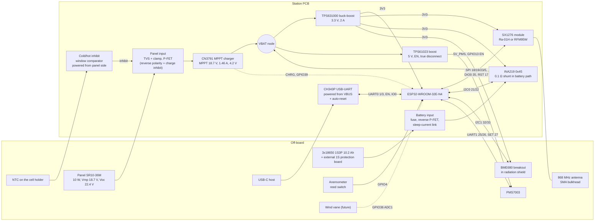

# Station PCB architecture

Status: **F1 draft for review**, 25.10.2026, written by `mobric/pcb-opus-5-5`. Every decision below is a recommendation until mobric approves it, except D1 (approved 25.10.2026) and R1 (decided (a), see [STATUS.md](STATUS.md)).

Requirements and labels are defined in [REQUIREMENTS.md](REQUIREMENTS.md):

- **datasheet**: a published document, standard, library source or dataset.
- **measured**: a third-party bench measurement.
- **assumed**: an engineering assumption.
- **computed**: derived from labelled inputs.

## 1. Block diagram

**Power path.**
- The panel feeds the CN3791 charger through a P-FET, which does two jobs:
  - It's the reverse-polarity protection shown in the CN3791 datasheet (Figure 3).
  - The cold/hot inhibit switches it off, so no panel power reaches the charger outside 0–45 °C at the cells.
- The charger and the loads meet at the VBAT node.
- The INA219 shunt sits between the battery connector and VBAT, so it sees charge (negative) and discharge (positive).
- A buck-boost holds 3.3 V over the whole 3.0–4.2 V battery range.
- A second boost makes 5 V for the PMS7003 only while a reading runs.

## 2. Power architecture choices in brief

| Block | Choice | Main reason | Decision |
|---|---|---|---|
| Charger | CN3791 on board, MPPT 18.69 V | Field-proven with this panel; cheapest | D5 |
| Cold-charge protection | NTC + window comparator switching the panel input | CN3791 has no NTC pin (datasheet) | D5 |
| Cell protection | Keep the external board at the cells | It also protects the battery cable | D5.2 |
| 3.3 V | TPS631000 buck-boost | Holds 3.3 V from 3.0 to 4.2 V; 2 A | D6 |
| 5 V | TPS61023 with true disconnect | 0.1 µA when off; one chip | D7 |
| Measurement | INA219 0x45, 0.1 Ω, battery path | Signed current; default library calibration fits | D9 |

## 3. Pin table

Source: `firmware/station/station.ino` at 82ee40d. Module: ESP32-WROOM-32E-N4.

Pin constraints (datasheet):
- **Strapping pins:** GPIO0, 2, 5, 12, 15. GPIO12 must be low at reset, otherwise the module may select 1.8 V flash.
- **Input only, no pulls:** GPIO34–39.
- **RTC GPIOs** (can wake the chip or hold state in deep sleep): 0, 2, 4, 12–15, 25–27, 32–39.
- **Internal flash:** GPIO6–11 are not led out on the module.

| Function | Today | New board | Change | Firmware impact |
|---|---|---|---|---|
| INA219 I²C0 SDA / SCL | GPIO21 / 22, module on wires | GPIO21 / 22, INA219 on board, 0x45 (A0 = A1 = VS) | Part moves on board; 0.1 Ω shunt in battery path | None needed. Readings become correct with the default calibration (today's 10 mΩ board reads 10× low). Recommended: `ina219.powerSave(true)` before deep sleep |
| BME680 I²C1 SDA / SCL | GPIO32 / 33 | GPIO32 / 33 to the cable connector, 4.7 kΩ pull-ups, TVS | None | None |
| PMS7003 UART1 RX / TX | GPIO25 / 26 | GPIO25 / 26 through 1 kΩ series resistors | Series resistors added | Park pins before 5 V goes off: UART end, TX/SET low or input, RX pull-up off |
| PMS7003 SET | GPIO27, held low in deep sleep with `gpio_hold_en` | GPIO27 through 1 kΩ | None | Hold no longer needed (sensor unpowered in sleep); harmless to keep |
| PMS7003 5 V enable | None (PMS always on the DevKit 5V pin) | **GPIO13** → TPS61023 EN, 100 kΩ pull-down | **New** | **New:** enable before the 30 s warm-up, disable after the read. Skip below −10 °C |
| Anemometer | GPIO4, `INPUT_PULLUP`, FALLING interrupt, 10 ms debounce | GPIO4, 1 kΩ + 10 nF filter, TVS, DNP footprint for an external pull-up | Filter added | None |
| LoRa radio | UART2: RX GPIO16, TX GPIO17, 57600 baud, Grove module on 5 V | **SPI:** SCK GPIO18, MISO GPIO19, MOSI GPIO23, NSS GPIO5. **DIO0 → GPIO35**, **RESET → GPIO17**, DIO1 → GPIO34 (DNP 0 Ω). Module on 3.3 V | **Changed bus** | **Driver change**, see D4 |
| GPIO16 | LoRa RX | 1-Wire header (DS18B20), 4.7 kΩ pull-up | Freed | Optional, only when used |
| Wind vane | None | **GPIO36** (ADC1_CH0), connector, divider footprint, RC filter, TVS | **New, reserved** | Optional, when the vane exists |
| Charger status | None | **GPIO39** ← CN3791 CHRG (open drain), 100 kΩ pull-up | **New** | Optional: read "charging" |
| USB-UART | DevKit CP2102 on GPIO1 / 3, DTR/RTS auto-reset | CH343P on GPIO1 / 3, two-transistor auto-reset on EN and GPIO0 | Same function | None. Upload works as on the DevKit |
| Buttons | DevKit BOOT / EN | BOOT on GPIO0, RESET on EN; EN 10 kΩ / 1 µF | Same | None |
| LED | DevKit power LED, always on | Optional status LED on GPIO2 (DNP) | No always-on LED | None |
| GPIO12, GPIO14, GPIO15 | Unused | GPIO12 unused (must stay low at reset). GPIO14 and GPIO15 go to test points | — | — |

Why these pins:
- **DIO0 on GPIO35.** GPIO35 is an RTC GPIO, so the radio can later wake the ESP32 from light or deep sleep. It's input-only, which suits an interrupt line.
- **5 V enable on GPIO13.** A pull-down keeps the boost off during reset and deep sleep without a hold.
- **CHRG on GPIO39.** An input-only pin does nothing at boot, so the open-drain status line never fights a pin the ESP32 drives at boot.
- **Radio alone on its SPI bus.** RadioHead does SPI inside its interrupt handler, so nothing else shares the bus (see D4).

## 4. Power budget

### 4.1 Inputs

| Input | Value | Label and source |
|---|---|---|
| ESP32 deep sleep (RTC timer + memory) | 10 µA | datasheet [E2] Table 4-2 |
| ESP32 awake at 240 MHz, radio off | 30–68 mA; budget 45 mA nominal, 68 mA pessimistic | datasheet range [E2]; nominal assumed |
| ESP32 awake at 80 MHz | 20–31 mA; budget 25 / 31 mA | datasheet [E2]; nominal assumed |
| ESP32 light sleep | 0.8 mA | datasheet [E2] |
| Wake time to the app, Arduino defaults | ≈ 0.19 s | measured [K1] |
| SX1276 sleep / standby / RX at BW125, 868 MHz | 0.2 µA / 1.6 mA / 10.3 mA | datasheet [S1] Tables 6 and 10 |
| SX1276 TX at +10 dBm, PA_BOOST | 40 mA (not tabulated) | assumed |
| LoRa airtime of the 28-byte frame (24 + 4 header) | 66.8 ms | computed [S1] §4.1.1.7 |
| BME680 sleep / gas heater 320 °C | 0.15 µA / 12 mA for 150 ms | datasheet [B1] Tables 1–2 |
| INA219 on / power-down | 0.7 mA / 6 µA | datasheet [I1] §7.5 |
| PMS7003 active at 5 V | ≤ 100 mA; budget 80 mA nominal, 100 mA pessimistic | datasheet [P1] max; measured 25–80 mA (informal) |
| PMS7003 time on per reading | 31.6 s (0.1 s + 30 s warm-up + about 1.5 s read) | computed from station.ino |
| CN3791 battery drain, no panel input | ≤ 15 µA | datasheet [CN] IBAT2 |
| TPS631000 quiescent / TPS61023 shutdown | 8 µA / 0.1 µA | datasheet |
| CH343P VIO, USB unplugged | 2 µA | datasheet |
| External protection board | 5 µA | assumed (DW01A class is 3–6 µA, datasheet) |
| Leakage on the 3.3 V rail | 1 µA | assumed |
| Buck-boost efficiency, 10–60 mA / ~20 µA load | 90 % / 70 % | assumed (datasheet curves start at 100 µA) |
| 5 V boost efficiency at 100 mA | 90 % | assumed (datasheet curve ≈ 93–95 %) |
| Battery voltage for conversion | 3.7 V | assumed |
| Charger efficiency at 0.3–1.5 W | 85 % | assumed |

Battery current is computed as I_bat = I_3V3 × 3.3 / (η₃ × 3.7) + I_5V × 5 / (η₅ × 3.7) + I_VBAT, where η₃ and η₅ are the 3.3 V and 5 V converter efficiencies.

### 4.2 Operating cases (battery side, computed)

**Cadence.** The design case is the intended firmware cadence: a listen every minute and a full read every 15 min, which gives 96 full reads and 1344 listen wakes per day. Today's firmware actually runs a 19.4-min cycle (74 full reads and 1111 listens per day), which uses about 20 % less. **M1** is the current firmware plus the required changes (radio sleep, INA219 power-down, PMS 5 V switching). **M2** adds optional optimizations (80 MHz CPU, light sleep while the radio listens, radio asleep during the full read).

| Case | M1 nominal | M1 pessimistic | M2 nominal |
|---|---|---|---|
| Deep sleep floor, whole board | **53 µA** | 53 µA | 53 µA |
| One listen wake (9.4 s M1 / 8.3 s M2) | 140 µAh | 200 µAh | 27 µAh |
| One full read (65 s), including PMS warm-up | 1.90 mAh (PMS 1.05) | 2.58 mAh | 1.51 mAh |
| Per day: sleep | 1.0 mAh | 1.0 mAh | 1.0 mAh |
| Per day: listening (1344 wakes) | 188 mAh | 268 mAh | 36 mAh |
| Per day: full reads (96) | 183 mAh | 247 mAh | 145 mAh |
| **Per day total** | **372 mAh = 1.38 Wh** | **517 mAh = 1.91 Wh** | **182 mAh = 0.67 Wh** |
| Average current | 15.5 mA | 21.5 mA | 7.6 mA |

Sleep floor breakdown:
- On the 3.3 V rail: ESP32 10 µA, SX1276 0.2 µA, BME680 0.15 µA, INA219 6 µA, CH343P 2 µA and leakage 1 µA. That 19.4 µA becomes 32.7 µA at the battery, including the converter's Iq.
- On the battery node: CN3791 15 µA, external protection 5 µA and the 5 V boost 0.1 µA.

The listen windows and the PMS7003 dominate; sleep current is now negligible. M2's pessimistic total is 218 mAh/day (0.81 Wh).

**Today's station, for comparison (estimate, not measured).** The 5 V rail draws 13–28 mA while asleep:
- DevKit 3.8–12.2 mA (measured, third party).
- Grove module 8.4 mA standby (datasheet), or about 15 mA left in RX (assumed).
- PMS standby 0.2 mA and INA219 0.7 mA (datasheet).

Through the step-up (85 % assumed, idle about 1.25 mA measured, informal) that is **22–46 mA at the battery, or 0.53–1.10 Ah/day for sleep alone**.

### 4.3 December harvest (PVGIS, computed)

PVGIS v5.3, SARAH3 radiation and ERA5 temperature, 2005–2023, terrain horizon on, 50.90 N 15.73 E. The figures are 10 Wp energy with PVGIS's 14 % system loss included. Converting to the battery side: × 0.85 charger / 0.86, then × 0.634 to remove the 36.6 % of December energy that arrives while the air is below 0 °C. That last step assumes the cells are at air temperature, which is pessimistic for a closed box.

| December case (60° south unless noted) | PVGIS, Wh/day | Into battery, Wh/day | Balance M1 nominal / pessimistic, Wh/day |
|---|---|---|---|
| Mean (hourly series) | 13.84 | 8.67 | +7.3 / +6.8 |
| Mean at 35° (PVcalc) | 12.0 | 7.52 | +6.1 / +5.6 |
| Median day | 7.87 | 4.93 | +3.6 / +3.0 |
| 10th-percentile day | 1.78 | 1.12 | −0.3 / −0.8 |
| Worst 7-day mean (12–18 Dec 2018) | 2.41 | 1.51 | +0.1 / −0.4 |
| Worst 14-day mean (13–26 Dec 2018) | 2.57 | 1.61 | +0.2 / −0.3 |
| Worst whole December (2018) | 5.92 | 3.71 | +2.3 / +1.8 |

- **Tilt.** 60–90° south gives about 15 % more December energy than 35–40° and sheds snow faster (sin(tilt) term in the NREL/Marion snow model). Recommend at least 60° if the mount allows.
- **Horizon.** The December noon sun reaches only 15.6°, and 66 % of December light is direct beam. Any building or tree higher than about 15° to the south removes most of it. PVGIS knows only the terrain horizon (1.5–3.8°).

### 4.4 Sizing and autonomy

**Usable capacity** is about 7.8 Ah: 10.2 Ah × 0.90 usable window × 0.85 cold derating (both assumed).

Autonomy with no harvest at all:
- **M1:** 21 days nominal, 15 days pessimistic.
- **M2:** 43 days nominal, 36 days pessimistic.

**Is 10 W enough?**
- The December mean gives 4.5–6× the daily need.
- For the worst 14-day window to break even on its own, the panel would need 8.5 W (M1 nominal) or 11.9 W (M1 pessimistic).
- Over that window the pessimistic deficit is about 0.3 Wh/day × 14 ≈ 4.2 Wh ≈ 1.1 Ah, which the battery covers many times over.
- **10 W and 10.2 Ah are enough; no change recommended.**
- What could break this:
  - persistent shading at the site;
  - snow covering the panel for weeks, where autonomy (15–21 days) is the buffer;
  - ESP32 awake current above the 68 mA pessimistic case.

**Peak currents, used to size the rails:**
- 3.3 V rail: ESP32 68 mA + radio TX 40 mA (120 mA at +20 dBm) + BME680 heater peak 18 mA + INA219 1 mA ≈ 130–210 mA without Wi-Fi. Wi-Fi TX would add up to 379 mA peak.
- 5 V rail: ≤ 100 mA plus inrush. The inrush isn't specified.
- From the battery at 3.0 V: about 0.5 A worst case (computed).

## 5. Decisions D1–D12

The costs below are JLC/LCSC listed unit prices at quantity 1, seen 25.10.2026, unless marked otherwise. Under Standard PCBA (see D12) every unique part also costs a $1.53 loading fee per order, basic parts included.

### D1. Project location: approved 25.10.2026
`zephyr-station/hardware/station-pcb/` on branch `hardware/station-pcb`. R1 decided (a): edit the layout in KiCad 9.0.x.

### D2. Microcontroller
- **Options:**
  - (a) ESP32-WROOM-32E-N4, PCB antenna.
  - (b) ESP32-WROOM-32UE-N4, u.FL connector, no antenna keep-out on the board.
  - (c) ESP32-S3 or C6 with native USB.
- **Recommendation: (a) WROOM-32E-N4.**
- **Reasons:**
  - Same chip class (ESP32-D0WD-V3) and 4 MB flash, so the Arduino core, `sketch.yaml` and the code stay as they are.
  - Choose N4, not N4R2. On R2 variants GPIO16 goes to PSRAM (datasheet), and on WROVER GPIO16/17 are taken.
  - The PCB antenna keeps Wi-Fi/BLE available later (for example OTA) without a second antenna. It needs edge placement with a keep-out.
  - Choose (b) if board area is tight and Wi-Fi will never be used.
  - (c) would need a firmware port.
- **Cost:** $3.76 (C701341, 37,771 in stock). (b) costs +$0.25. The module is listed "Standard Only", which forces Standard PCBA for the order (D12).
- **Firmware impact:** none beyond the pin table.

### D3. Programming
- **Options:**
  - (a) USB-C + CH343P (VDD5 from VBUS, VIO from 3V3) + two S8050 auto-reset transistors.
  - (b) USB-C + CH340C with its own USB-only 3.3 V LDO.
  - (c) a 6-pin UART header only (GND, 3V3, TX, RX, EN, IO0) with an external adapter.
- **Recommendation: (a).**
- **Reasons:**
  - The CH343P is powered from USB. Its VIO pin draws 2 µA and does not back-feed when USB is unplugged (datasheet).
  - It needs no crystal and is rated −40 °C.
  - The CH340C has no VIO pin, and most lots are rated only −20 °C.
  - (c) is the cheapest and draws zero standby, but every flash or log session needs an adapter.
  - The auto-reset follows Espressif DevKitC V4, with EN 10 kΩ / 1 µF per Espressif's checklist.
- **Cost:** about $1.3 per board (CH343P $0.97 C2846043, USB-C $0.19 C165948, S8050 $0.014 basic). Under Standard PCBA add about 5 unique parts × $1.53 ≈ $7.7 per order (computed). (c) costs about $0.05.
- **Firmware impact:** none; upload works as on the DevKit.

### D4. Radio
- **Options:**
  - (a) An SX1276 868 MHz module on SPI:
    - Ai-Thinker **Ra-01H** (C503593, $6.45, 3,056 in stock, −40 to +85 °C, 803–930 MHz).
    - Or HopeRF **RFM95W-868** (0 in stock at JLC and TME on 25.10.2026, −20 to +70 °C).
  - (b) A Grove connector with 5 V for today's UART module.
  - (c) An SX1262 module, which needs the RH_SX126x driver and is a different chip.
- **Recommendation: (a), with Ra-01H first.** RFM95W stays the alternative if stock returns. The footprints differ (about 17 × 16 mm vs 16 × 16 mm, assumed from the dimensions), so the choice is fixed in F2.
- **Reasons:**
  - The same SX1276 chip with RadioHead 1.147 `RH_RF95` matches the Seeed fork in every on-air setting: BW125, CR4/5, SF7, explicit header, CRC on, preamble 8, LDRO off, sync word 0x12, the same 4-byte header and broadcast address (datasheet: both library sources).
  - 3.3 V operation and no ATmega bridge (the Grove module draws 8.4 mA standby).
  - Sleep current 0.2 µA.
- **Link budget at 20 m:** free-space loss is 57.2 dB, sensitivity −123 dBm. Even with a high-loss outer wall, an inner wall and a 20 dB allowance, the margin is about 33 dB at 10 dBm (computed).
- **Antenna:**
  - u.FL on the board (Kinghelm C411563, $0.07) plus a pigtail to an IP-rated SMA bulkhead.
  - 50 Ω coplanar waveguide: about 1.2–1.4 mm track with 0.2 mm gaps on 1.6 mm FR-4 (computed; confirm with the JLC stackup tool).
  - π-match footprint and a low-capacitance RF ESD diode.
  - u.FL is rated for only about 30 mating cycles.
- **Cost:** the radio module is +$6.45 on the board, but it removes the Grove module and the always-on 5 V rail. Pigtail, bulkhead and antenna aren't priced yet.
- **Firmware impact (driver change):**
  1. Replace the Seeed fork with RadioHead 1.147 `RH_RF95 rf95(5, 35)`.
  2. Call `SPI.begin(18, 19, 23, 5)` before `rf95.init()`; RadioHead's own `SPI.begin()` returns early if the bus is already started.
  3. Pulse RESET on GPIO17.
  4. Call `setFrequency(868.0)`, which is mandatory because the default is 434 MHz.
  5. Call **`setTxPower(10, false)`** to match today's real output. In 1.147, 13 really means 13 dBm.
  6. Call **`rf95.sleep()` before every deep sleep**.
  7. Drop the 500 ms UART settle delay.

  The packet and the gateway stay unchanged. RadioHead's interrupt handler does SPI, and SPI in core 3.3.11 takes a mutex. So the radio stays alone on its bus and gets a deep-sleep soak test in F6.
- **Compliance note:**
  - 10 dBm conducted + 2 dBi is about 9.9 dBm ERP, under the 14 dBm limit.
  - Duty cycle is ≤ 0.03 %, against a 1 % limit.
  - A 125 kHz channel centred on 868.0 MHz straddles two EN 300 220 band entries. Fixing that needs both ends changed, so it's flagged and not fixed here.

### D5. Charging
- **Options:**
  - (a) CN3791 on the board plus an external cold/hot inhibit.
  - (b) TI BQ24650: built-in NTC window (TS pin), MPPSET disable, ≤ 15 µA drain, two external FETs.
  - (c) Consonance CN3722: TEMP pin, but its cold threshold is about +2.6 °C typical with a −2.9 to +7.3 °C spread (computed for a B3950 NTC).
- **Recommendation: (a).**
- **Settings:**
  - MPPT divider 470 kΩ / 32.4 kΩ gives 18.69 V nominal (18.3–19.1 V over the 1.205 V ±2 % reference). A basic-parts alternative is 1 MΩ / 68 kΩ for 18.93 V.
  - RCS 0.082 Ω gives 1.46 A (ICH = 120 mV / RCS, ±8 %).
  - 4.2 V charge voltage.
  - A P-FET on the input (reverse polarity, datasheet Figure 3), switched off by the inhibit.
  - Power parts on the panel net rated ≥ 40 V.
- **Inhibit:**
  - A 10 kΩ NTC on the cell holder feeds a window comparator.
  - The comparator is powered from the panel side, so it draws nothing from the battery at night.
  - It turns the input P-FET off below 0 °C and above 45 °C at the cells (datasheet limits for 18650 charging).
  - The divider is arranged so that an open or shorted NTC blocks charging.
  - Removing the input is documented behaviour: the charger sleeps when VCC < VBAT. That's why I chose it over pulling the MPPT pin low, which is undocumented.
- **Reasons:**
  - Field-proven here and the cheapest option.
  - (b) is the fallback if the inhibit bench test fails.
  - (c)'s threshold spread straddles 0 °C.
- **Risk:** cold Voc is 25.4–26.1 V at −20 to −30 °C (computed, coefficient assumed). The CN3791's operating maximum is 28 V and its absolute maximum is 30 V, so the input clamp is designed in F2.
- **Cost:** CN3791 $0.50 (C154992) plus inductor, FETs, Schottky, comparator and NTC: about $1.5–2 per board in total (assumed). (b): BQ24650 $3.57 + two FETs, about $4.5 (assumed).
- **Firmware impact:** none required. Optionally read CHRG on GPIO39.
- **Quick win for today's station:** replacing the module's bottom MPPT resistor (about 20 kΩ) with 12.1 kΩ gives 18.9 V (computed, using the third-party 178 kΩ top-resistor value). Measure first.

### D5.2. Cell protection: on the board or external
- **Options:**
  - (a) Keep the external 1S 10A board at the cells.
  - (b) DW01A + FS8205A on the main board: overcurrent trip about 3.6 A, 1.7–4.3 A spread.
  - (c) BQ29700 + FS8205A on the main board.
- **Recommendation: (a) for v1.**
- **Reasons:**
  - Protection at the cells also protects the battery cable, which on-board protection cannot do.
  - The board is already wired and in service.
  - On-board protectors trip on overcharge close to the CN3791's maximum charge voltage: DW01A at 4.25 V minimum against CN3791 VREG up to 4.242 V leaves 8 mV, so nuisance trips are possible.
  - The safety-critical layout stays off the first spin.
  - Still unknown: the external board's IC, thresholds and quiescent current (open question 2).
- **Cost:** $0 on the board, against about $0.10 + 2 loading fees for (b).
- **Firmware impact:** none.

### D6. 3.3 V rail
- **Options:**
  - (a) TI TPS631000 buck-boost: 8 µA, 2 A, $0.47, C5219190.
  - (b) TPS63900: 75 nA, ≥ 400 mA guaranteed, $1.12.
  - (c) TPS63802: 11 µA, 2 A, $0.91.
  - (d) A low-Iq LDO such as RT9080-33: 2 µA, 600 mA, $0.12, but it stops regulating below about 3.45–3.55 V input.
- **Recommendation: (a).**
- **Reasons:**
  - It holds 3.3 V across 3.0–4.2 V with 4× margin over the ESP32's 0.5 A requirement.
  - Its Iq costs 0.19 mAh/day (computed) against about 370 mAh/day of use, so (b)'s lower Iq doesn't matter.
  - (d) is a valid cost-down. Below about 3.5 V the rail sags, but it stays above the ESP32's 3.0 V minimum.
  - It replaces today's step-up → AMS1117 chain (AMS1117 Iq alone is 5 mA).
- **Cost:** $0.47 + inductor. Check in F2 that JLC can assemble the SOT-583 package.
- **Firmware impact:** none.

### D7. Switched 5 V for the PMS7003
- **Options:**
  - (a) TPS61023 boost with EN and true load disconnect: 0.1 µA shutdown, $0.24, C919459.
  - (b) MT3608 or SX1308 plus a TPS22917 load switch. These are non-synchronous, so on their own they never disconnect the load.
  - (c) An always-on 5 V rail with SET-pin sleep, as today (≤ 200 µA standby + boost idle).
- **Recommendation: (a).**
- **Reasons:**
  - One chip with true disconnect.
  - EN on GPIO13 with a pull-down keeps the rail off during reset and deep sleep without a hold.
  - 1 kΩ series resistors on the PMS lines plus firmware pin parking prevent back-powering.
  - An SN74LVC1G126 buffer ($0.07) is the option if measurements show back-feed.
- **Cost:** $0.24 + inductor.
- **Firmware impact:**
  - New enable sequence: 5 V on → 30 s warm-up → read → park pins → 5 V off.
  - Skip the PM reading below −10 °C (PMS7003 rating, datasheet).

### D8. BME680
- **Options:**
  - (a) Keep the existing off-board breakout in a radiation shield on the < 1 m Cat5e cable.
  - (b) BME680 on the main board.
- **Recommendation: (a).**
- **Reasons:**
  - It keeps the sensor away from board heat (ESP32, converters, PMS fan).
  - It's already in service.
  - I²C at 100 kHz over < 1 m stays well inside normal bus capacitance (about 50 pF/m assumed).
  - The board gets a connector that matches the cable (open question 6), 4.7 kΩ pull-ups and a TVS array.
- **Cost:** connector + ESD, about $0.5 (assumed). (b) would cost $10.87 for the part.
- **Firmware impact:** none.

### D9. Power measurement
- **Options:**
  - (a) One INA219 at 0x45 in the battery path with a 0.1 Ω shunt: signed charge and discharge.
  - (b) As today, in the load path only.
  - (c) Add a second INA219 on the panel side.
- **Recommendation: (a), with no second INA219.**
- **Reasons:**
  - One sensor sees both the charge and the load.
  - A 0.1 Ω shunt matches Adafruit's default 32V_2A calibration: ±3.2 A range, 0.1 mA resolution.
  - Power-down mode cuts it to 6 µA in sleep.
  - A panel-side INA219 would see up to 26 V cold Voc, at its 26 V maximum (datasheet). The CHRG pin already shows when it's charging.
  - Loss in the shunt at 1.46 A is 0.21 W (computed). Winter currents are far lower.
- **Cost:** INA219 $1.27 (C87469) + a 2512 shunt (not priced).
- **Firmware impact:**
  - None required.
  - Recommended: `powerSave(true)` before deep sleep.
  - Optional: stop clamping negative current to 0, to see charging.
  - The packet is unchanged.

### D10. Spare inputs
- **Recommendation:**
  - A wind-vane connector on GPIO36 (ADC1_CH0) with a divider footprint, RC filter and TVS.
  - A 1-Wire header on GPIO16 with a 4.7 kΩ pull-up.
  - GPIO34 to the radio's DIO1 through a DNP 0 Ω.
  - GPIO14, GPIO15 and GPIO2 to test points.
- **Cost:** about $0.3–0.5 (assumed).
- **Firmware impact:** none until used.

### D11. Size and enclosure: open
mobric hasn't decided whether to keep the clear box.
- **Recommendation:** a parametric outline (R-M2).
  - If the box stays, size for it first (needs its inner dimensions and mounting points).
  - Otherwise design a 3D-printed enclosure in ClassCAD from the board STEP (F5).
  - Either way it needs an antenna bulkhead and cable glands for the panel, anemometer and Cat5e.
- **Cost:** none for the board.
- **Firmware impact:** none.

### D12. Manufacturing
- **Recommendation:**
  - JLCPCB Standard PCBA (forced by the ESP32 module), 2 layers.
  - 5 boards, quantity still open.
  - Keep unique part values few, because Standard charges $1.53 per unique part, basic included.
- **First order of 5, estimate (computed):**
  - Fixed cost about $102: setup $25.56, stencil $8.21, handling ≥ $14.93, about 35 unique parts × $1.53.
  - Parts about $18–20 per board (listed main parts + assumed passives).
  - Bare boards about $2 for 5.
  - **Total about $195 plus shipping and VAT** (not sourced).
- **Alternative:** Economic PCBA without the ESP32 module, which is then hand-soldered (fixed cost about $56).
- **Firmware impact:** none.

## 6. Firmware changes for F5 (compile only)

**Required:**
1. Radio driver to RadioHead 1.147 SPI: `RH_RF95(5, 35)`, `SPI.begin(18, 19, 23, 5)`, RESET pulse on GPIO17, `setFrequency(868.0)`, `setTxPower(10, false)`.
2. `rf95.sleep()` before every deep sleep.
3. PMS7003 5 V control on GPIO13, with pin parking before power-off.
4. `ina219.powerSave(true)` before deep sleep.

**Recommended:**
5. Skip PMS below −10 °C.
6. Set `DEEP_SLEEP_CURRENT_MA` to the measured value.
7. Report signed INA219 current.

**Optional (M2 budget):**
8. CPU at 80 MHz while waiting.
9. Light sleep during the 8 s listen, waking on DIO0 (GPIO35).
10. Radio asleep during the full read.
11. Schedule from an absolute time base, so the full read really comes every 15 min.

## 7. Risks and bench tests (F6)

1. **Cold Voc against CN3791 maximums.** About 25.4–26.1 V against 28 V operating and 30 V absolute. Design the input clamp in F2; measure Voc on a cold morning.
2. **Cold/hot inhibit.** Test with the NTC replaced by resistors (0 °C, 45 °C, open, short) and with cold spray.
3. **Radio.** Check air compatibility and TX power against the real gateway; dump `printRegisters()` on both ends; read `frequencyError()`.
4. **RadioHead with core 3.3.11.** Its interrupt handler uses SPI behind a mutex. Run a deep-sleep cycling soak test.
5. **Sleep current.** Measure with a µA meter at the battery link (target ≤ 100 µA, estimate 53 µA).
6. **ESP32 awake current.** Measure under the real firmware. The budget's main uncertainty is 45 vs 68 mA.
7. **PMS7003 back-feed.** Measure current into the unpowered sensor and check its start-up after a cold power cycle.
8. **Low-temperature parts.** RFM95W −20 °C, PMS7003 −10 °C, CH343P −40 °C, Ra-01H −40 °C. Record each part's rating in the BOM (F2).
9. **Site.** Check shading above 15° to the south and snow on the panel. Both could change the verdict on the panel size.
10. **868.0 MHz straddles two band entries.** Unchanged and compliance-flagged. Any fix needs both ends.

## 8. Open questions for mobric

1. **Battery wiring.** You wrote "szeregowo" (series), but 3.7 V means 3 cells in parallel (1S3P). Please confirm. Which cell model is it?
2. **Protection board.** OK to keep the protection board at the cells (D5.2)? What marking is on its small protection IC?
3. **TP4056 module.** What feeds the TP4056 module (USB?), and do you want USB charging on the new board?
4. **Panel mounting.** What tilt and direction does the panel have? Is anything to the south higher than about 15° (buildings, trees)? Does snow stay on it?
5. **Measurements.** Can you measure today's sleep current with a multimeter in series with the battery (mA range)? And the two MPPT divider resistors on the CN3791 module?
6. **BME680 cable.** Which connector is on each end of the Cat5e (RJ45, RJ11/12, soldered)? Which BME680 breakout is it?
7. **Anemometer and panel cables.** Screw terminals or JST connectors on the board?
8. **Enclosure (D11).** Will you keep the clear box? If so, what are its inner dimensions and mounting points?
9. **Quantity and budget (D12).** How many boards, and what budget?
10. **Wi-Fi/BLE.** Will the station ever use Wi-Fi/BLE (e.g. OTA)? This decides D2 (a) vs (b).
11. **External antenna.** OK to fit an external 868 MHz antenna with an SMA bulkhead through the box?
12. **Cold PM readings.** OK to skip PM readings below −10 °C?
13. **Conformal coating.** Should the assembled board get conformal coating?
14. **Programming.** USB-C on the board (D3a) or a 6-pin header with an external adapter (D3c)?

## 9. Not sourced (assumptions to replace with data)

- SunUP SR10-36M temperature coefficients (−0.30 %/°C assumed) and the full panel datasheet.
- ESP32 awake current under this firmware (the datasheet range was used).
- SX1276 current on PA_BOOST at +10 dBm (40 mA assumed).
- The external protection board: IC, thresholds and quiescent current (5 µA assumed).
- Buck-boost efficiency at about 20 µA (70 % assumed) and charger efficiency at 0.3–1.5 W (85 % assumed).
- Li-ion capacity at −10 °C (85 %) and the usable window (90 %), both assumed.
- Prices of passives, connectors, the comparator, pigtail, bulkhead and antenna; shipping and VAT; the price of 10 bare boards.
- FG-000WIND-004 datasheet. The contact rating is unknown, and 2.4 km/h per Hz comes from the firmware comment only.
- The real divider resistors on today's CN3791 module. The "12V" pad ≈ 11.9 V is inferred from a third-party teardown.
- The PMS7003 inrush current and its internal pull-up values.

## Sources

**ESP32**
- [E1] Espressif ESP32-WROOM-32E/32UE datasheet v2.1: https://www.espressif.com/sites/default/files/documentation/esp32-wroom-32e_esp32-wroom-32ue_datasheet_en.pdf
- [E2] Espressif ESP32 Series datasheet v5.3: https://www.espressif.com/sites/default/files/documentation/esp32_datasheet_en.pdf
- [E6] Espressif hardware design guidelines, schematic checklist: https://docs.espressif.com/projects/esp-hardware-design-guidelines/en/latest/esp32/schematic-checklist.html
- [K1] K. Kessler, "Bootloader Wake Time Improvements", hackaday.io (2020): https://hackaday.io/project/174898/log/183782
- Espressif ESP32-DevKitC V4 schematic: https://dl.espressif.com/dl/schematics/esp32_devkitc_v4_sch.pdf
- arduino-esp32 3.3.11: https://github.com/espressif/arduino-esp32/tree/3.3.11

**Radio**
- [S1] Semtech SX1276/77/78/79 datasheet: https://cdn.sparkfun.com/assets/7/7/3/2/2/SX1276_Datasheet.pdf
- HopeRF RFM95/96/97/98(W) V1.0: https://cdn.sparkfun.com/assets/learn_tutorials/8/0/4/RFM95_96_97_98W.pdf
- RadioHead 1.147: https://www.airspayce.com/mikem/arduino/RadioHead/RadioHead-1.147.zip
- Seeed fork at f82d4dc: https://github.com/Seeed-Studio/Grove_LoRa_433MHz_and_915MHz_RF/tree/f82d4dc943e8c91fd80ecef5fa5f1a625466ca0d
- Grove LoRa Radio wiki: https://wiki.seeedstudio.com/Grove_LoRa_Radio/
- ERC/REC 70-03: https://docdb.cept.org/download/5013
- ETSI EN 300 220-1 V3.1.1: https://www.etsi.org/deliver/etsi_en/300200_300299/30022001/03.01.01_60/en_30022001v030101p.pdf
- ETSI EN 300 220-2 V3.2.1: https://www.etsi.org/deliver/etsi_en/300200_300299/30022002/03.02.01_60/en_30022002v030201p.pdf
- 3GPP TR 38.901 (penetration loss): https://www.etsi.org/deliver/etsi_tr/138900_138999/138901/17.00.00_60/tr_138901v170000p.pdf

**Sensors**
- [B1] Bosch BME680 datasheet rev 1.9: https://www.bosch-sensortec.com/media/boschsensortec/downloads/datasheets/bst-bme680-ds001.pdf
- [I1] TI INA219 SBOS448G: https://www.ti.com/lit/ds/symlink/ina219.pdf
- DFRobot SEN0291 wiki: https://wiki.dfrobot.com/Gravity:%20I2C%20Digital%20Wattmeter%20SKU:%20SEN0291
- [P1] Plantower PMS7003 manual V2.5: https://download.kamami.pl/p564008-PMS7003%20series%20data%20manua_English_V2.5.pdf

**Charging and battery**
- [CN] Consonance CN3791 datasheet (English copy): https://files.waveshare.com/wiki/Solar-Power-Manager-(D)/CN3791_Datasheet_EN.pdf
- CN3791 Chinese original: https://static.chipdip.ru/lib/174/DOC013174086.pdf
- CN3791 module teardowns:
  - https://github.com/heypete/petes-guide-to-solar-battery-chargers/blob/main/improved-CN3791.md
  - https://techobsessed.net/2019/07/cn3791-mppt-solar-li-ion-charger-module-hinky-circuit/
- Panasonic NCR18650B: https://www.batteryspace.com/prod-specs/NCR18650B.pdf
- LG INR18650 MJ1: https://cdn.shopify.com/s/files/1/0721/2761/1190/files/LG-MJ1.pdf
- Fortune DW01A: https://atta.szlcsc.com/upload/public/pdf/source/20160616/1466072038371.pdf
- FS8205A: https://datasheet.lcsc.com/datasheet/pdf/36a54836e5c348019e2245591dab54ff.pdf?productCode=C16052

**Power parts and assembly**
- TI datasheets (TPS631000, TPS63900, TPS63802, TPS61023, TPS22917, BQ24650, BQ29700): https://www.ti.com/lit/ds/symlink/<part>.pdf
- AMS1117: http://www.advanced-monolithic.com/pdf/ds1117.pdf
- MT3608: https://www.olimex.com/Products/Breadboarding/BB-PWR-3608/resources/MT3608.pdf
- WCH CH343: https://static.chipdip.ru/lib/163/DOC045163990.pdf
- JLCPCB assembly pricing (updated 22.10.2026): https://jlcpcb.com/help/article/pcb-assembly-price
- JLC parts library and LCSC pages by C-number: https://www.lcsc.com/product-detail/<C-number>.html

**Solar and weather**
- PVGIS v5.3 API (MRcalc, PVcalc, seriescalc, printhorizon, tmy) at lat 50.90, lon 15.73, e.g. https://re.jrc.ec.europa.eu/api/v5_3/seriescalc?lat=50.90&lon=15.73&startyear=2005&endyear=2023&angle=60&aspect=0&usehorizon=1&pvcalculation=1&peakpower=1&loss=14&pvtechchoice=crystSi&mountingplace=free&outputformat=json
- Marion et al. 2013, PV snow losses: doi:10.1016/j.solener.2013.07.029
- Andrews, Pollard & Pearce 2013: doi:10.1016/j.solener.2013.02.014
- Jurasz et al., EGU25-6203: doi:10.5194/egusphere-egu25-6203

**Dev-kit measurements**
- Mischianti, DOIT DevKit deep sleep (2021): https://www.mischianti.org/2021/03/15/esp32-practical-power-saving-deep-sleep-and-hibernation-3/
- Lucidarme, ESP32-DevKitC power consumption: https://lucidar.me/en/esp32/power-consumption-of-esp32/
