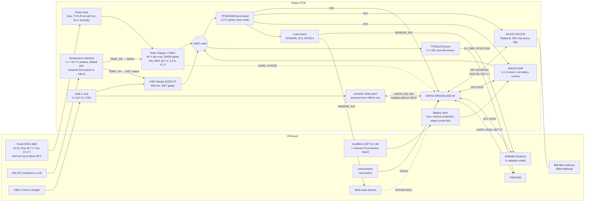

# Station PCB architecture

Status: **F1 revision 1 for review**, 25.10.2026, written by `mobric/pcb-opus-5-5`.
- It revises the F1 draft (4cd5e93) after the Codex review in [reviews/F1-codex.md](reviews/F1-codex.md). The item-by-item response is in [reviews/F1-response.md](reviews/F1-response.md).
- It folds in mobric's answers Q1–Q14 (§ 8).
- Every decision below is a recommendation until mobric approves it, except D1 (approved 25.10.2026) and R1 (decided (a), see [STATUS.md](STATUS.md)).

Labels are defined in [REQUIREMENTS.md](REQUIREMENTS.md#labels-and-sources): **datasheet**, **owner/photo**, **measured**, **assumed**, **computed**, **model-derived**.

## 1. Block diagram

**Power path.**
- **Panel input.** The panel reaches the solar charger through a fuse, a TVS and a 60 V Schottky.
  - The Schottky blocks a reversed panel and night backflow.
  - The TVS stays non-conducting at the coldest Voc (D5).
- **Interlock.** It runs only while the panel or USB supplies power, so it draws nothing from the battery. It compares an NTC bonded to a cell with a +1 / +44 °C window. Its output TEMP_OK enables the solar charger (SHDN) and the USB charger (ISET) only inside that window.
  - TEMP_OK is low by default: unpowered, starting, browning out, NTC open, NTC shorted.
- **USB.** VBUS feeds only the USB charger, the CH343P and the interlock supply.
- **Measurement.** The INA219 shunt sits between the battery connector and VBAT, where the chargers and loads meet. It sees net battery current, signed.
- **Rails.** The TPS631000 holds 3.3 V over the whole battery range. The TPS61023 makes 5 V for the PMS7003 only while a reading runs.
- **Sensors.** A load switch feeds the off-board sensors (BME680, vane divider, 1-Wire, anemometer pull-up) only while the firmware reads them.

## 2. Power architecture choices in brief

| Block | Choice | Main reason | Decision |
|---|---|---|---|
| Solar charger | LT3652, VIN_REG for 18.7 V, gated through SHDN | 40 V absolute maximum covers cold Voc and surges without an OVP; documented enable pin | D5 |
| Cold/hot protection | Cell NTC + ratiometric window comparator → TEMP_OK, off by default | Fail-safe gating of both chargers through documented enable inputs | D5 |
| USB charging | BQ25170, ISET switched by TEMP_OK | Open ISET means no charge (datasheet); 30 V absolute maximum, 6.75 V input OVP | D5 |
| Panel input | Fuse + SMBJ28A + 60 V Schottky | TVS stays off at cold Voc; reverse polarity and backflow blocked | D5 |
| Cell protection | Keep the external board at the cells | Confirmed by mobric (Q2) | D5.2 |
| 3.3 V | TPS631000 in power-save mode | Holds 3.3 V even when its input is below 3.0 V | D6 |
| 5 V | TPS61023 with true disconnect | 0.1 µA when off; one chip | D7 |
| Sensor supply | Load switch on GPIO14 | Sleep current no longer depends on the unknown BME680 breakout | D8 |
| Measurement | INA219 0x45, 0.1 Ω, battery path, voltage = bus + shunt | Signed net current and true battery voltage | D9 |
| Winter energy | mobric chooses | The cold-charge block, not the panel, limits the winter | D13 |

## 3. Pin table

Source: `firmware/station/station.ino` at 82ee40d. Module: ESP32-WROOM-32E-N4.

Pin constraints (datasheet):
- **Strapping pins:** GPIO0, 2, 5, 12, 15.
  - GPIO12 must be low at reset, otherwise the module may select 1.8 V flash.
  - GPIO5 is the radio NSS. It gets a pull-up, so the radio stays deselected through reset and the strap sees its default high level.
  - F2 checks the reset state of every strap on the schematic.
- **Input only, no pulls:** GPIO34–39.
- **RTC GPIOs:** 0, 2, 4, 12–15, 25–27, 32–39. These are the pins for EXT0/EXT1 wake and RTC hold.
  - Digital GPIOs can also hold an output level in deep sleep through `gpio_deep_sleep_hold_en()` (Espressif GPIO API).
  - RTC hold and EXT wake have different constraints.
- **Internal flash:** GPIO6–11 are not led out on the module.

| Function | Today | New board | Change | Firmware impact |
|---|---|---|---|---|
| INA219 I²C0 SDA / SCL | GPIO21 / 22, module on wires | GPIO21 / 22, INA219 on board, 0x45 (A0 = A1 = VS) | Part moves on board; 0.1 Ω shunt in the battery path | **Required:** - send battery voltage = bus + shunt voltage; - keep the current signed; - power down after every full read (D9) |
| BME680 I²C1 SDA / SCL | GPIO32 / 33 | GPIO32 / 33 to a pluggable terminal, pull-ups to SENSOR_3V3, ESD | Supply switched | **New:** - switch SENSOR_3V3 on and wait for start-up before init; - set the pins high-Z before switching off |
| PMS7003 UART1 RX / TX | GPIO25 / 26 | GPIO25 / 26 through 1 kΩ series resistors | Series resistors added | Before the 5 V rail goes off: end UART, TX and SET low, pulls off |
| PMS7003 SET | GPIO27, held low in deep sleep with `gpio_hold_en` | GPIO27 through 1 kΩ | None | Park low before 5 V goes off. Hold no longer needed |
| PMS7003 5 V enable | None (PMS always on the DevKit 5V pin) | **GPIO13** → TPS61023 EN, 100 kΩ pull-down | **New** | **New:** enable before the 30 s warm-up, disable after the read. Skip below −10 °C (Q12) |
| Sensor supply enable | None | **GPIO14** → SENSOR_3V3 load switch EN, 100 kΩ pull-down | **New** | **New:** on for full reads (BME680, wind, vane, 1-Wire), off before deep sleep |
| Anemometer | GPIO4, `INPUT_PULLUP`, FALLING interrupt, 10 ms debounce | GPIO4, 1 kΩ + 10 nF filter, TVS, pull-up to SENSOR_3V3 | Pull-up moves to the switched rail | `INPUT` without the internal pull-up. Before deep sleep, isolate GPIO4 (§ 6) |
| LoRa radio | UART2: RX GPIO16, TX GPIO17, 57600 baud, Grove module on 5 V | **SPI:** SCK GPIO18, MISO GPIO19, MOSI GPIO23, NSS GPIO5 (pull-up). **DIO0 → GPIO35**, **RESET → GPIO17** (never low in sleep), DIO1 → GPIO34 (DNP 0 Ω). Module on 3.3 V | **Changed bus** | **Driver change to RadioLib**, see D4 |
| GPIO16 | LoRa RX | 1-Wire header (DS18B20), 4.7 kΩ pull-up to SENSOR_3V3, ESD | Freed | Optional. A DS18B20 on the pack logs cell temperature (D13) |
| Wind vane | None | **GPIO36** (ADC1_CH0), terminal, divider fed from SENSOR_3V3, RC filter, TVS | **New, reserved** | Optional, when the vane exists |
| Charger status | None | **GPIO39** ← LT3652 CHRG (open drain), 100 kΩ pull-up to 3V3 | **New** | Optional: read "charging" |
| USB-UART | DevKit CP2102 on GPIO1 / 3, DTR/RTS auto-reset | CH343P on GPIO1 / 3, two-transistor auto-reset on EN and GPIO0. Powered from VBUS only, lines isolated without VBUS (D3) | Same function | None. Upload works as on the DevKit |
| Buttons | DevKit BOOT / EN | BOOT on GPIO0, RESET on EN; EN 10 kΩ / 1 µF | Same | None |
| LED | DevKit power LED, always on | Optional status LED on GPIO2 (DNP) | No always-on LED | None |
| GPIO12, GPIO15 | Unused | GPIO12 unused (must stay low at reset). GPIO15 to a test point | — | — |

Why these pins:
- **DIO0 on GPIO35.** GPIO35 is an input-only RTC GPIO. The radio can wake the ESP32 from light sleep (M2), and the RadioLib interrupt only sets a flag.
- **5 V enable on GPIO13 and sensor enable on GPIO14.** Pull-downs keep both rails off during reset and deep sleep without a hold. GPIO14 may glitch at boot (assumed, from community pin guides; F2 checks). A glitch only switches the sensors on for a moment.
- **CHRG on GPIO39.** An input-only pin does nothing at boot, so the open-drain status line never fights a pin the ESP32 drives. Its pull-up goes to 3V3, as the review's N1 notes.
- **Radio alone on VSPI.** This keeps the bus simple, but it doesn't make the radio driver interrupt-safe. That fix is the driver change (D4).

## 4. Power budget

### 4.1 Inputs

| Input | Typical | Bounded / pessimistic | Label and source |
|---|---|---|---|
| ESP32 deep sleep (RTC timer + memory) | 10 µA | no maximum published | datasheet [E2] Table 4-2 |
| ESP32 awake at 240 MHz, radio off | 45 mA | 68 mA | datasheet range 30–68 mA [E2]; nominal assumed |
| ESP32 awake at 80 MHz | 25 mA | 31 mA | datasheet [E2]; nominal assumed |
| ESP32 light sleep | 0.8 mA | — | datasheet [E2] |
| Wake time to the app, Arduino defaults | ≈ 0.19 s | — | measured [K1] |
| Ra-01H receive at BW125, 868 MHz | 12.15 mA | — | datasheet [RA] p.5 |
| SX1276 sleep / standby | 0.2 µA / 1.6 mA | 1 µA (sleep) | datasheet [S1] Table 6 |
| Ra-01H RF switch (PE4259), fed from 3V3 inside the module | 9 µA | 20 µA | datasheet: [RA] p.11 schematic, [PE] Table 2 |
| SX1276 TX at +10 dBm, PA_BOOST | 40 mA | — | assumed (not tabulated) |
| LoRa airtime of the 28-byte frame (24 + 4 header) | 66.8 ms | — | computed [S1]; the reviewer got 66.816 ms |
| BME680 sleep / gas heater 320 °C | 0.15 µA / 12 mA for 150 ms | — | datasheet [B1]. The breakout is unpowered in sleep (D8) |
| INA219 on / power-down; IN+ and IN− leakage | 0.7 mA / 6 µA; 0.1 µA each | 1 mA / 15 µA; 0.5 µA each | datasheet [I1] §7.5 |
| PMS7003 active at 5 V | 80 mA | 100 mA | 80 mA assumed (no traceable measurement); 100 mA datasheet maximum [P1] |
| PMS7003 time on per reading | 31.6 s | 35.1 s | computed from station.ino: nominal, retries allow 30.6–35.1 s |
| LT3652 battery drain with VIN floating, plus its float divider | 5.6 µA at 3.7 V (chip 3.1, divider 2.5) | 6.4 µA at 4.2 V; no maximum published | datasheet [LT2] p.6 typical curve, read from the graph; divider current computed (p.15) |
| LT3652 catch Schottky, reverse-biased by the battery at night | about 5 µA at 25 °C | rises steeply when hot (an SS34: about 0.3 mA at 75 °C) | datasheet [SS] curve; F2 picks a low-leakage part |
| LT3652 VIN node at night: VIN_REG divider (≥ 1 MΩ) and input-Schottky leakage | 0 | 3.5 µA allowance | assumed: the drain curve suggests a diode-like path from BAT to VIN; computed for 1 MΩ |
| BQ25170 battery drain, no VBUS | 0.35 µA | 0.6 µA | datasheet [BQ] |
| TPS631000 quiescent current, not switching | 0.15 µA at VIN, 8 µA at VOUT | 6.1 µA at VIN; none published at VOUT | datasheet [T1] §5.5. The VOUT share is a 3.3 V load and is converted like the rest of the rail |
| TPS631000 feedback divider 511 kΩ / 91 kΩ | 5.5 µA | — | datasheet [T1] Table 7-5 values; current computed |
| TPS61023 shutdown | 0.1 µA | 0.2 µA at 85 °C (curve) | datasheet [T2] §6.5, Fig. 6-8 |
| CH343P and its isolation (two SN74LVC1T45), USB unplugged | 0 | 8 µA | design (D3); translator supply and Ioff limits from datasheet [LV] |
| SENSOR_3V3 load switch TPS22917, off | 0.01 µA | 0.1 µA | datasheet [LS] §7.5, −40 to 85 °C |
| External protection board | 3 µA | 6 µA | datasheet: DW01A at 3.9 V, 25 °C. The board's IC is unidentified (Q2), so DW01A-class is assumed |
| Leakage at the battery node: ESD/TVS parts, capacitors, board | 0.5 µA | 2 µA | assumed allowance. Every other ESD/TVS part sits on a net that is unpowered in sleep. Low-leakage ESD parts are rated ≤ 0.1–0.15 µA at stand-off (datasheets [U1], [U2]) |
| Li-ion self-discharge | 2 % of stored energy per month | 10 % in 30 days (LG MJ1 limit, an example cell) | assumed; 1–2 %/month is typical at 25 °C [BU]. The cell model is unknown (Q1) |
| Buck-boost switching efficiency at sleep load | 85 % | — | assumed. The converter's own quiescent current is counted separately, so it isn't counted twice |
| Buck-boost efficiency, 10–60 mA | 90 % | — | assumed (datasheet curves ≈ 90–95 %) |
| 5 V boost efficiency at 100 mA | 90 % | — | assumed (datasheet curve ≈ 93–95 %) |
| Battery voltage for conversion | 3.7 V | — | assumed |
| Charger efficiency at 0.3–1.5 W | 85 % | — | assumed |

Battery current while awake: I_bat = I_3V3 × 3.3 / (η₃ × 3.7) + I_5V × 5 / (η₅ × 3.7) + I_VBAT, where η₃ and η₅ are the 3.3 V and 5 V converter efficiencies.

### 4.2 Sleep floor

**Conditions.** Deep sleep with the radio asleep, sensors and PMS unpowered, USB unplugged and no panel voltage. All values at 25 °C.
- **Typical** uses typical values.
- **Bounded** uses datasheet maxima where they are published and the typical value where they aren't. So it isn't a guaranteed bound.
- The 3.3 V rail is converted to the battery at 3.3 / (0.85 × 3.7) = 1.049 (§ 4.1).

| Load | Supplied from | Typical, µA | Bounded, µA |
|---|---|---|---|
| ESP32 deep sleep, RTC timer and memory | 3V3 | 10 | 10 (no maximum) |
| SX1276 sleep | 3V3 | 0.2 | 1 |
| Ra-01H RF switch (PE4259) | 3V3 | 9 | 20 |
| INA219 power-down | 3V3 | 6 | 15 |
| TPS631000 quiescent current at VOUT | 3V3 | 8 | 8 (no maximum) |
| TPS631000 feedback divider | 3V3 | 5.5 | 5.5 |
| CH343P isolation, two SN74LVC1T45 | 3V3 | 0 | 8 |
| SENSOR_3V3 load switch, off | 3V3 | 0.01 | 0.1 |
| **3.3 V rail** | | **38.7** | **67.6** |
| **3.3 V rail, at the battery (× 1.049)** | | **40.6** | **70.9** |
| TPS631000 quiescent current at VIN | VBAT | 0.15 | 6.1 |
| TPS61023 shutdown | VBAT | 0.1 | 0.2 |
| LT3652 with VIN floating | VBAT | 3.1 | 3.6 (no maximum) |
| LT3652 float divider | VBAT | 2.5 | 2.8 |
| LT3652 VIN node (VIN_REG divider, input Schottky) | VBAT | 0 | 3.5 (allowance) |
| LT3652 catch Schottky at 25 °C | VBAT | 5 | 5 |
| BQ25170 without VBUS | VBAT | 0.35 | 0.6 |
| INA219 IN+ and IN− leakage | VBAT | 0.2 | 1 |
| ESD/TVS and board leakage | VBAT | 0.5 | 2 (allowance) |
| **Board total at the battery link** | | **52.5** | **95.8** |
| External protection board (DW01A class) | cells | 3 | 6 |
| **Total drain on the cells** | | **55.5** | **101.8** |

All computed from the inputs in § 4.1, not measured.
- **Zero in sleep by design:**
  - BME680 breakout, vane divider, 1-Wire and anemometer pull-ups: SENSOR_3V3 is off.
  - PMS7003: the 5 V rail is off.
  - CH343P: powered from VBUS only.
  - Interlock and NTC divider: powered only from the panel or VBUS.
  - CHRG pull-up: the unpowered LT3652 leaves CHRG open.
  - EN and BOOT pull-ups: the auto-reset transistors are off and only leak.
  - GPIO13/14 pull-downs: they drive CMOS enable inputs.
- **R-P7.** The board's bounded 95.8 µA meets the ≤ 100 µA target under the budget's conversion assumption. With the converter at 70 % from a 3.0 V pack, the 3.3 V share grows and the board reaches about 131 µA (computed).
- **The protection board is upstream of the battery link**, so a meter in the link (R-P8) doesn't see its 3–6 µA.
- **Traps.** F2, F5 and F6 must avoid each of these, because any one would dominate the floor:
  - an unswitched BME680 breakout: about 1–240 µA (D8);
  - today's anemometer `INPUT_PULLUP` with the reed switch resting closed: about 72 µA through the 45 kΩ internal pull-up ([E2] Table 5-3);
  - CHRG held low: 33 µA through its 100 kΩ pull-up;
  - the radio's NRESET (GPIO17) held low: up to 1 mA ([S1] § 5.2.2);
  - a hot catch Schottky (about 0.3 mA at 75 °C for an SS34), so F2 picks a low-leakage part;
  - a TVS on the battery line with a low stand-off voltage, whose leakage F2 checks at 4.2 V.
- **Energy.** Even the bounded 101.8 µA is 2.4 mAh/day, under 2 % of daily use in the normal schedules (§ 4.3). The floor matters for storage and for R-P7, hardly for the winter.

### 4.3 Operating cases (battery side, computed)

**Cadence** (all timing nominal).
- The design case is a listen every minute and a full read every 15 min: 96 full reads and 1344 listen wakes per day.
- Today's firmware runs a 19.4-min cycle, about 74 full reads and 1111 listens per day.
- In F5 the schedule runs on absolute time, and the listen slot that falls inside a 65 s full read is skipped.

**Cases.**
- **M1** is the current firmware plus the required changes: radio sleep, INA219 power-down, PMS 5 V switching, sensor supply switching.
- **M2** adds the optional optimizations: 80 MHz CPU, light sleep while the radio listens, radio asleep during the full read.
- **Allowances in every case:** the Ra-01H receive current (12.15 mA instead of the draft's 10.3 mA, +5.5 mAh/day) and 1 mAh/day for occasional Wi-Fi/OTA sessions.
- **Pessimistic cases also add** the bounded sleep floor and 5 % for failed reads and on-demand requests.

| Case | M1 nominal | M1 pessimistic | M2 nominal | M2 pessimistic |
|---|---|---|---|---|
| Sleep floor on the cells (§ 4.2) | 55.5 µA | 101.8 µA | 55.5 µA | 101.8 µA |
| One listen wake (9.4 s M1 / 8.3 s M2) | 144 µAh | 204 µAh | 31 µAh | 31 µAh |
| One full read (65 s M1 / 63.8 s M2), including PMS warm-up | 1.90 mAh (PMS 1.05) | 2.58 mAh (PMS 1.32) | 1.51 mAh (PMS 1.05) | 1.88 mAh (PMS 1.32) |
| Per day: listening (1344 wakes) | 194 mAh | 274 mAh | 41 mAh | 42 mAh |
| Per day: full reads (96) | 183 mAh | 247 mAh | 145 mAh | 180 mAh |
| Per day: sleep, Wi-Fi allowance, margin | 2.0 mAh | 29.1 mAh (margin 26.2) | 2.1 mAh | 14.2 mAh (margin 11.3) |
| **Per day total** | **378 mAh = 1.40 Wh** | **550 mAh = 2.04 Wh** | **188 mAh = 0.70 Wh** | **236 mAh = 0.87 Wh** |

Two further schedules form the adaptive policy (D13). Both are computed with M2 costs:
- **lean:** listen every 5 min, full read every 30 min, 83 mAh = 0.31 Wh/day;
- **survival:** listen every 15 min, hourly read without PM, 16 mAh = 0.06 Wh/day.

The listen windows and the PMS7003 dominate. The sleep floor is under 2 % of daily use even in the bounded case.

**Today's station, for comparison** (estimate, not measured). The 5 V rail draws 13–28 mA while asleep:
- DevKit 3.8–12.2 mA (measured, third party).
- Grove module 8.4 mA in standby (datasheet), or about 15 mA if left in RX (assumed).
- PMS standby 0.2 mA and INA219 0.7 mA (datasheet).

Through the step-up (85 % assumed, idle about 1.25 mA assumed), that is **22–46 mA at the battery, or 0.53–1.10 Ah/day for sleep alone**.

### 4.4 Winter harvest and the hourly model

**Data.** PVGIS v5.3 hourly series, SARAH3 radiation and ERA5 temperature, 2005–2023, terrain horizon on, 50.90 N 15.73 E.
- The panel is at **45° south**: tilt from mobric (Q4), azimuth assumed south.
- Battery-side energy = PVGIS 10 Wp energy ÷ 0.86 (removing PVGIS's 14 % system loss) × 0.85 (charger).
- Charging counts only in hours when the cell temperature is inside the interlock window. The model takes cell temperature = air temperature T2m (assumed; the sensitivities are in § 4.5).

All figures are model-derived.

| December case, 45° south | No temperature limit, Wh/day | Charging 0–45 °C, Wh/day | Charging +1 to +44 °C, Wh/day |
|---|---|---|---|
| Mean | 12.58 | 7.99 | 6.93 |
| Median day | 7.46 | 3.37 | 2.99 |
| 10th-percentile day | 1.88 | 0.00 | 0.00 |
| Worst 7-day window | 2.52 (12–18 Dec 2018) | 0.00 (14–20 Dec 2007) | 0.00 (25–31 Dec 2005) |
| Worst 14-day window | 2.64 (13–26 Dec 2018) | 0.13 (1–14 Dec 2012) | 0.00 (1–14 Dec 2012) |

- **Sunshine and frost come together.** The cold block removes 37 % of the December mean but almost all of the energy in the worst spells: anticyclonic cold spells are both sunny and freezing.
  - The draft multiplied every window by the December-wide factor 0.634, which hid this.
  - Its worst 14-day figure of 1.61 Wh/day was wrong, as the review's M1 found.
- **The reviewer's figures reproduce exactly.** At 60° the script gives 8.678 / 0.264 / 1.007 / 0 / 0.123 Wh/day and cumulative deficits of 40.57 / 66.00 Wh.
  - It used a PVGIS file byte-identical to the reviewer's cache (SHA-256 `66b15480…b19`).
  - The M2 deficits (16.12 / 19.32 Wh against the review's 16.08 / 19.44) differ only because the review rounded the loads to 0.67 / 0.81 Wh/day.
- **Tilt.** Once charging is cold-blocked, 70° gains nothing over 45° (§ 4.5). The draft's "at least 60°" is withdrawn as an energy fix. A steeper tilt still sheds snow faster (Marion snow model).
- **Horizon.** The December noon sun reaches only 15.6°. mobric says nothing probably shades the panel to the south (Q4); PVGIS knows only the terrain horizon.

**The chronological model** is [calc/winter_model.py](calc/winter_model.py), standard library only.
- It steps hour by hour from 1 Jan 2005 to 31 Dec 2023 and carries the battery state across days, months and years.
- Charging is clipped at 1.46 A × 3.8 V. Self-discharge is 2 %/month. PM readings are skipped below −10 °C air.
- **Brown-out** means the usable energy is spent. The station is then off (sleep floor only) until 5 % has been recovered.
- **Statistics** cover the 18 full winters 2005/06–2022/23.
- Usable energy = nominal Ah × 0.90 window × 0.85 cold derating × 3.7 V, which is 28.9 Wh for today's 10.2 Ah.

### 4.5 Options for getting through the winter

Brown-outs over the 18 winters, model-derived. Each cell gives winters with a brown-out, total brown-out days, and the longest brown-out, or the lowest state of charge reached if there was none.

| Case (10 W, 45°, 10.2 Ah unless stated) | M1 nominal | M1 pessimistic | M2 nominal | M2 adaptive |
|---|---|---|---|---|
| Lower cutoff 0 °C at the cells (exact, no tolerance) | 5/18, 21 d (longest 4 d) | 8/18, 98 d (longest 14 d) | none (lowest 49 %) | none (lowest 49 %) |
| Lower cutoff +1 °C (interlock error ≤ 1 K) | 6/18, 90 d (longest 27 d) | 11/18, 186 d (longest 38 d) | 1/18, 2 d (longest 2 d) | none (lowest 23 %) |
| Lower cutoff +2 °C (interlock error ≤ 2 K) | 10/18, 178 d (longest 48 d) | 15/18, 315 d (longest 50 d) | 2/18, 24 d (longest 12 d) | none (lowest 14 %) |
| Lower cutoff +3 °C (interlock error ≤ 3 K) | 14/18, 304 d (longest 72 d) | 16/18, 478 d (longest 79 d) | 2/18, 80 d (longest 50 d) | none (lowest 6 %) |
| Pack ×2 (20.4 Ah), cutoff +1 °C | 2/18, 15 d (longest 10 d) | 5/18, 67 d (longest 34 d) | none (lowest 45 %) | none (lowest 45 %) |
| Pack ×3 (30.6 Ah), cutoff +1 °C | none (lowest 19 %) | 2/18, 24 d (longest 19 d) | none (lowest 62 %) | none (lowest 62 %) |
| Panel 20 W, cutoff +1 °C | 6/18, 64 d (longest 24 d) | 9/18, 150 d (longest 32 d) | none (lowest 3 %) | none (lowest 25 %) |
| Tilt 70°, cutoff +1 °C | 6/18, 95 d (longest 27 d) | 12/18, 192 d (longest 38 d) | 1/18, 4 d (longest 4 d) | none (lowest 22 %) |
| Sun-warmed box, cells +1 K per 100 W/m² (illustrative), cutoff +1 °C | none (lowest 20 %) | 2/18, 5 d (longest 3 d) | none (lowest 63 %) | none (lowest 63 %) |
| Panel-powered pack heater (illustrative), cutoff +1 °C | none (lowest 42 %) | none (lowest 7 %) | none (lowest 78 %) | none (lowest 78 %) |
| Cells chargeable down to −20 °C (e.g. LTO) | none (lowest 86 %) | none (lowest 80 %) | none (lowest 93 %) | none (lowest 93 %) |

Smallest nominal pack with no brown-out in any of the 18 winters (10 W, 45°, model-derived):

| Load profile | Cutoff 0 °C | Cutoff +1 °C | Cutoff +3 °C |
|---|---|---|---|
| M1, today's 19.4-min cycle | 9.6 Ah | 19.5 Ah | 46.4 Ah |
| M1 nominal | 13.9 Ah | 24.7 Ah | 59.0 Ah |
| M1 pessimistic | 26.2 Ah | 44.3 Ah | 88.4 Ah |
| M2 nominal | 5.2 Ah | 10.8 Ah | 25.8 Ah |
| M2 pessimistic | 6.6 Ah | 13.9 Ah | 33.6 Ah |
| M2 adaptive | 1.9 Ah | 3.8 Ah | 6.6 Ah |

What the numbers say:
- **The cutoff's tolerance is expensive.** The guaranteed limit is 0 °C, so the nominal trip must sit above it by the interlock's worst-case error. With M1, the winters with a brown-out go 5 → 6 → 10 → 14 for 0, 1, 2 and 3 K of error. Hence R-P4's ≤ 1 K target: 0.1 % resistors and a ratiometric window give about ±0.8 K (computed in D5).
- **A bigger panel or a steeper tilt barely helps**, because in cold spells charging is blocked, not short of light. This confirms the review's warning.
- **A bigger pack helps slowly.** M1 needs about 2.5× today's pack at a +1 °C cutoff.
- **The adaptive M2 schedule survives every case on today's pack.**
  - At a +1 °C cutoff it spends 45 days in lean mode over 18 winters (about 2.5 days a winter) and none in survival mode.
  - At +3 °C it spends 169 days in lean mode and 51 in survival mode.
  - The station keeps reporting throughout, only less often.
- **The thermal cases are illustrative.** Their parameters are guesses that only a measurement can replace (§ 7, Q16):
  - box warming of +1 K per 100 W/m² with no lag;
  - a heater taking up to 2 W from the panel, on a pack of 200 J/K in 20 mm foam (0.05 W/K), held at +5 °C.

  They show that pack temperature on sunny cold days is the strongest lever.
- **Cells chargeable below 0 °C** (for example LTO) remove the problem. They would change the charge voltage, the converter input range and the pack size. Not recommended for v1.
- **The model can't see:**
  - snow on the panel;
  - local shading;
  - the real cell-to-air temperature difference;
  - cell ageing;
  - the real ESP32 awake current;
  - the actual cell model (Q1).

### 4.6 Peak currents

- **3.3 V rail:** ESP32 68 mA + radio TX 40 mA (120 mA at +20 dBm) + BME680 heater peak 18 mA + INA219 1 mA ≈ 130–210 mA without Wi-Fi. Wi-Fi TX peaks reach 379 mA (datasheet [E2]), during OTA sessions only (R-F11).
- **5 V rail:** ≤ 100 mA plus inrush. The inrush isn't specified.
- **From the battery at 3.0 V:** about 0.5 A worst case with Wi-Fi (computed).
- **Converter headroom:** at the 3.0 V pack endpoint, the shunt, fuse and protection FETs put the TPS631000 input below 3.0 V. Its 2 A headline is specified at VIN ≥ 3 V, so it isn't a guaranteed rating at that endpoint. The 0.5 A need still leaves ample margin (F2 checks the datasheet curve).

## 5. Decisions

Costs are LCSC listed unit prices at quantity 1 for the exact part number given, seen on 25.10.2026. Stock and prices change, and F2 rechecks each one. Under Standard PCBA (D12), every unique part also costs a $1.53 loading fee per order, basic parts included.

### D1. Project location: approved 25.10.2026
`zephyr-station/hardware/station-pcb/` on branch `hardware/station-pcb`. R1 decided (a): edit the layout in KiCad 9.0.x.

### D2. Microcontroller
- **Options:**
  - (a) ESP32-WROOM-32E-N4, PCB antenna.
  - (b) ESP32-WROOM-32UE-N4, u.FL connector, no antenna keep-out on the board.
  - (c) ESP32-S3 or C6 with native USB.
- **Recommendation: (a) WROOM-32E-N4.** mobric's answer that Wi-Fi may be needed for OTA (Q10) settles (a) over (b).
- **Reasons:**
  - Same chip class (ESP32-D0WD-V3) and 4 MB flash, so the Arduino core and the code stay as they are.
  - Choose N4, not N4R2. On R2 variants GPIO16 goes to PSRAM (datasheet).
  - The PCB antenna needs edge placement and a keep-out clear of cells, metal and cables (D11, § 10).
  - (c) would need a firmware port.
- **Cost:** $3.76 (C701341, 37,771 in stock on 25.10.2026). The module is listed "Standard Only", which forces Standard PCBA (D12).
- **Firmware impact:** a partition layout with two OTA app slots (R-F11). F5 checks that the sketch fits.

### D3. Programming and USB
- **Options:**
  - (a) USB-C + CH343P powered from VBUS only, with auto-reset.
  - (b) USB-C + CH340C with its own USB-only 3.3 V LDO.
  - (c) A 6-pin UART header only, with an external adapter.
- **Recommendation: (a).** mobric chose USB-C on the board (Q14) and wants USB charging from it (Q3).
- **Circuit (changed for M2):**
  - The draft fed the CH343P's VIO from the battery-powered 3V3. The review showed that VIO then draws 2 µA typical and up to 50 µA, and that suspend isn't the same as unplugged.
  - Now the whole bridge runs from VBUS. VDD5 comes from VBUS and VIO is tied to the CH343P's own V3 output, the datasheet's all-USB-powered 3.3 V configuration (V3 supplies up to 10 mA).
  - **TXD and RXD go through two SN74LVC1T45 translators**, one per direction, with the A side on 3V3 and the B side on the CH343P's V3.
    - If either supply is at 0 V, both ports go high-Z (datasheet [LV] § 7.3.6). That also covers the battery-absent case.
    - Series resistors alone aren't enough. The CH343P's UART pins are rated only to VIO + 0.5 V, and it promises no back-flow only while VIO is powered (datasheet § 5.2).
  - **DTR and RTS** drive the auto-reset transistors. Unplugged, their base-emitter voltage is 0, so only collector leakage flows.
  - USB-C sink with 5.1 kΩ on CC1 and CC2. ESD protection on VBUS, D+ and D−.
  - VBUS also feeds the USB charger and the interlock supply (D5).
  - The auto-reset follows Espressif DevKitC V4, with EN 10 kΩ / 1 µF per Espressif's checklist.
- **Battery draw with USB unplugged:** zero for the CH343P itself. The translators draw at most 8 µA in total from 3V3 (datasheet supply and Ioff maxima), typically about 0. F6 measures four states: USB absent, attached, suspended, battery absent.
- **Reasons:** no crystal, rated −40 °C, and (b)'s CH340C is mostly rated only −20 °C. (c) draws nothing, but every flash or log session needs an adapter.
- **Cost:** about $1.5 per board: CH343P $0.97 (C2846043), USB-C $0.19 (C165948), plus ESD parts and the two translators, which aren't priced yet. Under Standard PCBA add the loading fees for about 6 unique parts.
- **Firmware impact:** none; upload works as on the DevKit.

### D4. Radio
- **Options:**
  - (a) An SX1276 868 MHz module on SPI:
    - Ai-Thinker **Ra-01H** (C503593, $6.45, 3,056 in stock on 25.10.2026, −40 to +85 °C, 803–930 MHz, 17 × 16 mm, receive 12.15 mA, datasheet [RA]).
    - Or HopeRF **RFM95W-868** (16 × 16 mm, −20 to +70 °C, out of stock at JLC and TME on 25.10.2026).
  - (b) A Grove connector with 5 V for today's UART module.
  - (c) An SX1262 module, a different chip and driver.
- **Recommendation: (a), Ra-01H.** The footprints aren't interchangeable, so F2 fixes the choice.
- **Driver (changed for M6): RadioLib 7.8.1, not RadioHead 1.147.**
  - RadioHead's DIO0 handler reads the radio over SPI inside the interrupt. On arduino-esp32 3.3.11 every such access takes two FreeRTOS mutexes with `portMAX_DELAY` (verified in the sources; HAL locks are on in the prebuilt core).
  - ESP-IDF 5.5 doesn't assert on this. It works silently while the bus is uncontended and corrupts scheduler state when it isn't.
  - A private SPI bus doesn't change that.
  - In RadioLib the interrupt only sets a flag, and the radio is serviced from the main loop, which is the fix the review suggested.
  - Today's Seeed fork already services its module from the loop, so RadioHead 1.147 on SPI would have been a regression.
  - Rejected:
    - RadioHead with DIO0 polled through a subclass: it depends on a protected internal and still takes mutexes with interrupts masked.
    - `CONFIG_DISABLE_HAL_LOCKS`: it applies to the whole core.
- **Air compatibility:**
  - Every setting is passed explicitly, because RadioLib's defaults differ: `begin(868.0, 125.0, 7, 5, 0x12, 10, 8, 0)`, `forceLDRO(false)`, `setCurrentLimit(100)` (RadioHead leaves the chip default of 100 mA).
  - This gives the same frequency register (0xD90000), sync word 0x12, preamble 8, CRC on, explicit header, LDRO off and modem bytes 0x72 / 0x74.
  - Frames carry the 4-byte RadioHead header as plain bytes: today both ends send TO = FROM = 0xFF, ID = FLAGS = 0, and neither checks it.
  - `setOutputPower(10)` writes PA_CONFIG 0xF8 instead of RadioHead's 0x88. On PA_BOOST both select OutputPower 8, which is 10 dBm (datasheet [S1]).
  - Sources: the agent's checks of RadioLib, RadioHead and the Seeed fork, listed in [reviews/F1-response.md](reviews/F1-response.md).
- **Exchange (unchanged):**
  - The gateway sends `AA 55 01` every 2 s until a valid 24-byte frame arrives or 120 s pass.
  - The station listens 8 s every minute, sends its frame once, then sleeps.
  - There is no ACK in either direction yet.
- **Link budget at 20 m:** free-space loss is 57.2 dB, sensitivity −123 dBm. Even with a high-loss outer wall, an inner wall and a 20 dB allowance, the margin is about 33 dB at 10 dBm (computed).
- **Antenna (confirmed, Q11):**
  - u.FL on the board (Kinghelm C411563, $0.07), plus a pigtail to an IP-rated SMA bulkhead.
  - A 50 Ω line whose width comes from JLC's real stackup (the draft's 1.2–1.4 mm was only an estimate).
  - Continuous ground and via stitching.
  - π-match footprint and a low-capacitance RF ESD diode.
- **Compliance note:**
  - 10 dBm conducted + 2 dBi is about 9.9 dBm ERP, under the 14 dBm limit.
  - Duty cycle is ≤ 0.03 %, against a 1 % limit.
  - A 125 kHz channel centred on 868.0 MHz straddles two EN 300 220 band entries. Fixing that needs both ends changed, so it's flagged and not fixed here.
- **Cost:** +$6.45 on the board, but it removes the Grove module and the always-on 5 V rail. Pigtail, bulkhead and antenna aren't priced yet.
- **Firmware impact:** see § 6 item 1. The packet and the gateway stay unchanged.

### D5. Charging (rewritten for B1, M4 and Q3)
- **Options.** All three share the interlock and the USB charger described below.
  - (a) **LT3652** solar charger, gated through SHDN.
  - (b) **CN3791** with a true disconnect and an OVP:
    - back-to-back P-FETs (IRF7342, −55 V, ±20 V gate) in the panel line;
    - an OVP comparator that opens them above 26.5 V;
    - the blocking diode D1 to stop the night drain path.
  - (c) **BQ24650**: built-in fail-safe TS input, MPPSET disable, two external FETs.
- **Recommendation: (a) LT3652**, with (b) as the cheaper alternative.
- **Why the draft was wrong (B1):**
  - The P-FET in the CN3791 reference circuit (Waveshare copy, Figure 3) has its body diode pointing from the panel into the charger. Switching it off only blocks reverse input and backflow. It never stopped forward charging.
  - That figure doesn't exist in the Consonance original, where Fig. 3 is a snubber.
- **Reasons for (a):**
  - **Input headroom.** The LT3652 is rated 32 V operating and 40 V absolute against a worst-case cold Voc of about 28 V.
    - A current-limited or finished charger lets the panel float to near Voc. For the CN3791 that is up to about 27.4 V against 28 V operating and 30 V absolute.
    - So (b) needs the OVP, which locks charging out when a worst-case panel is below about −15 °C.
  - **No TVS can protect a 30 V part.** An SMBJ24A breaks down at about 25.3 V at −30 °C, so it conducts at cold Voc and has to absorb watts; it also clamps at 38.9 V. For the LT3652, an SMBJ28A still stands off above cold Voc at −30 °C (about 29.5 V) and clamps below 40 V for moderate surges.
  - **A documented enable.** The SHDN threshold is 1.15–1.25 V. The CN3791 has no enable pin; pulling its MPPT pin low is undocumented.
  - **Lower night drain:** about 5.6 µA typical (chip 3.1 µA from the datasheet curve, float divider 2.5 µA) against about 30 µA typical for the CN3791 circuit without D1 (its ≤ 15 µA IBAT2 covers the BAT pin only). Both chargers also need a catch Schottky, which leaks about 5 µA at 25 °C.
  - **Why not (c):** the BQ24650's 28 V operating limit sits at the cold Voc, with input OVP at 31–33 V. Its fail-safe TS doesn't cover USB, so the external interlock is still needed.
- **Interlock (all options):**
  - **Sensing.** A window comparator on a ratiometric NTC divider, so supply and reference errors cancel: for example TLV3012 (output driven low below its minimum supply), or MCP6542 with an LM4041.
  - **NTC.** A 10 kΩ B3950 1 % thermistor bonded to a cell, away from warm parts, with 0.1 % resistors.
  - **Trips.** Nominal +1 °C and +44 °C with 2–3 K hysteresis.
    - The worst-case electrical error is about ±0.8 K (computed for a +3 °C design from the Shiheng MF52 tables; F2 recomputes it for +1 °C).
    - With 1 % resistors it would be ±1.6 K, costing several winters in § 4.5.
  - **Power.** A 40 V LDO (for example TPS7B6933) diode-fed from the panel and from VBUS powers the interlock only while a charge source exists, so it draws no battery current at night.
  - **TEMP_OK** = window OK AND supply good, with a pull-down. It's low while unpowered, starting or browning out. An open NTC reads too cold and a shorted one too hot.
  - **Solar enable.** TEMP_OK drives the LT3652's SHDN through a FET-switched divider from VIN.
    - This keeps SHDN ≤ VIN + 0.5 V, as the datasheet requires.
    - The divider only enables above about 10 V, so on a slow dawn ramp the interlock (valid from about 4 V) always decides first.
    - The LT3652's own NTC input stays unused: an open thermistor disables it, so it can't be the safety function.
  - **USB enable.** TEMP_OK drives a 2N7002 in series with the BQ25170's ISET resistor. An open ISET means no charge current (datasheet). The BQ25170's TS pin gets a fixed 10 kΩ, because an open TS reads as cold.
  - **Heater option (D13).** A DNP footprint for a panel-powered heater driver, switched by the interlock's "too cold" output.
- **Settings for (a):**
  - VIN_REG divider for 18.7 V, at least 1 MΩ in total (the pin's bias is ≤ 100 nA). The drain curve suggests a path from BAT to VIN at night, so anything on VIN may add drain (§ 4.2).
  - A low-leakage catch Schottky. An SS34-class part leaks about 5 µA at 25 °C and about 0.3 mA at 75 °C.
  - About 1.5 A charge current from the sense resistor.
  - 4.2 V float from the FB divider with 0.1 % resistors.
  - Timer or C/10 termination.
  - F2 tolerances all of these (R-P2, R-P3).
  - Panel input: fuse, SMBJ28A, a 60 V Schottky (about 0.25 W at 0.5 A).
  - USB: BQ25170 ISET for 500 mA, input OVP 6.75 V.
- **Settings for (b), if chosen:**
  - MPPT divider 470 kΩ / 32.4 kΩ: 18.69 V nominal, 17.9–19.5 V toleranced.
  - RCS 0.082 Ω: 1.46 A nominal, 1.33–1.60 A toleranced.
  - OVP trip 26.1–26.9 V (LM4041-B, MCP6541, 0.1 % divider).
  - Gates clamped by a 12 V zener and held off by a 100 kΩ pull-up.
- **Cost (computed from listed prices):**
  - (a) about $12.5 per board: LT3652 C671115 $8.55, BQ25170 C5208201 $0.70, interlock, TVS, Schottky.
  - (b) about $6.7: CN3791 $0.50, IRF7342 C41811 $0.78, OVP, interlock, BQ25170.
  - (c) about $5 plus the interlock.
- **Risk:**
  - The LT3652 hasn't been proven at this site (the CN3791 module has).
  - F6 checks VIN_REG, CC/CV and termination with the INA219 shunt and a load present.
  - Only 3 of the LT3652HV were in stock, so (a) uses the 32 V-operating LT3652 (2,779 in stock).
- **Firmware impact:** none required. Optionally read CHRG on GPIO39.
- **Quick win for today's station:** replacing the module's bottom MPPT resistor (about 20 kΩ) with 12.1 kΩ gives 18.9 V (computed, using the third-party 178 kΩ top-resistor value). Measure first.

### D5.2. Cell protection: decided by mobric's answer (Q2)
Keep the external 1S 10A board at the cells.
- It also protects the battery cable.
- An on-board DW01A would trip at 4.25 V minimum against a 4.2 V ±1 % charge voltage, leaving almost no margin.
- Its IC, thresholds and quiescent current stay assumed: 3–6 µA for the DW01A class.

### D6. 3.3 V rail
- **Options:**
  - (a) TI TPS631000 buck-boost: 2 A at VIN ≥ 3 V, $0.47, C5219190.
  - (b) TPS63900: 75 nA, ≥ 400 mA guaranteed, $1.12.
  - (c) TPS63802: 11 µA, 2 A, $0.91.
- **Recommendation: (a).**
- **Reasons:**
  - It holds 3.3 V across the whole battery range, including inputs below 3.0 V at the pack endpoint.
  - Its quiescent current is small against daily use, so (b)'s lower Iq doesn't matter. It is 0.15 µA at the input (6.1 µA maximum) and 8 µA at the output (typical), plus 5.5 µA in the feedback divider. F2 checks whether a higher-value divider is allowed.
  - MODE is tied to GND for automatic power-save operation at light load. The pin must not float (datasheet [T1] p.3).
- **Removed (m3):** the draft's LDO cost-down. It can't deliver 3.0 V from a 3.0 V pack after dropout, shunt and protection losses.
- **Cost:** $0.47 + inductor. F2 checks that JLC can assemble the SOT-583 package.
- **Firmware impact:** none.

### D7. Switched 5 V for the PMS7003
- **Options:**
  - (a) TPS61023 boost with EN and true load disconnect: 0.1 µA typical shutdown, $0.24, C919459.
  - (b) MT3608 or SX1308 plus a TPS22917 load switch. These are non-synchronous, so on their own they never disconnect the load.
  - (c) An always-on 5 V rail with SET-pin sleep, as today.
- **Recommendation: (a).**
- **Reasons:**
  - One chip with true disconnect.
  - EN on GPIO13 with a pull-down keeps the rail off during reset and deep sleep without a hold.
  - 1 kΩ series resistors plus pin parking (TX and SET low, pulls off) prevent back-powering. An SN74LVC1G126 buffer is the option if F6 shows back-feed.
- **Cost:** $0.24 + inductor.
- **Firmware impact:**
  - The enable sequence is: 5 V on → 30 s warm-up → read → park pins → 5 V off.
  - Skip the PM reading below −10 °C (confirmed, Q12).

### D8. BME680 and the sensor supply
- **Options:**
  - (a) Keep the existing off-board breakout in a radiation shield on the < 1 m Cat5e cable.
  - (b) BME680 on the main board.
- **Recommendation: (a)**, fed from a switched sensor supply.
- **Reasons:**
  - It keeps the sensor away from board heat, and it's already in service.
  - I²C at 100 kHz over < 1 m stays well inside normal bus capacitance (about 50 pF/m assumed).
- **Sensor supply (changed for M3):**
  - The breakout model is unknown (Q6). Common breakouts carry a regulator, level shifters and sometimes a power LED, which could dominate the sleep budget.
  - Left on, five common breakouts would draw about 1–240 µA, because at 3.3 V their regulators sit in dropout. The regulators come from each board's schematic or photos, and their currents (typical / maximum) from the regulator datasheets:
    - Adafruit 3660 (MIC5225): 29 / 50 µA;
    - Adafruit STEMMA QT version (AP2112K or AP2127K, plus an LED): 123–240 µA;
    - Pimoroni PIM357 (TCR2EE18): 35 / 60 µA;
    - Waveshare (RT9193): 90 / 130 µA;
    - CJMCU-680 (XC6206): 1 / 3 µA, rising in dropout.
  - So SENSOR_3V3 comes from a TPS22917 load switch, enabled by GPIO14 and pulled off.
    - Off, it draws 10 nA typical and 100 nA maximum from −40 to 85 °C (datasheet [LS]). A SiP32431 is the alternative.
    - QOD is tied to VOUT, so the rail discharges and the BME680 gets a clean power-on reset.
    - After switching on, the firmware waits at least 2 ms (the BME680's start-up time) plus the rail's rise time, then re-initializes the sensor.
  - The rail also feeds the vane divider, the 1-Wire pull-up and the anemometer pull-up.
  - The I²C pull-ups sit on SENSOR_3V3 too, so nothing back-powers the breakout while it's off. Before the switch opens, the firmware ends I²C1 and sets GPIO32/33 to high-Z, because the BME680's pins must stay ≤ VDDIO + 0.3 V (datasheet [B1]).
- **Connection:** the cable is soldered at both ends today (Q6). It gets re-terminated into a pluggable terminal block (D14), with TVS protection on all four lines.
- **Cost:** the load switch (not priced yet) plus terminal and ESD, about $0.5 (assumed). (b) would cost $10.87 for the part.
- **Firmware impact:** switch the supply on before init and off before deep sleep (§ 6).

### D9. Power measurement (rewritten for M5)
- **Options:**
  - (a) One INA219 at 0x45 in the battery path with a 0.1 Ω shunt.
  - (b) As today, in the load path only.
  - (c) Add a second INA219 on the panel side.
- **Recommendation: (a)**, with the semantics below.
- **Where the shunt sits:** IN+ at the battery connector, IN− at VBAT, where the chargers and loads meet.
  - The INA219 measures bus voltage at IN− (datasheet [I1] Figure 13, §8.5.2), so `getBusVoltage_V()` reports VBAT, not the battery.
  - **Battery voltage = bus voltage + shunt voltage** (signed). That is the voltage at the protection board output, which is what today's packet field means (R-C5).
  - The protection FETs' drop (about 15 mV at 1.46 A, assumed) stays outside the measurement.
- **Current is net battery current, signed:** discharge positive, charging negative.
  - Today's firmware clamps negative current to 0. It must stop doing that.
  - During charging, net battery current is not the load current.
  - The current isn't in the packet today, so no backend field changes.
- **Effect on charging:**
  - The charger regulates 4.2 V at VBAT, so the cell sees 4.2 V minus I × 0.1 Ω: 146 mV at 1.46 A, about 23 mV at a C/10-class termination current.
  - CV therefore starts earlier, and charging ends about 1–2 % short of a full 4.2 V charge (computed; it's kinder to the cells).
  - A load drawn at VBAT also delays termination. F6 checks CC/CV and termination with a load present.
- **Shunt:**
  - 0.21 W continuous at 1.46 A, so a 2512 resistor rated ≥ 1 W, pulse-rated.
  - The battery fuse is coordinated so a fault clears before the shunt's pulse limit (§ 10).
  - Kelvin-routed to the INA219.
- **Calibration:** A0 = A1 = VS selects 0x45. The default 32V_2A calibration fits 0.1 Ω: ±3.2 A, 0.1 mA resolution.
- **Power-down is mandatory, not recommended** (review N3).
  - The INA219 stays powered through ESP32 deep sleep and keeps its mode.
  - The firmware powers it down after every full read, including the first boot, and restores conversion mode at the next full read.
  - It doesn't rely on the per-boot `inaInitialized` flag.
- **Why not (c):** a panel-side INA219 would see the cold Voc at its 26 V maximum.
- **Cost:** INA219 $1.27 (C87469) + a 2512 shunt (not priced).
- **Firmware impact:** § 6 item 2.

### D10. Spare inputs
- **Recommendation:**
  - A wind-vane terminal on GPIO36 (ADC1_CH0) with a divider fed from SENSOR_3V3, an RC filter and a TVS. A typical vane's resistor network would otherwise draw current all the time. A SEN-15901 or 80422 vane spans 688 Ω to 120 kΩ, so through 10 kΩ at 3.3 V it draws 25–309 µA, 182 µA on average (computed from the datasheets). On SENSOR_3V3 it draws nothing in sleep; the firmware reads it after five RC time constants.
  - A 1-Wire header on GPIO16 with a 4.7 kΩ pull-up to SENSOR_3V3 and an ESD diode (m4).
  - GPIO34 to the radio's DIO1 through a DNP 0 Ω.
  - GPIO15 and GPIO2 to test points.
- **Cost:** about $0.3–0.5 (assumed).
- **Firmware impact:** none until used.

### D11. Size and enclosure
mobric wants a new, better enclosure (Q8).
- **Recommendation:** a parametric board outline (R-M2), and a 3D-printed enclosure designed in ClassCAD from the board STEP in F5.
- It needs:
  - an SMA bulkhead and cable glands for the panel, anemometer and Cat5e;
  - the ESP32 antenna at a wall, clear of cells, metal and cables;
  - a battery compartment placed and insulated with D13 in mind.
- **Cost:** none for the board.
- **Firmware impact:** none.

### D12. Manufacturing
- **Recommendation:** JLCPCB Standard PCBA (forced by the ESP32 module), 2 layers.
  - Quantity and budget are deferred until the design is done (Q9).
  - Keep unique part values few, because Standard charges $1.53 per unique part, basic included.
- **First order of 5, estimate (computed, to be redone in F2):**
  - Fixed cost about $110: setup $25.56, stencil $8.21, handling ≥ $14.93, about 40 unique parts × $1.53.
  - Parts about $25–28 per board, mainly because of the LT3652 option.
  - **Total about $250 plus shipping and VAT** (not sourced). With D5 (b) it's about $215.
- **Alternative:** Economic PCBA without the ESP32 module, which is then hand-soldered.
- **Firmware impact:** none.

### D13. Winter energy strategy (new, for M1)
- **Options:**
  - (a) **Firmware:** M2 optimizations plus an adaptive schedule that slows reporting as the battery drains (§ 6 items 9–10).
  - (b) **Bigger pack:** 1S6P (20.4 Ah) or 1S9P (30.6 Ah).
  - (c) **Warmer pack:** an insulated pack with a panel-powered heater, or an enclosure designed for solar gain. Both need measured temperatures first.
  - (d) **Accept brown-outs** with M1 firmware.
  - (e) **Cells chargeable below 0 °C** (for example LTO).
  - (f) **Bigger panel or steeper tilt.** Shown in § 4.5 for completeness; not effective on its own.
- **Recommendation: (a) now, and measure for (c).**
  - Keep today's 10 W panel and 10.2 Ah pack.
  - Put a temperature logger inside today's box this winter (Q16), and a DS18B20 on the new pack.
  - Fit the DNP heater footprint so (c) can be turned on without a new board.
- **Reasons (all model-derived, § 4.5):**
  - (a) has no brown-out in any of the 18 winters on today's pack at a +1 °C cutoff. It spends about 2.5 days a winter in lean mode and keeps reporting.
  - (b) needs about 2.5× today's capacity to cover M1. It costs space and money and still leaves the cold block in place.
  - (c) is the strongest lever in the illustrative runs, but its parameters are guesses until the logger data exists.
  - (d) means 6 winters with a brown-out, 90 days in total and up to 27 days in one go at +1 °C (M1 nominal). It gets worse quickly if the interlock is looser.
  - (e) changes charger, converter and pack, which is too much for v1.
- **Conditions on the verdict:**
  - (a) depends on the M2 assumptions: light-sleep listening at the datasheet's 0.8 mA and an 80 MHz CPU. F6 has to confirm them.
  - (a) also needs an interlock error ≤ 1 K. If either fails, fall back to (b) or (c).
- **Cost:**
  - (a) $0 on the board, some F5 work.
  - (b) about €15–35 for 3–6 good cells, plus space (assumed).
  - (c) a heater pad, FET and foam, about €5 (assumed), plus enclosure work.
  - (e) a different charger setting, a different converter input range and a bigger pack.
- **Firmware impact:** for (a), § 6 items 9–10. The adaptive thresholds come from the battery voltage at rest (bus + shunt), set in F5.

### D14. Connectors (new; mobric left the choice to me, Q7)
- **Options:**
  - (a) Pluggable screw terminal blocks for field cables and locking JST for internal leads.
  - (b) Locking JST (PH or XH) for everything.
  - (c) Fixed screw terminals.
- **Recommendation: (a).**
  - Field cables (panel, anemometer, BME680 Cat5e, wind vane) go on pluggable terminal blocks, 3.5 or 3.81 mm pitch, with screw flange or latch.
  - Internal leads (battery, NTC, PMS7003 adapter) go on locking polarised JST.
- **Reasons:**
  - Today's cables are soldered at their ends (Q6) and Cat5e is often solid-core. Solid wire in crimp contacts is unreliable, and field re-termination shouldn't need a crimp tool.
  - Pluggable blocks let the board come out without unscrewing every wire.
  - JST keeps the internal leads polarised and locked.
- **Cost:** about $0.3–0.6 per pluggable pair (assumed). F2 prices exact parts.
- **Firmware impact:** none.

## 6. Firmware changes for F5 (compile only)

**Required:**
1. **Radio to RadioLib 7.8.1** (D4):
   - `Module(5, 35, 17)`, `SPI.begin(18, 19, 23, 5)`, then `begin(868.0, 125.0, 7, 5, 0x12, 10, 8, 0)`, `forceLDRO(false)`, `setCurrentLimit(100)`.
   - The DIO0 interrupt only sets a flag; the radio is read in the loop.
   - Transmit 28-byte frames: the header `FF FF 00 00` plus the 24-byte payload.
   - Accept 7-byte requests: header plus `AA 55 01`.
   - `radio.sleep()` before every deep sleep. Leave GPIO17 (NRESET) high or high-Z: held low, the SX1276 draws up to 1 mA (datasheet § 5.2.2).
   - Add RadioLib to `sketch.yaml`.
2. **INA219** (D9):
   - battery voltage = bus + shunt voltage;
   - signed current;
   - power down after every full read, including the first boot, without relying on the per-boot `inaInitialized` flag.
3. **PMS7003 5 V control** on GPIO13. Park the pins before power-off and skip below −10 °C.
4. **Sensor supply** on GPIO14 (D8):
   - On for full reads, with BME680 init after switch-on.
   - GPIO4 as a plain input, because the external pull-up sits on SENSOR_3V3.
   - Before deep sleep: sensors off, I²C1 pins high-Z, and GPIO4 isolated with `rtc_gpio_isolate()`.
     - GPIO4 is RTC GPIO 10, so the call applies. It disables input, output and both pulls, then holds the pad (ESP-IDF 5.5.1 sources). Call `rtc_gpio_hold_dis()` after waking.
     - Today's `INPUT_PULLUP` would draw about 72 µA whenever the reed switch rests closed.
5. **OTA partition layout** with two app slots (R-F11).

**Recommended:**
6. Battery percentage from the corrected voltage, preferably at rest.
7. Set `DEEP_SLEEP_CURRENT_MA` to the measured value (F6).
8. Schedule from an absolute time base, and skip the listen slot that falls inside a full read.

**If D13 (a) is chosen:**
9. **M2:**
   - CPU at 80 MHz while waiting;
   - light sleep during the 8 s listen, waking on DIO0 (GPIO35);
   - radio asleep during the full read.
10. **Adaptive schedule:**
    - normal: listen every minute, read every 15 min;
    - **lean** below 40 % charge, back to normal above 50 %: listen every 5 min, read every 30 min;
    - **survival** below 15 %, back to lean above 20 %: listen every 15 min, hourly read without PM.

    The charge level comes from the battery voltage at rest, temperature-compensated; F5 sets the thresholds.

**Optional:**
11. Log the pack temperature from a DS18B20 on the 1-Wire header (D13 measurement).

## 7. Risks and bench tests (F6)

1. **Interlock (R-P4):**
   - Substitute resistors for the NTC at each trip point ±0.5 K, then open and short.
   - Check with cold spray.
   - Ramp the panel input and VBUS slowly, 0 → 20 V over minutes, and brown out each supply.
   - Both chargers must stay off outside the window.
2. **Panel input (R-P1):**
   - Measure Voc on a cold morning.
   - Check that the TVS doesn't conduct at cold Voc.
   - Test a reversed panel, and measure night backflow current.
3. **Solar charger:** VIN_REG holding about 18.7 V, and CC/CV and termination with the INA219 shunt and a load present (D9).
4. **USB:**
   - CH343P leakage in four states: USB absent, attached, suspended, battery absent.
   - USB charge current.
   - No back-feed into VBUS.
5. **Radio:**
   - A two-way link with the real gateway over ≥ 100 frames, logging RSSI, SNR and frequency error.
   - Register dumps on both ends: 0x06–0x09, 0x0B, 0x0C, 0x1D, 0x1E, 0x20/0x21, 0x26, 0x33, 0x39, 0x3B, 0x4D.
   - 10 dBm output.
   - A soak of ≥ 5000 wake/listen/transmit cycles logging `esp_reset_reason()`.
   - Sleep current after `radio.sleep()`.
6. **Sleep current:** µA meter at the battery link. Target ≤ 100 µA bounded; the inventory estimates 52.5 µA typical and 95.8 µA bounded for the board (§ 4.2). Check the catch Schottky warm and cold.
7. **ESP32 awake current** under the real firmware. The main budget uncertainty is 45 vs 68 mA, plus M2's light-sleep listening.
8. **PMS7003:** back-feed into the unpowered sensor, and start-up after a cold power cycle.
9. **Converters:** inrush, effective capacitance, output discharge and restart, pin parking and low-battery transients (review N3).
10. **Low-temperature parts.** Record each part's rating in the BOM: Ra-01H −40 °C, PMS7003 −10 °C, CH343P −40 °C.
11. **Site:** shading above 15° to the south, snow on the panel, and the azimuth (Q4).
12. **868.0 MHz straddles two band entries.** Unchanged and compliance-flagged. Any fix needs both ends.
13. **Thermal:** box and cell temperature against air on sunny cold days. This decides D13 (c).

## 8. Open questions and answers

mobric's answers to the F1 questions, relayed by the coordinator on 25.10.2026:

| # | Question | Answer | Used in |
|---|---|---|---|
| 1 | Battery wiring and cell model | Yes, 1S3P at 3.7 V. Cell model unknown | REQUIREMENTS § 1; § 4.4 |
| 2 | Keep the protection board? Its IC? | Keep it; IC unknown, so thresholds and Iq stay assumed | D5.2; § 4.1 |
| 3 | TP4056 feed; USB charging on the new board? | Yes, USB charging on the new board | D3, D5; R-P11 |
| 4 | Panel tilt, direction, shading, snow | 45°, probably nothing shading it to the south. Azimuth still being asked; snow not answered | § 4.4–4.5 |
| 5 | Measure sleep current and the MPPT divider? | No; keep the estimates | § 4, § 9 |
| 6 | BME680 cable connectors and breakout | Soldered at both ends; breakout unknown | D8, D14 |
| 7 | Screw terminals or JST? | My choice, with a reason | D14 |
| 8 | Keep the clear box? | No, a new and better enclosure | D11 |
| 9 | Quantity and budget | Deferred until the design is done | D12 |
| 10 | Wi-Fi/BLE ever? | Wi-Fi may be needed: keep the antenna keep-out and allow OTA | D2; R-F11 |
| 11 | External antenna with an SMA bulkhead? | Yes | D4 |
| 12 | Skip PM below −10 °C? | Yes | D7; § 4.4 |
| 13 | Conformal coating? | Pending: the coordinator explained it and waits for a yes or no | R-E4 |
| 14 | USB-C or a 6-pin header? | USB-C on the board | D3 |

Still open, for the coordinator to route to mobric:

15. **Panel azimuth and snow** (Q4, part still open). Does snow stay on the panel?
16. **Thermal logging.** Could you put a small temperature logger inside today's box for a few weeks this winter, and note the sunny days? It's the cheapest way to calibrate D13 (c).
17. **D13: the winter strategy.** I recommend (a), firmware, and measuring for (c).
18. **D5: the charger.** I recommend the LT3652 (about +$6 per board, more input headroom) over the CN3791 with a disconnect and an OVP.
19. **Cell model** (Q1). A photo of one cell's wrapper would let the budget use its real capacity, charge-temperature limits and self-discharge.
20. **Protection IC marking** (Q2). It would bound the protection board's quiescent current and thresholds.
21. **Conformal coating** (Q13). Still waiting for your yes or no.

## 9. Not sourced (assumptions to replace with data)

- SunUP SR10-36M temperature coefficients (−0.30 to −0.35 %/°C assumed), Voc tolerance (+5 % assumed) and the full panel datasheet.
- ESP32 awake current under this firmware, and M2's light-sleep listening current.
- SX1276 current on PA_BOOST at +10 dBm (40 mA assumed).
- The protection board's IC, thresholds and quiescent current (3–6 µA assumed).
- Buck-boost switching efficiency at sleep load (85 % assumed) and charger efficiency (85 % assumed).
- Li-ion capacity at −10 °C (85 %), the usable window (90 %) and self-discharge (2 %/month), all assumed until the cell model is known.
- Cell temperature compared with air. The model uses air temperature; the thermal options are illustrative.
- PMS7003 active current (80 mA nominal), inrush and internal pull-ups.
- Prices of passives, connectors, interlock parts, heater, pigtail, bulkhead and antenna; shipping and VAT.
- FG-000WIND-004 datasheet. The contact rating is unknown, and 2.4 km/h per Hz comes from the firmware comment only.
- The real divider resistors on today's CN3791 module.
- The GPIO14 boot-time glitch (community sources).

## 10. F2/F3 checklist

Closed item by item before the F2 and F3 gates (R-M6).

**Ports.** For each port: connector series and pin order, mating part, current rating, ESD/TVS and any series filter.
- Panel: pluggable terminal, fuse, SMBJ28A, 60 V Schottky. Prove reverse polarity and the R-P1 voltage bound.
- Battery: locking JST rated above the fuse.
  - The fuse is coordinated with the shunt's pulse rating and the protection board's overcurrent trip.
  - Reverse protection.
- USB-C:
  - 5.1 kΩ on CC1 and CC2;
  - ESD on VBUS, D+ and D−;
  - VBUS bulk capacitance and inrush;
  - USB 2.0 pair routing;
  - CH343P isolation (D3).
- Anemometer, wind vane, BME680 (four wires), 1-Wire: pluggable terminals, ESD, series resistors and filters.
- NTC: locking JST, ESD, filter.
- PMS7003: adapter to its 1.27 mm connector, series resistors.
- Antenna:
  - u.FL, π-match, RF ESD;
  - 50 Ω width from the JLC stackup, never the draft estimate;
  - continuous ground under the line, via stitching, short run.

**Board.**
- ESP32 antenna keep-out at the board edge, no copper, clear of cells, metal and cables (with D11).
- M3 holes: plated or NPTH, and the copper keep-out around screws and standoffs.
- Test points:
  - several grounds;
  - VBAT, VPANEL, VBUS, 3V3, 5V_PMS, SENSOR_3V3;
  - both shunt sides (Kelvin);
  - TEMP_OK, EN, BOOT (GPIO0);
  - UART0, I²C0, I²C1;
  - radio SCK, MISO, MOSI, NSS, DIO0, RESET.
- Strap pins GPIO0, 2, 5, 12, 15: reset states checked on the schematic.
- Shunt Kelvin routing and power rating. Converter layouts per their datasheets.

**Calculations.**
- Interlock trip tolerance at +1 / +44 °C with the chosen parts, hysteresis, and default-off proof: unpowered, starting, brown-out, open or shorted NTC.
- Panel voltage bound (R-P1).
- MPPT, charge-current and float tolerances (R-P2, R-P3).
- Sleep inventory with the actual BOM (R-P7). It includes the catch Schottky's leakage at temperature, the LT3652 VIN node at night, and the leakage at 4.2 V of any TVS on the battery line.

**BOM.**
- Every part: exact MPN, LCSC number, stock, price and the date seen.
- Temperature ratings listed. Prefer −40 °C, and flag anything rated only to −20 °C.

## Sources

**ESP32**
- [E1] Espressif ESP32-WROOM-32E/32UE datasheet v2.1: https://www.espressif.com/sites/default/files/documentation/esp32-wroom-32e_esp32-wroom-32ue_datasheet_en.pdf
- [E2] Espressif ESP32 Series datasheet v5.3: https://www.espressif.com/sites/default/files/documentation/esp32_datasheet_en.pdf
- [E6] Espressif hardware design guidelines, schematic checklist: https://docs.espressif.com/projects/esp-hardware-design-guidelines/en/latest/esp32/schematic-checklist.html
- Espressif GPIO API (deep-sleep hold, RTC isolation): https://docs.espressif.com/projects/esp-idf/en/stable/esp32/api-reference/peripherals/gpio.html
- [K1] K. Kessler, "Bootloader Wake Time Improvements", hackaday.io (2020): https://hackaday.io/project/174898/log/183782
- Espressif ESP32-DevKitC V4 schematic: https://dl.espressif.com/dl/schematics/esp32_devkitc_v4_sch.pdf
- arduino-esp32 3.3.11 and its prebuilt libraries (`sdkconfig`, ESP-IDF v5.5.5): https://github.com/espressif/arduino-esp32/tree/3.3.11

**Radio**
- [S1] Semtech SX1276/77/78/79 datasheet: https://cdn.sparkfun.com/assets/7/7/3/2/2/SX1276_Datasheet.pdf
- [RA] Ai-Thinker Ra-01H product specification v1.0: https://docs.ai-thinker.com/_media/lora/docs/ra-01h_product_specification_en.pdf
- HopeRF RFM95/96/97/98(W) V1.0: https://cdn.sparkfun.com/assets/learn_tutorials/8/0/4/RFM95_96_97_98W.pdf
- RadioLib 7.8.1: https://github.com/jgromes/RadioLib/releases/tag/7.8.1
- RadioHead 1.147: https://www.airspayce.com/mikem/arduino/RadioHead/RadioHead-1.147.zip
- Seeed fork at f82d4dc: https://github.com/Seeed-Studio/Grove_LoRa_433MHz_and_915MHz_RF/tree/f82d4dc943e8c91fd80ecef5fa5f1a625466ca0d
- ERC/REC 70-03: https://docdb.cept.org/download/5013
- ETSI EN 300 220-1 V3.1.1: https://www.etsi.org/deliver/etsi_en/300200_300299/30022001/03.01.01_60/en_30022001v030101p.pdf
- ETSI EN 300 220-2 V3.2.1: https://www.etsi.org/deliver/etsi_en/300200_300299/30022002/03.02.01_60/en_30022002v030201p.pdf
- 3GPP TR 38.901 (penetration loss): https://www.etsi.org/deliver/etsi_tr/138900_138999/138901/17.00.00_60/tr_138901v170000p.pdf

**Sensors**
- [B1] Bosch BME680 datasheet rev 1.9: https://www.bosch-sensortec.com/media/boschsensortec/downloads/datasheets/bst-bme680-ds001.pdf
- [I1] TI INA219 SBOS448G: https://www.ti.com/lit/ds/symlink/ina219.pdf
- DFRobot SEN0291 wiki: https://wiki.dfrobot.com/Gravity:%20I2C%20Digital%20Wattmeter%20SKU:%20SEN0291
- [P1] Plantower PMS7003 manual V2.5: https://download.kamami.pl/p564008-PMS7003%20series%20data%20manua_English_V2.5.pdf

**Charging, battery and input protection**
- [CN] Consonance CN3791 datasheet (Waveshare English copy): https://files.waveshare.com/wiki/Solar-Power-Manager-(D)/CN3791_Datasheet_EN.pdf, and the Chinese original: https://static.chipdip.ru/lib/174/DOC013174086.pdf
- [LT] Analog Devices LT3652 and LT3652HV datasheets (LCSC copies C671115 and C580115): https://www.analog.com/en/products/lt3652.html
- [BQ] TI BQ25170: https://www.ti.com/lit/ds/symlink/bq25170.pdf
- TI BQ24650: https://www.ti.com/lit/ds/symlink/bq24650.pdf
- TI TLV3012: https://www.ti.com/lit/ds/symlink/tlv3012.pdf
- Microchip MCP6541/2: https://ww1.microchip.com/downloads/en/DeviceDoc/21696H.pdf
- LM4041 (TI and Diodes): https://www.ti.com/lit/ds/symlink/lm4041-n.pdf
- TI TPS7B69: https://www.ti.com/lit/ds/symlink/tps7b69-q1.pdf
- Infineon IRF7342: https://www.infineon.com/dgdl/irf7342pbf.pdf
- Littelfuse SMBJ series: https://www.littelfuse.com/products/tvs-diodes/surface-mount/smbj.aspx
- Shiheng MF52 NTC thermistor tables (MF52A 103F3950), LCSC copy
- CN3791 module teardowns:
  - https://github.com/heypete/petes-guide-to-solar-battery-chargers/blob/main/improved-CN3791.md
  - https://techobsessed.net/2019/07/cn3791-mppt-solar-li-ion-charger-module-hinky-circuit/
- Panasonic NCR18650B: https://www.batteryspace.com/prod-specs/NCR18650B.pdf
- LG INR18650 MJ1: https://cdn.shopify.com/s/files/1/0721/2761/1190/files/LG-MJ1.pdf
- Fortune DW01A: https://atta.szlcsc.com/upload/public/pdf/source/20160616/1466072038371.pdf

**Sleep-current inventory** (copies under `build/f1-revision/research/leak/`, gitignored)
- [LT2] LT3652 datasheet Rev E, LCSC copy C194712 (drain curve p.6, float divider p.15): https://atta.szlcsc.com/upload/public/pdf/source/20180628/C194712_0E862AA8E78C054D6A2241B670DF3444.pdf
- [PE] pSemi PE4259: https://www.psemi.com/pdf/datasheets/pe4259ds.pdf
- Ai-Thinker Ra-01H V1.0 specification with the module schematic (p.11): https://aithinker-static.oss-cn-shenzhen.aliyuncs.com/docs/Public%20Document%20Center/LoRa/lora/Specification/Ra-01H_V1.0%20Specification-20191029.pdf
- [SS] Vishay SS32–SS36: https://www.vishay.com/docs/88751/ss32.pdf
- [LV] TI SN74LVC1T45: https://www.ti.com/lit/ds/symlink/sn74lvc1t45.pdf
- [LS] TI TPS22917: https://www.ti.com/lit/ds/symlink/tps22917.pdf, and Vishay SiP32431: https://www.vishay.com/docs/66597/sip32431.pdf
- [U1] ST USBLC6-2: https://www.st.com/resource/en/datasheet/usblc6-2.pdf
- [U2] onsemi ESD9B: https://www.onsemi.com/download/data-sheet/pdf/esd9b-d.pdf
- ST SMBJ series: https://www.st.com/resource/en/datasheet/smbj.pdf
- [BU] Battery University BU-802b: https://batteryuniversity.com/article/bu-802b-what-does-elevated-self-discharge-do
- BME680 breakouts, from their schematics and photos: Adafruit 3660 and its STEMMA QT version, Pimoroni PIM357, Waveshare BME680, CJMCU-680. Regulator datasheets: Microchip MIC5225, Diodes AP2112 and AP2127, Toshiba TCR2EE, Richtek RT9193, Torex XC6206.
- Wind vane: SparkFun SEN-15901, https://cdn.sparkfun.com/assets/d/1/e/0/6/DS-15901-Weather_Meter.pdf, and Argent Data 80422, https://www.argentdata.com/files/80422_datasheet.pdf
- ESP-IDF v5.5.1 RTC GPIO sources (`rtc_io.h`, `rtc_io_hal.c`, `soc/esp32/rtc_io_periph.c`): https://github.com/espressif/esp-idf/tree/v5.5.1/components

**Power parts and assembly**
- [T1] TI TPS631000: https://www.ti.com/lit/ds/symlink/tps631000.pdf
- [T2] TI TPS61023: https://www.ti.com/lit/ds/symlink/tps61023.pdf
- Other TI datasheets (TPS63900, TPS63802, TPS22917): https://www.ti.com/lit/ds/symlink/<part>.pdf
- WCH CH343 datasheet (manufacturer-authored mirror): https://archive.decromancer.ca/bitsavers.org/components/wch/_dataSheets/CH343DS1.PDF
- JLCPCB assembly pricing (updated 22.10.2026): https://jlcpcb.com/help/article/pcb-assembly-price
- JLC parts library and LCSC pages by C-number: https://www.lcsc.com/product-detail/<C-number>.html

**Solar and weather**
- PVGIS v5.3 hourly series at lat 50.90, lon 15.73, 45° (and 60°, 70° for comparison): https://re.jrc.ec.europa.eu/api/v5_3/seriescalc?lat=50.90&lon=15.73&startyear=2005&endyear=2023&angle=45&aspect=0&usehorizon=1&pvcalculation=1&peakpower=1&loss=14&pvtechchoice=crystSi&mountingplace=free&outputformat=json
- Energy model and its output: [calc/winter_model.py](calc/winter_model.py), [calc/winter_model_output.txt](calc/winter_model_output.txt)
- Marion et al. 2013, PV snow losses: doi:10.1016/j.solener.2013.07.029
- Andrews, Pollard & Pearce 2013: doi:10.1016/j.solener.2013.02.014
- Jurasz et al., EGU25-6203: doi:10.5194/egusphere-egu25-6203

**Dev-kit measurements**
- Mischianti, DOIT DevKit deep sleep (2021): https://www.mischianti.org/2021/03/15/esp32-practical-power-saving-deep-sleep-and-hibernation-3/
- Lucidarme, ESP32-DevKitC power consumption: https://lucidar.me/en/esp32/power-consumption-of-esp32/
