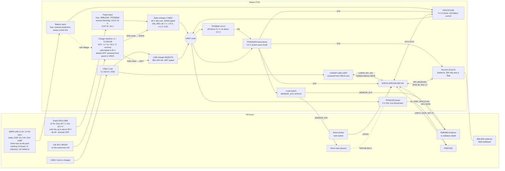

# Station PCB architecture

Status: **F1 revision 2 for review**, 26.10.2026, written by `mobric/pcb-opus-5-5` (listed as `mobric/mikolaj-claude-60` since a restart).
- It revises revision 1 (a22e006) after the Codex re-review in [reviews/F1-codex-r2.md](reviews/F1-codex-r2.md). The item-by-item response is in [reviews/F1-response-r2.md](reviews/F1-response-r2.md). The response to the first review is [reviews/F1-response.md](reviews/F1-response.md).
- It folds in mobric's answers to questions 15–21 (§ 8).
- Approved so far:
  - D1 (25.10.2026);
  - R1, decided (a) (see [STATUS.md](STATUS.md));
  - **D5 = LT3652**, approved by mobric on 25.10.2026 and relayed by the coordinator.

  Every other decision below is a recommendation until the F1 gate. mobric's answers 15–21 are preferences, not approvals.

Labels are defined in [REQUIREMENTS.md](REQUIREMENTS.md#labels-and-sources): **datasheet**, **owner/photo**, **measured**, **assumed**, **computed**, **model-derived**.

## 1. Block diagram

**Power path.**
- **Panel input.** The panel reaches the solar charger through a fuse, an SMBJ33A TVS and a TPS26600 protection switch (D5).
  - The TPS26600 blocks a reversed panel and night backflow. It keeps the charger's input off until the panel is above about 15 V (UVLO) and opens above 31–34 V (OVP). It replaces revision 1's 60 V Schottky.
  - The TVS stays non-conducting at the coldest Voc and keeps surges below the TPS26600's 62 V rating.
- **Interlock.** It runs only while the panel or USB supplies power, so it draws nothing from the battery. Three TLV3012B comparators check two things: that the NTC on the pack reads between +1.7 and +43.3 °C (nominal trips), and that the cells are below 4.35 V. Series FETs combine the three outputs (an AND) into the solar charger's SHDN and the USB charger's ISET return.
  - Charging is blocked by default: interlock unpowered, starting (power-on reset) or browning out, NTC open or shorted, cells overcharged.
- **USB.** VBUS feeds only the USB charger, the CH343P and the interlock supply.
- **Battery.** The board protects itself without relying on the pack's protection board, whose IC is unmarked (answer 20, D5.2):
  - a fuse and reverse-polarity protection in the battery input;
  - the battery overvoltage cut-off in the interlock;
  - a TPS3840 that holds the 3.3 V converter off below 3.1 V;
  - an inline fuse at the pack for the battery cable.
- **Measurement.** The INA219 shunt sits between the battery connector and VBAT, where the chargers and loads meet. It sees net battery current, signed. The firmware infers charging from it. The LT3652's CHRG and FAULT pins go to test points only (D5).
- **Rails.** The TPS631000 holds 3.3 V over the whole battery range above the UVLO. The TPS61023 makes 5 V for the PMS7003 only while a reading runs.
- **Sensors.** A load switch feeds the off-board sensors (BME680, vane divider, 1-Wire, anemometer pull-up) only while the firmware reads them.

## 2. Power architecture choices in brief

| Block | Choice | Main reason | Decision |
|---|---|---|---|
| Solar charger | LT3652, VIN_REG for 18.7 V, gated through SHDN, C/10 termination | 40 V absolute maximum; documented enable pin | D5, **approved 25.10.2026** |
| Panel input | Fuse + SMBJ33A + TPS26600 (reverse blocking, UVLO, OVP) | Bounds the charger's input below its 40 V rating during surges; blocks reverse polarity and backflow | D5 |
| Charge interlock | MF52A NTC and two TLV3012B as a window, a third TLV3012B for battery overvoltage, series-FET AND, off by default | The B variant's power-on reset holds its output low (datasheet); documented enable inputs on both chargers | D5 |
| USB charging | BQ25170, ISET 750 Ω through the AND chain | Open ISET means no charge (datasheet); ≤ 444 mA including the ±10 % gain tolerance | D5 |
| Cell protection | On-board and self-sufficient. The pack's board stays but isn't relied on | Its IC is unmarked (answer 20) | D5.2 |
| Low-battery cut-off | TPS3840PL31 on VBAT drives the TPS631000's EN | Hardware backstop behind the firmware's hibernation | D5.2, § 6 item 11 |
| 3.3 V | TPS631000 in power-save mode | Holds 3.3 V even when its input is below 3.0 V | D6 |
| 5 V | TPS61023 with true disconnect | 0.1 µA when off; one chip | D7 |
| Sensor supply | Load switch on GPIO14 | Sleep current no longer depends on the unknown BME680 breakout | D8 |
| Measurement | INA219 0x45, 0.1 Ω, battery path, voltage = bus + shunt | Signed net current and true battery voltage; also shows whether the battery is charging | D9 |
| Winter energy | M2 adaptive firmware with 2-min listens and a 1S8P pack (mobric's preference, sized here; not yet approved) | The cold-charge block, not the panel, limits the winter | D13 |

## 3. Pin table

Source: `firmware/station/station.ino` at 82ee40d. Module: ESP32-WROOM-32E-N4.

Pin constraints (datasheet):
- **Strapping pins:** GPIO0, 2, 5, 12, 15.
  - GPIO12 must be low at reset, otherwise the module may select 1.8 V flash.
  - GPIO5 is the radio NSS. It gets a pull-up, so the radio stays deselected through reset and the strap sees its default high level.
  - F2 checks the reset state of every strap on the schematic.
- **Input only, no pulls:** GPIO34–39.
- **RTC GPIOs:** 0, 2, 4, 12–15, 25–27, 32–39. These are the pins for EXT0/EXT1 wake and RTC hold.
  - Digital GPIOs can also hold an output level in deep sleep through `gpio_deep_sleep_hold_en()` (Espressif GPIO API).
  - RTC hold and EXT wake have different constraints.
- **Internal flash:** GPIO6–11 are not led out on the module.

| Function | Today | New board | Change | Firmware impact |
|---|---|---|---|---|
| INA219 I²C0 SDA / SCL | GPIO21 / 22, module on wires | GPIO21 / 22, INA219 on board, 0x45 (A0 = A1 = VS) | Part moves on board; 0.1 Ω shunt in the battery path | **Required:** - send battery voltage = bus + shunt voltage; - keep the current signed; - power down after every full read (D9) |
| BME680 I²C1 SDA / SCL | GPIO32 / 33 | GPIO32 / 33 to a pluggable terminal, pull-ups to SENSOR_3V3, ESD | Supply switched | **New:** - switch SENSOR_3V3 on and wait for start-up before init; - set the pins high-Z before switching off |
| PMS7003 UART1 RX / TX | GPIO25 / 26 | GPIO25 / 26 through 1 kΩ series resistors | Series resistors added | Before the 5 V rail goes off: end UART, TX and SET low, pulls off |
| PMS7003 SET | GPIO27, held low in deep sleep with `gpio_hold_en` | GPIO27 through 1 kΩ | None | Park low before 5 V goes off. Hold no longer needed |
| PMS7003 5 V enable | None (PMS always on the DevKit 5V pin) | **GPIO13** → TPS61023 EN, 100 kΩ pull-down | **New** | **New:** enable before the 30 s warm-up, disable after the read. Skip below −10 °C (Q12) |
| Sensor supply enable | None | **GPIO14** → SENSOR_3V3 load switch EN, 100 kΩ pull-down | **New** | **New:** on for full reads (BME680, wind, vane, 1-Wire), off before deep sleep |
| Anemometer | GPIO4, `INPUT_PULLUP`, FALLING interrupt, 10 ms debounce | GPIO4, 1 kΩ + 10 nF filter, TVS, pull-up to SENSOR_3V3 | Pull-up moves to the switched rail | `INPUT` without the internal pull-up. Before deep sleep, isolate GPIO4 (§ 6) |
| LoRa radio | UART2: RX GPIO16, TX GPIO17, 57600 baud, Grove module on 5 V | **SPI:** SCK GPIO18, MISO GPIO19, MOSI GPIO23, NSS GPIO5 (pull-up). **DIO0 → GPIO35**, **RESET → GPIO17** (never low in sleep), DIO1 → GPIO34 (DNP 0 Ω). Module on 3.3 V | **Changed bus** | **Driver change to RadioLib**, see D4 |
| GPIO16 | LoRa RX | 1-Wire header (DS18B20), 4.7 kΩ pull-up to SENSOR_3V3, ESD | Freed | Optional. A DS18B20 on the pack logs cell temperature (D13) |
| Wind vane | None | **GPIO36** (ADC1_CH0), terminal, divider fed from SENSOR_3V3, RC filter, TVS | **New, reserved** | Optional, when the vane exists |
| GPIO39 | Unused | Spare input. The LT3652's CHRG and FAULT go to test points only (D5) | Revision 1's CHRG input dropped (R2-M4) | None. Charging is inferred from the sign of the INA219's current (D9) |
| USB-UART | DevKit CP2102 on GPIO1 / 3, DTR/RTS auto-reset | CH343P on GPIO1 / 3, two-transistor auto-reset on EN and GPIO0. Powered from VBUS only, lines isolated without VBUS (D3) | Same function | None. Upload works as on the DevKit |
| Buttons | DevKit BOOT / EN | BOOT on GPIO0, RESET on EN; EN 10 kΩ / 1 µF | Same | None |
| LED | DevKit power LED, always on | Optional status LED on GPIO2 (DNP) | No always-on LED | None |
| GPIO12, GPIO15 | Unused | GPIO12 unused (must stay low at reset). GPIO15 to a test point | — | — |

Why these pins:
- **DIO0 on GPIO35.** GPIO35 is an input-only RTC GPIO. The radio can wake the ESP32 from light sleep (M2), and the RadioLib interrupt only sets a flag.
- **5 V enable on GPIO13 and sensor enable on GPIO14.** Pull-downs keep both rails off during reset and deep sleep without a hold. GPIO14 may glitch at boot (assumed, from community pin guides; F2 checks). A glitch only switches the sensors on for a moment.
- **GPIO39 spare.** Revision 1 read the LT3652's CHRG here, through a pull-up to the always-on 3V3. The CHRG pin is rated only VIN + 0.5 V, and VIN is 0 V every night, so that pull-up would have driven 3.3 V into it (the review's R2-M4). The pin now goes to a test point with no pull-up.
- **Radio alone on VSPI.** This keeps the bus simple, but it doesn't make the radio driver interrupt-safe. That fix is the driver change (D4).

## 4. Power budget

### 4.1 Inputs

The third column holds the datasheet maximum where one is published, otherwise a pessimistic value or an allowance. It is not a guaranteed bound (R2-M2, § 4.2).

| Input | Typical | High-side / pessimistic | Label and source |
|---|---|---|---|
| ESP32 deep sleep (RTC timer + memory) | 10 µA | no maximum published | datasheet [E2] Table 4-2 |
| ESP32 awake at 240 MHz, radio off | 45 mA | 68 mA | datasheet range 30–68 mA [E2]; nominal assumed |
| ESP32 awake at 80 MHz | 25 mA | 31 mA | datasheet [E2]; nominal assumed |
| ESP32 light sleep | 0.8 mA | — | datasheet [E2] |
| Wake time to the app, Arduino defaults | ≈ 0.19 s | — | measured [K1] |
| Ra-01H receive at BW125, 868 MHz | 12.15 mA | — | datasheet [RA] p.5 |
| SX1276 sleep / standby | 0.2 µA / 1.6 mA | 1 µA (sleep) | datasheet [S1] Table 6 |
| Ra-01H RF switch (PE4259), fed from 3V3 inside the module | 9 µA | 20 µA | datasheet: [RA] p.11 schematic, [PE] Table 2 |
| SX1276 TX at +10 dBm, PA_BOOST | 40 mA | — | assumed (not tabulated) |
| LoRa airtime of the 28-byte frame (24 + 4 header) | 66.8 ms | — | computed [S1]; the reviewer got 66.816 ms |
| BME680 sleep / gas heater 320 °C | 0.15 µA / 12 mA for 150 ms | — | datasheet [B1]. The breakout is unpowered in sleep (D8) |
| INA219 on / power-down; IN+ and IN− leakage | 0.7 mA / 6 µA; 0.1 µA each | 1 mA / 15 µA; 0.5 µA each | datasheet [I1] §7.5 |
| PMS7003 active at 5 V | 80 mA | 100 mA | 80 mA assumed (no traceable measurement); 100 mA datasheet maximum [P1] |
| PMS7003 time on per reading | 31.6 s | 35.1 s | computed from station.ino: nominal, retries allow 30.6–35.1 s |
| Gateway requests answered with an extra full read | 2 a day | 10 a day | assumed (§ 4.3) |
| LT3652 battery drain with VIN floating, plus its float divider | 5.6 µA at 3.7 V (chip 3.1, divider 2.5) | 6.4 µA at 4.2 V; no maximum published | datasheet [LT2] p.6 typical curve, read from the graph; divider current computed (p.15) |
| LT3652 catch Schottky, reverse-biased by the battery at night | about 5 µA at 25 °C | rises steeply when hot (an SS34: about 0.3 mA at 75 °C) | datasheet [SS] curve; F2 picks a part with ≤ 10 µA at 4.2 V and 50 °C |
| LT3652 VIN node at night: VIN_REG divider (≥ 1 MΩ) and the TPS26600's OUT leakage | 0 | 3.5 µA allowance | datasheet: the battery reaches VIN only through the LT3652's reverse path, IREVERSE 1 µA typical at VIN = 0 V ([LT2] p.3); TPS26600 OUT leakage ≤ 11 µA at OUT 24 V, IN 0 V ([TP]). Allowance assumed |
| BQ25170 battery drain, no VBUS | 0.35 µA | 0.6 µA | datasheet [BQ] |
| TPS3840PL31 supervisor on VBAT (new) | 0.3 µA | 0.7 µA | datasheet [SV] |
| Battery-overvoltage divider and its switch Q8, interlock off (new) | 0 | 1 µA | assumed: 2N7002-class IDSS maximum at 60 V; F2 checks the chosen part at 4.2 V |
| Interlock rail VREG: three TLV3012B, LM4041, NTC and tap dividers, FET gates (new) | about 0.6 mA | 0.7 mA (NTC hot, VREG 3.4 V) | computed from D5; drawn from the panel or VBUS only, never from the battery |
| TPS631000 quiescent current, not switching | 0.15 µA at VIN, 8 µA at VOUT | 6.1 µA at VIN; none published at VOUT | datasheet [T1] §5.5. The VOUT share is a 3.3 V load and is converted like the rest of the rail |
| TPS631000 feedback divider 511 kΩ / 91 kΩ | 5.5 µA | — | datasheet [T1] Table 7-5 values; current computed |
| TPS61023 shutdown | 0.1 µA | 0.2 µA at 85 °C (curve) | datasheet [T2] §6.5, Fig. 6-8 |
| CH343P and its isolation (two SN74LVC1T45), USB unplugged | 0 | 8 µA | design (D3); translator supply and Ioff limits from datasheet [LV] |
| SENSOR_3V3 load switch TPS22917, off | 0.01 µA | 0.1 µA | datasheet [LS] §7.5, −40 to 85 °C |
| External protection board | 3 µA | 6 µA | assumed: DW01A at 3.9 V, 25 °C (datasheet). The board's IC is unmarked (answer 20), so DW01A-class is assumed. Nothing relies on it (D5.2) |
| Leakage at the battery node: ESD/TVS parts, capacitors, board | 0.5 µA | 2 µA | assumed allowance. Every other ESD/TVS part sits on a net that is unpowered in sleep. Low-leakage ESD parts are rated ≤ 0.1–0.15 µA at stand-off (datasheets [U1], [U2]) |
| Cells | 3.4 Ah each; 10.2 Ah today (1S3P) | — | owner/photo: Samsung 18650, model unknown (answer 19) |
| Li-ion self-discharge | 2 % of stored energy per month | 10 % in 30 days (LG MJ1 limit, an example cell) | assumed; 1–2 %/month is typical at 25 °C [BU]. The cell model is unknown (answer 19) |
| Charge interlock trips (cell temperature) | off below +1.71 °C, on above +2.11 °C; off above +43.26 °C, on below +43.04 °C | energy corner: +2.69 / +3.06 °C and +42.16 / +41.97 °C | computed, [calc/interlock_trips_output.txt](calc/interlock_trips_output.txt) (D5) |
| Firmware's charge estimate | exact | 15 % of usable energy too high or too low | assumed (§ 6 item 10) |
| Low-energy thresholds | hibernate below 3 %, resume above 12 %; TPS3840 off below 3.1 V, on again about 3.3 V (2 %) | — | assumed (hibernation, § 6 item 11); datasheet (TPS3840 thresholds [SV]) |
| Buck-boost switching efficiency at sleep load | 85 % at 3.7 V | 70 % at 3.0 V | assumed. The converter's own quiescent current is counted separately, so it isn't counted twice |
| Buck-boost efficiency, 10–60 mA | 90 % | — | assumed (datasheet curves ≈ 90–95 %) |
| 5 V boost efficiency at 100 mA | 90 % | — | assumed (datasheet curve ≈ 93–95 %) |
| Battery voltage for conversion | 3.7 V | 3.0 V | assumed |
| Charger efficiency at 0.3–1.5 W | 85 % | — | assumed |

Battery current while awake: I_bat = I_3V3 × 3.3 / (η₃ × 3.7) + I_5V × 5 / (η₅ × 3.7) + I_VBAT, where η₃ and η₅ are the 3.3 V and 5 V converter efficiencies.

### 4.2 Sleep floor

**Conditions.** Deep sleep with the radio asleep, sensors and PMS unpowered, USB unplugged and the panel dark. Part values at 25 °C.
- **Typical** uses typical values.
- **High-side estimate** uses the datasheet maximum where one is published, and otherwise the typical value or an allowance. The last column says which.
  - It is **not a guaranteed bound** (R2-M2). The ESP32's deep-sleep current, the converter's output-side quiescent current, the LT3652's battery drain and the catch diode's leakage have no published maximum.
  - Revision 1 called this column "bounded"; the word is dropped.
- **Conversion.** The 3.3 V rail is converted to the battery at 3.3 / (0.85 × 3.7) = 1.049 at 3.7 V. In the low-battery corner (3.0 V, 70 % efficiency, assumed) the factor is 3.3 / (0.70 × 3.0) = 1.571.

| Load | Supplied from | Typical, µA | High-side, µA | Basis of the high-side figure |
|---|---|---|---|---|
| ESP32 deep sleep, RTC timer and memory | 3V3 | 10 | 10 | typical; no maximum published |
| SX1276 sleep | 3V3 | 0.2 | 1 | maximum |
| Ra-01H RF switch (PE4259) | 3V3 | 9 | 20 | maximum |
| INA219 power-down | 3V3 | 6 | 15 | maximum |
| TPS631000 quiescent current at VOUT | 3V3 | 8 | 8 | typical; no maximum published |
| TPS631000 feedback divider | 3V3 | 5.5 | 5.5 | computed |
| CH343P isolation, two SN74LVC1T45 | 3V3 | 0 | 8 | maximum |
| SENSOR_3V3 load switch, off | 3V3 | 0.01 | 0.1 | maximum |
| **3.3 V rail** | | **38.7** | **67.6** | |
| **3.3 V rail at the battery, 3.7 V / 85 % (× 1.049)** | | **40.6** | **70.9** | |
| TPS631000 quiescent current at VIN | VBAT | 0.15 | 6.1 | maximum |
| TPS61023 shutdown | VBAT | 0.1 | 0.2 | curve at 85 °C |
| LT3652 with VIN floating | VBAT | 3.1 | 3.6 | typical curve; no maximum published |
| LT3652 float divider | VBAT | 2.5 | 2.8 | computed |
| LT3652 VIN node: VIN_REG divider, TPS26600 OUT leakage | VBAT | 0 | 3.5 | allowance |
| LT3652 catch Schottky at 25 °C | VBAT | 5 | 5 | typical curve; F2 limit ≤ 10 µA at 4.2 V and 50 °C |
| BQ25170 without VBUS | VBAT | 0.35 | 0.6 | maximum |
| INA219 IN+ and IN− leakage | VBAT | 0.2 | 1 | maximum |
| TPS3840 supervisor (new) | VBAT | 0.3 | 0.7 | maximum |
| Battery-overvoltage divider switch, off (new) | VBAT | 0 | 1 | 2N7002-class IDSS maximum at 60 V (assumed; F2 checks at 4.2 V) |
| ESD/TVS and board leakage | VBAT | 0.5 | 2 | allowance |
| **Board total at the battery link, 3.7 V / 85 %** | | **52.8** | **97.4** | |
| **Board total at the battery link, 3.0 V / 70 %** | | **73.0** | **132.7** | |
| External protection board (DW01A class) | cells | 3 | 6 | assumed |
| **Total drain on the cells, 3.7 V / 85 %** | | **55.8** | **103.4** | |
| **Total drain on the cells, 3.0 V / 70 %** | | **76.0** | **138.7** | |

All computed from the inputs in § 4.1, not measured.
- **The VIN node.** The battery can reach the LT3652's VIN only through the chip's reverse path. IREVERSE is 1 µA typical at VIN = 0 V and 4.2 V on BAT, SENSE and SW, and SW may sit up to 4.5 V above VIN (datasheet [LT2] p.2–3). So the VIN_REG divider and the TPS26600's OUT leakage (≤ 11 µA at OUT 24 V, IN 0 V, datasheet [TP]) can draw only through that path. The 3.5 µA allowance stays.
- **Zero in sleep by design:**
  - BME680 breakout, vane divider, 1-Wire and anemometer pull-ups: SENSOR_3V3 is off.
  - PMS7003: the 5 V rail is off.
  - CH343P: powered from VBUS only.
  - The interlock: its comparators, NTC divider and LM4041 run from the panel or VBUS only. The battery-overvoltage divider's low side opens whenever the interlock rail is off.
  - CHRG and FAULT: no pull-ups any more (D5).
  - EN and BOOT pull-ups: the auto-reset transistors are off and only leak.
  - GPIO13/14 pull-downs: they drive CMOS enable inputs.
- **R-P7, revised (R2-M2, Q22).**
  - Revision 1 said its "bounded" 95.8 µA met an unconditional ≤ 100 µA target. The review showed that this isn't a bound and that it fails in the document's own low-battery case: about 131 µA at 3.0 V and 70 %.
  - R-P7 now proposes measured acceptance limits with conditions, for the board at the battery link: **≤ 100 µA at 3.7 V and 25 °C, and ≤ 150 µA at 3.0 V and +50 °C.**
  - The estimates sit inside those limits: 97.4 µA high-side at 3.7 V, leaving 2.6 µA, and 132.7 µA at 3.0 V, leaving 17 µA.
  - The 17 µA must also cover the rise from 25 to 50 °C:
    - the catch diode, which F2 limits to ≤ 10 µA at 4.2 V and 50 °C;
    - the ESP32's deep-sleep current, for which there is no data.
  - mobric is asked to agree to the relaxed form (§ 8, Q22).
- **The protection board is upstream of the battery link**, so a meter in the link (R-P8) doesn't see its 3–6 µA.
- **Traps.** F2, F5 and F6 must avoid each of these, because any one would dominate the floor:
  - an unswitched BME680 breakout: about 1–240 µA (D8);
  - today's anemometer `INPUT_PULLUP` with the reed switch resting closed: about 72 µA through the 45 kΩ internal pull-up ([E2] Table 5-3);
  - a battery-overvoltage divider left connected at night: 4 µA (its low side must open with the interlock rail);
  - the radio's NRESET (GPIO17) held low: up to 1 mA ([S1] § 5.2.2);
  - a hot catch Schottky (about 0.3 mA at 75 °C for an SS34), so F2 picks a low-leakage part;
  - a TVS on the battery line with a low stand-off voltage, whose leakage F2 checks at 4.2 V.
- **Energy.** The floor is small against the normal schedules: 138.7 µA is 3.3 mAh/day, 1.4 % of M2's pessimistic normal day. In the survival schedule it is a large share: 3.3 of 12.7 mAh/day. So the winter model uses the 3.0 V high-side figure in every pessimistic case (§ 4.3).

### 4.3 Operating cases (battery side, computed)

Every event comes from one explicit timeline (R2-m1), implemented in [calc/winter_model.py](calc/winter_model.py) (`listen_event`, `read_event`, `day_load`). While awake, battery current = 3.3 V rail current × 3.3 / (0.9 × 3.7) + 5 V rail current × 5 / (0.9 × 3.7) (§ 4.1).

**Events.** Timing comes from station.ino at 82ee40d.
- **Listen wake.**
  - First the set-up while awake: M1 1.3 s, M2 0.3 s.
  - Then the 8 s receive window with the radio in RX at 12.15 mA. M1 spends 8.1 s at full CPU current; M2 spends 8.0 s in light sleep at 0.8 mA.
- **Full read, M1 (sequential, as today).** Radio in standby throughout.
  1. Boot, BME680, INA219 and TX: 2.417 s.
  2. The PMS7003: 31.6 s nominal, 35.1 s with retries.
  3. The wind count: 31 s.

  Total 65.0 s nominal, 68.5 s pessimistic.
- **Full read, M2.** The radio sleeps until TX, and the wind is counted during the PMS warm-up: 1.2 s + max(PMS, 31 s) = 32.8 s nominal, 36.3 s pessimistic.
- **Read without PM** (survival schedule, and air below −10 °C): 33.4 s for M1, 32.2 s for M2.
- **Other loads:**
  - PMS7003 at 5 V: 80 mA nominal, 100 mA pessimistic, for the PMS time above;
  - BME680 heater: 12 mA × 0.15 s;
  - TX: 40 mA × 66.8 ms;
  - INA219: 0.7 mA while awake.

| Event (battery side) | M1 nominal | M1 pessimistic | M2 nominal | M2 pessimistic |
|---|---|---|---|---|
| Listen wake | 9.4 s, 144 µAh | 9.4 s, 204 µAh | 8.3 s, 31 µAh | 8.3 s, 31 µAh |
| Full read | 65.0 s, 1.90 mAh (PMS 1.05) | 68.5 s, 2.79 mAh (PMS 1.46) | 32.8 s, 1.29 mAh (PMS 1.05) | 36.3 s, 1.78 mAh (PMS 1.46) |
| Read without PM | 33.4 s, 0.44 mAh | 33.4 s, 0.65 mAh | 32.2 s, 0.23 mAh | 32.2 s, 0.28 mAh |

**Schedules** run on an absolute minute grid (§ 6 item 8). A full read takes the listen slot it starts in and every slot that starts before it ends. So a 65 s M1 read costs two minute slots and a 32.8 s M2 read costs one.

| Schedule | Full read every | Listen every | PM | Wi-Fi allowance | Gateway requests heard |
|---|---|---|---|---|---|
| normal | 15 min | 1 min | yes | 1 mAh/day | 100 % |
| lean | 30 min | 5 min | yes | 1 mAh/day | 40 % |
| survival | 60 min | 15 min | no | none | 13 % |
| lean, 2-min listen | 30 min | 2 min | yes | 1 mAh/day | 100 % |
| survival, 2-min listen | 60 min | 2 min | no | none | 100 % |

**Requests (R2-m1, R2-m4).**
- The unchanged gateway repeats a request every 2 s for 120 s (`REQUEST_TIMEOUT_MS` in gateway.ino).
- A request is heard only if a listen window falls inside those 120 s. The share heard is therefore min(1, 120 s / listen period).
- Each request heard costs one extra full read, and may take the next listen slot.
- Requests are budgeted separately from retries:
  - requests: 2 a day nominal and 10 a day pessimistic (assumed);
  - PMS retries: inside the pessimistic 35.1 s.
- Revision 1's 5 % margin is gone.

| Profile | Schedule | Full reads / day | Listens / day | Requests served / day | Per day |
|---|---|---|---|---|---|
| M1 nominal | normal | 96 | 1246 | 2.0 | 368 mAh = 1.36 Wh |
| M1 pessimistic | normal | 96 | 1238 | 10.0 | 552 mAh = 2.04 Wh |
| M2 nominal | normal | 96 | 1344 | 2.0 | 170 mAh = 0.63 Wh |
| M2 pessimistic | normal | 96 | 1344 | 10.0 | 235 mAh = 0.87 Wh |
| M2 nominal | lean | 48 | 240 | 0.8 | 72.5 mAh = 0.27 Wh |
| M2 pessimistic | lean | 48 | 240 | 4.0 | 104 mAh = 0.39 Wh |
| M2 nominal | survival | 24 | 72 | 0.3 | 9.1 mAh = 0.034 Wh |
| M2 pessimistic | survival | 24 | 72 | 1.3 | 12.7 mAh = 0.047 Wh |
| M2 nominal | lean, 2-min listen | 48 | 672 | 2.0 | 87.3 mAh = 0.32 Wh |
| M2 pessimistic | lean, 2-min listen | 48 | 672 | 10.0 | 128 mAh = 0.48 Wh |
| M2 nominal | survival, 2-min listen | 24 | 696 | 2.0 | 28.6 mAh = 0.11 Wh |
| M2 pessimistic | survival, 2-min listen | 24 | 696 | 10.0 | 34.4 mAh = 0.13 Wh |
| M1, today's 19.4-min cycle | — | 74.1 | 1111 | 0 | 303 mAh = 1.12 Wh |

- **Sleep floor.** Nominal profiles use the typical floor (55.8 µA). Pessimistic ones use the 3.0 V high-side estimate (138.7 µA, § 4.2).
- **Hibernation** is the sleep floor plus a 0.25 s battery check every hour: 1.4 mAh/day typical, 3.4 mAh/day pessimistic.
- **UVLO off** (the TPS3840 holds the converter off): 0.4 / 0.7 mAh/day.

**Cases.**
- **M1:** today's firmware plus the required changes (§ 6 items 1–5).
- **M2:** M1 plus the optional changes (§ 6 item 9).
- **Adaptive:** M2 plus the schedule switching and low-energy recovery (§ 6 items 10–11).

**Today's station, for comparison** (estimate, not measured). The 5 V rail draws 13–28 mA while asleep:
- DevKit 3.8–12.2 mA (measured, third party).
- Grove module 8.4 mA in standby (datasheet), or about 15 mA if left in RX (assumed).
- PMS standby 0.2 mA and INA219 0.7 mA (datasheet).

Through the step-up (85 % assumed, idle about 1.25 mA assumed), that is **22–46 mA at the battery, or 0.53–1.10 Ah/day for sleep alone**.

### 4.4 Winter harvest and the hourly model

**Data.** PVGIS v5.3 hourly series, SARAH3 radiation and ERA5 temperature, 2005–2023, terrain horizon on, 50.90 N 15.73 E.
- **Panel orientation:** tilt 45° (Q4), azimuth 233°, south-west (answer 15). PVGIS counts azimuth from south, so 233° is aspect = 53. Revision 1 assumed south; that series stays as a comparison.
- **Battery-side energy** = PVGIS 10 Wp energy ÷ 0.86 (removing PVGIS's 14 % system loss) × 0.85 (charger), clipped at 1.46 A × 3.8 V.
- Charging counts only in hours when the interlock allows it. The model takes cell temperature = air temperature T2m (assumed, § 9).

**The interlock in the model (R2-M1).** A Schmitt gate with the trips from D5:
- **Nominal:** off below +1.71 °C, back on above +2.11 °C; off above +43.26 °C, back on below +43.04 °C.
- **Energy corner** (every tolerance toward less charging): off below +2.69 °C, on above +3.06 °C; off above +42.16 °C, on below +41.97 °C.
- **Nightly reset.** The interlock runs from the panel, so it loses power every night and restarts off (power-on reset, D5). The model resets it in every hour with no PV power, so each morning charging starts only above the "on" trip.
- A sensitivity case keeps the state overnight instead (the review's +1 / +4 °C case).

All figures are model-derived.

| December, 45°, azimuth 233° | No temperature limit | Interlock nominal | Interlock energy corner |
|---|---|---|---|
| Mean, Wh/day | 9.18 | 4.31 | 3.41 |
| Median day, Wh | 5.91 | 0.68 | 0.00 |
| Worst 7-day window, Wh/day | 2.15 (20–26 Dec 2018) | 0.00 (5–11 Dec 2005) | 0.00 (1–7 Dec 2005) |
| Worst 14-day window, Wh/day | 2.20 (13–26 Dec 2018) | 0.00 (13–26 Dec 2007) | 0.00 (1–14 Dec 2005) |

- **The azimuth costs 27 % of the December mean without a temperature limit** (12.58 → 9.18 Wh/day against south). Once charging is cold-blocked it matters much less: at the energy corner a south panel would deliver 4.27 Wh/day in December, the SW one 3.41.
- **The longest stretch without any charging** is 55.0 days from 25 Dec 2009 with the nominal trips, and 59.8 days at the energy corner. With revision 1's stateless +1 °C gate it was 45.7 days. This stretch sizes the survival reserve (§ 6 item 10).
- **The reviewers' figures still reproduce exactly.**
  - `codex` at 60° south gives 8.678 / 0.264 / 1.007 / 0 / 0.123 Wh/day and deficits of 40.57 / 66.00 Wh, as in revision 1.
  - `r2check` reproduces the re-review's hysteresis table to the last digit, with revision 1's loads and policy at 45° south:
    - stateless baseline: 44.54 lean days and 22.511 % lowest charge;
    - +1 / +4 °C: 1 outage winter, 9.71 days;
    - +2 / +5 °C: 1 outage winter, 10.75 days.
- **Horizon.** The December noon sun reaches only 15.6°. mobric says nothing probably shades the panel to the south (Q4); PVGIS knows only the terrain horizon.

**The chronological model** is [calc/winter_model.py](calc/winter_model.py), standard library only. Its output, with the SHA-256 of every input, is [calc/winter_model_output.txt](calc/winter_model_output.txt).
- It steps hour by hour from 1 Jan 2005 to 31 Dec 2023 and carries the battery state across days, months and years. Self-discharge is 2 %/month. PM readings are skipped below −10 °C air.
- **Statistics** cover the 18 full winters 2005/06–2022/23, now including the longest outage. Revision 1 took that from the whole series, which the review flagged.
- **Usable energy** = nominal Ah × 0.90 window × 0.85 cold derating × 3.7 V: 28.9 Wh for today's 10.2 Ah.
- **Low-energy states (R2-M1):**
  - **Run** in one of the schedules. The adaptive policy switches on the firmware's charge estimate, which the model offsets by −15 %, 0 or +15 % of usable energy (§ 6 items 6 and 10).
  - **Hibernate** below 3 % of the true charge, drawing the sleep floor plus an hourly battery check. Near empty the voltage curve is steep, so the voltage-based threshold is applied to the true charge (assumed). The station resumes in the lowest schedule above 12 %.
  - **Off.** If the energy runs out anyway, the TPS3840 cuts the 3.3 V converter and only the UVLO-off drain remains. It releases at 2 % (about 3.3 V), and the ESP32 boots straight into hibernation (§ 6 item 11).
- **Outage** means any hour not in run: hibernating or off.

### 4.5 Options for getting through the winter

Outages over the 18 winters, model-derived, at azimuth 233°. Each cell gives winters with an outage, total outage days and the longest outage, or the lowest charge reached if there was none. For the adaptive profiles it adds the lean and survival days, **totalled over the 18 winters**. These rows use the 5/15-min listens in lean/survival.

| Case (10 W, 45°, azimuth 233°, 10.2 Ah unless stated) | M1 nominal | M1 pessimistic | M2 nominal | M2 adaptive | M2 adaptive pessimistic |
|---|---|---|---|---|---|
| Revision-1 gate: stateless +1 / +44 °C | 6/18, 100 d (longest 37 d) | 12/18, 216 d (longest 52 d) | none (lowest 7 %) | none (lowest 42 %); lean 76 d, survival 0 d | none (lowest 34 %); lean 148 d, survival 15 d |
| Interlock nominal (+1.7 off / +2.1 on), reset at night | 10/18, 191 d (longest 58 d) | 16/18, 355 d (longest 59 d) | 2/18, 30 d (longest 26 d) | none (lowest 34 %); lean 165 d, survival 21 d | none (lowest 30 %); lean 264 d, survival 58 d |
| **Interlock energy corner (+2.7 / +3.1), reset at night** | 14/18, 314 d (longest 72 d) | 16/18, 513 d (longest 79 d) | 2/18, 57 d (longest 48 d) | none (lowest 29 %); lean 263 d, survival 54 d | none (lowest 27 %); lean 367 d, survival 102 d |
| Energy corner, charge estimate 15 % high | as above (no estimate used) | as above | as above | none (lowest 15 %); lean 165 d, survival 37 d | none (lowest 13 %); lean 257 d, survival 81 d |
| Energy corner, charge estimate 15 % low | as above | as above | as above | none (lowest 45 %); lean 430 d, survival 78 d | none (lowest 40 %); lean 530 d, survival 143 d |
| Review sensitivity +1 / +4 °C, state kept overnight | 14/18, 372 d (longest 108 d) | 17/18, 594 d (longest 115 d) | 2/18, 93 d (longest 84 d) | none (lowest 24 %); lean 310 d, survival 92 d | none (lowest 18 %); lean 391 d, survival 157 d |
| Energy corner, tilt 70° | 14/18, 321 d (longest 72 d) | 16/18, 523 d (longest 80 d) | 2/18, 59 d (longest 48 d) | none (lowest 29 %); lean 269 d, survival 54 d | none (lowest 26 %); lean 370 d, survival 103 d |
| Energy corner, panel due south | 14/18, 303 d (longest 72 d) | 16/18, 493 d (longest 80 d) | 2/18, 62 d (longest 48 d) | none (lowest 29 %); lean 264 d, survival 54 d | none (lowest 27 %); lean 353 d, survival 100 d |

**Pack options (D13)** at the energy corner, 3.4 Ah cells in 1S. "Worst" is the worse of three runs with the charge estimate 15 % low, exact and 15 % high. The lean / survival days are **per winter**, given for those three runs in that order.

With 5-min listens in lean and 15-min in survival (40 % and 13 % of requests heard in those modes):

| Pack | M2 adaptive, worst | lean / survival days per winter | M2 adaptive pessimistic, worst | lean / survival days per winter |
|---|---|---|---|---|
| 3 cells, 10.2 Ah (today) | none (lowest 15 %) | 23.9 / 4.4, 14.6 / 3.0, 9.1 / 2.0 | none (lowest 13 %) | 29.5 / 8.0, 20.4 / 5.7, 14.3 / 4.5 |
| 5 cells, 17.0 Ah | none (lowest 21 %) | 17.1 / 1.3, 8.3 / 0.5, 5.5 / 0.0 | none (lowest 17 %) | 23.3 / 3.2, 13.3 / 2.2, 7.7 / 1.4 |
| 8 cells, 27.2 Ah | none (lowest 38 %) | 10.1 / 0.0, 4.9 / 0.0, 2.2 / 0.0 | none (lowest 26 %) | 15.4 / 1.0, 7.6 / 0.1, 4.8 / 0.0 |
| 8 cells, 20 % faded (21.8 Ah) | none (lowest 31 %) | 13.5 / 0.3, 6.6 / 0.0, 3.6 / 0.0 | none (lowest 19 %) | 19.4 / 1.9, 10.2 / 1.0, 6.1 / 0.4 |
| 14 cells, 47.6 Ah | none (lowest 55 %) | 4.8 / 0.0, 2.3 / 0.0, 0.0 / 0.0 | none (lowest 43 %) | 7.4 / 0.0, 3.6 / 0.0, 1.3 / 0.0 |
| 14 cells, 20 % faded (38.1 Ah) | none (lowest 45 %) | 6.3 / 0.0, 3.2 / 0.0, 0.0 / 0.0 | none (lowest 38 %) | 10.6 / 0.0, 4.9 / 0.0, 3.0 / 0.0 |

With 2-min listens in every mode (every request heard):

| Pack | M2 adaptive, worst | lean / survival days per winter | M2 adaptive pessimistic, worst | lean / survival days per winter |
|---|---|---|---|---|
| 3 cells, 10.2 Ah (today) | none (lowest 4 %) | 23.4 / 5.5, 14.6 / 3.7, 8.7 / 2.8 | **1/18, 14 d (longest 14 d)** | 27.1 / 11.3, 18.9 / 7.7, 13.5 / 4.8 |
| 5 cells, 17.0 Ah | none (lowest 18 %) | 16.6 / 2.0, 7.7 / 1.1, 5.1 / 0.4 | none (lowest 11 %) | 22.3 / 4.6, 12.5 / 3.1, 7.2 / 2.0 |
| **8 cells, 27.2 Ah** | none (lowest 36 %) | 10.1 / 0.0, 4.9 / 0.0, 2.3 / 0.0 | none (lowest 22 %) | 14.9 / 1.7, 7.1 / 0.7, 4.8 / 0.0 |
| 8 cells, 20 % faded (21.8 Ah) | none (lowest 28 %) | 12.9 / 1.0, 6.5 / 0.1, 4.2 / 0.0 | none (lowest 17 %) | 18.9 / 3.0, 9.5 / 1.7, 5.7 / 0.9 |
| 14 cells, 47.6 Ah | none (lowest 55 %) | 4.8 / 0.0, 2.3 / 0.0, 0.0 / 0.0 | none (lowest 44 %) | 7.5 / 0.0, 3.7 / 0.0, 2.2 / 0.0 |
| 14 cells, 20 % faded (38.1 Ah) | none (lowest 45 %) | 6.4 / 0.0, 3.2 / 0.0, 0.0 / 0.0 | none (lowest 36 %) | 10.5 / 0.2, 5.0 / 0.0, 3.0 / 0.0 |

With fixed schedules (no adaptive switching):

| Pack | M2 nominal, fixed 15 min | M2 pessimistic, fixed 15 min | M1, today's 19.4-min cycle |
|---|---|---|---|
| 3 cells, 10.2 Ah | 2/18, 57 d (longest 48 d) | 5/18, 113 d (longest 60 d) | 11/18, 231 d (longest 68 d) |
| 5 cells, 17.0 Ah | 1/18, 13 d (longest 13 d) | 2/18, 48 d (longest 38 d) | 6/18, 99 d (longest 53 d) |
| 8 cells, 27.2 Ah | none (lowest 27 %) | 1/18, 15 d (longest 15 d) | 1/18, 45 d (longest 27 d) |
| 8 cells, 20 % faded | none (lowest 11 %) | 1/18, 27 d (longest 18 d) | 2/18, 69 d (longest 41 d) |
| 14 cells, 47.6 Ah | none (lowest 55 %) | none (lowest 35 %) | none (lowest 9 %) |
| 14 cells, 20 % faded | none (lowest 45 %) | none (lowest 21 %) | 1/18, 19 d (longest 19 d) |

Smallest pack with no outage hour in any of the 18 winters, as Ah and as 3.4 Ah cells, new (and with 20 % fade). For the adaptive profiles this only means no outage; the lean and survival days above show the data cost.

| Load profile | Interlock nominal | Energy corner | Energy corner, estimate off by up to 15 % |
|---|---|---|---|
| M1, today's 19.4-min cycle | 32.6 Ah = 10 cells (12) | 44.6 Ah = 14 cells (17) | same (no estimate used) |
| M1 nominal | 43.3 Ah = 13 cells (16) | 55.7 Ah = 17 cells (21) | same |
| M1 pessimistic | 74.1 Ah = 22 cells (28) | 87.7 Ah = 26 cells (33) | same |
| M2 nominal | 15.0 Ah = 5 cells (6) | 20.0 Ah = 6 cells (8) | same |
| M2 pessimistic | 22.3 Ah = 7 cells (9) | 30.6 Ah = 10 cells (12) | same |
| M2 adaptive | 1.9 Ah = 1 cell (1) | 2.2 Ah = 1 cell (1) | 3.5 Ah = 2 cells (2) |
| M2 adaptive pessimistic | 2.6 Ah = 1 cell (1) | 3.4 Ah = 2 cells (2) | 5.5 Ah = 2 cells (3) |
| M2 adaptive, 2-min listen | 4.4 Ah = 2 cells (2) | 6.8 Ah = 3 cells (3) | 9.9 Ah = 3 cells (4) |
| M2 adaptive, 2-min listen, pessimistic | 5.8 Ah = 2 cells (3) | 8.8 Ah = 3 cells (4) | 13.1 Ah = 4 cells (5) |

**Low-energy recovery** at the energy corner on today's pack, over the 18 winters:

| Load profile | Hibernations | Restarts | UVLO cut-offs | Longest outage |
|---|---|---|---|---|
| M1, today's cycle | 16 | 16 | 0 | 68.0 d from 11 Dec 2005 |
| M1 nominal | 23 | 23 | 0 | 72.2 d from 7 Dec 2005 |
| M1 pessimistic | 43 | 43 | 0 | 79.0 d from 30 Nov 2005 |
| M2 nominal | 3 | 3 | 0 | 47.5 d from 2 Jan 2006 |
| M2 pessimistic | 7 | 7 | 0 | 60.4 d from 19 Dec 2005 |
| M2 adaptive, both load cases | 0 | 0 | 0 | none |
| M1 nominal, firmware never hibernates (TPS3840 only) | 0 | 22 | 22 | 71.6 d from 7 Dec 2005 |
| M2 pessimistic, firmware never hibernates (TPS3840 only) | 0 | 7 | 7 | 60.3 d from 20 Dec 2005 |

What the numbers say:
- **Revision 1's "survives every case" is withdrawn as worded.** The review's +1 / +4 °C case does break revision 1's policy, and `r2check` reproduces that exactly. Revision 2 states its claim with conditions.
  - With today's 10.2 Ah pack, the M2 adaptive schedule has no outage hour in any of the 18 winters when all of these apply at once: the interlock at its energy corner, the nightly reset, pessimistic loads, and a charge estimate off by up to 15 % either way. Its lowest charge is 13 %.
  - It also passes the review's +1 / +4 °C sensitivity with the state kept overnight (lowest 18 %).
  - Two changes make the difference:
    - the interlock's hysteresis is 0.26–0.48 K, not 2–3 K (D5);
    - the policy's thresholds are raised by the estimate error (§ 6 item 10).
- **The cost is data, not energy.** On today's pack the station spends about 9–30 days a winter in lean mode and 2–8 in survival, depending on the loads and the estimate's error. In those modes only 40 % and 13 % of gateway requests are heard. With 2-min listens every request is heard, but today's pack then has an outage winter at pessimistic loads.
- **A bigger pack buys back the data.**
  - **8 cells**, M2 adaptive with 2-min listens: 2–15 lean days and under 2 survival days a winter, and every request heard. Faded by 20 %, up to 19 lean and 3 survival days.
  - **14 cells:** lean mode drops to 0–11 days a winter, and survival to at most 0.2 days (faded). Even the fixed 15-min M2 schedule survives every winter.
- **The interlock's tolerance is still expensive:** between the nominal trips and the energy corner, M1 nominal goes from 10 to 14 winters with an outage.
- **Without M2 the pack must be very large:** 14 cells for today's cycle when new (17 faded), 26 for M1 pessimistic (33 faded).
- **A bigger panel or a steeper tilt barely helps**, and the azimuth hardly matters once charging is cold-blocked (the 70° and due-south rows).
- **Recovery works in every case.** Every hibernation ends in a restart. With the firmware's hibernation removed, the TPS3840 cut-off also recovers the station every time: 22 of 22 cut-offs for M1 nominal.
- **The model can't see:**
  - snow on the panel, and local shading;
  - the cell-to-air temperature difference. A bigger pack also lags the air temperature: it warms more slowly on a sunny cold morning, which may cost charging hours;
  - cell ageing beyond the 20 % rows;
  - the real ESP32 awake and light-sleep currents;
  - the actual cell model.
- **The thermal options (D13 c)** aren't rerun. Revision 1's illustrative runs (a sun-warmed box, a heater) showed pack temperature to be the strongest lever, but their parameters are guesses until the logger data exists (§ 8, Q16).

### 4.6 Peak currents

- **3.3 V rail:** ESP32 68 mA + radio TX 40 mA (120 mA at +20 dBm) + BME680 heater peak 18 mA + INA219 1 mA ≈ 130–210 mA without Wi-Fi. Wi-Fi TX peaks reach 379 mA (datasheet [E2]), during OTA sessions only (R-F11).
- **5 V rail:** ≤ 100 mA plus inrush. The inrush isn't specified.
- **From the battery at 3.0 V:** about 0.5 A worst case with Wi-Fi (computed).
- **Converter headroom:** at the 3.0 V pack endpoint, the shunt, fuse and protection FETs put the TPS631000 input below 3.0 V. Its 2 A headline is specified at VIN ≥ 3 V, so it isn't a guaranteed rating at that endpoint. The 0.5 A need still leaves ample margin (F2 checks the datasheet curve).

## 5. Decisions

Costs are LCSC listed unit prices at quantity 1 for the exact part number given, seen on 25.10.2026. Stock and prices change, and F2 rechecks each one. Under Standard PCBA (D12), every unique part also costs a $1.53 loading fee per order, basic parts included.

### D1. Project location: approved 25.10.2026
`zephyr-station/hardware/station-pcb/` on branch `hardware/station-pcb`. R1 decided (a): edit the layout in KiCad 9.0.x.

### D2. Microcontroller
- **Options:**
  - (a) ESP32-WROOM-32E-N4, PCB antenna.
  - (b) ESP32-WROOM-32UE-N4, u.FL connector, no antenna keep-out on the board.
  - (c) ESP32-S3 or C6 with native USB.
- **Recommendation: (a) WROOM-32E-N4.** mobric's answer that Wi-Fi may be needed for OTA (Q10) settles (a) over (b).
- **Reasons:**
  - Same chip class (ESP32-D0WD-V3) and 4 MB flash, so the Arduino core and the code stay as they are.
  - Choose N4, not N4R2. On R2 variants GPIO16 goes to PSRAM (datasheet).
  - The PCB antenna needs edge placement and a keep-out clear of cells, metal and cables (D11, § 10).
  - (c) would need a firmware port.
- **Cost:** $3.76 (C701341, 37,771 in stock on 25.10.2026). The module is listed "Standard Only", which forces Standard PCBA (D12).
- **Firmware impact:** a partition layout with two OTA app slots (R-F11). F5 checks that the sketch fits.

### D3. Programming and USB
- **Options:**
  - (a) USB-C + CH343P powered from VBUS only, with auto-reset.
  - (b) USB-C + CH340C with its own USB-only 3.3 V LDO.
  - (c) A 6-pin UART header only, with an external adapter.
- **Recommendation: (a).** mobric chose USB-C on the board (Q14) and wants USB charging from it (Q3).
- **Circuit (changed for M2):**
  - The draft fed the CH343P's VIO from the battery-powered 3V3. The review showed that VIO then draws 2 µA typical and up to 50 µA, and that suspend isn't the same as unplugged.
  - Now the whole bridge runs from VBUS. VDD5 comes from VBUS and VIO is tied to the CH343P's own V3 output, the datasheet's all-USB-powered 3.3 V configuration (V3 supplies up to 10 mA).
  - **TXD and RXD go through two SN74LVC1T45 translators**, one per direction, with the A side on 3V3 and the B side on the CH343P's V3.
    - If either supply is at 0 V, both ports go high-Z (datasheet [LV] § 7.3.6). That also covers the battery-absent case.
    - Series resistors alone aren't enough. The CH343P's UART pins are rated only to VIO + 0.5 V, and it promises no back-flow only while VIO is powered (datasheet § 5.2).
  - **DTR and RTS** drive the auto-reset transistors. Unplugged, their base-emitter voltage is 0, so only collector leakage flows.
  - USB-C sink with 5.1 kΩ on CC1 and CC2. ESD protection on VBUS, D+ and D−.
  - VBUS also feeds the USB charger and the interlock supply (D5).
  - **VBUS limit (R2-M5).** The CH343P's VDD5 is rated 6 V absolute, so the board supports only USB sources within the USB voltage limits (D5). There is no overvoltage protection for the bridge.
  - The auto-reset follows Espressif DevKitC V4, with EN 10 kΩ / 1 µF per Espressif's checklist.
- **Battery draw with USB unplugged:** zero for the CH343P itself. The translators draw at most 8 µA in total from 3V3 (datasheet supply and Ioff maxima), typically about 0. F6 measures four states: USB absent, attached, suspended, battery absent.
- **Reasons:** no crystal, rated −40 °C, and (b)'s CH340C is mostly rated only −20 °C. (c) draws nothing, but every flash or log session needs an adapter.
- **Cost:** about $1.5 per board: CH343P $0.97 (C2846043), USB-C $0.19 (C165948), plus ESD parts and the two translators, which aren't priced yet. Under Standard PCBA add the loading fees for about 6 unique parts.
- **Firmware impact:** none; upload works as on the DevKit.

### D4. Radio
- **Options:**
  - (a) An SX1276 868 MHz module on SPI:
    - Ai-Thinker **Ra-01H** (C503593, $6.45, 3,056 in stock on 25.10.2026, −40 to +85 °C, 803–930 MHz, 17 × 16 mm, receive 12.15 mA, datasheet [RA]).
    - Or HopeRF **RFM95W-868** (16 × 16 mm, −20 to +70 °C, out of stock at JLC and TME on 25.10.2026).
  - (b) A Grove connector with 5 V for today's UART module.
  - (c) An SX1262 module, a different chip and driver.
- **Recommendation: (a), Ra-01H.** The footprints aren't interchangeable, so F2 fixes the choice.
- **Driver (changed for M6): RadioLib 7.8.1, not RadioHead 1.147.**
  - RadioHead's DIO0 handler reads the radio over SPI inside the interrupt. On arduino-esp32 3.3.11 every such access takes two FreeRTOS mutexes with `portMAX_DELAY` (verified in the sources; HAL locks are on in the prebuilt core).
  - ESP-IDF 5.5 doesn't assert on this. It works silently while the bus is uncontended and corrupts scheduler state when it isn't.
  - A private SPI bus doesn't change that.
  - In RadioLib the interrupt only sets a flag, and the radio is serviced from the main loop, which is the fix the review suggested.
  - Today's Seeed fork already services its module from the loop, so RadioHead 1.147 on SPI would have been a regression.
  - Rejected:
    - RadioHead with DIO0 polled through a subclass: it depends on a protected internal and still takes mutexes with interrupts masked.
    - `CONFIG_DISABLE_HAL_LOCKS`: it applies to the whole core.
- **Air compatibility:**
  - Every setting is passed explicitly, because RadioLib's defaults differ: `begin(868.0, 125.0, 7, 5, 0x12, 10, 8, 0)`, `forceLDRO(false)`, `setCurrentLimit(100)` (RadioHead leaves the chip default of 100 mA).
  - This gives the same frequency register (0xD90000), sync word 0x12, preamble 8, CRC on, explicit header, LDRO off and modem bytes 0x72 / 0x74.
  - Frames carry the 4-byte RadioHead header as plain bytes: today both ends send TO = FROM = 0xFF, ID = FLAGS = 0, and neither checks it.
  - `setOutputPower(10)` writes PA_CONFIG 0xF8 instead of RadioHead's 0x88. On PA_BOOST both select OutputPower 8, which is 10 dBm (datasheet [S1]).
  - Sources: the agent's checks of RadioLib, RadioHead and the Seeed fork, listed in [reviews/F1-response.md](reviews/F1-response.md).
- **Exchange (unchanged):**
  - The gateway sends `AA 55 01` every 2 s until a valid 24-byte frame arrives or 120 s pass.
  - The station listens 8 s every minute, sends its frame once, then sleeps.
  - There is no ACK in either direction yet.
- **Link budget at 20 m:** free-space loss is 57.2 dB, sensitivity −123 dBm. Even with a high-loss outer wall, an inner wall and a 20 dB allowance, the margin is about 33 dB at 10 dBm (computed).
- **Antenna (confirmed, Q11):**
  - u.FL on the board (Kinghelm C411563, $0.07), plus a pigtail to an IP-rated SMA bulkhead.
  - A 50 Ω line whose width comes from JLC's real stackup (the draft's 1.2–1.4 mm was only an estimate).
  - Continuous ground and via stitching.
  - π-match footprint and a low-capacitance RF ESD diode.
- **Compliance note:**
  - 10 dBm conducted + 2 dBi is about 9.9 dBm ERP, under the 14 dBm limit.
  - Duty cycle is ≤ 0.03 %, against a 1 % limit.
  - A 125 kHz channel centred on 868.0 MHz straddles two EN 300 220 band entries. Fixing that needs both ends changed, so it's flagged and not fixed here.
- **Cost:** +$6.45 on the board, but it removes the Grove module and the always-on 5 V rail. Pigtail, bulkhead and antenna aren't priced yet.
- **Firmware impact:** see § 6 item 1. The packet and the gateway stay unchanged.

### D5. Charging: LT3652, approved 25.10.2026 (revised for R2-B1, R2-M3, R2-M4 and R2-m3)
- **Decision.** mobric approved the LT3652 on 25.10.2026, relayed by the coordinator. The CN3791 is the rejected alternative (note at the end of D5). Revision 2 designs the whole charging path around the LT3652; F2 picks exact parts where this section says so.
- **Why the LT3652** (unchanged from revision 1):
  - 40 V absolute maximum at VIN against a cold Voc of about 28 V;
  - a documented enable: SHDN, threshold 1.15–1.25 V (datasheet [LT2] p.3);
  - lower night drain: about 5.6 µA typical for the chip and its float divider (§ 4.1).

**Panel input (R2-M3).** Panel → fuse → SMBJ33CA → TPS26600 → LT3652 VIN.
- **TPS26600** (TI 60 V eFuse with factory thresholds, datasheet [TP] §7):
  - reverse polarity down to −60 V, and reverse-current blocking. It replaces revision 1's 60 V Schottky, so there is no diode drop and no backflow path to the panel at night;
  - factory UVLO: on above 14.25–15.75 V, off below 13.25–14.75 V;
  - factory OVP: off above 31–34 V, on again below 28.5–31.5 V; disable delay 6 µs typical, no maximum published;
  - current limit 0.95–1.05 A with R(ILIM) = 12 kΩ. Its fast trip acts within 250 ns at 1.87 × I(OL) + 15 mA, at most 1.98 A;
  - absolute maximum 62 V at IN (70 V for 10 ms at 25 °C).
  - The cold Voc of about 28 V is below the lowest OVP trip (31 V) and the lowest release (28.5 V), so the OVP acts only on surges. In normal use VIN stays inside the LT3652's 32 V operating range.
- **SMBJ33CA** (bidirectional, datasheet [SM]):
  - stand-off 33 V at ≤ 1 µA;
  - breakdown 36.7–40.6 V at 25 °C, coefficient 0.097 %/K;
  - clamp 53.3 V at 11.3 A (600 W, 10/1000 µs).
  - At −30 °C the breakdown is still ≥ 34.7 V, above the cold Voc, so the TVS never conducts in normal use.
  - Bidirectional, so a reversed panel meets the TPS26600's reverse blocking rather than a forward-biased TVS.
- **Surge bound.**
  - **The design surge** is any pulse the SMBJ33CA clamps within its rating: up to 11.3 A at 10/1000 µs (assumed definition). The panel cable is under 1 m, on the station's own mast. A direct lightning strike is out of scope.
  - **At the TPS26600's IN:** at most 53.3 V, or 54.6 V with the TVS at +50 °C; ≤ 55 V including layout. That is below the 62 V rating.
  - **At the LT3652's VIN:** the TPS26600 opens once IN passes 34 V. Until then, OUT can rise only as fast as the current limit charges the input capacitance: ≤ 1.98 A into ≥ 10 µF effective is ≤ 0.2 V/µs.
    - Taking 10 µs for the disable (assumed; 6 µs typical), VIN rises at most 2 V past 34 V, to ≤ 36 V. That is below the LT3652's 40 V absolute maximum.
    - The 40 V holds for any disable delay up to 30 µs.
    - F2 keeps ≥ 10 µF effective at 35 V on VIN: an aluminium electrolytic beside the ceramics, because ceramic capacitance falls with DC bias.
  - **A sustained overvoltage,** such as a wrong supply above the TVS breakdown, makes the TVS conduct and opens the fuse.
  - **Revision 1's SMBJ28A** clamps at 45.4 V, so it didn't bound the 40 V rating, as the review showed.
- **Night drain.** The TPS26600's OUT leakage (≤ 11 µA at OUT 24 V, IN 0 V) can draw from the battery only through the LT3652's reverse path (§ 4.2).

**Interlock (R2-B1).** Charging needs three conditions at once: the cells warm enough, not too hot, and not overcharged. Each condition has its own **TLV3012BIDBVR** comparator (TI, push-pull output, datasheet [TL]).
- **Why the B version:**
  - Its power-on reset holds the push-pull output low (sinking) while V+ is below the 1.65 V minimum supply, and for up to 1.9 ms after V+ crosses it ([TL] §9.4.5).
  - Its inputs are fail-safe up to 5.5 V, independent of V+ ([TL] §9.4.4).
  - Revision 1 named the plain TLV3012, which has no power-on reset; the guarantee belongs to the B version (the review's R2-B1). The open-drain TLV3011B goes high-Z during its reset and doesn't qualify.
- **Interlock rail VREG.** A TPS7B6933: 4–40 V operating, 45 V for 200 ms, 3.3 V ± 3 %, 15 µA typical quiescent current (datasheet [T7]).
  - Fed from the panel side of the TPS26600 (its IN node) through a diode and 1 kΩ, with a 36 V Zener at the LDO input. At a 55 V surge the Zener carries 19 mA.
  - Fed from VBUS through a ≥ 40 V diode.
  - Load about 0.6 mA (§ 4.1), all from the panel or VBUS. At night, with USB unplugged, VREG is 0 V and the interlock draws nothing from the battery.
  - VREG is valid from a panel voltage of about 5 V.
- **Temperature window (U1, U2).** A ratiometric divider: VREG – RS 12.0 kΩ – V_T – NTC – AGND.
  - The NTC is an MF52A 103F3950 (1 %) on the outermost cell; the resistors are 0.1 %.
  - U1 (cold): IN+ is a tap, RC1 10.0 kΩ from VREG and RC2 24.3 kΩ to AGND, with RHYS 3.32 MΩ from OUT1. IN− is V_T. OUT1 is high when the cells are warm enough.
  - U2 (hot): IN+ is V_T. IN− is a tap, RH1 10.0 kΩ from VREG and RH2 3.92 kΩ to AGND, with only the built-in hysteresis. OUT2 is high when the cells aren't too hot.
  - Both comparators compare fractions of VREG, so supply and reference errors cancel. The internal reference isn't used.
  - Each input sees V_T through 10 kΩ, with 100 nF to AGND. This filters the signal and limits input current, as [TL] §9.4.4 recommends. A low-leakage ESD diode sits at the NTC connector.
- **Trips** from [calc/interlock_trips.py](calc/interlock_trips.py) (output in [calc/interlock_trips_output.txt](calc/interlock_trips_output.txt)). The tolerances are:
  - the NTC table's spread (R25 ± 1 %, B ± 1 %, datasheet) plus ± 0.5 % drift (assumed);
  - 0.1 % resistors at 25 ppm/K over 25 ± 30 °C (assumed part class);
  - offset ± 9 mV and hysteresis 2–8 mV ([TL] §6.9);
  - VREG 3.2–3.4 V.

| Trip | Nominal | Electrical worst case | Safety corner |
|---|---|---|---|
| Cold off (cooling) | +1.71 °C | +0.75 to +2.69 °C | +0.15 °C (must be ≥ 0 °C) |
| Cold on (warming) | +2.11 °C | +1.11 to +3.06 °C | +0.51 °C |
| Hot off (heating) | +43.26 °C | +42.16 to +44.36 °C | +44.86 °C (must be ≤ 45 °C) |
| Hot on (cooling) | +43.04 °C | +41.97 to +44.16 °C | +44.66 °C |

  - **Safety corner** = the worst electrical corner, plus two assumed allowances:
    - on the cold side, the NTC's self-heating: computed 0.099 K at 82 µA, allowance 0.1 K;
    - on both sides, a 0.5 K gradient between the NTC and the coldest or hottest cell. F6 measures this gradient (§ 7 item 13).
  - **Hysteresis:** 0.40 K cold (0.26–0.48 K) and 0.22 K hot (0.07–0.31 K).
  - **Why not revision 1's 2–3 K (R2-M1).** After every cold night, charging can start only above the "on" trip, so wide hysteresis costs charging hours. The review showed it would break revision 1's survival claim.
    - The hysteresis only has to stop chatter on a slow thermal signal that the 100 nF already filters (assumed).
    - F6 checks for chatter on a slow temperature ramp.
  - **Energy corner** for the winter model: off below +2.69 °C, on above +3.06 °C. Every tolerance points toward less charging there.
- **Battery overvoltage (U3, new).**
  - IN−: the battery voltage through 768 kΩ / 301 kΩ (0.1 %), with 100 nF at IN−. It's taken on the battery side of the shunt, after the board fuse and the reverse protection.
    - The divider's low side is switched by Q8, whose gate comes from VREG, so the divider draws nothing at night.
    - While the interlock is powered, the divider draws about 4 µA from the battery.
  - IN+: an LM4041-B (1.225 V ± 0.2 % at 25 °C, 100 ppm/°C maximum, datasheet [LM]), fed by 27 kΩ from VREG. That gives 72 µA at VREG 3.2 V, above its 65 µA minimum operating current.
  - **Trip** (computed): off above 4.36 V and on again below 4.34 V nominally. Worst case, off above 4.29–4.43 V; the hysteresis is 7–28 mV at the battery.
  - **It never interferes with normal charging.**
    - The LT3652's float is 4.17–4.23 V at 25 °C and 4.15–4.25 V over the chip's temperature range: at least 36 mV below U3's lowest trip.
    - The BQ25170's float is 4.18–4.22 V (± 0.5 % at 25 °C, datasheet [BQ]).
    - While a charger runs, U3's sense point is below the charger's regulation point, by the shunt's drop.
  - **The LM4041 earns its place:** with the TLV3012B's own reference the trip would spread over 4.22–4.47 V.
  - **With a failed charger**, U3's small hysteresis switches that charger on and off around the trip.
    - That still holds the cells below 4.43 V, which is its only job.
    - The firmware reports any battery reading above 4.25 V as a charger fault (§ 6 item 12).
  - **At start-up its errors point to "overvoltage":** an under-biased LM4041 reads low, and a Q8 not yet fully on makes the divider read high.
- **Combining the outputs: an AND of series FETs, never wired outputs.**
  - **Solar.**
    - Q1 (OUT1), Q2 (OUT2) and Q6 (OUT3) in series pull P-FET Q3's gate low through 100 kΩ.
    - Q3's gate is pulled up to its source, the LT3652's VIN, by 100 kΩ and clamped by a 12 V Zener.
    - Q3 feeds the SHDN divider. The divider enables the LT3652 only above about 10 V at VIN and keeps SHDN ≤ VIN + 0.5 V, as the datasheet requires.
    - With Q3 off, the divider's lower resistor holds SHDN at 0 V.
  - **USB.**
    - Q4 (OUT1), Q5 (OUT2) and Q7 (OUT3) sit in series with the BQ25170's 750 Ω ISET resistor.
    - With the chain open, ISET is open, and the BQ25170 starts with no charge current (datasheet [BQ] §7.3.1.1).
    - The chain's resistance can only lower the current.
  - **Gate drive.** Each gate is driven through 100 kΩ from its comparator and held by 1 MΩ to ground, so an unpowered or high-Z driver means "off".
  - **FET requirements for F2.**
    - VGS(th) ≥ 1.0 V minimum, so no gate can turn on while VREG is below 1 V, where no datasheet describes the comparator.
    - On-resistance specified at VGS ≤ 2.9 V (VREG minimum × 1 MΩ / 1.1 MΩ), so the ISET chain adds ≤ 15 Ω, at most 2 % less USB current.
    - "2N7002" below is a placeholder: its 2.5 V maximum threshold leaves little drive at 2.9 V.
- **Proof by state.** Charging needs all three outputs high. Solar charging also needs the TPS26600 on and VIN above about 10 V. Each row is one state the circuit can be in, and what holds each charger off.

| State | Solar charger | USB charger | Basis |
|---|---|---|---|
| No source: night, USB unplugged | VIN = 0 V | no input | design |
| VREG between 0 and 1.0 V, rising or collapsing | Every gate ≤ VREG, below VGS(th) min; 1 MΩ pull-downs | same | FET class value, assumed; F2 confirms |
| VREG 1.0–1.65 V, and 1.9 ms after it crosses 1.65 V | The power-on reset holds all three outputs low | same | datasheet [TL] §9.4.5 |
| VREG above 1.65 V but still ramping: slow dawn, slow USB | U1 and U2 compare fractions of VREG and are valid. U3's start-up errors read "overvoltage", so OUT3 stays low until VREG and Q8 settle | same | design; [calc/interlock_trips.py](calc/interlock_trips.py) |
| Panel ramp at dawn | The TPS26600 keeps VIN at 0 V below 14.25 V minimum; VREG has been valid since about 5 V | — | datasheet [TP] |
| Panel brownout: cloud, dusk | The TPS26600 opens below 13.25–14.75 V, and SHDN falls below its threshold under about 10 V. VREG lasts down to about 5 V; if it sags below 1.65 V, the reset forces the outputs low at once | — | datasheets [TP], [TL] |
| USB plugged in or out, VBUS ramp or brownout | — | VREG follows VBUS through its diode: the same reset and ratiometric sequence | datasheet [TL] |
| Both sources | Gated by the same three outputs; VREG takes the higher source through the diodes | same | design |
| NTC open (cable broken, connector off) | V_T rises to VREG, which reads colder than −2 °C: OUT1 low | same | design |
| NTC shorted | V_T falls to 0 V, which reads hotter than +47 °C: OUT2 low | same | design |
| Cells above 4.29–4.43 V | OUT3 low | same | computed |
| Q8 or the divider's low side open | IN− rises to the cell voltage: OUT3 low | same | design |
| ISET chain open | — | no charge current | datasheet [BQ] |

  - **The interlock isn't redundant.** A single failed comparator or shorted FET defeats its own condition.
    - Overcharge still has each charger's own voltage regulation behind U3.
    - Temperature has no second line: the BQ25170's TS pin is fixed, and the LT3652's NTC input is unused (below).
    - Single-fault tolerance isn't a requirement (R-P4).

**USB charging (R2-m3).**
- **BQ25170, RISET 750 Ω (1 %).** I_CHG = K_ISET / R_ISET, with K_ISET 270–330 AΩ (datasheet [BQ]), gives **356–444 mA**. Revision 1's 500 mA setting could reach 550 mA with that tolerance.
- **VBUS budget: ≤ 461 mA.** That is ≤ 444 mA for the charger, ≤ 15 mA for the CH343P and ≤ 2 mA for the interlock (0.7 mA computed). A USB 2.0 port, or a USB-C source at default power, supplies 500 mA. The board presents 5.1 kΩ on CC and never asks for more.
- **Supported sources:** USB host ports, USB-C sources at default power, and 5 V USB chargers within the USB voltage limits. VBUS must stay ≤ 5.5 V because the CH343P's VDD5 is rated 6 V absolute (R2-M5). The board has ESD protection on VBUS, but no overvoltage protection for the CH343P.
- **Charge voltage** 4.2 V (VSET, ± 0.5 % at 25 °C). **TS:** a fixed 10 kΩ to ground, because an open TS reads as cold (datasheet).

**LT3652 settings (R-P2, R-P3).**
- **VIN_REG** divider for 18.7 V, at least 1 MΩ in total (the pin draws ≤ 100 nA). The threshold of 2.65–2.75 V gives 18.3–19.1 V (computed).
- **Charge current:** RSENSE 68 mΩ (1 %). VSENSE 95–105 mV gives 1.38–1.56 A, 1.47 A nominal (datasheet p.3).
- **Termination at C/10.** TIMER tied to ground disables the timer (threshold 0.1–0.25 V). Charging then ends when VSENSE falls to 7.5–12.5 mV, which is 110–184 mA.
  - A new cycle starts when VFB falls 82.5 mV below float (typical), about 4.1 V at the battery.
  - C/10 is used instead of the timer because the timer's 3-hour top-off holds the cells at 4.2 V, and nothing here needs it.
- **Float 4.2 V.** A 0.1 % feedback divider whose Thevenin resistance is about 250 kΩ, as the datasheet's equations assume. It gives 4.17–4.23 V at 25 °C and 4.15–4.25 V over temperature (computed).
- **Catch Schottky:** low leakage, ≤ 10 µA at 4.2 V and 50 °C (F2).
- **The LT3652's NTC pin** stays unused. Left open, the function is disabled. An open thermistor would silently disable it the same way, so it can't be the safety function.
- **CHRG and FAULT (R2-M4): test points only, with no pull-up on the board.**
  - Both pins are rated VIN + 0.5 V absolute. Revision 1's pull-up to the always-on 3V3 would have pushed 3.3 V into them every night, with VIN at 0 V.
  - F6 probes them with a pull-up to the LT3652's own VIN.
  - The firmware infers charging from the sign of the INA219's current (D9). GPIO39 becomes a spare input (§ 3).
- **Input capacitance** ≥ 10 µF effective at 35 V (surge bound above).

**Cost.** Revision 1 priced the LT3652 (C671115, $8.55) and the BQ25170 (C5208201, $0.70). The new parts are not priced yet: TPS26600, three TLV3012B, TPS7B6933, LM4041-B, TPS3840, SMBJ33CA and eight small FETs (F2). Estimate for D5: about $15–18 per board (assumed).

**Risk:**
- The LT3652 hasn't been proven at this site; the CN3791 module has.
- Only 3 LT3652HV were in stock at revision 1, so the 32 V-operating LT3652 is used (2,779 in stock then).
- F6 checks VIN_REG, CC/CV and termination with the INA219 shunt and a load present, and the interlock as in § 7 item 1.

**Firmware impact:** none required; CHRG isn't read. § 6 item 12 adds a charger-fault report above 4.25 V.

**Quick win for today's station:** replacing the module's bottom MPPT resistor (about 20 kΩ) with 12.1 kΩ gives 18.9 V (computed, using the third-party 178 kΩ top-resistor value). Measure first.

**Rejected alternative (note).** Revision 1's option (b) was the CN3791 with back-to-back P-FETs and an OVP. It was cheaper (about $6.7 per board), but:
- it is rated 28 V operating and 30 V absolute, against a cold Voc of about 28 V, so it needed an OVP that locks charging out on the coldest days;
- it has no documented enable pin;
- its night drain is higher.

The review's question about the rigour of that OVP (R2-M3) lapses with the decision. The BQ24650 (option (c)) was rejected in revision 1 for its 28 V operating limit.

### D5.2. Cell protection: self-sufficient on the board (answer 20)
mobric: "keep the BMS unknown and the on-board protection self-sufficient". The pack's 1S board stays, but nothing on the board relies on it. Its IC is unmarked.

| Hazard | First line | Backstop | Basis |
|---|---|---|---|
| Overcharge | Each charger's float: LT3652 4.15–4.25 V, BQ25170 4.18–4.22 V | U3 cuts both chargers above 4.29–4.43 V. The firmware flags a reading above 4.25 V (§ 6 item 12) | computed; datasheets [LT2], [BQ] |
| Charging when too cold or too hot | Interlock window: off below +0.75 to +2.69 °C and above +42.16 to +44.36 °C | None (single comparator per side, see D5) | computed |
| Overdischarge | The firmware hibernates below 3 % (§ 6 item 11) | The TPS3840 holds the 3.3 V converter off below 3.1 V. The cells then lose only 15.6–27.3 µA plus self-discharge | datasheet [SV]; § 4.3 |
| Short circuit or overcurrent on the board | Board fuse in the battery input | The protection board, if it works (not relied on) | design |
| Short in the battery cable | Inline fuse at the pack, about 5 A (assumed; F2 coordinates it) | — | design |
| Reversed battery | Reverse-polarity protection in the battery input | — | design |

- **Charge rate in the cold.** Charging may start at +0.75 °C (worst-case off trip). The charge current is at most 1.56 A: 0.15 C per cell on today's 3 cells, 0.06 C on 8. That rate is assumed acceptable for a 3.4 Ah Samsung cell; the cell's datasheet would confirm it once the model is known (§ 8, Q19).
- **Revision 1 kept the external board as the cell protection.** The decision changes because its IC is unmarked (answer 20), so its thresholds can't be checked against the 4.2 V float.

### D6. 3.3 V rail
- **Options:**
  - (a) TI TPS631000 buck-boost: 2 A at VIN ≥ 3 V, $0.47, C5219190.
  - (b) TPS63900: 75 nA, ≥ 400 mA guaranteed, $1.12.
  - (c) TPS63802: 11 µA, 2 A, $0.91.
- **Recommendation: (a).**
- **Reasons:**
  - It holds 3.3 V across the whole battery range, including inputs below 3.0 V at the pack endpoint.
  - Its quiescent current is small against daily use, so (b)'s lower Iq doesn't matter. It is 0.15 µA at the input (6.1 µA maximum) and 8 µA at the output (typical), plus 5.5 µA in the feedback divider. F2 checks whether a higher-value divider is allowed.
  - MODE is tied to GND for automatic power-save operation at light load. The pin must not float (datasheet [T1] p.3).
- **EN (new in revision 2):** driven by the TPS3840PL31 on VBAT, so the converter is off below 3.1 V and on again at about 3.3 V (D5.2, § 6 item 11).
- **Removed (m3):** the draft's LDO cost-down. It can't deliver 3.0 V from a 3.0 V pack after dropout, shunt and protection losses.
- **Cost:** $0.47 + inductor. F2 checks that JLC can assemble the SOT-583 package.
- **Firmware impact:** none.

### D7. Switched 5 V for the PMS7003
- **Options:**
  - (a) TPS61023 boost with EN and true load disconnect: 0.1 µA typical shutdown, $0.24, C919459.
  - (b) MT3608 or SX1308 plus a TPS22917 load switch. These are non-synchronous, so on their own they never disconnect the load.
  - (c) An always-on 5 V rail with SET-pin sleep, as today.
- **Recommendation: (a).**
- **Reasons:**
  - One chip with true disconnect.
  - EN on GPIO13 with a pull-down keeps the rail off during reset and deep sleep without a hold.
  - 1 kΩ series resistors plus pin parking (TX and SET low, pulls off) prevent back-powering. An SN74LVC1G126 buffer is the option if F6 shows back-feed.
- **Cost:** $0.24 + inductor.
- **Firmware impact:**
  - The enable sequence is: 5 V on → 30 s warm-up → read → park pins → 5 V off.
  - Skip the PM reading below −10 °C (confirmed, Q12).

### D8. BME680 and the sensor supply
- **Options:**
  - (a) Keep the existing off-board breakout in a radiation shield on the < 1 m Cat5e cable.
  - (b) BME680 on the main board.
- **Recommendation: (a)**, fed from a switched sensor supply.
- **Reasons:**
  - It keeps the sensor away from board heat, and it's already in service.
  - I²C at 100 kHz over < 1 m stays well inside normal bus capacitance (about 50 pF/m assumed).
- **Sensor supply (changed for M3):**
  - The breakout model is unknown (Q6). Common breakouts carry a regulator, level shifters and sometimes a power LED, which could dominate the sleep budget.
  - Left on, five common breakouts would draw about 1–240 µA, because at 3.3 V their regulators sit in dropout. The regulators come from each board's schematic or photos, and their currents (typical / maximum) from the regulator datasheets:
    - Adafruit 3660 (MIC5225): 29 / 50 µA;
    - Adafruit STEMMA QT version (AP2112K or AP2127K, plus an LED): 123–240 µA;
    - Pimoroni PIM357 (TCR2EE18): 35 / 60 µA;
    - Waveshare (RT9193): 90 / 130 µA;
    - CJMCU-680 (XC6206): 1 / 3 µA, rising in dropout.
  - So SENSOR_3V3 comes from a TPS22917 load switch, enabled by GPIO14 and pulled off.
    - Off, it draws 10 nA typical and 100 nA maximum from −40 to 85 °C (datasheet [LS]). A SiP32431 is the alternative.
    - QOD is tied to VOUT, so the rail discharges and the BME680 gets a clean power-on reset.
    - After switching on, the firmware waits at least 2 ms (the BME680's start-up time) plus the rail's rise time, then re-initializes the sensor.
  - The rail also feeds the vane divider, the 1-Wire pull-up and the anemometer pull-up.
  - The I²C pull-ups sit on SENSOR_3V3 too, so nothing back-powers the breakout while it's off. Before the switch opens, the firmware ends I²C1 and sets GPIO32/33 to high-Z, because the BME680's pins must stay ≤ VDDIO + 0.3 V (datasheet [B1]).
- **Connection:** the cable is soldered at both ends today (Q6). It gets re-terminated into a pluggable terminal block (D14), with TVS protection on all four lines.
- **Cost:** the load switch (not priced yet) plus terminal and ESD, about $0.5 (assumed). (b) would cost $10.87 for the part.
- **Firmware impact:** switch the supply on before init and off before deep sleep (§ 6).

### D9. Power measurement (rewritten for M5)
- **Options:**
  - (a) One INA219 at 0x45 in the battery path with a 0.1 Ω shunt.
  - (b) As today, in the load path only.
  - (c) Add a second INA219 on the panel side.
- **Recommendation: (a)**, with the semantics below.
- **Where the shunt sits:** IN+ at the battery connector, IN− at VBAT, where the chargers and loads meet.
  - The INA219 measures bus voltage at IN− (datasheet [I1] Figure 13, §8.5.2), so `getBusVoltage_V()` reports VBAT, not the battery.
  - **Battery voltage = bus voltage + shunt voltage** (signed). That is the voltage at the protection board output, which is what today's packet field means (R-C5).
  - The protection FETs' drop (about 15 mV at 1.46 A, assumed) stays outside the measurement.
- **Current is net battery current, signed:** discharge positive, charging negative.
  - Today's firmware clamps negative current to 0. It must stop doing that.
  - During charging, net battery current is not the load current.
  - The sign is also how the firmware knows the battery is charging. The LT3652's CHRG pin isn't read any more (D5, R2-M4).
  - The current isn't in the packet today, so no backend field changes.
- **Effect on charging (revised for R2-m2):**
  - The chargers regulate their float at VBAT, so the cells see the float minus I × 0.1 Ω, plus the protection board's and the wiring's drop.
  - In CC at 1.47 A that is 147 mV, so CV starts earlier. This costs charging time, not final voltage.
  - At the LT3652's C/10 termination (110–184 mA) the shunt drops 11–18 mV, so the cells stop about 15 mV below the float (computed). The BQ25170 terminates at about 10 % of its set current (datasheet [BQ]), about 4 mV across the shunt.
  - Revision 1 called this "about 1–2 % short of a full charge". No data for this unknown cell supports a capacity figure, so that claim is withdrawn. The capacity effect stays unknown until the cell model is known (Q19) or F6 measures it.
  - A load drawn at VBAT also delays termination, because the charger sees load plus battery current. F6 checks CC/CV and termination with a load present.
- **Shunt:**
  - 0.24 W continuous at 1.56 A (the LT3652's maximum charge current, D5), so a 2512 resistor rated ≥ 1 W, pulse-rated.
  - The battery fuse is coordinated so a fault clears before the shunt's pulse limit (§ 10).
  - Kelvin-routed to the INA219.
- **Calibration:** A0 = A1 = VS selects 0x45. The default 32V_2A calibration fits 0.1 Ω: ±3.2 A, 0.1 mA resolution.
- **Power-down is mandatory, not recommended** (review N3).
  - The INA219 stays powered through ESP32 deep sleep and keeps its mode.
  - The firmware powers it down after every full read, including the first boot, and restores conversion mode at the next full read.
  - It doesn't rely on the per-boot `inaInitialized` flag.
- **Why not (c):** a panel-side INA219 would see the cold Voc at its 26 V maximum.
- **Cost:** INA219 $1.27 (C87469) + a 2512 shunt (not priced).
- **Firmware impact:** § 6 item 2.

### D10. Spare inputs
- **Recommendation:**
  - A wind-vane terminal on GPIO36 (ADC1_CH0) with a divider fed from SENSOR_3V3, an RC filter and a TVS. A typical vane's resistor network would otherwise draw current all the time. A SEN-15901 or 80422 vane spans 688 Ω to 120 kΩ, so through 10 kΩ at 3.3 V it draws 25–309 µA, 182 µA on average (computed from the datasheets). On SENSOR_3V3 it draws nothing in sleep; the firmware reads it after five RC time constants.
  - A 1-Wire header on GPIO16 with a 4.7 kΩ pull-up to SENSOR_3V3 and an ESD diode (m4).
  - GPIO34 to the radio's DIO1 through a DNP 0 Ω.
  - GPIO15 and GPIO2 to test points.
- **Cost:** about $0.3–0.5 (assumed).
- **Firmware impact:** none until used.

### D11. Size and enclosure
mobric wants a new, better enclosure (Q8).
- **Recommendation:** a parametric board outline (R-M2), and a 3D-printed enclosure designed in ClassCAD from the board STEP in F5.
- It needs:
  - an SMA bulkhead and cable glands for the panel, anemometer and Cat5e;
  - the ESP32 antenna at a wall, clear of cells, metal and cables;
  - a battery compartment for the D13 pack, with about 10 mm of foam: about 100 × 62 × 88 mm for 8 cells, 155 × 62 × 88 mm for 14 (D13);
  - a route for the NTC lead to the outermost cell, and for the inline fuse at the pack.
- **Cost:** none for the board.
- **Firmware impact:** none.

### D12. Manufacturing
- **Recommendation:** JLCPCB Standard PCBA (forced by the ESP32 module), 2 layers.
  - Quantity and budget are deferred until the design is done (Q9).
  - Keep unique part values few, because Standard charges $1.53 per unique part, basic included.
- **First order of 5, estimate (computed, to be redone in F2):**
  - Fixed cost about $122: setup $25.56, stencil $8.21, handling ≥ $14.93, about 48 unique parts × $1.53. Revision 2's input and interlock parts add about 8 unique parts (assumed count).
  - Parts about $30–35 per board (assumed): revision 1's $25–28 plus the TPS26600, the three TLV3012B, the LM4041, the TPS3840 and their small parts, none priced yet.
  - **Total about $280–300 plus shipping and VAT** (assumed; F2 redoes it with prices).
- **Alternative:** Economic PCBA without the ESP32 module, which is then hand-soldered.
- **Firmware impact:** none.

### D13. Winter energy strategy (revised for R2-M1 and answer 17)
- **Options:**
  - (a1) **Firmware, as in revision 1:** M2 plus the adaptive schedule, listening every 5 min in lean and every 15 min in survival. 40 % and 13 % of gateway requests are heard in those modes (§ 6 items 9–11).
  - (a2) **Firmware, every request heard:** as (a1), but listening every 2 min in lean and survival.
  - (b) **Bigger pack** of the same 3.4 Ah cells. mobric asked for 24.7 and 44.3 Ah, revision 1's figures (answer 17). That is **8 cells (1S8P, 27.2 Ah)** or **14 cells (1S14P, 47.6 Ah)**.
  - (c) **Warmer pack:** an insulated pack with a panel-powered heater, or an enclosure designed for solar gain. Both need measured temperatures first.
  - (d) **Accept outages** with M1 firmware.
  - (e) **Cells chargeable below 0 °C** (for example LTO).
  - (f) **Bigger panel or steeper tilt.** Shown in § 4.5; not effective on its own.
- **mobric's preference (answer 17): (b) combined with (a).** It isn't an approval until the F1 gate.
- **Recommendation: (a2) with 8 cells (1S8P, 27.2 Ah).**
  - 14 cells is the fallback if F6 shows that M2's savings don't hold.
  - Fit the DNP heater footprint so (c) stays possible without a new board, and put a temperature logger in today's box this winter (Q16).
- **Reasons** (all model-derived at the interlock's energy corner, § 4.5):
  - **(a2) with 8 cells has no outage hour in any of the 18 winters,** even with all of these at once:
    - pessimistic loads;
    - a charge estimate 15 % off in either direction;
    - cells faded by 20 %.
    
    It spends 2–15 days a winter in lean mode and under 2 in survival (up to 19 and 3 faded), and it hears every gateway request.
  - **(a1) on today's pack also has no outage** (lowest charge 13 %). But it spends 9–30 days a winter in lean and 2–8 in survival, hearing only 40 % and 13 % of requests in those modes.
  - **(a2) on today's pack** has one outage winter (14 days) at pessimistic loads.
  - **14 cells** cut lean mode to 0–11 days a winter, and survival to at most 0.2 days (faded). Even the fixed 15-min M2 schedule survives every winter. Today's M1 cycle survives when the cells are new (lowest 9 %), but not faded (1 winter, 19 days).
  - **(b) with M1 firmware alone** needs 14 cells for today's cycle (17 faded), 17 for M1 nominal (21) and 26 for M1 pessimistic (33).
  - **(d):** M1 nominal on today's pack has an outage in 14 of 18 winters, 314 days in total, up to 72 days in one go.
  - **(c)** was the strongest lever in revision 1's illustrative runs. It isn't rerun, because its parameters stay guesses until the logger data exists.
  - **(e)** changes the charger, converter and pack, which is too much for v1. **(f)** barely helps (§ 4.5).
- **The pack** (computed from the cell size, 18.4 × 65 mm bare, about 68 mm with strips and insulation, assumed):

| | 8 cells, 1S8P | 14 cells, 1S14P |
|---|---|---|
| Capacity | 27.2 Ah | 47.6 Ah |
| Usable energy (× 0.90 window × 0.85 cold × 3.7 V) | 77.0 Wh | 134.7 Wh |
| Spot-welded block | 2 × 4 cells, about 80 × 42 × 68 mm, 0.23 L | 2 × 7 cells, about 135 × 42 × 68 mm, 0.39 L |
| In holders (4-cell holders, about 77 × 82 × 21 mm each, assumed) | 2 holders stacked: 77 × 82 × 42 mm, 0.27 L | 4 holders, 2 × 2: about 154 × 82 × 42 mm, 0.53 L |
| Mass | about 0.4 kg | about 0.7 kg |
| Compartment with 10 mm foam (welded block) | about 100 × 62 × 88 mm | about 155 × 62 × 88 mm |
| New cells to buy | 8 | 14 |
| Cost at €3–5 per cell (assumed) | €25–40 | €45–70 |

- **Pack rules:**
  - New, matched cells of one model and batch. Today's three cells are of unknown age and aren't mixed in.
  - 1S only: the board, the charger settings and every threshold stay the same.
  - An inline fuse at the pack, about 5 A (assumed; F2 coordinates it with the board fuse).
  - The pack's existing 1S board may stay (rated 10 A), but nothing relies on it (D5.2).
- **Thermal lag and the NTC.**
  - A bigger pack lags the air temperature. It warms more slowly on a sunny cold morning, which costs charging hours, and cools more slowly at dusk. The model uses air temperature (§ 9).
  - The NTC sits on the outermost cell. That cell cools first, so the cold trip errs safe while the pack cools. In the morning it also warms first, so an inner cell can still be colder than the NTC reads.
  - The insulation keeps the gradients inside the pack small. F6 measures the outer-to-inner gradient on a cold sunny morning (§ 7 item 13). If it exceeds the 0.5 K allowed in the safety corner (D5), the cold trip moves up by the excess, which is one resistor change.
- **Enclosure (D11, F5).** The compartment has to fit beside the board and the cable glands.
- **Conditions on the verdict:**
  - (a1) and (a2) rest on M2's assumptions: light-sleep listening at the datasheet's 0.8 mA, and an 80 MHz CPU. F6 has to confirm them. If they fail, use 14 cells.
  - The interlock's energy corner and a 15 % estimate error are already included.
  - The model can't see snow (Q15), the cell-to-air difference (Q16) or the real cell (Q19).
- **Cost:**
  - (a) $0 on the board, some F5 work;
  - (b) €25–40 for 8 cells or €45–70 for 14 (assumed), plus strips or holders and the inline fuse;
  - (c) a heater pad, FET and foam, about €5 (assumed), plus enclosure work.
- **Firmware impact:** § 6 items 9–12.
- **For mobric (§ 8, Q23):** (a1) or (a2), and 8 or 14 cells.

### D14. Connectors (new; mobric left the choice to me, Q7)
- **Options:**
  - (a) Pluggable screw terminal blocks for field cables and locking JST for internal leads.
  - (b) Locking JST (PH or XH) for everything.
  - (c) Fixed screw terminals.
- **Recommendation: (a).**
  - Field cables (panel, anemometer, BME680 Cat5e, wind vane) go on pluggable terminal blocks, 3.5 or 3.81 mm pitch, with screw flange or latch.
  - Internal leads (battery, NTC, PMS7003 adapter) go on locking polarised JST.
- **Reasons:**
  - Today's cables are soldered at their ends (Q6) and Cat5e is often solid-core. Solid wire in crimp contacts is unreliable, and field re-termination shouldn't need a crimp tool.
  - Pluggable blocks let the board come out without unscrewing every wire.
  - JST keeps the internal leads polarised and locked.
- **Cost:** about $0.3–0.6 per pluggable pair (assumed). F2 prices exact parts.
- **Firmware impact:** none.

## 6. Firmware changes for F5 (compile only)

**Required:**
1. **Radio to RadioLib 7.8.1** (D4):
   - `Module(5, 35, 17)`, `SPI.begin(18, 19, 23, 5)`, then `begin(868.0, 125.0, 7, 5, 0x12, 10, 8, 0)`, `forceLDRO(false)`, `setCurrentLimit(100)`.
   - The DIO0 interrupt only sets a flag; the radio is read in the loop.
   - Transmit 28-byte frames: the header `FF FF 00 00` plus the 24-byte payload.
   - Accept 7-byte requests: header plus `AA 55 01`.
   - `radio.sleep()` before every deep sleep. Leave GPIO17 (NRESET) high or high-Z: held low, the SX1276 draws up to 1 mA (datasheet § 5.2.2).
   - Add RadioLib to `sketch.yaml`.
2. **INA219** (D9):
   - battery voltage = bus + shunt voltage;
   - signed current. Its sign also tells whether the battery is charging, because the LT3652's CHRG pin isn't read any more (D5);
   - power down after every full read, including the first boot, without relying on the per-boot `inaInitialized` flag.
3. **PMS7003 5 V control** on GPIO13. Park the pins before power-off and skip below −10 °C.
4. **Sensor supply** on GPIO14 (D8):
   - On for full reads, with BME680 init after switch-on.
   - GPIO4 as a plain input, because the external pull-up sits on SENSOR_3V3.
   - Before deep sleep: sensors off, I²C1 pins high-Z, and GPIO4 isolated with `rtc_gpio_isolate()`.
     - GPIO4 is RTC GPIO 10, so the call applies. It disables input, output and both pulls, then holds the pad (ESP-IDF 5.5.1 sources). Call `rtc_gpio_hold_dis()` after waking.
     - Today's `INPUT_PULLUP` would draw about 72 µA whenever the reed switch rests closed.
5. **OTA partition layout** with two app slots (R-F11).

**Recommended:**
6. **Charge estimate** from the battery voltage at rest (bus + shunt), temperature-compensated, refined by counting charge with the INA219 between rests. The policy in item 10 allows the estimate to be off by 15 % of usable energy in either direction. F6 measures the real error (§ 7 item 14).
7. Set `DEEP_SLEEP_CURRENT_MA` to the measured value (F6).
8. **Absolute minute grid (R2-m1).** Schedule from an absolute time base. A full read takes the listen slot it starts in and every slot that starts before it ends, as § 4.3 counts them.

**If D13 (a) is chosen:**
9. **M2:**
   - CPU at 80 MHz while waiting;
   - light sleep during the 8 s listen, waking on DIO0 (GPIO35);
   - radio asleep during the full read;
   - the wind counted during the PMS warm-up.
10. **Adaptive schedule (revised for R2-M1):**
    - normal: listen every minute, read every 15 min;
    - **lean** below 60 % estimated charge, back to normal above 70 %: read every 30 min; listen every 5 min (a1) or every 2 min (a2);
    - **survival** below 35 %, back to lean above 40 %: hourly read without PM, no Wi-Fi; listen every 15 min (a1) or every 2 min (a2).

    Revision 1's thresholds (40/50 % and 15/20 %) assumed an exact estimate. The new ones are chosen so that there is no outage hour even when the estimate reads 15 % high (§ 4.5). F5 maps them to voltages.

**Required for every firmware variant (new in revision 2):**

11. **Low-energy recovery (R2-M1):**
    - **Hibernate** below 3 % charge.
      - Near empty the voltage curve is steep, so this threshold is a voltage, set in F5 from the cell's curve.
      - In hibernation: radio asleep, sensors off, and a 0.25 s battery check every hour.
      - Resume in the survival schedule above 12 %.
    - **Boot check.** On every boot, read the battery with the INA219 before starting the radio, Wi-Fi or the PMS. That includes the boot after the TPS3840 releases the converter at about 3.3 V. Below the hibernation threshold, go straight back to hibernation.
    - **Brown-out.** Keep the ESP32's brown-out detector enabled. The TPS3840 cuts the 3.3 V converter below 3.1 V, so the ESP32 never runs from a collapsing rail.
    - In the model every hibernation ends in a restart, and the TPS3840 alone also recovers the station (§ 4.5).
12. **Charger-fault report (D5).** A battery reading above 4.25 V (bus + shunt) means a charger has lost its regulation. Report it; F5 decides between a packet flag and a log entry.

**Optional:**
13. Log the pack temperature from a DS18B20 on the 1-Wire header (D13 measurement).

## 7. Risks and bench tests (F6)

1. **Interlock (R-P4):**
   - Substitute resistors for the NTC at each trip point ± 0.5 K, then open and short.
   - Check with cold spray, and for chatter on a slow temperature ramp.
   - Battery overvoltage: feed the battery input from a lab supply, 4.1 → 4.5 V. Both chargers must stop above U3's trip.
   - Ramp the panel input slowly, 0 → 30 V over minutes, and brown it out. Ramp VBUS only up to 5.5 V, because the CH343P's VDD5 is rated 6 V absolute (R2-M5). Revision 1's VBUS ramp to 20 V is withdrawn.
   - Log VREG, OUT1–OUT3, SHDN and the ISET chain throughout. Both chargers must stay off outside the window, at every point of every ramp.
2. **Panel input (R-P1):**
   - Measure Voc on a cold morning, and check that the TVS doesn't conduct at cold Voc.
   - With a lab supply up to 36 V, check the TPS26600's UVLO and OVP thresholds. Test a reversed panel and measure night backflow.
   - Measure the OVP disable delay with a fast step to 36 V, and VIN's overshoot. The bound is ≤ 36 V (D5).
3. **Solar charger:**
   - VIN_REG holding about 18.7 V;
   - CC/CV and C/10 termination, with the INA219 shunt and a load present (D9);
   - CHRG and FAULT at their test points, probed with a pull-up to VIN.
4. **USB:**
   - CH343P leakage in four states: USB absent, attached, suspended, battery absent.
   - Charge current within 356–444 mA, and total VBUS current ≤ 461 mA.
   - Panel and USB charging at the same time, and termination under system load (R2-m3).
   - No back-feed into VBUS.
5. **Radio:**
   - A two-way link with the real gateway over ≥ 100 frames, logging RSSI, SNR and frequency error.
   - Register dumps on both ends: 0x06–0x09, 0x0B, 0x0C, 0x1D, 0x1E, 0x20/0x21, 0x26, 0x33, 0x39, 0x3B, 0x4D.
   - 10 dBm output.
   - A soak of ≥ 5000 wake/listen/transmit cycles logging `esp_reset_reason()`.
   - Sleep current after `radio.sleep()`.
   - A gateway request heard within its 120 s at each listen period (§ 4.3).
6. **Sleep current (R-P7):**
   - µA meter at the battery link, at 3.0, 3.7 and 4.2 V.
   - Proposed acceptance (Q22): ≤ 100 µA at 3.7 V and 25 °C, and ≤ 150 µA at 3.0 V and +50 °C.
   - The estimates are 52.8 µA typical and 97.4 µA high-side at 3.7 V, and 73.0 / 132.7 µA at 3.0 V (§ 4.2).
   - Check the catch Schottky warm and cold.
7. **ESP32 awake current** under the real firmware. The main budget uncertainty is 45 vs 68 mA, plus M2's light-sleep listening.
8. **PMS7003:** back-feed into the unpowered sensor, and start-up after a cold power cycle.
9. **Converters and UVLO:**
   - inrush, effective capacitance, output discharge and restart, pin parking and low-battery transients (review N3);
   - ramp VBAT down through 3.1 V and back up through 3.3 V: the 3.3 V rail must stop cleanly and restart, and the boot check must send the ESP32 back to hibernation (§ 6 item 11).
10. **Low-temperature parts.** Record each part's rating in the BOM: Ra-01H −40 °C, PMS7003 −10 °C, CH343P −40 °C. The new interlock, input and supervisor parts are rated from −40 °C (datasheets).
11. **Site:** shading above 15° to the south, and snow on the panel (Q15).
12. **868.0 MHz straddles two band entries.** Unchanged and compliance-flagged. Any fix needs both ends.
13. **Thermal:**
    - box and cell temperature against air on sunny cold days, which decides D13 (c);
    - the gradient between an outer and an inner cell of the pack, against the 0.5 K allowed in the interlock's safety corner (D5, D13).
14. **Charge estimate (new).** Compare the firmware's estimate with counted charge over several cycles. The policy assumes ≤ 15 % error (§ 6 items 6 and 10).

## 8. Open questions and answers

mobric's answers to questions 15–21, relayed by the coordinator on 25.10.2026:

| # | Question | Answer | Used in |
|---|---|---|---|
| 15 | Panel azimuth and snow | Azimuth about 233°, south-west. Snow not answered | § 4.4–4.5 |
| 16 | A temperature logger in today's box this winter | Not answered | D13 |
| 17 | D13: the winter strategy | (b) a bigger pack combined with (a) the firmware savings. Size (b) for 24.7 and 44.3 Ah and rerun the model at 233° | D13, § 4.5 |
| 18 | D5: the charger | LT3652, approved 25.10.2026 | D5 |
| 19 | Cell model | Samsung 18650, model unknown. 1S3P is 10.2 Ah, so 3.4 Ah per cell | § 4.1, D13 |
| 20 | Protection IC marking | Unmarked. Keep the protection board unknown, and make the on-board protection self-sufficient | D5.2 |
| 21 | Conformal coating | Yes | R-E4; § 10 |

Answers to questions 1–14 (revision 1):

| # | Question | Answer | Used in |
|---|---|---|---|
| 1 | Battery wiring and cell model | Yes, 1S3P at 3.7 V. Cell model unknown | REQUIREMENTS § 1; § 4.4 |
| 2 | Keep the protection board? Its IC? | Keep it; IC unknown, so thresholds and Iq stay assumed | D5.2; § 4.1 |
| 3 | TP4056 feed; USB charging on the new board? | Yes, USB charging on the new board | D3, D5; R-P11 |
| 4 | Panel tilt, direction, shading, snow | 45°, probably nothing shading it to the south. Azimuth and snow followed up in Q15 | § 4.4–4.5 |
| 5 | Measure sleep current and the MPPT divider? | No; keep the estimates | § 4, § 9 |
| 6 | BME680 cable connectors and breakout | Soldered at both ends; breakout unknown | D8, D14 |
| 7 | Screw terminals or JST? | My choice, with a reason | D14 |
| 8 | Keep the clear box? | No, a new and better enclosure | D11 |
| 9 | Quantity and budget | Deferred until the design is done | D12 |
| 10 | Wi-Fi/BLE ever? | Wi-Fi may be needed: keep the antenna keep-out and allow OTA | D2; R-F11 |
| 11 | External antenna with an SMA bulkhead? | Yes | D4 |
| 12 | Skip PM below −10 °C? | Yes | D7; § 4.4 |
| 13 | Conformal coating? | Answered yes in Q21 | R-E4 |
| 14 | USB-C or a 6-pin header? | USB-C on the board | D3 |

Still open, for the coordinator to route to mobric:

15. **Snow.** Does snow stay on the panel, and for how long after a snowfall?
16. **Thermal logging.** Could you put a small temperature logger inside today's box for a few weeks this winter, and note the sunny days? It's the cheapest way to calibrate D13 (c) and the pack's thermal lag.
19. **Cell model, the rest.** A photo of one cell's wrapper would give the real cell's capacity, charge-temperature limits and self-discharge.
22. **R-P7, the sleep-current target (new, R2-M2).** Do you accept a measured target with conditions, for the board at the battery link?
    - ≤ 100 µA at 3.7 V and 25 °C;
    - ≤ 150 µA at 3.0 V and +50 °C.

    The old single ≤ 100 µA can't be shown at 3.0 V: the estimate there is 132.7 µA (§ 4.2).
23. **D13, the choice (new).** (a1) or (a2), and 8 or 14 cells?
    - (a1) hears 40 % and 13 % of the gateway's requests in lean and survival mode; (a2) hears all of them.
    - I recommend (a2) with 8 cells, and 14 cells if M2's savings fail in F6.

## 9. Not sourced (assumptions to replace with data)

- SunUP SR10-36M temperature coefficients (−0.30 to −0.35 %/°C assumed), Voc tolerance (+5 % assumed) and the full panel datasheet.
- ESP32 awake current under this firmware, and M2's light-sleep listening current.
- SX1276 current on PA_BOOST at +10 dBm (40 mA assumed).
- The protection board's IC, thresholds and quiescent current (3–6 µA assumed). Its IC is unmarked (answer 20), and nothing relies on it.
- Buck-boost switching efficiency at sleep load (85 % at 3.7 V and 70 % at 3.0 V, assumed) and charger efficiency (85 % assumed).
- Li-ion capacity at −10 °C (85 %), the usable window (90 %) and self-discharge (2 %/month), all assumed until the cell model is known. mobric's cells are Samsung 18650, 3.4 Ah (answer 19).
- Cell temperature compared with air. The model uses air temperature; the thermal options are illustrative.
- The interlock's allowances: a 0.5 K NTC-to-cell gradient, ± 0.5 % NTC drift, and a board temperature of 25 ± 30 °C while charging is possible.
- The 2N7002-class values: VGS(th) ≥ 1.0 V minimum and IDSS ≤ 1 µA. F2 confirms them for the chosen FET.
- The surge definition (≤ 11.3 A at 10/1000 µs) and the TPS26600's OVP disable delay (10 µs assumed; 6 µs typical).
- Gateway requests per day (2 nominal, 10 pessimistic), the charge estimate's error (± 15 %), and the hibernation thresholds (3 % and 12 %).
- Cell size with strips (68 mm), holder size and cell price (€3–5).
- PMS7003 active current (80 mA nominal), inrush and internal pull-ups.
- Prices of passives, connectors, interlock and input parts, heater, pigtail, bulkhead and antenna; shipping and VAT.
- FG-000WIND-004 datasheet. The contact rating is unknown, and 2.4 km/h per Hz comes from the firmware comment only.
- The real divider resistors on today's CN3791 module (quick win only).
- The GPIO14 boot-time glitch (community sources).

## 10. F2/F3 checklist

Closed item by item before the F2 and F3 gates (R-M6).

**Ports.** For each port: connector series and pin order, mating part, current rating, ESD/TVS and any series filter.
- Panel: pluggable terminal, fuse, SMBJ33CA, TPS26600 with its factory UVLO and OVP and R(ILIM) 12 kΩ.
  - Prove reverse polarity and the R-P1 bounds: ≤ 55 V at the TPS26600, ≤ 36 V at the LT3652's VIN.
  - ≥ 10 µF effective at 35 V on VIN.
- Battery: locking JST rated above the fuse.
  - The board fuse is coordinated with the shunt's pulse rating, the inline fuse at the pack and the protection board's overcurrent trip.
  - Reverse protection.
- USB-C:
  - 5.1 kΩ on CC1 and CC2;
  - ESD on VBUS, D+ and D−;
  - VBUS bulk capacitance and inrush;
  - USB 2.0 pair routing;
  - CH343P isolation (D3): fixed DIR levels on the translators, no floating inputs, and the V3 rail's behaviour while unpowered.
- Anemometer, wind vane, BME680 (four wires), 1-Wire: pluggable terminals, ESD, series resistors and filters.
- NTC: locking JST, low-leakage ESD, 10 kΩ and 100 nF at each comparator input.
- PMS7003: adapter to its 1.27 mm connector, series resistors.
- Antenna:
  - u.FL, π-match, RF ESD;
  - 50 Ω width from the JLC stackup, never the draft estimate;
  - continuous ground under the line, via stitching, short run.

**Board.**
- ESP32 antenna keep-out at the board edge, no copper, clear of cells, metal and cables (with D11).
- M3 holes: plated or NPTH, and the copper keep-out around screws and standoffs.
- Test points:
  - several grounds;
  - VBAT, VPANEL, VBUS, 3V3, 5V_PMS, SENSOR_3V3, VREG;
  - both shunt sides (Kelvin);
  - OUT1–OUT3, SHDN, the ISET chain, and the LT3652's CHRG and FAULT (no pull-ups);
  - EN, BOOT (GPIO0);
  - UART0, I²C0, I²C1;
  - radio SCK, MISO, MOSI, NSS, DIO0, RESET.
- Strap pins GPIO0, 2, 5, 12, 15: reset states checked on the schematic.
- Shunt Kelvin routing and power rating. Converter layouts per their datasheets.
- **Conformal coating (R-E4, answer 21):** mark keep-out areas for connectors, test points, the antenna's u.FL and the USB-C receptacle.

**Calculations.**
- Interlock with the chosen parts, rerunning [calc/interlock_trips.py](calc/interlock_trips.py):
  - safety corners ≥ 0 °C and ≤ 45 °C;
  - U3's lowest trip above the highest float;
  - the proof by state (D5).
- FETs of the AND chains: VGS(th) ≥ 1.0 V minimum, on-resistance specified at VGS ≤ 2.9 V.
- Status pins: no pull-up from any rail that is powered while the LT3652's VIN isn't (R-F10).
- Panel voltage bounds (R-P1).
- MPPT, charge-current, float and C/10 tolerances (R-P2, R-P3).
- Sleep inventory with the actual BOM (R-P7). It includes:
  - the catch Schottky's leakage at temperature;
  - the LT3652 VIN node at night;
  - the TPS3840, Q8 and any TVS on the battery line, at 4.2 V.

**BOM.**
- Every part: exact MPN, LCSC number, stock, price and the date seen.
- Temperature ratings listed. Prefer −40 °C, and flag anything rated only to −20 °C.

## Sources

**ESP32**
- [E1] Espressif ESP32-WROOM-32E/32UE datasheet v2.1: https://www.espressif.com/sites/default/files/documentation/esp32-wroom-32e_esp32-wroom-32ue_datasheet_en.pdf
- [E2] Espressif ESP32 Series datasheet v5.3: https://www.espressif.com/sites/default/files/documentation/esp32_datasheet_en.pdf
- [E6] Espressif hardware design guidelines, schematic checklist: https://docs.espressif.com/projects/esp-hardware-design-guidelines/en/latest/esp32/schematic-checklist.html
- Espressif GPIO API (deep-sleep hold, RTC isolation): https://docs.espressif.com/projects/esp-idf/en/stable/esp32/api-reference/peripherals/gpio.html
- [K1] K. Kessler, "Bootloader Wake Time Improvements", hackaday.io (2020): https://hackaday.io/project/174898/log/183782
- Espressif ESP32-DevKitC V4 schematic: https://dl.espressif.com/dl/schematics/esp32_devkitc_v4_sch.pdf
- arduino-esp32 3.3.11 and its prebuilt libraries (`sdkconfig`, ESP-IDF v5.5.5): https://github.com/espressif/arduino-esp32/tree/3.3.11

**Radio**
- [S1] Semtech SX1276/77/78/79 datasheet: https://cdn.sparkfun.com/assets/7/7/3/2/2/SX1276_Datasheet.pdf
- [RA] Ai-Thinker Ra-01H product specification v1.0: https://docs.ai-thinker.com/_media/lora/docs/ra-01h_product_specification_en.pdf
- HopeRF RFM95/96/97/98(W) V1.0: https://cdn.sparkfun.com/assets/learn_tutorials/8/0/4/RFM95_96_97_98W.pdf
- RadioLib 7.8.1: https://github.com/jgromes/RadioLib/releases/tag/7.8.1
- RadioHead 1.147: https://www.airspayce.com/mikem/arduino/RadioHead/RadioHead-1.147.zip
- Seeed fork at f82d4dc: https://github.com/Seeed-Studio/Grove_LoRa_433MHz_and_915MHz_RF/tree/f82d4dc943e8c91fd80ecef5fa5f1a625466ca0d
- Gateway request timing: `firmware/gateway/gateway.ino` at 82ee40d, `REQUEST_TIMEOUT_MS` 120000 (line 106) and `REQUEST_RESEND_INTERVAL_MS` 2000 (line 132)
- ERC/REC 70-03: https://docdb.cept.org/download/5013
- ETSI EN 300 220-1 V3.1.1: https://www.etsi.org/deliver/etsi_en/300200_300299/30022001/03.01.01_60/en_30022001v030101p.pdf
- ETSI EN 300 220-2 V3.2.1: https://www.etsi.org/deliver/etsi_en/300200_300299/30022002/03.02.01_60/en_30022002v030201p.pdf
- 3GPP TR 38.901 (penetration loss): https://www.etsi.org/deliver/etsi_tr/138900_138999/138901/17.00.00_60/tr_138901v170000p.pdf

**Sensors**
- [B1] Bosch BME680 datasheet rev 1.9: https://www.bosch-sensortec.com/media/boschsensortec/downloads/datasheets/bst-bme680-ds001.pdf
- [I1] TI INA219 SBOS448G: https://www.ti.com/lit/ds/symlink/ina219.pdf
- DFRobot SEN0291 wiki: https://wiki.dfrobot.com/Gravity:%20I2C%20Digital%20Wattmeter%20SKU:%20SEN0291
- [P1] Plantower PMS7003 manual V2.5: https://download.kamami.pl/p564008-PMS7003%20series%20data%20manua_English_V2.5.pdf

**Charging, battery and input protection**
- [LT] Analog Devices LT3652 and LT3652HV datasheets: https://www.analog.com/en/products/lt3652.html. LCSC copies (Chinese, Rev E) under `build/f1-revision/research/power/` (gitignored): C580114 (LT3652) and C580115 (LT3652HV); electrical characteristics p.2–4. See also [LT2].
- [BQ] TI BQ25170 (K_ISET, ISET pin detection §7.3.1.1, VREG_ACC): https://www.ti.com/lit/ds/symlink/bq25170.pdf
- [TL] TI TLV3011/TLV3012/TLV3011B/TLV3012B, SBOS300C (April 2023): electrical characteristics §6.9, fail-safe inputs §9.4.4, power-on reset §9.4.5: https://www.ti.com/lit/ds/symlink/tlv3012.pdf
- [TP] TI TPS2660x 60 V eFuse, SLVSDG2G (December 2019): factory UVLO and OVP, current limit, fast trip, OUT leakage, §7.1 and §7.5: https://www.ti.com/lit/ds/symlink/tps2660.pdf
- [SV] TI TPS3840 nano-power supervisor, SNVSB03E: https://www.ti.com/lit/ds/symlink/tps3840.pdf
- [LM] TI LM4041-N, SNOS641I (July 2025): B grade ± 0.2 %, 100 ppm/°C, minimum operating current: https://www.ti.com/lit/ds/symlink/lm4041-n.pdf
- [T7] TI TPS7B69xx: https://www.ti.com/lit/ds/symlink/tps7b69-q1.pdf
- [SM] Littelfuse SMBJ series (LCSC copy; SMBJ33A/CA row): https://www.littelfuse.com/products/tvs-diodes/surface-mount/smbj.aspx
- Shiheng MF52 NTC thermistor tables (MF52A 103F3950), LCSC copy
- Rejected alternatives, kept for the record:
  - [CN] Consonance CN3791 datasheet (Waveshare English copy): https://files.waveshare.com/wiki/Solar-Power-Manager-(D)/CN3791_Datasheet_EN.pdf, and the Chinese original: https://static.chipdip.ru/lib/174/DOC013174086.pdf
  - TI BQ24650: https://www.ti.com/lit/ds/symlink/bq24650.pdf
  - Microchip MCP6541/2: https://ww1.microchip.com/downloads/en/DeviceDoc/21696H.pdf
  - Infineon IRF7342: https://www.infineon.com/dgdl/irf7342pbf.pdf
  - CN3791 module teardowns: https://github.com/heypete/petes-guide-to-solar-battery-chargers/blob/main/improved-CN3791.md and https://techobsessed.net/2019/07/cn3791-mppt-solar-li-ion-charger-module-hinky-circuit/
- Panasonic NCR18650B: https://www.batteryspace.com/prod-specs/NCR18650B.pdf
- LG INR18650 MJ1: https://cdn.shopify.com/s/files/1/0721/2761/1190/files/LG-MJ1.pdf
- Fortune DW01A: https://atta.szlcsc.com/upload/public/pdf/source/20160616/1466072038371.pdf
- Interlock calculation and its output: [calc/interlock_trips.py](calc/interlock_trips.py), [calc/interlock_trips_output.txt](calc/interlock_trips_output.txt)

**Sleep-current inventory** (copies under `build/f1-revision/research/leak/`, gitignored)
- [LT2] LT3652 datasheet Rev E, LCSC copy C194712 (reverse current p.3, drain curve p.6, float divider p.15): https://atta.szlcsc.com/upload/public/pdf/source/20180628/C194712_0E862AA8E78C054D6A2241B670DF3444.pdf
- [PE] pSemi PE4259: https://www.psemi.com/pdf/datasheets/pe4259ds.pdf
- Ai-Thinker Ra-01H V1.0 specification with the module schematic (p.11): https://aithinker-static.oss-cn-shenzhen.aliyuncs.com/docs/Public%20Document%20Center/LoRa/lora/Specification/Ra-01H_V1.0%20Specification-20191029.pdf
- [SS] Vishay SS32–SS36: https://www.vishay.com/docs/88751/ss32.pdf
- [LV] TI SN74LVC1T45: https://www.ti.com/lit/ds/symlink/sn74lvc1t45.pdf
- [LS] TI TPS22917: https://www.ti.com/lit/ds/symlink/tps22917.pdf, and Vishay SiP32431: https://www.vishay.com/docs/66597/sip32431.pdf
- [U1] ST USBLC6-2: https://www.st.com/resource/en/datasheet/usblc6-2.pdf
- [U2] onsemi ESD9B: https://www.onsemi.com/download/data-sheet/pdf/esd9b-d.pdf
- ST SMBJ series: https://www.st.com/resource/en/datasheet/smbj.pdf
- [BU] Battery University BU-802b: https://batteryuniversity.com/article/bu-802b-what-does-elevated-self-discharge-do
- BME680 breakouts, from their schematics and photos: Adafruit 3660 and its STEMMA QT version, Pimoroni PIM357, Waveshare BME680, CJMCU-680. Regulator datasheets: Microchip MIC5225, Diodes AP2112 and AP2127, Toshiba TCR2EE, Richtek RT9193, Torex XC6206.
- Wind vane: SparkFun SEN-15901, https://cdn.sparkfun.com/assets/d/1/e/0/6/DS-15901-Weather_Meter.pdf, and Argent Data 80422, https://www.argentdata.com/files/80422_datasheet.pdf
- ESP-IDF v5.5.1 RTC GPIO sources (`rtc_io.h`, `rtc_io_hal.c`, `soc/esp32/rtc_io_periph.c`): https://github.com/espressif/esp-idf/tree/v5.5.1/components

**Power parts and assembly**
- [T1] TI TPS631000: https://www.ti.com/lit/ds/symlink/tps631000.pdf
- [T2] TI TPS61023: https://www.ti.com/lit/ds/symlink/tps61023.pdf
- Other TI datasheets (TPS63900, TPS63802, TPS22917): https://www.ti.com/lit/ds/symlink/<part>.pdf
- WCH CH343 datasheet (manufacturer-authored mirror): https://archive.decromancer.ca/bitsavers.org/components/wch/_dataSheets/CH343DS1.PDF
- JLCPCB assembly pricing (updated 22.10.2026): https://jlcpcb.com/help/article/pcb-assembly-price
- JLC parts library and LCSC pages by C-number: https://www.lcsc.com/product-detail/<C-number>.html

**Solar and weather**
- PVGIS v5.3 hourly series at lat 50.90, lon 15.73, 45°, azimuth 233° (`aspect=53`, PVGIS counts from south): https://re.jrc.ec.europa.eu/api/v5_3/seriescalc?lat=50.90&lon=15.73&startyear=2005&endyear=2023&angle=45&aspect=53&usehorizon=1&pvcalculation=1&peakpower=1&loss=14&pvtechchoice=crystSi&mountingplace=free&outputformat=json. For comparison the same query with `angle=70`, and with `aspect=0` (south) at 45° and 60°.
- Energy model and its output: [calc/winter_model.py](calc/winter_model.py), [calc/winter_model_output.txt](calc/winter_model_output.txt)
- Marion et al. 2013, PV snow losses: doi:10.1016/j.solener.2013.07.029
- Andrews, Pollard & Pearce 2013: doi:10.1016/j.solener.2013.02.014
- Jurasz et al., EGU25-6203: doi:10.5194/egusphere-egu25-6203

**Dev-kit measurements**
- Mischianti, DOIT DevKit deep sleep (2021): https://www.mischianti.org/2021/03/15/esp32-practical-power-saving-deep-sleep-and-hibernation-3/
- Lucidarme, ESP32-DevKitC power consumption: https://lucidar.me/en/esp32/power-consumption-of-esp32/
